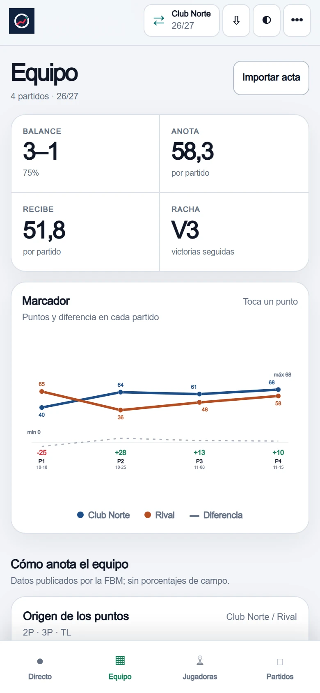
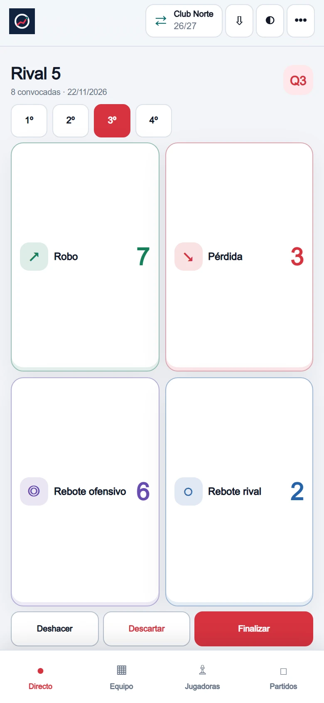
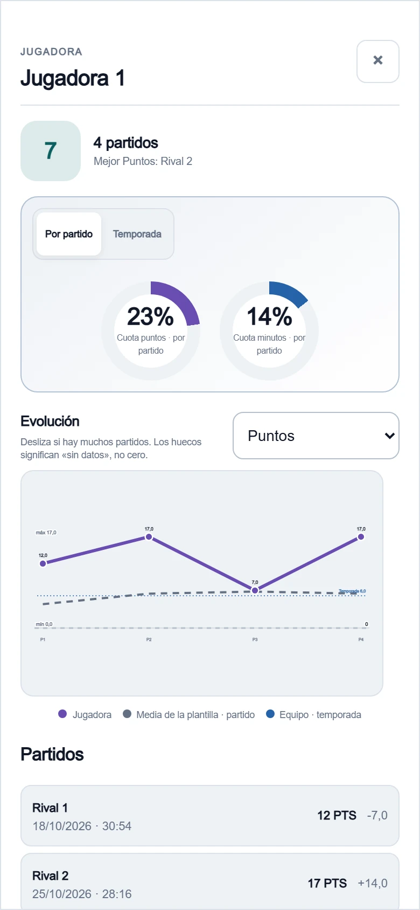
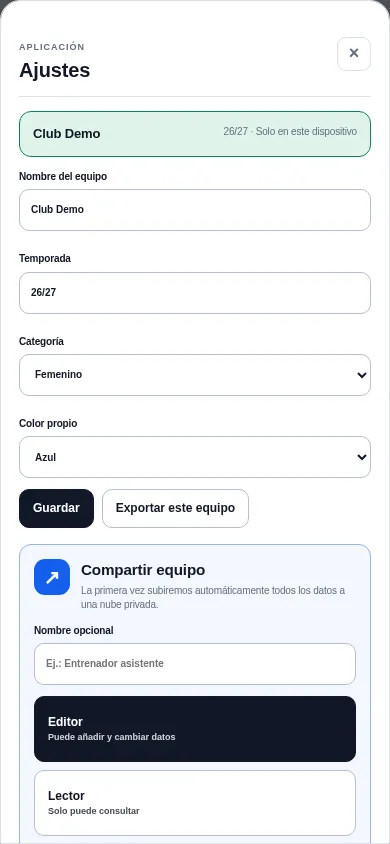

# PROYECTO ESTADÍSTICAS · CONTEXTO MAESTRO v12

Generado desde la entrega v12 exacta. Los binarios de landing se referencian por nombre; todo el código, tests, workflow, tools y documentación de texto aparece íntegro. No contiene assets, capturas privadas ni tokens.

===== BEGIN FILE: .github/workflows/check.yml =====
name: check-v12
on: [push, pull_request]
jobs:
  test:
    runs-on: ubuntu-latest
    steps:
      - uses: actions/checkout@v4
      - uses: actions/setup-python@v5
        with: {python-version: '3.12'}
      - uses: actions/setup-node@v4
        with: {node-version: '22'}
      - run: pip install playwright pillow
      - run: playwright install --with-deps chromium
      - run: python -m py_compile tools/*.py tests/smoke.py
      - run: python tools/validate.py . --allow-assets
      - run: python tests/smoke.py
      - run: python tests/updater_e2e.py

===== END FILE: .github/workflows/check.yml =====

===== BEGIN FILE: .gitignore =====
captures/
GUIA_ESTADISTICAS_v12.pdf
__pycache__/
*.pyc

===== END FILE: .gitignore =====

===== BEGIN FILE: AGENTS.md =====
# AGENTS · v12
- Conserva `STORE = 'estadisticas_shared_v2'` y `MULTI_STORE = 'estadisticas_multiteam_v11'` para migración.
- No renombres ni borres rutas/tablas w2. No llames a `/api/setup` en actualizaciones.
- No incluyas tokens, copias privadas ni capturas con credenciales.
- No entregues ni modifiques `assets/` o el logo `data-logo="aro-vector"`.
- Directo ausente es `null`/hueco, nunca cero.
- Posesiones extra = `(orbFor + steal) - (orbAgainst + turnover)`.
- «per» en estos datos significa pérdidas, no Player Efficiency Rating.
- Mantén género, paleta y aislamiento por workspace/teamId.
- Ejecuta `tools/validate.py` y `tests/smoke.py` antes de publicar.
- `instalar.html` debe instalar la PWA real (manifest/start_url raíz), no otra app; mantener fallbacks iOS/in-app y capturas anonimizadas.
- `actualizar.html` no se bloquea a una versión: conservar contexto íntegro, partes, `content`, create/delete y autocambio. Nunca permitir `assets/`.

===== END FILE: AGENTS.md =====

===== BEGIN FILE: AUDITORIA_v12.md =====
# Auditoría dura · Estadísticas v12

## Hallazgos de v11
1. Varias cadenas seguían ligadas a «BC» y la Diferencia duplicaba el mismo dato con signo opuesto.
2. El mismo gráfico de líneas se repetía incluso cuando Totales, Comparar o un solo partido pedían otra lectura.
3. La diferencia del marcador competía con la línea punteada y las etiquetas de puntos podían aproximarse demasiado.
4. La ficha individual mezclaba la abreviatura PER con una posible métrica de eficiencia y mostraba FAL/40 sin aportar claridad.
5. Compartir existía técnicamente, pero Ajustes exponía URL, token y permiso; un equipo local no se promovía al compartir.
6. El service worker podía servir app.js/styles.css antiguos tras publicar index.html nuevo.
7. Las pruebas fijaban una ruta de Chromium inexistente en GitHub Actions.

## Correcciones verificadas
- Tres móviles: 360×640, 390×844 y 412×915, claro/oscuro, sin desbordamiento horizontal.
- Buen Consejo real: 4 partidos, un Directo de 53 eventos y Posesiones extra +13.
- CB POZUELO B real: 6 partidos, masculino, sin Directo; no aparecen tarjetas manuales inventadas.
- Temporada de 25 partidos: 25 puntos, scroll lateral y modal completo.
- Un partido de Directo: barras legibles en lugar de dos puntos aislados.
- Compartir simulado: 7 operaciones pendientes más foto completa; enlaces editor/lector y teamId aislado.
- Migración desde `estadisticas_shared_v2` conserva equipo, 4 partidos, rol, token y color; el token nunca se copia a fixtures, capturas o documentación.
- Service worker con caché v12 y recursos `?v=12`; navegación y recursos principales intentan red antes de caché.
- `tools/validate.py` y `tests/smoke.py` terminan en OK.

## Límites honestos
- La app no puede desplegar Cloudflare por sí sola: el propietario debe pegar worker.js y pulsar Deploy una vez.
- La privacidad es por enlaces con token. Quien reenvíe un enlace comparte su permiso; el propietario debe revocarlo si deja de ser válido.
- La carpeta assets no se entrega porque se conserva sin cambios en GitHub.

## Refuerzo final: actualizador y landing
- El actualizador anterior estaba atado a v12 y a una sola respuesta. Se sustituyó por un flujo version-independent, multipartes, full-content, create/delete y autocambio.
- El contexto actual ronda menos de 700 KB; se valida byte lógico por byte lógico dentro de BEGIN/END. Por encima del umbral se divide por archivo en un ZIP, nunca con elipsis.
- Tres peticiones E2E pasan: visual multiarchivo, app.js completo multipartes y Worker+docs+actualizador con salto v13.
- La landing se probó a 360×640, 390×844, 412×915 y 1440×900, claro/oscuro, `beforeinstallprompt` simulado y fallback iOS.
- Las cuatro capturas usadas por la landing proceden de v12 real, con equipos, rivales y personas anonimizados; no contienen conexión ni credenciales.

===== END FILE: AUDITORIA_v12.md =====

===== BEGIN FILE: CHANGELOG.md =====
# CHANGELOG

## v12 · 2026-11-17
- Marcador móvil sin solapes, diferencias de 18–19 px con halo, desplazamiento horizontal y detalle completo.
- Diferencia propia única; elimina el valor rival opuesto.
- Visualizaciones distintas por modo y barras para tarjetas con un solo partido.
- Nueva tarjeta Posesiones extra, solo con Directo; La Dehesa valida +13.
- Terminología universal: nombre del equipo/Rival; «Rojo» y paletas accesibles renovadas.
- Ficha individual sin FAL/40; Pérdidas sin ambigüedad; balance `(ROB + REB O) − pérdidas`.
- Lista de jugadores corregida a 360–412 px y ficha con color sutil.
- Ajustes simplificados: sin Worker, URL ni token. Compartir crea enlaces Editor/Lector.
- Primer compartir de un equipo local crea su espacio privado y envía estado completo, conservando operaciones pendientes.
- Worker w4-v12 compatible con w2: no recrea D1, no exige `/api/setup`, añade límites básicos.
- Cache busting v12 y service worker network-first.
- GitHub Actions y scripts Playwright sin ruta fija obligatoria.
- Nuevo `instalar.html`: landing responsive, claro/oscuro, logo Aro vector, funciones reales, capturas v12 anonimizadas e instalación/fallback por navegador.
- Ajustes permite compartir la URL exacta de la landing publicada.
- `actualizar.html` pasa a ser universal: repositorio completo, contexto íntegro, multipartes, archivos completos, creación/borrado, autocambio y versiones futuras.
- Nueva regresión `tests/updater_e2e.py` con tres peticiones realistas y prueba v12→v13.

===== END FILE: CHANGELOG.md =====

===== BEGIN FILE: CONTEXTO_ESTADISTICAS.md =====
# Contexto v12
PWA local-first universal. Importa actas FBM, une Directo, muestra mapas y sincroniza equipos privados. La interfaz normal nunca pide Worker ni token: Ajustes > Compartir crea Editor/Lector. Al primer compartir, un equipo local se crea en `/api/v3/teams`, envía una foto completa idempotente y conserva ops pendientes. Buen Consejo sigue en rutas w2; no se recrea D1. Recursos v12 usan cache busting. Véanse README, MAPA_DEL_CODIGO y AUDITORIA_v12.

La página pública de instalación es `instalar.html`; usa el mismo manifest y service worker, y el start_url abre la app. Ajustes comparte su URL exacta. actualizar.html es independiente de v12, incluye todos los textos actuales sin recorte, parte contextos/respuestas grandes y regenera el contexto tras aplicar cambios.

===== END FILE: CONTEXTO_ESTADISTICAS.md =====

===== BEGIN FILE: GEM_GEMINI.md =====
# Gem Gemini · instrucciones estables para actualizar TODA la app

Tu función es mantener el repositorio completo de Estadísticas, no solo hacer parches pequeños. En cada petición recibirás `CONTEXTO_ACTUAL_ESTADISTICAS.md` o `CONTEXTO_ACTUAL_ESTADISTICAS_PARTES.zip`, generado desde la versión publicada. Esa fuente actual manda sobre cualquier recuerdo o archivo de conocimiento.

Puedes modificar cualquier archivo de texto del repositorio: app, estilos, HTML, service worker, config, Worker de Cloudflare, actualizador, configurador, tests, tools, workflow y documentación; también crear y borrar. Nunca modifiques `assets/`, nunca incluyas tokens ni copias privadas.

Devuelve solo JSON compatible con actualizar.html. Para una respuesta normal:
`{"schema":"estadisticas-update","updateId":"nombre-unico","targetVersion":"vActual","files":[...]}`.
Cada elemento usa uno de: `changes:[{"find":"literal único","replace":"..."}]`, `content:"archivo completo"`, o `delete:true`.

Si la respuesta es larga, divídela en mensajes JSON independientes con el mismo `updateId`, `targetVersion`, `totalParts` y `part` correlativo. No recortes archivos ni uses «continúa igual». Para app.js u otro archivo grande, `content` completo es válido.

Puedes subir de versión. Si cambias v12 a v13, actualiza en la misma respuesta APP_VERSION/estado, `?v=13` en index, CACHE de sw.js, textos visibles y CHANGELOG. Mantén migraciones, rutas w2, privacidad, logo Aro vector y aislamiento por equipo. Incluye/actualiza pruebas. Si un find puede no ser único, usa más contexto o `content`.

===== END FILE: GEM_GEMINI.md =====

===== BEGIN FILE: MAPA_DEL_CODIGO.md =====
# Mapa del código v12
- `app.js`: estado/migración; importación FBM; agregados; gráficos; UI; Directo; multiequipo; `snapshotOps`, `ensureCloudTeam`, invitaciones y sync.
- `styles.css`: diseño responsive, paletas, marcador, tarjetas, jugadores, compartir.
- `sw.js`: caché v12 network-first y limpieza de cachés anteriores.
- `worker.js`: D1 w2 compatible + equipos v3 + límites básicos.
- `config.js`: solo URL pública del servicio; nunca tokens.
- `actualizar.html`: parche multiarchivo v12.
- `tests/smoke.py`: tamaños, temas, datos reales, 25 partidos, migración y nube simulada.
- `tools/validate.py`: sintaxis, estructura, fixtures y fuga de secretos.
- `instalar.html` + `landing/*.webp`: landing pública, instalación PWA real, fallbacks y capturas anonimizadas.
- `tests/updater_e2e.py`: tres actualizaciones E2E, contexto completo/partido, autocambio y salto de versión.
- `PRUEBAS_ACTUALIZADOR_E2E.md`: evidencia y límites de tamaño.

===== END FILE: MAPA_DEL_CODIGO.md =====

===== BEGIN FILE: PROMPT_MAPA_TIRO.md =====
# Mapa de tiro
La captura FBM identifica equipo superior = mitad izquierda e inferior = mitad derecha. Cruza cabecera, color y lista; si discrepan, `checksAgree:false`. Responde solo JSON con `ownShots`, `opponentShots`, coordenadas 0–1 y canasta arriba. No inventes tiros.

===== END FILE: PROMPT_MAPA_TIRO.md =====

===== BEGIN FILE: PROYECTO_CLAUDE.md =====
# Proyecto Claude · instrucciones estables para actualizar TODA la app

Mantén el repositorio completo de Estadísticas. En cada petición usa exclusivamente el contexto actual recién generado (`CONTEXTO_ACTUAL_ESTADISTICAS.md` o el ZIP de partes). El contexto actual prevalece sobre conocimiento estable y conversaciones anteriores.

Cobertura: app.js, styles.css, index, sw, config, Worker, actualizar, configurar, tests, fixtures, tools, workflow y documentación; varios archivos, creación y borrado. Nunca assets/, tokens ni copias privadas.

Responde solo JSON: `schema`, `updateId`, `targetVersion`, `files`. Cada archivo lleva `changes` literal/único, `content` completo o `delete:true`. Para respuestas largas usa varias partes JSON con mismo `updateId`, `totalParts`, `part` y versión. Cada archivo debe ir íntegro: sin elipsis ni referencias a una parte anterior.

Puedes subir la versión en una sola actualización coherente: APP_VERSION y estado, queries `?v=`, CACHE del service worker y CHANGELOG. Conserva compatibilidad `estadisticas_shared_v2`, multiequipo v11, rutas/tablas w2, logo Aro vector, privacidad y tests. Si un find no es inequívoco, amplíalo o sustituye el archivo completo.

===== END FILE: PROYECTO_CLAUDE.md =====

===== BEGIN FILE: PRUEBAS_ACTUALIZADOR_E2E.md =====
# Pruebas del actualizador universal

Comando: `python tests/updater_e2e.py`.

## Cobertura verificada
- Contexto íntegro: compara cada contenido original con su bloque BEGIN/END, longitud y checksum.
- Tamaño actual: menor que 700 KB; actualizar.html muestra KB y estimación de tokens. Es apto como un único adjunto. Al superar 700 KB, genera un ZIP de partes por fronteras de archivo; prueba forzada a 80 KB produce varias partes sin recortar ningún archivo.
- Petición 1: cambio visual en styles.css + index.html, creación y borrado de documentación.
- Petición 2: app.js completo, de gran tamaño, dividido en dos JSON y reunido en orden.
- Petición 3: worker.js + documentación + actualizar.html; subida virtual v12→v13 con APP_VERSION, recursos `?v=13`, CACHE y CHANGELOG.
- Autocambio: el contexto posterior incluido en el ZIP contiene actualizar.html y Worker ya modificados.
- Errores: find ausente/no único y partes faltantes/duplicadas explican exactamente qué pedir a la IA.

===== END FILE: PRUEBAS_ACTUALIZADOR_E2E.md =====

===== BEGIN FILE: README.md =====
# Estadísticas v12

PWA local-first y multiequipo para actas FBM, Directo, mapas y sincronización privada.

## Novedades visibles
- Marcador horizontal desplazable, etiquetas legibles y ventana ampliada.
- Diferencia como un único valor con signo y barras divergentes.
- Gráficos por criterio: evolución en Por partido, barras en Totales y balance en Comparar.
- Posesiones extra de Directo: `(REB O propios + robos) − (REB O rival + pérdidas propias)`.
- Etiquetas universales basadas en el nombre del equipo; paletas Azul, Verde, Morado y Rojo.
- Ficha individual sin FAL/40; «PER» se presenta como Pérdidas; balance `(ROB + REB O) − pérdidas`.
- Compartir sin configuración: Editor o Lector. El primer enlace sube automáticamente el equipo local.
- Ajustes normales sin URL del Worker ni token.
- Recursos `?v=12` y service worker network-first para evitar mezclar versiones.

## Publicar
1. Conserva tu carpeta `assets/`; no viene en este paquete.
2. Copia esta carpeta sobre el repositorio respetando `.github`, `tests` y `tools`.
3. Publica el Worker de `5_CLOUDFLARE` antes de probar equipos nuevos compartidos.
4. Haz commit y espera a GitHub Actions/Pages.
5. Cierra y abre la PWA.

## Comprobar
```bash
python tools/validate.py . --allow-assets
python tests/smoke.py
```
Chromium solo usa la ruta `/opt/pw-browsers/...` si existe; en GitHub Actions usa la instalación normal de Playwright.

## Página pública para instalar
La landing independiente es `instalar.html`. La dirección que se comparte es **la URL actual de GitHub Pages de la app terminada en `/instalar.html`**. Por ejemplo, si la app abre en `https://USUARIO.github.io/REPOSITORIO/`, la dirección exacta es `https://USUARIO.github.io/REPOSITORIO/instalar.html`.

Como el dominio y repositorio no están escritos en el código, Ajustes incluye **Compartir página de instalación**: al pulsarlo copia o comparte la URL exacta del sitio publicado, sin que el usuario tenga que construirla.

Chrome/Edge/Android permiten el aviso de instalación en un toque cuando disparan `beforeinstallprompt`. iPhone/iPad Safari y navegadores internos no permiten iniciarlo desde JavaScript; la landing detecta el caso y muestra `Compartir → Añadir a pantalla de inicio` o pide abrir en Chrome/Safari.

## Actualizaciones completas con IA
`actualizar.html` cubre todo archivo de texto del repositorio salvo `assets/`, acepta sustitución completa, creación, borrado, varias partes y subidas de versión. Siempre genera el contexto posterior. Véase `PRUEBAS_ACTUALIZADOR_E2E.md`.

===== END FILE: README.md =====

===== BEGIN FILE: actualizar.html =====
<!doctype html>
<html lang="es"><head><meta charset="utf-8"><meta name="viewport" content="width=device-width,initial-scale=1"><title>Actualizar Estadísticas</title>
<style>
:root{font-family:Arial,sans-serif;color:#10233f;background:#f3f5f8;--green:#16805a;--red:#b42331;--blue:#2563a9;--line:#cbd5e1}*{box-sizing:border-box}body{margin:0}.wrap{max-width:980px;margin:auto;padding:24px 14px 60px}h1{font-size:clamp(30px,6vw,48px);letter-spacing:-.05em;margin:4px 0}p{line-height:1.5;color:#526173}.card{background:#fff;border:1px solid var(--line);border-radius:16px;padding:18px;margin:13px 0}.step{display:inline-grid;place-items:center;width:31px;height:31px;border-radius:9px;background:#10233f;color:#fff;margin-right:8px}h2{font-size:17px;margin:0 0 8px}h3{font-size:13px;margin:0 0 5px}code{word-break:break-word}label{display:block;font-size:11px;font-weight:800;margin:10px 0 5px}input,textarea{width:100%;border:1px solid #aeb9c7;border-radius:9px;background:#fff;padding:11px;font:inherit}textarea{min-height:270px;font-family:ui-monospace,SFMono-Regular,Consolas,monospace;font-size:12px;line-height:1.45}button{border:1px solid #10233f;border-radius:9px;background:#10233f;color:#fff;padding:11px 14px;font-weight:800;cursor:pointer;margin:5px 5px 0 0}button.alt{background:#fff;color:#10233f}button.blue{background:var(--blue);border-color:var(--blue)}button:disabled{opacity:.45}.status{padding:12px;border-radius:10px;background:#eef2f6;white-space:pre-wrap;font-size:12px}.ok{background:#e6f5ee;color:var(--green)}.bad{background:#fff0f1;color:var(--red)}.tiny{font-size:10px}.files{display:grid;gap:4px;max-height:170px;overflow:auto;color:#526173;font-size:10px}.note{border-left:4px solid #d97706;padding:10px 12px;background:#fff8e8;border-radius:0 9px 9px 0}.actions{display:flex;flex-wrap:wrap;gap:5px}.two{display:grid;grid-template-columns:1fr 1fr;gap:12px}.once{border-color:#9bb4d0;background:#f7fbff}.every{border-color:#9fd7c1;background:#f6fffb}.badge{display:inline-block;padding:3px 7px;border-radius:99px;background:#10233f;color:#fff;font-size:9px;font-weight:900}.truth{padding:12px;border:1px solid #b9c9dc;border-radius:11px;background:#eef5fb}.truth b{display:block;margin-bottom:4px}.truth span{font-size:11px;color:#42536a}.parts{display:grid;gap:6px;margin:9px 0}.part{display:flex;justify-content:space-between;gap:10px;padding:9px 11px;border:1px solid var(--line);border-radius:9px;background:#f8fafc;font-size:11px}.part b,.part span{display:block}.part span{color:#526173}.size-pill{display:inline-block;margin-left:6px;padding:3px 7px;border-radius:99px;background:#e8eef6;font-size:9px;font-weight:800}@media(max-width:680px){.wrap{padding-top:16px}.card{padding:14px}.two{grid-template-columns:1fr}}
</style></head><body><main class="wrap">
<small>ESTADÍSTICAS · ACTUALIZADOR UNIVERSAL</small><h1>Actualizar toda la app</h1>
<p>Esta página trabaja con la copia actual del repositorio, genera contexto íntegro, une respuestas grandes por partes y prepara un ZIP listo para GitHub. Nunca lee ni modifica <code>assets/</code>.</p>
<div class="truth"><b>Regla principal</b><span>Gemini o Claude no deben confiar en conocimiento antiguo. En cada petición reciben el contexto recién generado aquí, con todos los archivos de texto completos, longitudes y comprobaciones.</span></div>
<section class="card once"><span class="badge">SOLO UNA VEZ</span><h2>Crear el Gem o Proyecto</h2><p>Configura las instrucciones de 2_GEMINI o 3_CLAUDE y sube solo su archivo estable. No subas el código como conocimiento permanente: quedaría antiguo.</p></section>
<section class="card every"><span class="badge">EN CADA ACTUALIZACIÓN</span><div class="two"><div><h3>1. Carga el repositorio actual</h3><p>Carpeta completa o ZIP recién descargado.</p></div><div><h3>2. Genera contexto</h3><p>Adjunta el MD; si crece demasiado, se descarga un ZIP de partes completas.</p></div><div><h3>3. Pega la respuesta</h3><p>Una respuesta normal o varias partes numeradas. También admite archivos completos.</p></div><div><h3>4. Publica y repite</h3><p>Sube el ZIP a GitHub. La actualización incluye el contexto siguiente regenerado.</p></div></div></section>
<section class="card"><h2><span class="step">1</span>Carga la versión actual</h2>
<p>Se incluyen código, pruebas, herramientas, workflow y documentación. Se excluyen assets, capturas, PDF, ZIP, cachés y copias privadas.</p>
<label for="repoFolder">Carpeta completa</label><input id="repoFolder" type="file" webkitdirectory multiple>
<label for="repoZip">O ZIP del repositorio</label><input id="repoZip" type="file" accept=".zip,application/zip">
<div id="fileSummary" class="status">Todavía no hay código cargado.</div><div id="fileList" class="files"></div>
<button class="blue" id="context" disabled>Descargar contexto actual para la IA</button></section>
<section class="card"><h2><span class="step">2</span>Pega la respuesta de la IA</h2>
<p>Para un cambio normal, pega un JSON y pasa al paso 3. Para una respuesta larga, pega cada parte y pulsa <b>Guardar esta parte</b>; el actualizador comprobará que estén todas.</p>
<textarea id="answer" spellcheck="false" placeholder='{"schema":"estadisticas-update","updateId":"cambio-2026-11-17","part":1,"totalParts":2,"targetVersion":"v13","files":[{"path":"app.js","content":"archivo completo..."}]}'></textarea>
<div class="actions"><button class="alt" id="addPart">Guardar esta parte</button><button class="alt" id="clearParts">Vaciar partes</button></div><div id="partList" class="parts"></div>
<p class="tiny">Admite: <code>changes</code> exactos, sustitución completa con <code>content</code>, archivos nuevos con <code>content</code> y borrado con <code>delete:true</code>. Para borrar se genera un archivo <code>.BORRAR.txt</code>. Nunca se acepta una ruta dentro de assets.</p></section>
<section class="card"><h2><span class="step">3</span>Comprueba y descarga</h2>
<div class="actions"><button id="build" disabled>Comprobar y preparar</button><button id="download" disabled>Descargar actualización</button></div>
<p id="status" class="status">Carga el código actual y pega el JSON o guarda sus partes.</p>
<div class="note"><b>Sin bloqueos de versión.</b><br><span class="tiny">La IA puede subir APP_VERSION, la caché, los recursos versionados y CHANGELOG en la misma actualización. El ZIP incluye el contexto completo posterior al cambio. Conserva assets en GitHub.</span></div></section>
</main><script src="assets/jszip.min.js"></script><script>
'use strict';
const $=id=>document.getElementById(id),files=new Map(),changed=new Map(),savedParts=new Map();let builtZip=null,lastBuild=null;
const textExt=/\.(?:html?|m?js|css|json|md|txt|ya?ml|py|toml|ini|cfg|gitignore)$/i;
const ignored=path=>path.startsWith('assets/')||path.startsWith('captures/')||path.startsWith('4_GUIA/')||path.endsWith('.pdf')||path.endsWith('.zip')||path.includes('__pycache__/')||path.endsWith('.pyc')||/(^|\/)estadisticas-\d{4}-\d{2}-\d{2}(?:\s*\(\d+\))?\.json$/i.test(path);
function normalizePath(path){return String(path||'').replace(/\\/g,'/').replace(/^\.\//,'').replace(/^\/+/, '')}
function commonRoot(paths){const roots=paths.filter(Boolean).map(path=>normalizePath(path).split('/'));if(!roots.length||roots.some(parts=>parts.length<2))return '';const first=roots[0][0];return roots.every(parts=>parts[0]===first)?first:''}
function isTextPath(path){return textExt.test(path)||path==='.gitignore'||path==='.editorconfig'}
async function loadFolder(list){files.clear();savedParts.clear();const raw=[...list].map(file=>({file,path:normalizePath(file.webkitRelativePath||file.name)})),root=commonRoot(raw.map(item=>item.path));for(const item of raw){const path=root?item.path.slice(root.length+1):item.path;if(!path||ignored(path)||!isTextPath(path))continue;files.set(path,await item.file.text())}showFiles()}
async function loadZip(file){files.clear();savedParts.clear();const zip=await JSZip.loadAsync(file),entries=Object.values(zip.files).filter(entry=>!entry.dir),root=commonRoot(entries.map(entry=>entry.name));for(const entry of entries){const raw=normalizePath(entry.name),path=root?raw.slice(root.length+1):raw;if(!path||ignored(path)||!isTextPath(path))continue;files.set(path,await entry.async('text'))}showFiles()}
function detectVersion(map){const app=map.get('app.js')||'',match=app.match(/APP_VERSION\s*=\s*['"](v?\d+(?:\.\d+)*)['"]/i);return match?match[1]:''}
function versionNumber(version){return String(version||'').replace(/^v/i,'')}
function sourceFiles(map){return [...map.entries()].filter(([path])=>!ignored(path)&&!['PROYECTO_ESTADISTICAS.md','CONTEXTO_ACTUAL_ESTADISTICAS.md','CONTEXTO_SIGUIENTE_ESTADISTICAS.md'].includes(path)).sort(([a],[b])=>a.localeCompare(b))}
function checksum(text){let h=2166136261;for(let i=0;i<text.length;i++){h^=text.charCodeAt(i);h=Math.imul(h,16777619)}return (h>>>0).toString(16).padStart(8,'0')}
function contextStats(map){const rows=sourceFiles(map),chars=rows.reduce((n,[,text])=>n+text.length,0);return {files:rows.length,chars,tokens:Math.ceil(chars/4)}}
function showFiles(){const names=[...files.keys()].sort(),hasCore=['app.js','styles.css','index.html','sw.js','worker.js','actualizar.html'].every(name=>files.has(name)),stats=contextStats(files),version=detectVersion(files)||'sin detectar';$('fileSummary').className=`status ${hasCore?'ok':'bad'}`;$('fileSummary').textContent=hasCore?`✓ ${names.length} archivos de texto cargados · versión ${version} · contexto ${Math.round(stats.chars/1024)} KB · ≈${stats.tokens.toLocaleString('es-ES')} tokens. Sin recortes.`:`Se cargaron ${names.length} archivos, pero faltan archivos básicos de la app.`;$('fileList').innerHTML=names.map(name=>`<span>${name} <i class="size-pill">${files.get(name).length.toLocaleString('es-ES')} caracteres</i></span>`).join('');$('context').disabled=!hasCore;updateButtons()}
function contextHeader(map,part=1,total=1){const version=detectVersion(map)||'desconocida',stats=contextStats(map);return `# CONTEXTO ACTUAL · ESTADÍSTICAS ${version}\n\nParte ${part} de ${total}. Fuente local exacta. Archivos completos: ${stats.files}. Caracteres de código fuente: ${stats.chars}. Estimación conservadora: ${stats.tokens} tokens.\n\nREGLAS: no hay recortes ni «…». Cada BEGIN/END contiene el archivo íntegro. Usa este contexto y no conocimiento anterior. Puedes cambiar cualquier archivo de texto salvo assets/. Para cambios grandes usa content o partes JSON numeradas. Puedes subir la versión actualizando APP_VERSION, consultas ?v=, CACHE de sw.js y CHANGELOG en la misma respuesta.\n`}
function renderFiles(rows){return rows.map(([path,text])=>`\n===== BEGIN FILE: ${path} · chars=${text.length} · fnv=${checksum(text)} =====\n${text}\n===== END FILE: ${path} =====\n`).join('')}
function master(map){const rows=sourceFiles(map),inventory=rows.map(([path,text])=>`- ${path} | ${text.length} caracteres | fnv ${checksum(text)}`).join('\n');return `${contextHeader(map)}\n## INVENTARIO VERIFICABLE\n${inventory}\n${renderFiles(rows)}`}
function contextParts(map,maxChars=700000){const rows=sourceFiles(map),groups=[];let current=[],size=0;for(const row of rows){const block=renderFiles([row]);if(current.length&&size+block.length>maxChars){groups.push(current);current=[];size=0}current.push(row);size+=block.length}if(current.length)groups.push(current);return groups.map((group,index)=>`${contextHeader(map,index+1,groups.length)}\n${renderFiles(group)}`)}
function downloadBlob(blob,name){const a=document.createElement('a');a.href=URL.createObjectURL(blob);a.download=name;a.click();setTimeout(()=>URL.revokeObjectURL(a.href),0)}
async function downloadContext(){try{const full=master(files),stats=contextStats(files);if(full.length<=700000){downloadBlob(new Blob([full],{type:'text/markdown'}),'CONTEXTO_ACTUAL_ESTADISTICAS.md');$('status').textContent=`✓ Contexto único creado: ${Math.round(full.length/1024)} KB, ≈${stats.tokens.toLocaleString('es-ES')} tokens, sin recortes.`}else{const parts=contextParts(files),zip=new JSZip();parts.forEach((text,i)=>zip.file(`CONTEXTO_ACTUAL_${String(i+1).padStart(2,'0')}_DE_${String(parts.length).padStart(2,'0')}.md`,text));zip.file('INDICE_Y_COMO_ADJUNTAR.txt',`Contexto completo dividido por límites de tamaño. Adjunta este ZIP al Gem o Proyecto. Si no acepta ZIP, extrae y adjunta TODAS las ${parts.length} partes en el mismo mensaje. Ningún archivo está recortado.`);downloadBlob(await zip.generateAsync({type:'blob'}),'CONTEXTO_ACTUAL_ESTADISTICAS_PARTES.zip');$('status').textContent=`✓ Contexto grande dividido en ${parts.length} partes completas. Adjunta el ZIP o todas las partes.`}$('status').className='status ok'}catch(error){fail(error)}}
function cleanJSON(text){return text.trim().replace(/^```(?:json)?\s*/i,'').replace(/\s*```$/,'')}
function parseJSON(text){try{return JSON.parse(cleanJSON(text))}catch(error){throw Error(`JSON no válido: ${error.message}. Pide a la IA que repita solo el JSON, sin explicación.`)}}
function normalizePart(value){if(!value||typeof value!=='object'||Array.isArray(value))throw Error('Cada parte debe ser un objeto JSON.');if(!Array.isArray(value.files)||!value.files.length)throw Error('La parte no contiene files.');const part=Number(value.part||1),total=Number(value.totalParts||1);if(!Number.isInteger(part)||!Number.isInteger(total)||part<1||total<part)throw Error('part/totalParts no son válidos.');return {...value,part,totalParts:total,updateId:String(value.updateId||'actualizacion-unica'),targetVersion:String(value.targetVersion||value.version||'')}}
function parseMany(text){const value=parseJSON(text);return (Array.isArray(value)?value:[value]).map(normalizePart)}
function renderParts(){const rows=[...savedParts.values()].sort((a,b)=>a.part-b.part);$('partList').innerHTML=rows.map(part=>`<div class="part"><span><b>${part.updateId} · parte ${part.part}/${part.totalParts}</b><span>${part.files.length} archivo(s) · ${part.targetVersion||'misma versión'}</span></span><button class="alt" data-remove-part="${part.part}">Quitar</button></div>`).join('');updateButtons()}
function addCurrentParts(){const text=$('answer').value.trim();if(!text)throw Error('Pega una parte antes de guardarla.');for(const part of parseMany(text)){const key=`${part.updateId}:${part.part}`;savedParts.set(key,part)}$('answer').value='';renderParts();$('status').className='status ok';$('status').textContent='✓ Parte guardada. Pega la siguiente o pulsa Comprobar y preparar.'}
function collectParts(){const rows=[...savedParts.values()];if($('answer').value.trim())rows.push(...parseMany($('answer').value));if(!rows.length)throw Error('No hay ninguna respuesta pegada ni partes guardadas.');const ids=[...new Set(rows.map(p=>p.updateId))];if(ids.length!==1)throw Error(`Hay partes de actualizaciones distintas: ${ids.join(', ')}. Vacía las partes y pega solo una actualización.`);const totals=[...new Set(rows.map(p=>p.totalParts))];if(totals.length!==1)throw Error('Las partes no coinciden en totalParts. Pide a la IA que repita todas con el mismo total.');const total=totals[0],byPart=new Map();for(const part of rows){if(byPart.has(part.part))throw Error(`La parte ${part.part} está duplicada.`);byPart.set(part.part,part)}const missing=[];for(let i=1;i<=total;i++)if(!byPart.has(i))missing.push(i);if(missing.length)throw Error(`Faltan las partes ${missing.join(', ')} de ${total}. Pégalas antes de continuar.`);const ordered=[...byPart.values()].sort((a,b)=>a.part-b.part),versions=[...new Set(ordered.map(p=>p.targetVersion).filter(Boolean))];if(versions.length>1)throw Error(`Las partes declaran versiones distintas: ${versions.join(', ')}.`);return {schema:'estadisticas-update',updateId:ids[0],targetVersion:versions[0]||'',files:ordered.flatMap(p=>p.files)}}
function safePath(path){path=normalizePath(path);if(!path||path.startsWith('/')||path.split('/').includes('..')||path.startsWith('assets/')||path.startsWith('captures/'))throw Error(`Ruta no permitida: ${path||'(vacía)'}. assets/ nunca se modifica.`);return path}
function applyChanges(source,changes,path){let out=source;for(const [index,change] of changes.entries()){if(typeof change.find!=='string'||!change.find||typeof change.replace!=='string')throw Error(`${path} · bloque ${index+1}: find/replace no válidos.`);const count=out.split(change.find).length-1;if(count===0)throw Error(`${path} · bloque ${index+1}: find no existe. Pide a la IA que use el texto exacto del contexto actual o que envíe el archivo completo con content.`);if(count>1)throw Error(`${path} · bloque ${index+1}: find aparece ${count} veces. Pide más líneas alrededor para hacerlo único o usa content.`);out=out.replace(change.find,change.replace)}return out}
function applyPatch(base,patch){const all=new Map(base),edits=new Map();for(const [index,item] of patch.files.entries()){if(!item||typeof item!=='object')throw Error(`files[${index}] no es válido.`);const path=safePath(item.path);if(item.delete===true){if(!all.has(path))throw Error(`${path}: no existe para borrar. Pide a la IA que revise el contexto actual.`);all.delete(path);edits.set(path,null);continue}let out;if(typeof item.content==='string')out=item.content;else{if(!all.has(path))throw Error(`${path}: no existe; para crearlo la IA debe usar content.`);if(!Array.isArray(item.changes)||!item.changes.length)throw Error(`${path}: faltan changes o content.`);out=applyChanges(all.get(path),item.changes,path)}all.set(path,out);edits.set(path,out)}return {all,edits}}
function validate(all,beforeVersion,targetVersion=''){const errors=[],need=path=>{if(!all.has(path))errors.push(`Falta ${path}`)};['app.js','styles.css','index.html','sw.js','config.js','worker.js','actualizar.html','configurar.html','CHANGELOG.md','tests/smoke.py','tools/validate.py','.github/workflows/check.yml'].forEach(need);const app=all.get('app.js')||'',index=all.get('index.html')||'',sw=all.get('sw.js')||'',worker=all.get('worker.js')||'',after=detectVersion(all);if(!app.includes('estadisticas_shared_v2'))errors.push('app.js: se perdió la migración estadisticas_shared_v2');if(!app.includes('estadisticas_multiteam_v11'))errors.push('app.js: se perdió el almacén multiequipo compatible');if(!index.includes('data-logo="aro-vector"'))errors.push('index.html: se perdió el logo Aro vector');if(!worker.includes('w2-compatible')||!worker.includes('/api/events'))errors.push('worker.js: se perdió compatibilidad w2');if(targetVersion&&after!==targetVersion)errors.push(`APP_VERSION quedó en ${after||'sin detectar'}, pero la IA declaró ${targetVersion}`);if(beforeVersion&&after&&beforeVersion!==after){const n=versionNumber(after);if(!sw.includes(`estadisticas-${after}-`)&&!sw.includes(`estadisticas-v${n}-`))errors.push(`sw.js: sube CACHE a ${after}`);for(const resource of ['app.js','styles.css','config.js'])if(!index.includes(`${resource}?v=${n}`))errors.push(`index.html: falta ${resource}?v=${n}`);if(!(all.get('CHANGELOG.md')||'').includes(`## ${after}`))errors.push(`CHANGELOG.md: falta una sección ## ${after}`)}for(const [path,text] of all){if(path.endsWith('.json'))try{JSON.parse(text)}catch(error){errors.push(`${path}: JSON no válido (${error.message})`)}if(path.endsWith('.css')){let depth=0;for(const char of text){if(char==='{')depth++;if(char==='}')depth--}if(depth)errors.push(`${path}: llaves CSS desequilibradas`)}}return {errors,after}}
async function build(){try{builtZip=null;lastBuild=null;changed.clear();const patch=collectParts(),before=detectVersion(files),{all,edits}=applyPatch(files,patch),check=validate(all,before,patch.targetVersion);if(check.errors.length)throw Error(check.errors.join('\n'));const nextContext=master(all),nextVersion=check.after||patch.targetVersion||before||'siguiente',project=nextContext.replace(/^# CONTEXTO ACTUAL[^\n]*/,`# PROYECTO ESTADÍSTICAS · CONTEXTO MAESTRO ${nextVersion}`);all.set('PROYECTO_ESTADISTICAS.md',project);edits.set('PROYECTO_ESTADISTICAS.md',project);for(const [path,value] of edits)changed.set(path,value);const zip=new JSZip();for(const [path,text] of changed)if(text===null)zip.file(`${path}.BORRAR.txt`,`BORRAR DE GITHUB: ${path}\nNo borres assets ni otros archivos.`);else zip.file(path,text);zip.file('CONTEXTO_SIGUIENTE_ESTADISTICAS.md',nextContext);zip.file('LEEME_ACTUALIZACION.txt',`ESTADÍSTICAS ${nextVersion}\n\n1. Sube a GitHub todos los archivos conservando carpetas.\n2. Para cada .BORRAR.txt, borra en GitHub el archivo indicado.\n3. No borres assets ni archivos no mencionados.\n4. Commit changes; espera Actions y Pages.\n5. Cierra y abre la app.\n6. En la próxima petición genera un contexto nuevo desde el código publicado.\n\nActualización: ${patch.updateId}\nArchivos: ${[...changed.keys()].join(', ')}\n`);builtZip=await zip.generateAsync({type:'blob'});lastBuild={all,changed:new Map(changed),nextContext,nextVersion,patch};$('download').disabled=false;$('status').className='status ok';$('status').textContent=`✓ ${changed.size} archivo(s) preparados · ${nextVersion}. Contexto posterior regenerado: ${Math.round(nextContext.length/1024)} KB, sin recortes.`;return lastBuild}catch(error){builtZip=null;lastBuild=null;$('download').disabled=true;fail(error);throw error}}
function updateButtons(){$('build').disabled=!files.size||(!savedParts.size&&!$('answer').value.trim());$('download').disabled=!builtZip}
function fail(error){$('status').className='status bad';$('status').textContent=error.message||String(error)}
$('repoFolder').onchange=e=>loadFolder(e.target.files).catch(fail);$('repoZip').onchange=e=>e.target.files[0]&&loadZip(e.target.files[0]).catch(fail);$('answer').oninput=updateButtons;$('context').onclick=downloadContext;$('addPart').onclick=()=>{try{addCurrentParts()}catch(error){fail(error)}};$('clearParts').onclick=()=>{savedParts.clear();renderParts();$('status').className='status';$('status').textContent='Partes vaciadas.'};$('partList').onclick=e=>{const button=e.target.closest('[data-remove-part]');if(!button)return;for(const [key,part] of savedParts)if(part.part===+button.dataset.removePart)savedParts.delete(key);renderParts()};$('build').onclick=()=>build().catch(()=>{});$('download').onclick=()=>builtZip&&downloadBlob(builtZip,`actualizacion-estadisticas-${lastBuild?.nextVersion||'siguiente'}-${new Date().toISOString().slice(0,10)}.zip`);
window.__ACTUALIZAR__={files,changed,savedParts,ignored,sourceFiles,contextStats,master,contextParts,detectVersion,parseMany,collectParts,safePath,applyChanges,applyPatch,validate,build,loadFolder,loadZip,getLastBuild:()=>lastBuild};
</script></body></html>

===== END FILE: actualizar.html =====

===== BEGIN FILE: app.js =====
/* Estadísticas v12 · universal · local-first · nube privada al compartir */
'use strict';

const APP_VERSION = 'v12';
const STORE = 'estadisticas_shared_v2'; // Compatibilidad: no renombrar ni borrar.
const MULTI_STORE = 'estadisticas_multiteam_v11';
const APP_CONFIG = window.ESTADISTICAS_CONFIG || {};
const teamLabel = () => state?.team?.name || 'Mi equipo';
const GENDERS={female:{singular:'Jugadora',plural:'Jugadoras',number:'N.º jugadora'},male:{singular:'Jugador',plural:'Jugadores',number:'N.º jugador'},neutral:{singular:'Jugador',plural:'Jugadores',number:'N.º jugador'}};
const genderTerms=()=>GENDERS[state?.team?.gender]||GENDERS.neutral;
const PALETTES={blue:{label:'Azul',light:['#155EEF','#C2410C'],dark:['#75A7FF','#FDBA74']},teal:{label:'Verde',light:['#087E6A','#7C3AED'],dark:['#5EEAD4','#C4B5FD']},purple:{label:'Morado',light:['#6D28D9','#B45309'],dark:['#C4B5FD','#FCD34D']},red:{label:'Rojo',light:['#C6283D','#1E5F9E'],dark:['#FF6B78','#7CC4FF']}};
function applyTeamIdentity(){const key=PALETTES[state?.team?.color]?state.team.color:'blue',theme=document.documentElement.dataset.theme==='dark'?'dark':'light',[own,rival]=PALETTES[key][theme];document.documentElement.style.setProperty('--team',own);document.documentElement.style.setProperty('--rival',rival);document.documentElement.dataset.teamColor=key;}
function detectGender(rows){const value=norm((rows||[]).flat(Infinity).join(' ')),female=/(^| )FEM( |$)|FEMENIN[OA]/.test(value),male=/(^| )MASC( |$)|MASCULIN[OA]/.test(value);return female&&!male?'female':male&&!female?'male':null;}
function applyDetectedGender(rows){const detected=detectGender(rows);if(detected&&(!state.team.gender||state.team.gender==='neutral')){state.team.gender=detected;save();return detected}return detected;}
function genderOptions(value='neutral',allowBlank=false){return `${allowBlank?'<option value="">Elige una opción</option>':''}<option value="female" ${value==='female'?'selected':''}>Femenino</option><option value="male" ${value==='male'?'selected':''}>Masculino</option><option value="neutral" ${value==='neutral'?'selected':''}>Mixto o neutro</option>`;}
function colorOptions(value='blue'){return Object.entries(PALETTES).map(([key,item])=>`<option value="${key}" ${key===value?'selected':''}>${item.label}</option>`).join('');}
const $ = (s, r = document) => r.querySelector(s);
const $$ = (s, r = document) => [...r.querySelectorAll(s)];
const uid = () => crypto.randomUUID ? crypto.randomUUID() : Date.now().toString(36) + Math.random().toString(36).slice(2);
const esc = s => String(s ?? '').replace(/[&<>'"]/g, c => ({'&':'&amp;','<':'&lt;','>':'&gt;',"'":'&#39;','"':'&quot;'}[c]));
const norm = s => String(s || '').normalize('NFD').replace(/[\u0300-\u036f]/g, '').toUpperCase().replace(/[^A-Z0-9]+/g, ' ').trim();
const clamp = (n, a = 0, b = 1) => Math.max(a, Math.min(b, Number(n) || 0));
const num = (n, d = 1) => Number.isFinite(+n) ? (+n).toLocaleString('es-ES', {minimumFractionDigits:d, maximumFractionDigits:d}) : '—';
const pct = n => Number.isFinite(+n) ? `${num(n, 0)}%` : '—';
const signed = n => Number.isFinite(+n) ? `${+n > 0 ? '+' : ''}${num(n)}` : '—';
const today = () => { const d=new Date(); return `${d.getFullYear()}-${String(d.getMonth()+1).padStart(2,'0')}-${String(d.getDate()).padStart(2,'0')}`; };
const minutes = s => { if (typeof s === 'number') return s; const [m, x] = String(s || '0').split(':').map(Number); return (m || 0) + (x || 0) / 60; };
const formatMinutes = v => { const total = Math.max(0, Math.round((+v || 0) * 60)); return `${Math.floor(total / 60)}:${String(total % 60).padStart(2, '0')}`; };
const parseAI = s => { const [m, a] = String(s || '0/0').split('/').map(Number); return {m:m || 0, a:a || 0}; };
const sum = (arr, getter) => arr.reduce((a, x) => a + (+getter(x) || 0), 0);
const mean = (arr, getter) => arr.length ? sum(arr, getter) / arr.length : null;
const deepSignature = x => JSON.stringify(x);

/* ── State, migration and persistence ───────────────────────────── */
function blank(name = 'Mi equipo', season = '', gender = 'neutral', color = 'blue') {
  return {
    version: 12,
    team: {name, season, gender, color},
    roster: [], games: [], live: null,
    liveDraft: {rival:'', date:today(), dateManual:false, selected:[]},
    ops: [], lastSeq: 0,
    settings: {api:'', token:'', role:'admin', teamId:'', syncMode:'local', shotSide:'auto', shotColor:'por confirmar', rivalColor:'por confirmar'}
  };
}

function loadWorkspaceBook() {
  try {
    const saved = JSON.parse(localStorage.getItem(MULTI_STORE) || 'null');
    if (saved?.workspaces?.length) {
      if (!saved.workspaces.some(item => item.id === saved.activeId)) saved.activeId = saved.workspaces[0].id;
      return saved;
    }
    const legacy = JSON.parse(localStorage.getItem(STORE) || 'null');
    if (legacy) {
      const id = uid();
      return {version:1, activeId:id, workspaces:[{id, name:legacy.team?.name || 'Mi equipo', data:legacy, legacy:true}]};
    }
    for (const key of ['estadisticas_v1', 'estadisticas_app_v1', 'basket_stats_v1']) {
      const old = JSON.parse(localStorage.getItem(key) || 'null');
      if (old) {
        const id=uid(), data=migrateV1(old);
        return {version:1,activeId:id,workspaces:[{id,name:data.team?.name||'Mi equipo',data,legacy:true}]};
      }
    }
  } catch (error) { console.warn('No se pudo leer la lista de equipos', error); }
  const id=uid(), data=blank('Mi equipo','','neutral','blue');
  return {version:1,activeId:id,workspaces:[{id,name:data.team.name,data,legacy:true}]};
}
function activeWorkspace(){return workspaceBook.workspaces.find(item=>item.id===workspaceBook.activeId)||workspaceBook.workspaces[0];}
function load(){return sanitise(activeWorkspace()?.data || blank());}
function persistWorkspace(){
  const item=activeWorkspace(); if(!item)return;
  item.data=state;item.name=state.team.name||'Mi equipo';item.updatedAt=new Date().toISOString();
  localStorage.setItem(MULTI_STORE,JSON.stringify(workspaceBook));
  if(item.legacy)localStorage.setItem(STORE,JSON.stringify(state));
}

let workspaceBook = loadWorkspaceBook();
let state = load();
let view = 'team';
let modalContext = null;
let fileMode = 'games';
let importPendingId = '';
let installPrompt = null;
let toastTimer;
let syncing = false;
let syncTimer;
let renderAfterEdit = false;
let playerSort = 'pts';
let playerSortDir = -1;
let minutesScope = 'season';
let statsMode = 'average'; // average | total | compare
let modalReturnFocus = null;

function legacyPlayer(p = {}) {
  const p2 = parseAI(p.p2ai || p.twoAI || p.twoPoints || '0/0');
  const p3 = parseAI(p.p3ai || p.threeAI || p.threePoints || '0/0');
  const ft = parseAI(p.ftai || p.freeAI || p.freeThrows || '0/0');
  return {
    ...p,
    id: p.id || uid(), number: String(p.number ?? p.num ?? ''), name: String(p.name || '').trim(),
    min: Number.isFinite(+p.min) ? +p.min : minutes(p.minRaw || p.minutes), minRaw: p.minRaw || p.minutes || '',
    pts: +(p.pts ?? p.points) || 0,
    p2m: +(p.p2m ?? p.twoMade ?? p2.m) || 0, p2a: +(p.p2a ?? p.twoAttempted ?? p2.a) || 0,
    p3m: +(p.p3m ?? p.threeMade ?? p3.m) || 0, p3a: +(p.p3a ?? p.threeAttempted ?? p3.a) || 0,
    ftm: +(p.ftm ?? p.freeMade ?? ft.m) || 0, fta: +(p.fta ?? p.freeAttempted ?? ft.a) || 0,
    rebDef: +(p.rebDef ?? p.defReb) || 0, rebOff: +(p.rebOff ?? p.offReb) || 0,
    rebTot: +(p.rebTot ?? p.rebounds) || 0, ast: +(p.ast ?? p.assists) || 0,
    rec: +(p.rec ?? p.steals) || 0, per: +(p.per ?? p.turnovers) || 0,
    tapTc: +(p.tapTc ?? p.blocksMade) || 0, tapTr: +(p.tapTr ?? p.blocksReceived) || 0,
    fouls: +(p.fouls ?? p.fal ?? p.foulsCommitted) || 0,
    foulsDrawn: +(p.foulsDrawn ?? p.fr) || 0, val: +(p.val ?? p.rating) || 0, pm: +(p.pm ?? p.plusMinus) || 0,
    p2ai: `${+(p.p2m ?? p.twoMade ?? p2.m) || 0}/${+(p.p2a ?? p.twoAttempted ?? p2.a) || 0}`,
    p3ai: `${+(p.p3m ?? p.threeMade ?? p3.m) || 0}/${+(p.p3a ?? p.threeAttempted ?? p3.a) || 0}`,
    ftai: `${+(p.ftm ?? p.freeMade ?? ft.m) || 0}/${+(p.fta ?? p.freeAttempted ?? ft.a) || 0}`
  };
}

function hasLegacyFields(g) {
  return [...(g.players || []), ...(g.opponentPlayers || [])].some(p =>
    ['points','twoMade','threeMade','freeMade','minutes','fal','fr','rating','plusMinus'].some(k => Object.hasOwn(p, k))
  );
}

function sanitise(s) {
  const base = blank();
  const out = {...base, ...s, version:12, team:{...base.team, ...(s.team || {})}, settings:{...base.settings, ...(s.settings || {})}};
  if(norm(out.team.name).includes('BUEN CONSEJO')){if(!s.team?.gender)out.team.gender='female';if(!s.team?.color)out.team.color='red';}
  if(!GENDERS[out.team.gender])out.team.gender='neutral';if(!PALETTES[out.team.color])out.team.color='blue';
  out.roster = (s.roster || []).filter(p => p?.name).map(p => ({...p, id:p.id || uid(), number:String(p.number || '')}));
  out.games = (s.games || []).filter(g => g && !g.demo && !g.isDemo && !['DEMO','EJEMPLO'].some(x => norm(g.opponent).includes(x))).map(g => {
    const pair = splitLegacyShots(g);
    const players = (g.players || []).filter(p => p?.name).map(legacyPlayer);
    const opponentPlayers = (g.opponentPlayers || g.rivalPlayers || []).filter(p => p?.name).map(legacyPlayer);
    const needsReimport = g.source !== 'live-pending' && (!!g.needsReimport || !opponentPlayers.length || !g.teamTotals || !g.opponentTotals || hasLegacyFields(g));
    return {
      ...g, id:g.id || uid(), players, opponentPlayers,
      teamTotals:g.teamTotals ? legacyPlayer(g.teamTotals) : null,
      opponentTotals:g.opponentTotals ? legacyPlayer(g.opponentTotals) : null,
      events:(g.events || []).filter(e => !e.demo && !e.seed),
      shotsFor:pair.for, shotsAgainst:pair.against, shots:undefined,
      needsReimport,
      availability:{boxscore:players.length > 0, opponentBoxscore:opponentPlayers.length > 0, manual:!!(g.events || []).length, shotMap:!!(pair.for.length || pair.against.length), ...(g.availability || {})}
    };
  });
  out.liveDraft = {...base.liveDraft, ...(s.liveDraft || {})};
  if (!Array.isArray(out.liveDraft.selected)) out.liveDraft.selected = [];
  // v9 persistía la fecha del Directo anterior. Solo conservamos una fecha
  // distinta de hoy cuando la persona la eligió de forma explícita en v10.
  if (!out.liveDraft.dateManual || !out.liveDraft.date) out.liveDraft.date = today();
  return out;
}

function migrateV1(old) {
  const out = blank();
  out.roster = (old.roster || old.players || []).filter(p => p?.name).map(p => ({id:p.id || uid(), number:p.number || p.num || '', name:p.name}));
  out.games = (old.games || old.matches || []).filter(g => g?.imported || g?.source === 'fbm' || g?.actaHash).map(g => ({...g, id:g.id || uid(), source:'fbm', needsReimport:true}));
  return sanitise(out);
}

function save() { state.version = 12; persistWorkspace(); }
function record(type, payload) { state.ops.push({id:uid(), at:new Date().toISOString(), type, payload}); save(); paintSync(); scheduleSync(); }
function toast(message) { const t = $('#toast'); t.textContent = message; t.classList.add('show'); clearTimeout(toastTimer); toastTimer = setTimeout(() => t.classList.remove('show'), 2600); }
function setView(next) { view = next; $$('[data-go]').forEach(b => b.setAttribute('aria-current', b.dataset.go === next ? 'page' : 'false')); render(); window.scrollTo(0, 0); }

function foldShots(points, mode = 'half', side = 'left') {
  return (points || []).map(p => {
    let x = +p.x, y = +p.y;
    if (mode === 'full' || p.fullCourt) {
      const shotSide = p.side || side || (x <= .5 ? 'left' : 'right');
      if (shotSide === 'right') return {x:clamp(1-y), y:clamp((1-x)*2), id:p.id || uid(), source:p.source || 'migrated'};
      return {x:clamp(y), y:clamp(x*2), id:p.id || uid(), source:p.source || 'migrated'};
    }
    return {x:clamp(x), y:clamp(y), id:p.id || uid(), source:p.source || 'manual'};
  });
}

function splitLegacyShots(g) {
  if (g.shotsFor || g.shotsAgainst) return {for:foldShots(g.shotsFor || []), against:foldShots(g.shotsAgainst || [])};
  const raw = g.shots || g.shotPoints || [], ownSide = g.sourceSide || 'left', mode = g.courtMode || 'half', own = [], against = [];
  raw.forEach(p => {
    const tag = String(p.team || p.kind || p.owner || '').toLowerCase();
    let mine = tag ? !(tag.includes('rival') || tag.includes('against') || tag.includes('opponent')) : true;
    if (mode === 'full' && !tag) mine = ownSide === 'left' ? +p.x <= .5 : +p.x >= .5;
    (mine ? own : against).push(p);
  });
  return {for:foldShots(own, mode, ownSide), against:foldShots(against, mode, ownSide === 'left' ? 'right' : 'left')};
}

/* ── FBM Excel import ───────────────────────────────────────────── */
async function readXlsx(file) {
  const zip = await JSZip.loadAsync(await file.arrayBuffer());
  const text = async path => zip.file(path) ? zip.file(path).async('text') : '';
  const sharedDoc = new DOMParser().parseFromString(await text('xl/sharedStrings.xml'), 'application/xml');
  const shared = [...sharedDoc.querySelectorAll('si')].map(si => [...si.querySelectorAll('t')].map(t => t.textContent).join(''));
  const wbDoc = new DOMParser().parseFromString(await text('xl/workbook.xml'), 'application/xml');
  const relDoc = new DOMParser().parseFromString(await text('xl/_rels/workbook.xml.rels'), 'application/xml');
  const first = wbDoc.querySelector('sheet');
  const rid = first?.getAttribute('r:id') || first?.getAttributeNS('http://schemas.openxmlformats.org/officeDocument/2006/relationships', 'id');
  const rel = [...relDoc.querySelectorAll('Relationship')].find(x => x.getAttribute('Id') === rid);
  const target = rel?.getAttribute('Target') || 'worksheets/sheet1.xml';
  const path = target.startsWith('/') ? target.slice(1) : `xl/${target.replace(/^\.\//, '')}`;
  const doc = new DOMParser().parseFromString(await text(path), 'application/xml');
  const rows = [];
  [...doc.querySelectorAll('row')].forEach(r => {
    const arr = [];
    [...r.querySelectorAll('c')].forEach(c => {
      const ref = c.getAttribute('r') || 'A1';
      const letters = ref.match(/[A-Z]+/)[0];
      let col = 0; for (const ch of letters) col = col * 26 + ch.charCodeAt(0) - 64; col--;
      const typ = c.getAttribute('t'), value = c.querySelector('v')?.textContent ?? '';
      const inline = [...c.querySelectorAll('is t')].map(x => x.textContent).join('');
      arr[col] = typ === 's' ? shared[+value] : typ === 'inlineStr' ? inline : value;
    });
    rows.push(arr);
  });
  return rows;
}

function parseRoster(rows) {
  const i = rows.findIndex(r => norm(r[0]) === 'APELLIDOS Y NOMBRE');
  if (i < 0) throw Error('No encuentro la tabla de la plantilla.');
  return rows.slice(i + 1).filter(r => r[0]).map(r => ({id:uid(), name:String(r[0]).trim(), number:''}));
}

function parseBoxRow(x, id) {
  const p2 = parseAI(x[4]), p3 = parseAI(x[6]), ft = parseAI(x[8]);
  return legacyPlayer({
    id, number:String(x[0] ?? ''), name:String(x[1] ?? '').trim(), min:minutes(x[2]), minRaw:String(x[2] ?? ''),
    pts:+x[3] || 0, p2m:p2.m, p2a:p2.a, p3m:p3.m, p3a:p3.a, ftm:ft.m, fta:ft.a,
    rebDef:+x[10] || 0, rebOff:+x[11] || 0, rebTot:+x[12] || 0, ast:+x[13] || 0,
    rec:+x[14] || 0, per:+x[15] || 0, tapTc:+x[16] || 0, tapTr:+x[17] || 0,
    fouls:+x[18] || 0, foulsDrawn:+x[19] || 0, val:+x[20] || 0, pm:+x[21] || 0
  });
}

function sumBox(players) {
  const keys = ['min','pts','p2m','p2a','p3m','p3a','ftm','fta','rebDef','rebOff','rebTot','ast','rec','per','tapTc','tapTr','fouls','foulsDrawn','val','pm'];
  const out = {id:'sum', number:'', name:'TOTALES'};
  keys.forEach(k => out[k] = sum(players, p => p[k]));
  out.minRaw = formatMinutes(out.min); out.p2ai = `${out.p2m}/${out.p2a}`; out.p3ai = `${out.p3m}/${out.p3a}`; out.ftai = `${out.ftm}/${out.fta}`;
  return out;
}

function validateTotals(players, total) {
  if (!total) return ['Falta la fila TOTALES'];
  const calculated = sumBox(players);
  const labels = {pts:'PTS', p2m:'2P anotados', p2a:'2P intentados', p3m:'3P anotados', p3a:'3P intentados', ftm:'TL anotados', fta:'TL intentados', fouls:'FAL', foulsDrawn:'FR', val:'VAL'};
  return Object.entries(labels).filter(([k]) => (+calculated[k] || 0) !== (+total[k] || 0)).map(([k, label]) => `${label}: filas ${calculated[k] || 0}, TOTALES ${total[k] || 0}`);
}

function parseGame(rows, fileName) {
  const title = rows.flat().find(x => String(x || '').startsWith('Estadísticas - '));
  if (!title) throw Error('No parece un acta FBM.');
  const groups = [];
  rows.forEach((r, i) => {
    if (norm(r[4]) !== 'TC 2P') return;
    const team = String(rows[i - 1]?.[0] || '').trim(), players = [];
    let total = null;
    for (let j = i + 2; j < rows.length; j++) {
      const x = rows[j] || [];
      if (norm(x[1]) === 'TOTALES') { total = parseBoxRow(x, `total-${groups.length}`); break; }
      if (x[1] && x[0] !== undefined && String(x[1]).trim()) players.push(parseBoxRow(x, uid()));
    }
    if (total) groups.push({team, score:+total.pts || 0, players, total, warnings:validateTotals(players, total)});
  });
  if (groups.length < 2) throw Error('El acta no contiene los dos equipos.');
  const own = groups.find(g => norm(g.team).includes(norm(teamLabel())) || norm(teamLabel()).includes(norm(g.team))), other = groups.find(g => g !== own);
  if (!own) throw Error(`No encuentro a ${teamLabel()} en el acta.`);
  return {
    id:uid(), opponent:other.team, home:groups[0] === own, us:own.score, them:other.score,
    players:own.players, opponentPlayers:other.players, teamTotals:own.total, opponentTotals:other.total,
    importWarnings:[...own.warnings.map(x => `${teamLabel()} · ${x}`), ...other.warnings.map(x => `${other.team} · ${x}`)],
    events:[], shotsFor:[], shotsAgainst:[], source:'fbm', fileName, date:today(), importedAt:new Date().toISOString(), needsReimport:false,
    availability:{boxscore:true, opponentBoxscore:true, manual:false, shotMap:false}
  };
}

async function handleFiles(files) {
  try {
    if (fileMode === 'roster') {
      const rows=await readXlsx(files[0]);applyDetectedGender(rows);const roster = parseRoster(rows);
      state.roster = mergeRoster(state.roster, roster);
      if (!state.liveDraft.selected.length) state.liveDraft.selected = state.roster.map(p => p.id);
      record('set-roster', {roster:state.roster});
      toast(`${roster.length} ${genderTerms().plural.toLowerCase()} importad${state.team.gender==='female'?'as':'os'}`); render(); return;
    }
    const parsed = [];
    for (const file of files){const rows=await readXlsx(file);applyDetectedGender(rows);parsed.push(parseGame(rows,file.name));}
    modalContext = {type:'import', games:parsed, forcedPendingId:importPendingId};
    importPendingId = '';
    openModal('Importación', `${parsed.length} acta${parsed.length > 1 ? 's' : ''}`, `
      ${parsed.map((g, i) => `<article class="import-card">
        <div><b>${esc(g.opponent)}</b><span>${gameScore(g)} · ${g.home ? 'Casa' : 'Fuera'} · local–visitante · ${g.players.length} + ${g.opponentPlayers.length} personas en acta</span></div>
        <label>Fecha<input type="date" data-import-date="${i}" value="${g.date}"></label>
        ${pendingImportControl(g,i,modalContext.forcedPendingId)}
        ${g.importWarnings.length ? `<div class="data-warning"><b>Revisar Excel</b>${g.importWarnings.map(x => `<span>${esc(x)}</span>`).join('')}</div>` : `<div class="validation-ok">✓ Filas y totales coinciden</div>`}
      </article>`).join('')}
      <div class="import-confirmation">Revisa la fecha y el Directo seleccionado. La unión conserva los eventos y evita duplicados.</div>
      <button class="btn primary wide" data-action="confirm-import">Guardar y unir lo seleccionado</button>`);
  } catch (error) { console.error(error); toast(error.message || 'No se pudo leer el Excel'); }
}

function mergeRoster(current, incoming) {
  const map = new Map(current.map(p => [norm(p.name), p]));
  incoming.forEach(p => { const old = map.get(norm(p.name)); map.set(norm(p.name), old ? {...old, number:old.number || p.number} : p); });
  return [...map.values()];
}

function dateDistance(a,b) {
  const ax=Date.parse(`${a||''}T00:00:00Z`),bx=Date.parse(`${b||''}T00:00:00Z`);
  return Number.isFinite(ax)&&Number.isFinite(bx)?Math.abs(ax-bx)/86400000:Infinity;
}

function opponentAffinity(a,b) {
  const na=norm(a),nb=norm(b); if(!na||!nb)return 0;if(na===nb)return 1;
  if(na.includes(nb)||nb.includes(na))return .82;
  const ignored=new Set(['CLUB','CD','CB','CDE','CDSCM','BALONCESTO','BASKET','FEMENINO','FEM']);
  const words=value=>new Set(value.split(' ').filter(word=>word.length>2&&!ignored.has(word)));
  const aw=words(na),bw=words(nb);if(!aw.size||!bw.size)return 0;
  const common=[...aw].filter(word=>bw.has(word)).length;
  return common/Math.max(aw.size,bw.size);
}

function pendingScore(pending,game,chosenDate=game.date) {
  const name=opponentAffinity(pending.opponent,game.opponent),days=dateDistance(pending.date,chosenDate);
  const date=days===0?.55:days<=2?.4:days<=7?.25:0;
  return {pending,name,days,score:name+date};
}

function pendingCandidates(game,chosenDate=game.date,includeAll=false) {
  return state.games.filter(item=>item.source==='live-pending'&&item.id!==game.id).map(item=>pendingScore(item,game,chosenDate)).filter(item=>includeAll||(item.name>=.45&&item.days<=7)).sort((a,b)=>b.score-a.score||a.days-b.days);
}

function automaticPendingMatch(game,chosenDate=game.date) {
  const rows=pendingCandidates(game,chosenDate),first=rows[0],second=rows[1];
  return first&&first.score>=.78&&(!second||first.score-second.score>=.15)?first.pending:null;
}

function pendingImportControl(game,index,forcedId='') {
  const all=pendingCandidates(game,game.date,true),automatic=automaticPendingMatch(game,game.date);
  const selected=forcedId&&all.some(row=>row.pending.id===forcedId)?forcedId:automatic?.id||'';
  if(!all.length)return `<div class="import-match none"><b>Directo</b><span>No hay Directos pendientes.</span></div>`;
  return `<label class="import-match">Directo a unir<select data-import-pending="${index}"><option value="">No unir ningún Directo</option>${all.map(row=>{const item=row.pending,events=(item.events||[]).filter(event=>!event.undone).length;return `<option value="${item.id}" ${item.id===selected?'selected':''}>${esc(item.opponent)} · ${item.date||'sin fecha'} · ${events} eventos${item.id===automatic?.id?' · recomendado':''}</option>`}).join('')}</select><small>${selected?'Se unirá el Directo indicado al guardar.':'No se unirá ningún Directo.'}</small></label>`;
}

function completeImportMatch(g,chosenDate='') {
  const exact=state.games.filter(x => norm(x.opponent) === norm(g.opponent) && hasScore(x.us) && hasScore(x.them) && +x.us === +g.us && +x.them === +g.them);
  const byDate=chosenDate&&exact.find(x=>x.date===chosenDate);
  return byDate || (exact.length===1?exact[0]:null);
}

function eventKey(event) {
  return event.id||[event.type,event.quarter,event.playerId||norm(event.playerName),event.at||''].join('|');
}

function mergeEvents(...lists) {
  const map=new Map();lists.flat().filter(Boolean).forEach(event=>{const key=eventKey(event);if(!map.has(key))map.set(key,event)});return [...map.values()];
}

function mergePendingIntoGame(pending,target) {
  if(!pending||!target||pending.id===target.id)return target;
  target.events=mergeEvents(target.events||[],pending.events||[]);
  target.shotsFor=(target.shotsFor||[]).length?target.shotsFor:(pending.shotsFor||[]);
  target.shotsAgainst=(target.shotsAgainst||[]).length?target.shotsAgainst:(pending.shotsAgainst||[]);
  target.availability={...(target.availability||{}),manual:hasManualData(target)||!!(pending.events||[]).length,shotMap:!!((target.shotsFor||[]).length||(target.shotsAgainst||[]).length)};
  state.games=state.games.filter(game=>game.id!==pending.id);
  return target;
}

function queueMerge(pending,target) {
  if(state.settings.role==='viewer')return;
  state.ops.push({id:uid(),at:new Date().toISOString(),type:'merge-game',payload:{sourceId:pending.id,targetId:target.id,game:target}});
}

function repairPendingGames() {
  let changed=0;
  for(const pending of [...state.games.filter(game=>game.source==='live-pending')]){
    const candidates=validGames().map(game=>({...pendingScore(pending,game,game.date),game})).filter(item=>item.name>=.45&&item.days<=7).sort((a,b)=>b.score-a.score||a.days-b.days);
    const first=candidates[0],second=candidates[1];
    if(!first||first.score<.78||(second&&first.score-second.score<.15))continue;
    mergePendingIntoGame(pending,first.game);queueMerge(pending,first.game);changed++;
  }
  if(changed)save();
  return changed;
}

function commitImport() {
  let joined=0;
  modalContext.games.forEach((g, i) => {
    const chosenDate = $(`[data-import-date="${i}"]`)?.value || '';
    const pendingId=$(`[data-import-pending="${i}"]`)?.value||'';
    const pending=state.games.find(game=>game.id===pendingId&&game.source==='live-pending');
    let existing = completeImportMatch(g,chosenDate);
    g.date = chosenDate;
    if(!existing&&pending)existing=pending;
    if(pending)joined++;
    if (existing) {
      const events=mergeEvents(existing.events||[],pending&&pending!==existing?pending.events||[]:[]),shotsFor=(existing.shotsFor||[]).length?existing.shotsFor:pending?.shotsFor||[],shotsAgainst=(existing.shotsAgainst||[]).length?existing.shotsAgainst:pending?.shotsAgainst||[];
      Object.assign(existing, {...g, id:existing.id, date:g.date || existing.date, events, shotsFor, shotsAgainst, needsReimport:false,
        availability:{...g.availability, manual:!!events.length, shotMap:!!(shotsFor.length || shotsAgainst.length)}});
      if(pending&&pending!==existing){mergePendingIntoGame(pending,existing);queueMerge(pending,existing);}
    } else state.games.push(g);
    const saved = existing || g;
    state.roster = mergeRoster(state.roster, g.players.map(player => ({id:player.id, number:player.number, name:player.name})));
    record('replace-game', {game:saved});
  });
  save(); scheduleSync(); closeModal(); toast(joined?`Actas guardadas · ${joined} Directo${joined===1?'':'s'} unido${joined===1?'':'s'}`:'Actas guardadas'); render();
}

/* ── Trusted statistics model ───────────────────────────────────── */
function effectiveTotals(g, side = 'own') {
  const players = side === 'own' ? (g.players || []) : (g.opponentPlayers || []);
  const total = side === 'own' ? g.teamTotals : g.opponentTotals;
  const calculated = sumBox(players);
  if (!total) return calculated;
  const out = {...calculated, ...total};
  for (const k of Object.keys(calculated)) if (out[k] === undefined || out[k] === null || out[k] === '') out[k] = calculated[k];
  return legacyPlayer(out);
}

function rosterPlayerForEvent(event) {
  return event?.playerId ? state.roster.find(player => player.id === event.playerId) || null : null;
}

function resolveEventPlayer(game, event) {
  const players = game?.players || [];
  if (!event || (!event.playerId && !event.playerName)) return null;
  const direct = event.playerId ? players.filter(player => player.id === event.playerId) : [];
  if (direct.length === 1) return direct[0];
  const rosterPlayer = rosterPlayerForEvent(event);
  for (const sourceName of [rosterPlayer?.name, event.playerName]) {
    const key = norm(sourceName);
    if (!key) continue;
    const matches = players.filter(player => norm(player.name) === key);
    if (matches.length === 1) return matches[0];
  }
  const number = String(rosterPlayer?.number || '').trim();
  if (number) {
    const matches = players.filter(player => String(player.number || '').trim() === number);
    if (matches.length === 1) return matches[0];
  }
  return null;
}

function eventCounts(g, p) {
  const events = (g.events || []).filter(event => !event.undone && (!p || resolveEventPlayer(g, event) === p));
  return {steals:events.filter(event => event.type === 'steal').length, turnovers:events.filter(event => event.type === 'turnover').length, orb:events.filter(event => event.type === 'orbFor').length, rivalOrb:events.filter(event => event.type === 'orbAgainst').length};
}

function unassignedEventCounts(g) {
  const events = (g.events || []).filter(event => !event.undone && !resolveEventPlayer(g, event));
  return {steals:events.filter(event => event.type === 'steal').length, turnovers:events.filter(event => event.type === 'turnover').length, orb:events.filter(event => event.type === 'orbFor').length, rivalOrb:events.filter(event => event.type === 'orbAgainst').length};
}

function hasScore(value) { return value !== null && value !== undefined && value !== '' && Number.isFinite(Number(value)); }
function gameScore(game,separator='–') {
  const left=game.home?game.us:game.them,right=game.home?game.them:game.us;
  return `${left??'—'}${separator}${right??'—'}`;
}
function gameSides(game) { const team=teamLabel(); return game.home?`${team} · ${game.opponent}`:`${game.opponent} · ${team}`; }
function gameTime(game) { return `${game.date || '9999-12-31'}|${game.importedAt || ''}|${game.id || ''}`; }
function chronological(games) { return [...games].sort((a,b) => gameTime(a).localeCompare(gameTime(b))); }
function validGames() { return chronological(state.games.filter(g => g.source !== 'live-pending' && hasScore(g.us) && hasScore(g.them))); }
function hasManualData(game) { return !!(game?.availability?.manual || (game?.events || []).some(event => !event.undone)); }
function ratio(a,b) { return Number.isFinite(+a) && Number.isFinite(+b) && +b !== 0 ? +a / +b : null; }
function difference(a,b) { return Number.isFinite(+a) && Number.isFinite(+b) ? +a - +b : null; }
function noData(message='Sin datos registrados todavía') { return `<div class="no-data"><span>○</span><div><b>${esc(message)}</b><small>Los partidos sin registro no cuentan como 0 ni entran en medias o ratios.</small></div></div>`; }

function playerAgg() {
  const map = new Map();
  for (const g of validGames()) for (const p of g.players || []) {
    const k = norm(p.name);
    const x = map.get(k) || {id:p.id || k, name:p.name, number:p.number, gp:0, manualGp:0, games:[]};
    x.gp++;
    ['min','pts','p2m','p2a','p3m','p3a','ftm','fta','fouls','foulsDrawn','val','pm','ast','rec','per','rebDef','rebOff','rebTot'].forEach(q => x[q] = (+x[q] || 0) + (+p[q] || 0));
    const ec = eventCounts(g, p); x.steals = (+x.steals || 0) + ec.steals; x.turnovers = (+x.turnovers || 0) + ec.turnovers; x.orbLive = (+x.orbLive || 0) + ec.orb;
    if (hasManualData(g)) x.manualGp++;
    x.games.push({g, p}); map.set(k, x);
  }
  state.roster.forEach(p => { const k = norm(p.name); if (!map.has(k)) map.set(k, {...p, gp:0, manualGp:0, games:[]}); });
  return [...map.values()].sort((a, b) => (b.gp ? b.pts / b.gp : -1) - (a.gp ? a.pts / a.gp : -1));
}

function teamStats() {
  const games = validGames();
  const own = games.map(g => effectiveTotals(g, 'own'));
  const opp = games.map(g => effectiveTotals(g, 'opp'));
  const played = games.length, wins = games.filter(g => g.us > g.them).length;
  const ev = games.flatMap(g => (g.events || []).filter(e => !e.undone));
  const agg = (rows, k) => sum(rows, p => p[k]);
  const ownPts = sum(games, g => g.us), oppPts = sum(games, g => g.them);
  const ftm = agg(own, 'ftm'), fta = agg(own, 'fta'), oftm = agg(opp, 'ftm'), ofta = agg(opp, 'fta');
  const p2 = agg(own, 'p2m'), p3 = agg(own, 'p3m'), op2 = agg(opp, 'p2m'), op3 = agg(opp, 'p3m');
  const playerTotals = playerAgg().filter(p => p.gp).sort((a, b) => b.pts - a.pts);
  const topScorer = playerTotals[0] || null;
  const topShare = ownPts && topScorer ? topScorer.pts / ownPts * 100 : null;
  const topThreePts = sum(playerTotals.slice(0, 3), p => p.pts);
  const topThreeShare = ownPts ? topThreePts / ownPts * 100 : null;
  const minuteSplit = games.map(g => {
    const ordered = [...(g.players || [])].sort((a, b) => b.min - a.min), first = ordered.slice(0, 5), rest = ordered.slice(5);
    return {first:sum(first, p => p.pts), rest:sum(rest, p => p.pts)};
  });
  const manualGames = games.filter(hasManualData);
  const scoreValues=games.map(game=>+game.us), marginValues=games.map(game=>+game.us-(+game.them));
  const deviation=values=>values.length?Math.sqrt(mean(values,value=>Math.pow(value-mean(values,item=>item),2))):null;
  return {
    games, own, opp, played, wins, losses:played - wins, ownPts, oppPts,
    ppg:played ? ownPts / played : null, papg:played ? oppPts / played : null, margin:played ? (ownPts - oppPts) / played : null,
    p2, p3, ftm, fta, ftp:fta ? ftm / fta * 100 : null, op2, op3, oftm, ofta, oftp:ofta ? oftm / ofta * 100 : null,
    fouls:agg(own, 'fouls'), foulsDrawn:agg(opp, 'fouls'), oppFouls:agg(opp, 'fouls'), oppFoulsDrawn:agg(own, 'fouls'),
    ast:agg(own, 'ast'), rec:agg(own, 'rec'), per:agg(own, 'per'), rebOff:agg(own, 'rebOff'), oppRebOff:agg(opp, 'rebOff'),
    shotRate:(p2 + p3) ? fta / (p2 + p3) : null, oppShotRate:(op2 + op3) ? ofta / (op2 + op3) : null,
    playerTotals, topScorer, topShare, topThreePts, topThreeShare, firstFivePts:sum(minuteSplit, x => x.first), restPts:sum(minuteSplit, x => x.rest),
    shotsFor:games.flatMap(g => g.shotsFor || []), shotsAgainst:games.flatMap(g => g.shotsAgainst || []),
    manualGames:manualGames.length, scoreDeviation:deviation(scoreValues), marginDeviation:deviation(marginValues),
    steals:ev.filter(e => e.type === 'steal').length, turnovers:ev.filter(e => e.type === 'turnover').length,
    orbLive:ev.filter(e => e.type === 'orbFor').length, oppOrbLive:ev.filter(e => e.type === 'orbAgainst').length
  };
}

function firstName(name) {
  const parts = String(name || '').split(',');
  const source = parts[1] || parts[0] || '';
  const first = source.trim().split(/\s+/)[0] || '—';
  return first[0]?.toUpperCase() + first.slice(1).toLowerCase();
}
function namePretty(name) { const [last, first] = String(name || '').split(','); return first ? `${title(first)} ${title(last)}` : title(last); }
function title(s) { return String(s || '').trim().toLowerCase().replace(/(^|[\s-])\p{L}/gu, c => c.toUpperCase()); }
function shortName(name) { const [last, first] = String(name || '').split(','); return `${firstName(name)} ${title(String(last || '').split(/\s+/)[0])}`.trim(); }

function sparkline(values, tone = 'team', width = 150, height = 42) {
  if (values.length > 12) values = values.slice(-12);
  const rows = values.map((value, index) => ({value:Number.isFinite(+value) ? +value : null, index}));
  const valid = rows.filter(row => row.value !== null);
  if (!valid.length) return '';
  const max = Math.max(...valid.map(row => row.value), 1);
  const min = Math.min(...valid.map(row => row.value), 0);
  const range = max - min || 1;
  const x = index => values.length === 1 ? width / 2 : index * width / (values.length - 1);
  const y = value => height - 5 - (value - min) / range * (height - 10);
  const segments = [];
  let segment = [];
  rows.forEach(row => {
    if (row.value === null) {
      if (segment.length) segments.push(segment);
      segment = [];
    } else segment.push(`${x(row.index)},${y(row.value)}`);
  });
  if (segment.length) segments.push(segment);
  return `<svg class="spark ${tone}" viewBox="0 0 ${width} ${height}" preserveAspectRatio="none" aria-hidden="true">
    ${segments.map(points => `<polyline points="${points.join(' ')}"/>`).join('')}
    ${valid.map(row => `<circle cx="${x(row.index)}" cy="${y(row.value)}" r="2.6"/>`).join('')}
    ${rows.filter(row => row.value === null).map(row => `<circle class="missing" cx="${x(row.index)}" cy="${height - 5}" r="2.6"/>`).join('')}
  </svg>`;
}

function scoreChart(games, expanded = false) {
  if (!games.length) return '';
  const ordered = [...games].sort((a,b) => String(a.date).localeCompare(String(b.date)));
  const all = ordered.flatMap(game => [+game.us, +game.them]);
  const max = Math.max(...all, 1), min = Math.min(...all, 0), w = ordered.length > 6 ? Math.max(760, ordered.length * (expanded ? 108 : 92)) : 760, h = expanded ? 300 : 250;
  const left=54,right=54;
  const x = index => ordered.length === 1 ? w / 2 : left + index * (w-left-right)/(ordered.length-1);
  const y = value => h-82-(value-min)/(max-min||1)*(h-132);
  const line = key => ordered.map((game,index)=>`${x(index)},${y(+game[key])}`).join(' ');
  const margins=ordered.map(game=>+game.us-(+game.them)), marginMax=Math.max(1,...margins.map(Math.abs));
  const marginBase=h-54, marginY=value=>marginBase-(value/marginMax)*16;
  const label=`${ordered.length} partido${ordered.length===1?'':'s'}${ordered.length>6?' · desliza ↔':''}`;
  return `<div class="score-chart-frame ${expanded?'expanded':''}"><div class="chart-window-label">${label}</div><div class="score-chart-scroller" data-detail="score-chart" tabindex="0" role="button" aria-label="Ampliar el gráfico completo"><svg class="score-chart" viewBox="0 0 ${w} ${h}" ${ordered.length>6||expanded?`style="min-width:${w}px!important"`:''} preserveAspectRatio="xMidYMid meet" role="img" aria-label="Marcador y diferencia de ${ordered.length} partidos">
    <line class="grid-line" x1="26" y1="${marginBase}" x2="${w-26}" y2="${marginBase}"/>
    <polyline class="score-us" points="${line('us')}"/><polyline class="score-them" points="${line('them')}"/>
    <polyline class="score-difference" points="${margins.map((value,index)=>`${x(index)},${marginY(value)}`).join(' ')}"/>
    ${ordered.map((game,index)=>{const margin=+game.us-(+game.them),yu=y(+game.us),yt=y(+game.them),close=Math.abs(yu-yt)<32,ux=x(index)+(close?-15:0),tx=x(index)+(close?15:0);return `<g data-detail="game:${game.id}" tabindex="0" role="button">
      <circle class="score-us" cx="${x(index)}" cy="${yu}" r="7"/><circle class="score-them" cx="${x(index)}" cy="${yt}" r="7"/>
      <text class="score-label us" x="${ux}" y="${Math.max(20,yu-16)}" text-anchor="middle">${game.us}</text>
      <text class="score-label them" x="${tx}" y="${Math.min(h-86,yt+27)}" text-anchor="middle">${game.them}</text>
      <text class="score-margin ${margin>=0?'positive':'negative'}" x="${x(index)}" y="${h-29}" text-anchor="middle">${margin>0?'+':''}${margin}</text>
      <text class="game-label" x="${x(index)}" y="${h-18}" text-anchor="middle">P${index+1}</text>
      <text class="date-label" x="${x(index)}" y="${h-4}" text-anchor="middle">${esc(String(game.date||'').slice(5))}</text>
      <title>${esc(gameSides(game))}: ${gameScore(game)} · diferencia ${margin>0?'+':''}${margin}</title></g>`;}).join('')}
  </svg></div><div class="chart-legend"><span class="us">${esc(teamLabel())}</span><span class="them">Rival</span><span class="margin">Diferencia</span></div></div>`;
}

function scoreOverviewSVG(games){
  const rows=[...games].sort((a,b)=>String(a.date).localeCompare(String(b.date))),values=rows.flatMap(game=>[+game.us,+game.them]),min=Math.min(0,...values),max=Math.max(1,...values),w=760,h=118,x=index=>rows.length===1?w/2:18+index*(w-36)/(rows.length-1),y=value=>h-17-(value-min)/(max-min||1)*(h-34),line=key=>rows.map((game,index)=>`${x(index)},${y(game[key])}`).join(' ');
  return `<div class="score-overview"><span>Temporada completa · ${rows.length} partidos</span><svg viewBox="0 0 ${w} ${h}" role="img" aria-label="Vista completa de la temporada"><polyline class="score-us" points="${line('us')}"/><polyline class="score-them" points="${line('them')}"/>${rows.map((game,index)=>`<circle class="${game.us>=game.them?'win':'loss'}" cx="${x(index)}" cy="${y(game.us)}" r="${rows.length>16?3:5}"/>`).join('')}</svg></div>`;
}
function openScoreChartDetail(){
  const games=validGames().sort((a,b)=>String(a.date).localeCompare(String(b.date)));
  const best=[...games].sort((a,b)=>(b.us-b.them)-(a.us-a.them))[0], worst=[...games].sort((a,b)=>(a.us-a.them)-(b.us-b.them))[0];
  modalContext={type:'score-chart'};
  openModal('Equipo','Marcador completo',`<p class="metric-explain">Todos los partidos, sin comprimir. La vista superior enseña la temporada completa; debajo puedes deslizar el detalle y tocar un punto para abrir el acta.</p>${scoreOverviewSVG(games)}${scoreChart(games,true)}<div class="best-worst"><div><span>Mayor diferencia</span><b>${best?signed(best.us-best.them).replace(',0',''):'—'}</b><small>${best?esc(best.opponent):''}</small></div><div><span>Menor diferencia</span><b>${worst?signed(worst.us-worst.them).replace(',0',''):'—'}</b><small>${worst?esc(worst.opponent):''}</small></div></div><section class="detail-block"><h3>Partido a partido</h3><div class="player-games">${games.map((game,index)=>`<button data-detail="game:${game.id}"><span><b>P${index+1} · ${esc(game.opponent)}</b><small>${game.date||'Sin fecha'} · ${game.home?'Casa':'Fuera'}</small></span><strong>${gameScore(game)}</strong><em>${signed(game.us-game.them).replace(',0','')}</em></button>`).join('')}</div></section>`);
  requestAnimationFrame(()=>{const scroller=$('.modal .score-chart-scroller');if(scroller)scroller.scrollLeft=scroller.scrollWidth;});
}

function pointShareChart(players, ownPts) {
  const shown = players.slice(0, 5), rest = Math.max(0, ownPts - sum(shown, p => p.pts));
  const max = Math.max(1, ...shown.map(p => p.pts), rest);
  const rows = [...shown.map(p => ({name:shortName(p.name), value:p.pts, key:norm(p.name)})), ...(rest ? [{name:'Resto', value:rest}] : [])];
  return `<div class="share-bars">${rows.map(row => `<button ${row.key ? `data-detail="player:${encodeURIComponent(row.key)}"` : ''}><span>${esc(row.name)}</span><i><b style="width:${row.value/max*100}%"></b></i><strong>${row.value} · ${pct(ownPts ? row.value/ownPts*100 : 0)}</strong></button>`).join('')}</div>`;
}

function minuteRows(players, scope = 'season') {
  if (scope.startsWith('game:')) {
    const game = validGames().find(item => item.id === scope.slice(5));
    return (game?.players || []).map(player => ({...player, display:+player.min || 0, gamesPlayed:1})).sort((a,b) => b.display-a.display);
  }
  return players.map(player => ({...player, display:scope === 'average' ? player.min / Math.max(1, player.gp) : player.min, gamesPlayed:player.gp})).sort((a,b) => b.display-a.display);
}

function minuteBars(players, scope = 'season', limit = 9) {
  const rows = minuteRows(players, scope).slice(0, limit), max = Math.max(1, ...rows.map(player => player.display));
  return `<div class="minute-bars">${rows.map(player => `<button data-detail="player:${encodeURIComponent(norm(player.name))}"><span>${esc(shortName(player.name))}</span><i><b style="width:${player.display/max*100}%"></b></i><strong>${formatMinutes(player.display)}</strong></button>`).join('')}</div>`;
}

function stackedBar(items, label) {
  const total = sum(items, item => item.value) || 1;
  return `<div class="stacked-chart" role="img" aria-label="${esc(label)}"><div>${items.map(item => `<i class="${item.tone}" style="width:${item.value/total*100}%" title="${esc(item.label)}: ${item.value}"></i>`).join('')}</div><ul>${items.map(item => `<li><span class="dot ${item.tone}"></span><b>${esc(item.label)}</b><strong>${num(item.value/total*100,0)}%</strong></li>`).join('')}</ul></div>`;
}

function scoringMixCompare(own, opp) {
  const row = (label, totals, side) => {
    const parts = [{label:'2P', value:totals.p2m*2, tone:'two'}, {label:'3P', value:totals.p3m*3, tone:'three'}, {label:'TL', value:totals.ftm, tone:'free'}];
    return `<div class="mix-row"><div><b>${label}</b><span>${sum(parts, item => item.value)} pts</span></div>${stackedBar(parts, `Origen de puntos · ${label}`)}</div>`;
  };
  return `<div class="mix-compare">${row(teamLabel(), own, 'own')}${row('Rival', opp, 'opp')}</div>`;
}

function compareBar(label, own, opp, formatter = num) {
  const max = Math.max(+own || 0, +opp || 0, 1);
  return `<div class="compare-row"><span>${label}</span><div class="compare-values"><b>${formatter(own)}</b><b>${formatter(opp)}</b></div><div class="compare-track"><i class="own" style="width:${(+own||0)/max*100}%"></i><i class="opp" style="width:${(+opp||0)/max*100}%"></i></div></div>`;
}

function donut(value, label, tone = 'team') {
  const v = clamp((+value || 0) / 100) * 100;
  return `<div class="donut ${tone}" style="--p:${v}" role="img" aria-label="${esc(label)}: ${num(v,0)} por ciento"><div><strong>${num(v,0)}%</strong><span>${esc(label)}</span></div></div>`;
}

const TEAM_METRICS = {
  points:{label:'Puntos', short:'PTS', player:'pts', compare:true, higherBetter:true, value:(game, totals, side) => side === 'own' ? +game.us : +game.them, note:'Marcador oficial.'},
  margin:{label:'Diferencia', short:'+/-', compare:false, signed:true, higherBetter:true, value:(game) => +game.us-(+game.them), note:'Un único margen con signo: puntos de mi equipo menos puntos del rival.'},
  p2m:{label:'Canastas de 2', short:'2P', player:'p2m', compare:true, higherBetter:true, value:(game, totals) => +totals.p2m || 0, note:'Canastas anotadas; no porcentaje porque los intentos de campo del acta no son fiables.'},
  p3m:{label:'Canastas de 3', short:'3P', player:'p3m', compare:true, higherBetter:true, value:(game, totals) => +totals.p3m || 0, note:'Triples anotados; las líneas coincidentes se separan y el rival se dibuja discontinuo.'},
  ftm:{label:'Tiros libres', short:'TL', player:'ftm', compare:true, higherBetter:true, value:(game, totals) => +totals.ftm || 0, note:'Tiros libres anotados.'},
  fta:{label:'TL intentados', short:'TLI', player:'fta', compare:true, higherBetter:true, value:(game, totals) => +totals.fta || 0, note:'Intentos de tiro libre; aproxima la presión sobre el aro sin inventar posesiones.'},
  ftp:{label:'Porcentaje TL', short:'TL%', player:'ftp', compare:true, percent:true, higherBetter:true, value:(game, totals) => totals.fta ? totals.ftm/totals.fta*100 : null, note:'Los partidos sin intentos quedan ausentes: no cuentan como 0% ni entran en la media.'},
  threeShare:{label:'Peso del triple', short:'3P PTS%', compare:true, percent:true, higherBetter:null, value:(game, totals, side) => {const pts=side==='own'?+game.us:+game.them;return pts?3*(+totals.p3m||0)/pts*100:null;}, note:'Porcentaje de los puntos que procede de triples. Describe el estilo, no si es mejor o peor.'},
  freeShare:{label:'Peso del tiro libre', short:'TL PTS%', compare:true, percent:true, higherBetter:null, value:(game, totals, side) => {const pts=side==='own'?+game.us:+game.them;return pts?(+totals.ftm||0)/pts*100:null;}, note:'Porcentaje de los puntos que procede del tiro libre. Describe el estilo anotador.'},
  fouls:{label:'Faltas', short:'FAL', player:'fouls', compare:true, lowerBetter:true, per40:true, value:(game, totals) => +totals.fouls || 0, note:'Faltas cometidas. Menos es mejor; las faltas del rival equivalen a faltas recibidas por el equipo.'},
  val:{label:'Valoración', short:'VAL', player:'val', compare:true, higherBetter:true, value:(game, totals) => +totals.val || 0, note:'Valoración publicada en el acta. La tarjeta principal conserva la referencia rival.'},
  ast:{label:'Asistencias', short:'AST', player:'ast', compare:true, optional:true, higherBetter:true, value:(game, totals) => +totals.ast || 0, note:'Asistencias publicadas en el acta. Solo aparece cuando el Excel contiene valores.'},
  rebTot:{label:'Rebotes totales', short:'REB', player:'rebTot', compare:true, optional:true, higherBetter:true, value:(game, totals) => +totals.rebTot || 0, note:'Rebotes totales publicados en el acta. Solo aparece cuando el Excel contiene valores fiables.'},
  rebOff:{label:'Rebotes ofensivos · acta', short:'REB O', player:'rebOff', compare:true, optional:true, higherBetter:true, value:(game, totals) => +totals.rebOff || 0, note:'Rebotes ofensivos publicados en el acta; no se mezclan con Directo.'},
  rec:{label:'Recuperaciones · acta', short:'REC', player:'rec', compare:true, optional:true, higherBetter:true, value:(game, totals) => +totals.rec || 0, note:'Recuperaciones publicadas en el acta; no se mezclan con los robos de Directo.'},
  per:{label:'Pérdidas · acta', short:'PER', player:'per', compare:true, optional:true, lowerBetter:true, value:(game, totals) => +totals.per || 0, note:'Pérdidas publicadas en el acta; no se mezclan con Directo.'}
};

function availableTeamMetricKeys() {
  return Object.keys(TEAM_METRICS).filter(key => {
    const metric = TEAM_METRICS[key];
    if (!metric.optional) return true;
    return validGames().some(game => {
      const own = effectiveTotals(game,'own'), opp = effectiveTotals(game,'opp');
      return (+own[metric.player] || 0) !== 0 || (+opp[metric.player] || 0) !== 0;
    });
  });
}

function teamMetricRows(key) {
  const metric = TEAM_METRICS[key];
  return validGames().sort((a,b) => String(a.date).localeCompare(String(b.date))).map(game => ({
    game,
    own:metric.value(game, effectiveTotals(game,'own'), 'own'),
    opp:metric.value(game, effectiveTotals(game,'opp'), 'opp')
  }));
}

function aggregateMetric(key, rows, side, mode = 'average') {
  if (key === 'ftp' && mode === 'total') {
    const totals = rows.reduce((out, row) => {
      const total = effectiveTotals(row.game, side === 'own' ? 'own' : 'opp');
      out.made += total.ftm || 0; out.attempted += total.fta || 0; return out;
    }, {made:0, attempted:0});
    return totals.attempted ? totals.made/totals.attempted*100 : null;
  }
  if (['threeShare','freeShare'].includes(key) && mode === 'total') {
    const points=sum(rows,row=>side==='own'?row.game.us:row.game.them);
    const made=sum(rows,row=>{const total=effectiveTotals(row.game,side==='own'?'own':'opp');return key==='threeShare'?(+total.p3m||0)*3:(+total.ftm||0)});
    return points?made/points*100:null;
  }
  const values = rows.map(row => row[side]).filter(value => value !== null && Number.isFinite(+value));
  if (!values.length) return null;
  return mode === 'total' ? sum(values, value => value) : mean(values, value => value);
}

function metricValue(key, value, digits = 1) {
  if (key === 'margin' || key === 'possession') return signed(value).replace(',0','');
  return key === 'ftp' ? pct(value) : num(value, digits);
}

function lineSegments(rows, side, x, y) {
  const segments = []; let segment = [];
  rows.forEach((row,index) => {
    const value = row[side];
    if (value === null || !Number.isFinite(+value)) {
      if (segment.length) segments.push(segment); segment = [];
    } else segment.push(`${x(index)},${y(+value)}`);
  });
  if (segment.length) segments.push(segment);
  return segments;
}

function dualTrendSVG(rows, key, compact = false) {
  if (compact && rows.length > 12) rows = rows.slice(-12);
  const valid = rows.flatMap(row => [row.own,row.opp]).filter(value => value !== null && Number.isFinite(+value));
  if (!valid.length) return '<div class="empty-chart">Sin datos</div>';
  const w=compact?760:Math.max(760,rows.length*76), h=compact?116:270, left=compact?10:42, bottom=compact?12:42;
  const min=Math.min(0,...valid), max=Math.max(1,...valid);
  const x=index => rows.length===1?w/2:left+index*(w-left*2)/(rows.length-1);
  const y=value => h-bottom-(value-min)/(max-min||1)*(h-bottom-(compact?10:30));
  const adjustedY = (row,side) => y(+row[side]) + (!compact && row.own !== null && row.opp !== null && +row.own === +row.opp ? (side === 'own' ? -5 : 5) : 0);
  const separatedSegments = side => { const segments=[]; let segment=[]; rows.forEach((row,index)=>{const value=row[side];if(value===null||!Number.isFinite(+value)){if(segment.length)segments.push(segment);segment=[];}else segment.push(`${x(index)},${adjustedY(row,side)}`)});if(segment.length)segments.push(segment);return segments; };
  const lines = side => separatedSegments(side).map(points => `<polyline class="${side}" points="${points.join(' ')}"/>`).join('');
  const label=(TEAM_METRICS[key]||LIVE_METRICS[key]||{}).label||key;
  return `<svg class="dual-trend ${compact?'compact':''}" viewBox="0 0 ${w} ${h}" ${compact?'':`style="min-width:${Math.max(0,rows.length*72)}px"`} role="img" aria-label="Evolución de ${esc(label)}">
    ${compact?'':`<line class="trend-axis" x1="${left-12}" y1="${h-bottom}" x2="${w-left+12}" y2="${h-bottom}"/>`}${lines('own')}${lines('opp')}
    ${rows.map((row,index) => `<g ${compact?'':`data-detail="game:${row.game.id}" tabindex="0" role="button"`}>
      ${row.own===null?'':`<circle class="own" cx="${x(index)}" cy="${adjustedY(row,'own')}" r="${compact?4:7}"/>`}${row.opp===null?'':`<circle class="opp" cx="${x(index)}" cy="${adjustedY(row,'opp')}" r="${compact?4:7}"/>`}
      ${compact?'':`<text x="${x(index)}" y="${h-13}" text-anchor="middle">P${index+1}</text><title>${esc(row.game.opponent)} · ${esc(teamLabel())} ${metricValue(key,row.own)} · Rival ${metricValue(key,row.opp)}</title>`}
    </g>`).join('')}
  </svg>`;
}

function pairedBarsVisual(key, rows) {
  const own=aggregateMetric(key,rows,'own'), opp=aggregateMetric(key,rows,'opp'), max=Math.max(+own||0,+opp||0,1);
  return `<div class="paired-bars"><div><span>${esc(teamLabel())}</span><i><b class="own" style="width:${(+own||0)/max*100}%"></b></i></div><div><span>Rival</span><i><b class="opp" style="width:${(+opp||0)/max*100}%"></b></i></div></div>`;
}

function pairedRingsVisual(key, rows) {
  const own=aggregateMetric(key,rows,'own',['ftp','threeShare','freeShare'].includes(key)?'total':'average'), opp=aggregateMetric(key,rows,'opp',['ftp','threeShare','freeShare'].includes(key)?'total':'average');
  return `<div class="mini-rings"><i class="own" style="--p:${clamp((+own||0)/100)*100}"></i><i class="opp" style="--p:${clamp((+opp||0)/100)*100}"></i></div>`;
}

function balanceVisual(key, rows) {
  const shown=rows.length>10?rows.slice(-10):rows,delta=row=>key==='margin'?(+row.own||0):(difference(row.own,row.opp)||0),max=Math.max(1,...shown.map(row=>Math.abs(delta(row)))),metric=TEAM_METRICS[key]||{};
  return `<div class="balance-mini" aria-label="Diferencia entre mi equipo y el rival">${shown.map(row=>{const d=delta(row),good=metric.lowerBetter?d<=0:d>=0;return `<i class="${good?'positive':'negative'}" style="height:${Math.max(4,Math.abs(d)/max*100)}%"></i>`}).join('')}</div>`;
}

function metricMiniVisual(key, rows, mode=statsMode) {
  let visual;
  if (key==='margin') visual=balanceVisual(key,rows);
  else if (rows.length===1 || mode==='total') visual=pairedBarsVisual(key,rows);
  else if (mode==='compare') visual=balanceVisual(key,rows);
  else visual=dualTrendSVG(rows,key,true);
  const kind=key==='margin'||mode==='compare'?'balance':(rows.length===1||mode==='total')?'barras':'evolución';
  return `<div class="metric-evolution visual-${kind}" aria-label="Vista de ${kind}">${visual}<small>${rows.length} partido${rows.length===1?'':'s'} · ${kind}${rows.length>1?' · toca para ampliar':''}</small></div>`;
}

function teamMetricCard(key) {
  const metric=TEAM_METRICS[key], rows=teamMetricRows(key);
  const ownAverage=aggregateMetric(key,rows,'own'), oppAverage=aggregateMetric(key,rows,'opp');
  const ownTotal=aggregateMetric(key,rows,'own','total'), oppTotal=aggregateMetric(key,rows,'opp','total');
  const mode = ['ftp','threeShare','freeShare'].includes(key) ? 'total' : statsMode;
  const ownShown = mode === 'total' ? ownTotal : ownAverage, oppShown = mode === 'total' ? oppTotal : oppAverage;
  const modeLabel = ['ftp','threeShare','freeShare'].includes(key) ? 'temporada' : mode === 'total' ? 'total' : mode==='compare'?'diferencia media':'por partido';
  const detail = key === 'ftp' ? `TL convertidos ${sum(rows,row=>effectiveTotals(row.game,'own').ftm)}/${sum(rows,row=>effectiveTotals(row.game,'own').fta)}` : `${rows.length} partido${rows.length===1?'':'s'} con acta`;
  if (key==='margin') return `<button class="stat-card stat-margin single-value-card" data-detail="metric:margin"><header><span>Diferencia</span><small>${esc(teamLabel())} − Rival</small></header><div class="comparison-value"><strong>${metricValue(key,ownShown,mode==='total'?0:1)}</strong><span>${modeLabel}</span></div>${metricMiniVisual(key,rows,statsMode)}<footer>Positivo: ventaja · negativo: desventaja<b>Ver detalle →</b></footer></button>`;
  if (statsMode==='compare' && metric.compare) {const delta=difference(ownAverage,oppAverage),shown=metric.percent?`${signed(delta)} pp`:signed(delta);return `<button class="stat-card stat-${key} comparison-card" data-detail="metric:${key}"><header><span>${metric.label}</span><small>${esc(teamLabel())} − Rival</small></header><div class="comparison-value"><strong>${shown}</strong><span>media por partido</span></div>${metricMiniVisual(key,rows,statsMode)}<footer>Color del equipo = favorable; color rival = desfavorable<b>Ver detalle →</b></footer></button>`;}
  if (!metric.compare) return `<button class="stat-card stat-${key}" data-detail="metric:${key}"><header><span>${metric.label}</span><small>${esc(teamLabel())}</small></header><div class="stat-values own-only"><strong>${metricValue(key,ownShown,mode==='total'?0:1)}</strong><span>${modeLabel}</span></div>${metricMiniVisual(key,rows,statsMode)}<footer>${detail}<b>Ver detalle →</b></footer></button>`;
  const hint=metric.lowerBetter?`${esc(teamLabel())} / Rival · menos`:`${esc(teamLabel())} / Rival`;
  return `<button class="stat-card stat-${key}" data-detail="metric:${key}"><header><span>${metric.label}</span><small>${hint}</small></header><div class="stat-values"><strong>${metricValue(key,ownShown,mode==='total'?0:1)}</strong><strong>${metricValue(key,oppShown,mode==='total'?0:1)}</strong></div><div class="value-caption"><span>${esc(teamLabel())} · ${modeLabel}</span><span>Rival · ${modeLabel}</span></div>${metricMiniVisual(key,rows,statsMode)}<footer>${detail}<b>Ver detalle →</b></footer></button>`;
}

function head(cls, title, actions = '', meta = '') {
  return `<section class="${cls}"><header class="page-head"><div><h1>${title}</h1>${meta ? `<p>${meta}</p>` : ''}</div><div class="action-row">${actions}</div></header>`;
}

function reimportBanner() {
  const n = state.games.filter(g => g.needsReimport).length;
  return n ? `<div class="reimport-banner"><span class="warning-mark">!</span><div><b>Faltan datos del rival en ${n} partido${n > 1 ? 's' : ''}</b><span>Vuelve a importar ${n > 1 ? 'las actas' : 'el acta'}. Se conservan fecha, Directo y mapas.</span></div><button class="btn" data-action="import-games">Reimportar</button></div>` : '';
}

function renderMinutesCard(stats) {
  const options = [`<option value="season" ${minutesScope==='season'?'selected':''}>Temporada</option>`, `<option value="average" ${minutesScope==='average'?'selected':''}>Media por partido</option>`, ...stats.games.map((game,index)=>`<option value="game:${game.id}" ${minutesScope===`game:${game.id}`?'selected':''}>P${index+1} · ${esc(game.opponent)}</option>`)].join('');
  const label = minutesScope === 'season' ? 'Minutos totales' : minutesScope === 'average' ? 'Media por partido' : 'Partido concreto';
  return `<article class="card visual-card minutes-card"><div class="card-title"><div><h3>Minutos</h3><span>${label}</span></div><select id="minutesScope" aria-label="Vista de minutos">${options}</select></div><div class="minutes-open">${minuteBars(stats.playerTotals,minutesScope)}</div><button class="text-link" data-detail="minutes">Ver ${genderTerms().plural.toLowerCase()}: ${playerAgg().length}, mapa y evolución →</button></article>`;
}

const LIVE_METRICS = {
  ball:{label:'Robos y pérdidas', ownLabel:'Robos', oppLabel:'Pérdidas', types:['steal','turnover'], note:'Compara los robos con las pérdidas de mi equipo.'},
  orb:{label:'Rebote ofensivo', ownLabel:'REB O propio', oppLabel:'REB O rival', types:['orbFor','orbAgainst'], note:'Solo usa los rebotes ofensivos apuntados en Directo.'},
  possession:{label:'Posesiones extra', ownLabel:'Ventaja de posesiones', oppLabel:'', types:[], note:'(REB O propios + robos) − (REB O rival + pérdidas propias). Solo cuenta partidos con Directo.'}
};

function recordedLiveGames() {
  return validGames().filter(hasManualData);
}

function liveMetricRows(key) {
  const metric=LIVE_METRICS[key];
  return recordedLiveGames().sort((a,b)=>String(a.date).localeCompare(String(b.date))).map(game=>{
    const events=(game.events||[]).filter(event=>!event.undone),count=type=>events.filter(event=>event.type===type).length;
    if(key==='possession')return {game,own:(count('orbFor')+count('steal'))-(count('orbAgainst')+count('turnover')),opp:null};
    return {game,own:count(metric.types[0]),opp:count(metric.types[1])};
  });
}

function liveMetricCard(key) {
  const metric=LIVE_METRICS[key],rows=liveMetricRows(key),ownTotal=sum(rows,row=>row.own),oppTotal=sum(rows,row=>row.opp),ownAvg=mean(rows,row=>row.own),oppAvg=mean(rows,row=>row.opp),max=Math.max(1,...rows.flatMap(row=>[row.own,row.opp]).filter(Number.isFinite));
  if(!rows.length)return '';
  const compareMode=statsMode==='compare',totalMode=statsMode==='total',own=totalMode?ownTotal:ownAvg,opp=totalMode?oppTotal:oppAvg;
  if(key==='possession'){const shown=totalMode?ownTotal:ownAvg,label=shown>0?'más para mi equipo':shown<0?'más para el rival':'equilibradas',visual=balanceVisual('possession',rows);return `<button class="stat-card live-stat-card possession-card single-value-card" data-detail="live:possession"><header><span>${metric.label}</span><small>Directo · ${totalMode?'total':'por partido'}</small></header><div class="comparison-value"><strong>${metricValue('possession',shown,totalMode?0:1)}</strong><span>${label}</span></div><div class="metric-evolution visual-balance">${visual}<small>${rows.length} partido${rows.length===1?'':'s'} con Directo · ausencia ≠ 0</small></div><footer>REB O + robos − REB O rival − pérdidas<b>Ver detalle →</b></footer></button>`;}
  const share=(ownTotal+oppTotal)?ownTotal/(ownTotal+oppTotal)*100:null, relation=ratio(ownTotal,oppTotal),balance=ownTotal-oppTotal;
  const insight=key==='ball'?`Balance ${signed(balance).replace(',0','')} · ratio ROB/Pérd. ${relation===null?'—':num(relation,2)}`:`Cuota REB O ${share===null?'—':pct(share)}`;
  const values=compareMode?`<div class="comparison-value"><strong>${signed(balance).replace(',0','')}</strong><span>${key==='ball'?'Robos − pérdidas':'REB O propio − rival'}</span></div>`:`<div class="stat-values"><strong>${num(own,totalMode?0:1)}</strong><strong>${num(opp,totalMode?0:1)}</strong></div><div class="live-card-labels"><span>${metric.ownLabel}</span><span>${metric.oppLabel}</span></div>`;
  const mini=rows.length===1||totalMode?pairedBarsVisual(key,rows):compareMode?balanceVisual(key,rows):dualTrendSVG(rows,key,true);
  const visual=`<div class="metric-evolution">${mini}<small>${rows.length} partido${rows.length===1?'':'s'} con Directo · sin datos ≠ 0</small></div>`;
  return `<button class="stat-card live-stat-card ${compareMode?'comparison-card':''}" data-detail="live:${key}"><header><span>${metric.label}</span><small>Directo · ${compareMode?'balance total':totalMode?'total':'por partido'}</small></header>${values}${visual}<footer>${insight}<b>Ver detalle →</b></footer></button>`;
}

function renderLiveMetrics() {
  const games=recordedLiveGames();
  return `<section class="live-data-block" data-manual-coverage="${games.length}"><div class="section-title"><div><h2>Estadísticas manuales · Directo</h2><p>Robos, pérdidas y rebote ofensivo siempre visibles. Sin registro no significa cero.</p></div><span class="coverage-badge">${games.length} de ${validGames().length} con datos</span></div><div class="stats-grid live-stats-grid">${liveMetricCard('ball')}${liveMetricCard('orb')}</div></section>`;
}

function renderTeam() {
  const stats = teamStats();
  if (!stats.played) return head('team-page','Equipo',`<button class="btn primary" data-action="import-games">Importar actas</button>`) + reimportBanner() + `<div class="empty card"><div class="empty-icon">▦</div><h2>Sin partidos</h2><button class="btn primary" data-action="import-games">Elegir Excel</button></div></section>`;
  const ownTotals=stats.own.reduce((out,row)=>{['p2m','p3m','ftm','fta','fouls','val'].forEach(key=>out[key]=(out[key]||0)+(+row[key]||0));return out;},{});
  const oppTotals=stats.opp.reduce((out,row)=>{['p2m','p3m','ftm','fta','fouls','val'].forEach(key=>out[key]=(out[key]||0)+(+row[key]||0));return out;},{});
  const current=currentStreak(stats.games), currentWins=current.startsWith('V');
  const liveCards=recordedLiveGames().length?liveMetricCard('ball')+liveMetricCard('orb')+liveMetricCard('possession'):'';
  return head('team-page','Equipo',`<button class="btn" data-action="import-games">Importar acta</button>`,`${stats.played} partidos · ${state.team.season}`) + reimportBanner() + `
    <div class="summary-grid">
      <article class="score-summary card"><div><span>Balance</span><strong>${stats.wins}–${stats.losses}</strong><em>${pct(stats.wins/stats.played*100)}</em></div><div><span>Anota</span><strong>${num(stats.ppg)}</strong><em>por partido</em></div><div><span>Recibe</span><strong>${num(stats.papg)}</strong><em>por partido</em></div><div><span>Racha</span><strong>${current}</strong><em>${currentWins?'victorias':'derrotas'} seguidas</em></div></article>
      <article class="card score-evolution"><div class="card-title"><div><h2>Marcador</h2><span>Puntos y diferencia en cada partido</span></div><small>Toca un punto</small></div>${scoreChart(stats.games)}</article>
    </div>
    <div class="section-title"><div><h2>Cómo anota el equipo</h2><p>Datos publicados por la FBM; sin porcentajes de campo.</p></div></div>
    <div class="analysis-grid feature-grid">
      <button class="card visual-card mix-card" data-detail="scoring-mix"><div class="card-title"><div><h3>Origen de los puntos</h3><span>2P · 3P · TL</span></div><small>${esc(teamLabel())} / Rival</small></div>${scoringMixCompare(ownTotals,oppTotals)}</button>
      <article class="card visual-card point-share"><div class="card-title"><div><h3>Reparto de puntos</h3><span>Contribución de ${genderTerms().plural.toLowerCase()}</span></div><small>Vista rápida</small></div>${pointShareChart(stats.playerTotals,stats.ownPts)}<button class="text-link" data-detail="point-share">Ver ${genderTerms().plural.toLowerCase()}: ${playerAgg().length} →</button></article>
      ${renderMinutesCard(stats)}
    </div>
    <div class="section-title stats-title"><div><h2>Todas las estadísticas</h2><p>Elige por partido, totales o comparación. Toca una tarjeta para ver ratios, evolución y desglose.</p></div><div class="segmented" aria-label="Escala de las estadísticas"><button data-action="stats-mode" data-mode="average" class="${statsMode==='average'?'active':''}">Por partido</button><button data-action="stats-mode" data-mode="total" class="${statsMode==='total'?'active':''}">Totales</button><button data-action="stats-mode" data-mode="compare" class="${statsMode==='compare'?'active':''}">Comparar</button></div></div>
    <div class="stats-grid">${availableTeamMetricKeys().map(teamMetricCard).join('')}${liveCards}</div>
    <div class="section-title"><div><h2>Mapas</h2><p>Solo partidos con mapa importado o editado.</p></div></div>
    <div class="analysis-grid maps-grid">
      <button class="card visual-card map-card" data-detail="heat-attack"><div class="card-title"><div><h3>Ataque</h3><span>${stats.shotsFor.length} canastas</span></div></div>${courtHTML(stats.shotsFor,[],true)}${zoneBars(stats.shotsFor,'attack')}</button>
      <button class="card visual-card map-card" data-detail="heat-defense"><div class="card-title"><div><h3>Defensa</h3><span>${stats.shotsAgainst.length} canastas</span></div></div>${courtHTML([],stats.shotsAgainst,true)}${zoneBars(stats.shotsAgainst,'defense')}</button>
    </div>
  </section>`;
}

function currentStreak(games) {
  let kind = '', n = 0;
  for (const g of [...games].sort((a, b) => String(a.date).localeCompare(String(b.date))).reverse()) {
    const next = g.us > g.them ? 'V' : 'D'; if (!kind) kind = next; if (next !== kind) break; n++;
  }
  return n ? `${kind}${n}` : '—';
}

/* ── Main views ─────────────────────────────────────────────────── */
function renderPlayers() {
  const players = playerAgg();
  if (!players.length) return head('players-page', genderTerms().plural, `<button class="btn primary" data-action="import-roster">Importar plantilla</button>`) + `<div class="empty card"><h2>Sin ${genderTerms().plural.toLowerCase()}</h2></div></section>`;
  const value=(p,key)=>p.gp ? (+p[key]||0)/p.gp : -Infinity;
  players.sort((a,b)=>(value(a,playerSort)-value(b,playerSort))*playerSortDir || namePretty(a.name).localeCompare(namePretty(b.name),'es'));
  const sortHead=(key,label)=>`<button data-action="sort-players" data-key="${key}" aria-sort="${playerSort===key?(playerSortDir===-1?'descending':'ascending'):'none'}">${label}${playerSort===key?(playerSortDir===-1?' ↓':' ↑'):''}</button>`;
  return head('players-page', genderTerms().plural, `<button class="btn" data-action="import-roster">Actualizar plantilla</button>`, `${players.length} ${genderTerms().plural.toLowerCase()}`) + reimportBanner() + `<div class="player-table-head"><span></span><span>${genderTerms().singular}</span><span></span>${sortHead('pts','PTS/P')}${sortHead('min','MIN/P')}${sortHead('val','VAL/P')}<span></span></div><div class="player-ranking">${players.map(p => {
    const points = p.games.map(x => x.p.pts), ppg = p.gp ? p.pts / p.gp : null;
    return `<button class="player-rank" data-detail="player:${encodeURIComponent(norm(p.name))}"><span class="player-number">${esc(p.number || '—')}</span><span class="player-id"><b>${esc(namePretty(p.name))}</b><small>${p.gp ? `${p.gp} partidos` : 'Sin acta'}</small></span><span class="player-spark">${sparkline(points, 'player', 100, 30)}</span><span class="rank-metric" title="Puntos por partido"><b>${p.gp ? num(ppg) : '—'}</b><small>PTS/P</small></span><span class="rank-metric" title="Minutos por partido"><b>${p.gp ? num(p.min / p.gp) : '—'}</b><small>MIN/P</small></span><span class="rank-metric" title="Valoración por partido"><b>${p.gp ? num(p.val / p.gp) : '—'}</b><small>VAL/P</small></span><span class="rank-arrow">›</span></button>`;
  }).join('')}</div></section>`;
}

function renderGames() {
  const games = [...state.games].sort((a, b) => String(b.date).localeCompare(String(a.date)));
  const played=validGames().length,pending=games.length-played,meta=`${played} partido${played===1?'':'s'}${pending?` · ${pending} pendiente${pending===1?'':'s'}`:''}`;
  return head('games-page', 'Partidos', `<button class="btn" data-action="import-games">Importar acta</button><button class="btn primary" data-action="open-shot">Añadir mapa</button>`, meta) + reimportBanner() + (!games.length ? `<div class="empty card"><h2>Sin partidos</h2><button class="btn primary" data-action="import-games">Elegir Excel</button></div>` : `<div class="games-list">${games.map(g => {
    const complete = !g.needsReimport && g.opponentPlayers?.length;
    const isPending=!hasScore(g.us)||!hasScore(g.them)||g.source==='live-pending',result=isPending?'pending':g.us>g.them?'win':'loss';
    const score=gameScore(g).split('–');
    return `<button class="game-row" data-detail="game:${g.id}"><span class="game-result ${result}">${isPending?'P':g.us > g.them ? 'V' : 'D'}</span><span class="game-main"><b>${esc(g.opponent)}</b><small>${g.date || 'Sin fecha'} · ${isPending?'Pendiente de acta':g.home ? 'Casa' : 'Fuera'}</small></span><span class="game-score" title="Local–visitante">${score[0]}<i>–</i>${score[1]}</span><span class="game-data"><i class="${complete ? 'ok' : 'warn'}"></i>${isPending?'Directo guardado':complete ? `${g.players.length} + ${g.opponentPlayers.length}` : 'Reimportar'}</span><span class="rank-arrow">›</span></button>`;
  }).join('')}</div>`) + `</section>`;
}

function ensureDraftSelection() {
  const ids = new Set(state.roster.map(p => p.id));
  state.liveDraft.selected = state.liveDraft.selected.filter(id => ids.has(id));
  if (!state.liveDraft.selected.length && state.roster.length) state.liveDraft.selected = state.roster.map(p => p.id);
}

function renderLive() {
  const L = state.live;
  if (!L) {
    ensureDraftSelection(); const d = state.liveDraft;
    return head('live-page', 'Directo', '', '') + `<div class="card live-setup"><div class="setup-fields"><label class="field">Rival<input id="rival" value="${esc(d.rival)}" placeholder="Nombre del rival" autocomplete="off"></label><label class="field">Fecha<input id="liveDate" type="date" value="${esc(d.date || today())}"></label></div><div class="roster-heading"><b>Convocadas</b><span id="selectedCount">${d.selected.length} convocad${state.team.gender==='female'?'as':'os'}</span></div>${state.roster.length ? `<div class="roster-grid">${state.roster.map(p => { const checked = d.selected.includes(p.id); return `<label class="roster-card ${checked ? 'selected' : ''}"><input type="checkbox" value="${p.id}" ${checked ? 'checked' : ''}><span class="check">${checked ? '✓' : ''}</span><strong>${esc(p.number || '—')}</strong><span class="roster-name">${esc(shortName(p.name))}</span></label>`; }).join('')}</div>` : `<div class="empty-inline">Importa la plantilla.</div>`}<div class="sticky-start"><button class="btn direct" data-action="start-live" ${state.settings.role === 'viewer' || !state.roster.length ? 'disabled' : ''}>Empezar</button><button class="btn" data-action="import-roster">Importar plantilla</button></div></div></section>`;
  }
  const count = type => L.events.filter(e => e.type === type && !e.undone).length;
  return `<section class="live-page"><div class="live-board"><div class="live-meta"><div><h1>${esc(L.opponent)}</h1><p>${L.players.length} convocad${state.team.gender==='female'?'as':'os'} · ${L.date}</p></div><span class="quarter-badge">Q${L.quarter}</span></div><div class="quarter" aria-label="Cuarto">${[1,2,3,4].map(q => `<button class="${q === L.quarter ? 'active' : ''}" data-action="quarter" data-q="${q}">${q}º</button>`).join('')}</div><div class="live-actions">${liveButton('steal','↗','Robo',count('steal'))}${liveButton('turnover','↘','Pérdida',count('turnover'))}${liveButton('orbFor','◎','Rebote ofensivo',count('orbFor'))}${liveButton('orbAgainst','◌','Rebote rival',count('orbAgainst'))}</div><div class="live-footer"><button class="btn" data-action="undo-live" ${L.events.some(e => !e.undone) ? '' : 'disabled'}>Deshacer</button><button class="btn danger" data-action="discard-live">Descartar</button><button class="btn direct" data-action="finish-live">Finalizar</button></div></div></section>`;
}

function liveButton(type, symbol, label, count) { return `<button class="live-action" data-action="add-live" data-type="${type}"><span class="symbol">${symbol}</span><b>${label}</b><strong>${count}</strong></button>`; }

function render() {
  applyTeamIdentity();$$('.team-players-label').forEach(node=>node.textContent=genderTerms().plural);
  $('#roleLabel').textContent = (state.settings.role || 'admin').toUpperCase();
  const teamButton=$('#teamButton');if(teamButton){teamButton.querySelector('b').textContent=teamLabel();teamButton.querySelector('small').textContent=state.team.season||'Sin temporada';}
  const brandMeta=$('.brand small');if(brandMeta)brandMeta.textContent=`${teamLabel()}${state.team.season?` · ${state.team.season}`:''}`;
  $('#view').innerHTML = view === 'team' ? renderTeam() : view === 'players' ? renderPlayers() : view === 'games' ? renderGames() : renderLive();
  document.body.dataset.view = view; document.body.dataset.role = state.settings.role || 'admin';
  document.body.classList.toggle('live-running', view === 'live' && !!state.live);
  applyTheme(document.documentElement.dataset.theme || 'light');
}

function openModal(kicker, titleText, body) {
  if($('#modal').hidden) modalReturnFocus=document.activeElement;
  $('#modalKicker').textContent = kicker; $('#modalTitle').textContent = titleText; $('#modalBody').innerHTML = body;
  const modal = $('#modal'); modal.hidden = false; modal.setAttribute('aria-hidden', 'false'); setTimeout(() => $('.modal-sheet .icon-button')?.focus(), 0);
}
function closeModal() { const modal = $('#modal'); modal.hidden = true; modal.setAttribute('aria-hidden', 'true'); modalContext = null; const target=modalReturnFocus;modalReturnFocus=null;if(target?.isConnected)setTimeout(()=>target.focus(),0); }

const PLAYER_METRICS = {
  pts:{label:'Puntos', value:player=>player.pts, team:game=>mean(game.players||[],player=>player.pts)},
  min:{label:'Minutos', value:player=>player.min, team:game=>mean(game.players||[],player=>player.min)},
  p2m:{label:'Canastas de 2', value:player=>player.p2m, team:game=>mean(game.players||[],player=>player.p2m)},
  p3m:{label:'Canastas de 3', value:player=>player.p3m, team:game=>mean(game.players||[],player=>player.p3m)},
  ftm:{label:'Tiros libres', value:player=>player.ftm, team:game=>mean(game.players||[],player=>player.ftm)},
  ftp:{label:'Porcentaje TL', value:player=>player.fta ? player.ftm/player.fta*100 : null, team:game=>{const total=effectiveTotals(game,'own');return total.fta?total.ftm/total.fta*100:null;}},
  fouls:{label:'Faltas por partido', value:player=>player.fouls, team:game=>mean(game.players||[],player=>player.fouls)},
  val:{label:'Valoración por partido', value:player=>player.val, team:game=>mean(game.players||[],player=>player.val)},
  pm:{label:'+/-', value:player=>player.pm, team:game=>mean(game.players||[],player=>player.pm)},
  liveSteals:{label:'Robos · Directo', live:true, value:(player,game)=>hasManualData(game)?eventCounts(game,player).steals:null, team:game=>hasManualData(game)?mean(game.players||[],player=>eventCounts(game,player).steals):null},
  liveTurnovers:{label:'Pérdidas · Directo', live:true, value:(player,game)=>hasManualData(game)?eventCounts(game,player).turnovers:null, team:game=>hasManualData(game)?mean(game.players||[],player=>eventCounts(game,player).turnovers):null},
  liveOrb:{label:'REB O · Directo', live:true, value:(player,game)=>hasManualData(game)?eventCounts(game,player).orb:null, team:game=>hasManualData(game)?mean(game.players||[],player=>eventCounts(game,player).orb):null}
};

function availablePlayerMetrics() {
  return Object.entries(PLAYER_METRICS);
}

function playerMetricRows(player,key) {
  const metric=PLAYER_METRICS[key]||PLAYER_METRICS.pts;
  return [...player.games].sort((a,b)=>gameTime(a.g).localeCompare(gameTime(b.g))).map(({g,p})=>({g,value:metric.value(p,g),team:metric.team(g)}));
}

function playerSeasonReference(key) {
  const metric=PLAYER_METRICS[key]||PLAYER_METRICS.pts;
  const games=validGames();
  if (key==='ftp') {
    const made=sum(games,game=>effectiveTotals(game,'own').ftm), attempted=sum(games,game=>effectiveTotals(game,'own').fta);
    return attempted?made/attempted*100:null;
  }
  const values=games.map(game=>metric.team(game)).filter(value=>value!==null&&Number.isFinite(+value));
  return values.length?mean(values,value=>value):null;
}

function playerTrendSVG(player,key) {
  const metric=PLAYER_METRICS[key]||PLAYER_METRICS.pts, rows=playerMetricRows(player,key), season=playerSeasonReference(key);
  if (!rows.length) return `<div class="empty-chart">Sin partidos</div>`;
  const valid=rows.flatMap(row=>[row.value,row.team,season]).filter(value=>value!==null&&Number.isFinite(+value));
  const min=Math.min(0,...valid), max=Math.max(1,...valid), w=Math.max(780,rows.length*78),h=285;
  const x=index=>rows.length===1?w/2:46+index*(w-92)/(rows.length-1), y=value=>h-46-(value-min)/(max-min||1)*(h-88);
  const buildSegments=field=>{const out=[];let current=[];rows.forEach((row,index)=>{const value=row[field];if(value===null||!Number.isFinite(+value)){if(current.length)out.push(current);current=[];}else current.push(`${x(index)},${y(value)}`)});if(current.length)out.push(current);return out;};
  return `<div class="trend-scroller"><svg class="player-trend" viewBox="0 0 ${w} ${h}" style="min-width:${Math.max(0,rows.length*72)}px" role="img" aria-label="Evolución de ${esc(metric.label)}">
    <line class="trend-axis" x1="28" y1="${h-46}" x2="${w-28}" y2="${h-46}"/>
    ${season===null?'':`<line class="team-season" x1="34" y1="${y(season)}" x2="${w-34}" y2="${y(season)}"/><text class="season-label" x="${w-36}" y="${Math.max(14,y(season)-7)}" text-anchor="end">Temporada ${metricValue(key,season)}</text>`}
    ${buildSegments('team').map(points=>`<polyline class="team-average" points="${points.join(' ')}"/>`).join('')}
    ${buildSegments('value').map(points=>`<polyline class="player-line" points="${points.join(' ')}"/>`).join('')}
    ${rows.map((row,index)=>`<g data-action="trend-game" data-id="${row.g.id}" tabindex="0" role="button">
      ${row.value===null?`<circle class="missing" cx="${x(index)}" cy="${h-46}" r="7"/><text class="missing-label" x="${x(index)}" y="${h-57}" text-anchor="middle">sin tiros</text>`:`<circle cx="${x(index)}" cy="${y(row.value)}" r="8"/><text x="${x(index)}" y="${Math.max(15,y(row.value)-14)}" text-anchor="middle">${metricValue(key,row.value)}</text>`}
      <text class="game-index" x="${x(index)}" y="${h-18}" text-anchor="middle">P${index+1}</text><title>${esc(row.g.opponent)} · ${metric.label} ${row.value===null?'sin tiros':metricValue(key,row.value)}</title>
    </g>`).join('')}
  </svg></div><div class="trend-legend"><span class="player">${genderTerms().singular}</span><span class="average">Equipo · partido</span><span class="season">Equipo · temporada</span></div>`;
}

function playerShareData(player, mode='average') {
  const playerGames=player.games.map(item=>item.g).filter(game=>hasScore(game.us));
  const teamPoints=sum(playerGames,game=>game.us);
  if(mode==='season') return {points:sum(validGames(),game=>game.us)?player.pts/sum(validGames(),game=>game.us)*100:0, minutes:validGames().length?player.min/(validGames().length*200)*100:0, label:'temporada'};
  const teamPpg=playerGames.length?teamPoints/playerGames.length:0;
  return {points:player.gp&&teamPpg?(player.pts/player.gp)/teamPpg*100:0,minutes:player.gp?(player.min/player.gp)/200*100:0,label:'por partido'};
}
function robPerDisplay(steals,turnovers){return turnovers?num(steals/turnovers,2):steals?'∞':'—';}

function openPlayerDetail(key,metricKey='pts',shareMode='average') {
  const player=playerAgg().find(item=>norm(item.name)===key); if(!player)return;
  modalContext={type:'player',key,metric:metricKey,shareMode};
  const metric=PLAYER_METRICS[metricKey]||PLAYER_METRICS.pts;
  const eligible=player.games.filter(({g,p})=>metric.value(p,g)!==null);
  const best=eligible.length?[...eligible].sort((a,b)=>(metric.value(b.p,b.g)||0)-(metric.value(a.p,a.g)||0))[0]:null;
  const averages=[['PTS/P',player.gp?num(player.pts/player.gp):'—'],['PTS/40',player.min?num(player.pts/player.min*40):'—'],['MIN/P',player.gp?num(player.min/player.gp):'—'],['VAL/P',player.gp?num(player.val/player.gp):'—'],['FAL/P',player.gp?num(player.fouls/player.gp):'—'],['+/- /P',player.gp?signed(player.pm/player.gp):'—'],['2P/P',player.gp?num(player.p2m/player.gp):'—'],['3P/P',player.gp?num(player.p3m/player.gp):'—'],['TL/P',player.gp?num(player.ftm/player.gp):'—'],['TL%',player.fta?pct(player.ftm/player.fta*100):'Sin tiros']];
  const balance=(player.steals||0)+(player.orbLive||0)-(player.turnovers||0);
  const liveStats=player.manualGp?[['Directos',player.manualGp],['Robos',player.steals||0],['Robos/P',num(player.steals/player.manualGp)],['Pérdidas',player.turnovers||0],['Pérdidas/P',num(player.turnovers/player.manualGp)],['Ratio robos/pérdidas',robPerDisplay(player.steals||0,player.turnovers||0)],['Balance (ROB + REB O) − pérdidas',signed(balance).replace(',0','')],['REB O',player.orbLive||0],['REB O/P',num(player.orbLive/player.manualGp)]]:[];
  const allStats=[...averages,...liveStats],share=playerShareData(player,shareMode);
  const options=availablePlayerMetrics().map(([metricId,item])=>`<option value="${metricId}" ${metricId===metricKey?'selected':''}>${item.label}</option>`).join('');
  const directNote=player.manualGp?`<p class="inline-data-note ${balance<0?'negative':''}"><b>Directo integrado · ${player.manualGp} partido${player.manualGp===1?'':'s'}</b><span>El ratio robos/pérdidas nunca es negativo. El balance suma robos y rebotes ofensivos y resta pérdidas; si no hay pérdidas, el ratio muestra ∞ o —.</span></p>`:'';
  openModal(genderTerms().singular,namePretty(player.name),`<div class="player-summary"><div class="player-number large">${esc(player.number||'—')}</div><div><b>${player.gp} partidos</b><span>${best?`Mejor ${metric.label}: ${esc(best.g.opponent)}`:'Sin dato válido'}</span></div></div><div class="player-overview"><div class="detail-stats unified-player-stats">${allStats.map(([label,value])=>`<div class="${label.startsWith('Balance')&&balance<0?'negative-value':''}"><span>${label}</span><strong>${value}</strong></div>`).join('')}</div><div><div class="segmented share-mode" aria-label="Escala de las cuotas"><button data-action="player-share" data-mode="average" class="${shareMode==='average'?'active':''}">Por partido</button><button data-action="player-share" data-mode="season" class="${shareMode==='season'?'active':''}">Temporada</button></div><div class="share-donuts">${donut(share.points,`Cuota puntos · ${share.label}`,'player')}${donut(share.minutes,`Cuota minutos · ${share.label}`,'game')}</div></div></div>${directNote}<section class="trend-section"><div class="trend-head"><div><h3>Evolución</h3><p>Desliza si hay muchos partidos. Los huecos significan «sin datos», no cero.</p></div><select id="playerMetric">${options}</select></div><div id="playerTrend">${playerTrendSVG(player,metricKey)}</div></section><section><h3>Partidos</h3><div class="player-games">${chronological(player.games.map(item=>item.g)).map(g=>{const p=player.games.find(item=>item.g.id===g.id)?.p;return `<button data-detail="game:${g.id}"><span><b>${esc(g.opponent)}</b><small>${g.date||'Sin fecha'} · ${formatMinutes(p?.min)}</small></span><strong>${p?.pts||0} PTS</strong><em>${signed(p?.pm||0)}</em></button>`}).join('')}</div></section>`);
}

/* ── Match report and shot maps ─────────────────────────────────── */
const BOX_GROUPS = [
  {label:'', cols:[['min','MIN'],['pts','PTS']]},
  {label:'TIRO', cols:[['p2ai','2P'],['p3ai','3P'],['ftai','TL']]},
  {label:'REBOTE', optional:true, cols:[['rebDef','DEF'],['rebOff','OF'],['rebTot','TOT']]},
  {label:'JUEGO', optional:true, cols:[['ast','AST'],['rec','REC'],['per','PER'],['tapTc','TAP'],['tapTr','TAP R']]},
  {label:'', cols:[['fouls','FAL'],['foulsDrawn','FR'],['val','VAL'],['pm','+/-']]},
  {label:'DIRECTO', live:true, cols:[['liveSteals','ROB'],['liveTurnovers','PER'],['liveOrb','REB O'],['liveRivalOrb','REB R']]}
];

function visibleBoxGroups(rows, total, own) {
  return BOX_GROUPS.map(group => ({...group, cols:group.cols.filter(([k]) => {
    if (group.live && !own) return false;
    if (group.live) return true;
    if (k === 'foulsDrawn' && !rows.some(r => +r[k])) return false;
    if (!group.optional && !group.live) return true;
    return rows.some(r => +r[k]) || +total[k];
  })})).filter(g => g.cols.length);
}

function formatBox(r, key) {
  if (key === 'min') return r.minRaw || formatMinutes(r.min);
  if (['p2ai','p3ai','ftai'].includes(key)) return esc(r[key] || '0/0');
  if (key === 'pm') return signed(+r[key] || 0).replace(',0','');
  if (key.startsWith('live')) {
    if (!r._manualAvailable || (key === 'liveRivalOrb' && !r._isTotal && !r._teamUnassigned)) return '—';
    return Number.isFinite(+r[key]) ? +r[key] : 0;
  }
  return Number.isFinite(+r[key]) ? +r[key] : '—';
}

function compareBox(a, b) {
  const ax = String(a ?? ''), bx = String(b ?? '');
  if (ax.includes('/') || bx.includes('/')) return parseAI(ax).m - parseAI(bx).m;
  const an = parseFloat(ax), bn = parseFloat(bx); return Number.isFinite(an) && Number.isFinite(bn) ? an - bn : ax.localeCompare(bx, 'es', {numeric:true});
}

function openGameDetail(gameId) {
  const g = state.games.find(x => x.id === gameId); if (!g) return;
  modalContext = {type:'game', gameId, side:'own', sort:'number', dir:1, map:'attack'};
  openModal('Partido', g.opponent, `<div id="gameDetail"></div>`); renderGameDetail();
}

function renderGameDetail() {
  if (modalContext?.type !== 'game') return;
  const g = state.games.find(x => x.id === modalContext.gameId); if (!g) return;
  if(g.source==='live-pending'||!hasScore(g.us)||!hasScore(g.them)){
    const ec=eventCounts(g),active=(g.events||[]).filter(event=>!event.undone);
    const games=validGames(),suggested=games.map(game=>({...pendingScore(g,game,game.date),game})).filter(item=>item.name>=.35).sort((a,b)=>b.score-a.score)[0]?.game;
    $('#gameDetail').innerHTML=`<div class="pending-hero"><span>Directo guardado · ${g.date||'Sin fecha'}</span><strong>Esperando acta</strong><p>Al importar el Excel del partido, la app conservará y unirá estos datos manuales.</p></div><div class="metric-summary"><div><span>Robos</span><strong>${ec.steals}</strong></div><div><span>Pérdidas</span><strong>${ec.turnovers}</strong></div><div><span>REB O propio</span><strong>${ec.orb}</strong></div><div><span>REB O rival</span><strong>${ec.rivalOrb}</strong></div></div><div class="coverage-note"><b>${active.length} evento${active.length===1?'':'s'} conservado${active.length===1?'':'s'}</b><span>No cuenta en estadísticas hasta tener marcador.</span></div>${games.length?`<div class="manual-join"><label class="field">Unir manualmente a un acta<select id="pendingTarget">${games.map(game=>`<option value="${game.id}" ${game.id===suggested?.id?'selected':''}>${esc(game.opponent)} · ${game.date} · ${gameScore(game)}</option>`).join('')}</select></label><button class="btn" data-action="merge-pending-manual" data-id="${g.id}">Unir a esta acta</button></div>`:''}<button class="btn primary wide pending-import" data-action="import-games" data-pending-id="${g.id}">Importar acta y unir</button>`;
    return;
  }
  const own = modalContext.side === 'own', players = own ? (g.players || []) : (g.opponentPlayers || []);
  const manualAvailable=own&&hasManualData(g);
  const rows = players.map(p => { const ec = eventCounts(g,p); return {...p, _manualAvailable:manualAvailable, liveSteals:own ? ec.steals : 0, liveTurnovers:own ? ec.turnovers : 0, liveOrb:own ? ec.orb : 0, liveRivalOrb:null}; });
  if (manualAvailable) {
    const unassigned=unassignedEventCounts(g);
    if (unassigned.steals||unassigned.turnovers||unassigned.orb||unassigned.rivalOrb) rows.push({id:'team-unassigned',number:'',name:'Equipo / sin asignar',_manualAvailable:true,_teamUnassigned:true,liveSteals:unassigned.steals,liveTurnovers:unassigned.turnovers,liveOrb:unassigned.orb,liveRivalOrb:unassigned.rivalOrb});
  }
  const ec = eventCounts(g), rawTotal = effectiveTotals(g, own ? 'own' : 'opp');
  const total = {...rawTotal, name:'TOTALES', _isTotal:true, _manualAvailable:manualAvailable, liveSteals:own ? ec.steals : 0, liveTurnovers:own ? ec.turnovers : 0, liveOrb:own ? ec.orb : 0, liveRivalOrb:own ? ec.rivalOrb : 0};
  rows.sort((a,b) => a._teamUnassigned ? 1 : b._teamUnassigned ? -1 : compareBox(a[modalContext.sort], b[modalContext.sort]) * modalContext.dir);
  const groups = visibleBoxGroups(rows, total, own), columns = groups.flatMap(x => x.cols);
  const individualRows=rows.filter(row=>!row._teamUnassigned),unassignedRow=rows.find(row=>row._teamUnassigned);
  if (own&&manualAvailable) {
    for (const key of ['liveSteals','liveTurnovers','liveOrb']) {
      const individual=sum(individualRows,row=>row[key]),unassigned=+unassignedRow?.[key]||0;
      if (individual+unassigned!==+total[key]) console.warn(`Directo incoherente en ${key}`);
    }
  }
  const warning = g.needsReimport || (!own && !players.length) ? `<div class="reimport-inline"><b>Faltan datos del rival</b><span>Vuelve a importar el acta. La actualización conserva Directo y mapas.</span><button class="btn" data-action="import-games">Reimportar</button></div>` : '';
  const manualNotice=own&&!manualAvailable?`<div class="manual-table-notice"><b>ROB · PER · REB O · REB R</b><span>Sin datos registrados todavía. Las columnas se muestran para distinguir ausencia de un cero real.</span></div>`:'';
  $('#gameDetail').innerHTML = `<div class="score-hero"><div><span>${gameSides(g)} · ${g.date || 'Sin fecha'} · local–visitante</span><strong>${gameScore(g)}</strong></div><div class="result-pill ${g.us > g.them ? 'win' : 'loss'}">${g.us > g.them ? 'Victoria' : 'Derrota'}</div></div>${warning}${manualNotice}<div class="team-tabs"><button class="${own ? 'active' : ''}" data-action="game-team" data-side="own">${esc(teamLabel())} · ${g.us}</button><button class="${!own ? 'active' : ''}" data-action="game-team" data-side="opp">${esc(g.opponent)} · ${g.them}</button></div><div class="box-hint">Desliza la tabla</div><div class="box-wrap"><table class="boxscore"><thead><tr><th class="identity" rowspan="2" data-action="sort-box" data-key="number">${genderTerms().number} · Nombre</th>${groups.map(group => `<th colspan="${group.cols.length}">${group.label}</th>`).join('')}</tr><tr>${groups.map(group => group.cols.map(([k,label]) => `<th data-action="sort-box" data-key="${k}">${label}${modalContext.sort === k ? (modalContext.dir === 1 ? ' ↑' : ' ↓') : ''}</th>`).join('')).join('')}</tr></thead><tbody>${rows.map(r => `<tr class="${r._teamUnassigned?'team-unassigned':''}"><td class="identity" title="${esc(namePretty(r.name))}"><b>${esc(r.number || '—')}</b><span>${esc(r._teamUnassigned?'Equipo / sin asignar':firstName(r.name))}</span></td>${columns.map(([k]) => `<td>${formatBox(r,k)}</td>`).join('')}</tr>`).join('')}<tr class="totals"><td class="identity"><b></b><span>TOTALES</span></td>${columns.map(([k]) => `<td>${formatBox(total,k)}</td>`).join('')}</tr></tbody></table></div><div class="game-map-block"><div class="map-switch"><button class="${modalContext.map === 'attack' ? 'active' : ''}" data-action="game-map" data-mode="attack">Ataque</button><button class="${modalContext.map === 'defense' ? 'active' : ''}" data-action="game-map" data-mode="defense">Defensa</button><button class="${modalContext.map === 'both' ? 'active' : ''}" data-action="game-map" data-mode="both">Juntos</button></div>${courtHTML(modalContext.map === 'defense' ? [] : g.shotsFor || [], modalContext.map === 'attack' ? [] : g.shotsAgainst || [], false)}<button class="btn" data-action="shot-for-game" data-id="${g.id}">Editar mapa</button></div>`;
}

function openScoringMixDetail() {
  const games = validGames().sort((a,b) => String(a.date).localeCompare(String(b.date)));
  const add = (out, total) => {
    ['p2m','p3m','ftm'].forEach(key => out[key] = (out[key] || 0) + (+total[key] || 0));
    return out;
  };
  const own = games.reduce((out,game) => add(out,effectiveTotals(game,'own')),{});
  const opp = games.reduce((out,game) => add(out,effectiveTotals(game,'opp')),{});
  modalContext = {type:'scoring-mix'};
  openModal('Estadística','Origen de los puntos',`<p class="metric-explain">Reparte los puntos entre canastas de 2, triples y tiros libres. Son anotaciones, no porcentajes de tiro.</p><section class="detail-block"><div class="card-title"><div><h3>Temporada</h3><span>${esc(teamLabel())} y rival</span></div></div>${scoringMixCompare(own,opp)}</section><section class="detail-block"><h3>Partido a partido</h3><div class="mix-games">${games.map((game,index)=>`<button data-detail="game:${game.id}"><header><span>P${index+1} · ${esc(game.opponent)}</span><strong title="Local–visitante">${gameScore(game)}</strong></header>${scoringMixCompare(effectiveTotals(game,'own'),effectiveTotals(game,'opp'))}</button>`).join('')}</div></section>`);
}

function metricPlayerBreakdown(key, mode='total') {
  const metric=TEAM_METRICS[key], players=playerAgg().filter(player=>player.gp);
  if (!metric?.player || key==='ftp') return '';
  const total=player=>+player[metric.player]||0;
  const value=player=>mode==='average'?total(player)/player.gp:total(player),max=Math.max(1,...players.map(value));
  return `<section class="detail-block"><div class="card-title breakdown-title"><div><h3>${metric.label} por ${genderTerms().singular.toLowerCase()}</h3><span>${mode==='average'?'Media por partido jugado':'Total de temporada'}</span></div><div class="segmented" aria-label="Escala del reparto"><button data-action="metric-breakdown" data-mode="total" class="${mode==='total'?'active':''}">Totales</button><button data-action="metric-breakdown" data-mode="average" class="${mode==='average'?'active':''}">Por partido</button></div></div><div class="breakdown-bars">${[...players].sort((a,b)=>value(b)-value(a)).map(player=>`<button data-detail="player:${encodeURIComponent(norm(player.name))}"><span>${esc(shortName(player.name))}</span><i><b style="width:${value(player)/max*100}%"></b></i><strong>${metricValue(key,value(player),mode==='total'?0:1)}${mode==='average'?' /P':''}</strong></button>`).join('')}</div></section>`;
}

function openTeamMetricDetail(key, breakdownMode='total') {
  const metric=TEAM_METRICS[key]; if(!metric)return;
  if(key==='margin'){const rows=teamMetricRows(key),total=aggregateMetric(key,rows,'own','total'),avg=aggregateMetric(key,rows,'own'),best=[...rows].sort((a,b)=>b.own-a.own)[0],worst=[...rows].sort((a,b)=>a.own-b.own)[0];modalContext={type:'metric',key,breakdownMode};return openModal('Estadística','Diferencia',`<p class="metric-explain">Un único valor con signo: ${esc(teamLabel())} menos rival. Positivo es ventaja; negativo es desventaja.</p><div class="metric-summary"><div><span>Total acumulado</span><strong>${metricValue(key,total,0)}</strong></div><div><span>Media por partido</span><strong>${metricValue(key,avg)}</strong></div><div><span>Mayor ventaja</span><strong>${best?metricValue(key,best.own,0):'—'}</strong></div><div><span>Mayor desventaja</span><strong>${worst?metricValue(key,worst.own,0):'—'}</strong></div></div><section class="detail-block"><h3>Evolución</h3><div class="diverging-detail">${balanceVisual(key,rows)}</div></section><div class="player-games">${rows.map(row=>`<button data-detail="game:${row.game.id}"><span><b>${esc(row.game.opponent)}</b><small>${row.game.date||'Sin fecha'}</small></span><strong>${metricValue(key,row.own,0)}</strong><em>${gameScore(row.game)}</em></button>`).join('')}</div>`);}
  const rows=teamMetricRows(key), ownTotal=aggregateMetric(key,rows,'own','total'), oppTotal=aggregateMetric(key,rows,'opp','total'), ownAvg=aggregateMetric(key,rows,'own'), oppAvg=aggregateMetric(key,rows,'opp');
  const ownValid=rows.filter(row=>row.own!==null&&Number.isFinite(+row.own));
  const ordered=[...ownValid].sort((a,b)=>metric.lowerBetter?a.own-b.own:b.own-a.own),best=ordered[0]||null,worst=ordered.at(-1)||null;
  const percentSummary=metric.percent?`<div class="metric-summary"><div><span>Temporada · ${esc(teamLabel())}</span><strong>${metricValue(key,ownTotal,0)}</strong></div><div><span>Temporada rival</span><strong>${metricValue(key,oppTotal,0)}</strong></div><div><span>Media · ${esc(teamLabel())}</span><strong>${metricValue(key,ownAvg)}</strong></div><div><span>Media de partidos rival</span><strong>${metricValue(key,oppAvg)}</strong></div></div>`:`<div class="metric-summary"><div><span>Total · ${esc(teamLabel())}</span><strong>${metricValue(key,ownTotal,0)}</strong></div><div><span>Total rival</span><strong>${metricValue(key,oppTotal,0)}</strong></div><div><span>Media · ${esc(teamLabel())}</span><strong>${metricValue(key,ownAvg)}</strong></div><div><span>Media rival / partido</span><strong>${metricValue(key,oppAvg)}</strong></div></div>`;
  const bestLabel=metric.lowerBetter?`Mejor ${teamLabel()} · menos`:metric.higherBetter===null?`Mayor peso · ${teamLabel()}`:`Mejor · ${teamLabel()}`,worstLabel=metric.lowerBetter?`Peor ${teamLabel()} · más`:metric.higherBetter===null?`Menor peso · ${teamLabel()}`:`Menor · ${teamLabel()}`;
  const ftpExtra=key==='ftp'?`<div class="attempt-summary"><b>${esc(teamLabel())}</b><span>${sum(rows,row=>effectiveTotals(row.game,'own').ftm)}/${sum(rows,row=>effectiveTotals(row.game,'own').fta)} TL</span><b>Rival</b><span>${sum(rows,row=>effectiveTotals(row.game,'opp').ftm)}/${sum(rows,row=>effectiveTotals(row.game,'opp').fta)} TL</span></div>`:'';
  const per40=metric.per40?(()=>{const ownMinutes=sum(rows,row=>effectiveTotals(row.game,'own').min),oppMinutes=sum(rows,row=>effectiveTotals(row.game,'opp').min);return `<div class="metric-summary per40-summary"><div><span>Faltas propias / 40 min</span><strong>${ownMinutes?num(ownTotal/ownMinutes*40):'—'}</strong></div><div><span>Faltas rival / 40 min</span><strong>${oppMinutes?num(oppTotal/oppMinutes*40):'—'}</strong></div></div>`;})():'';
  modalContext={type:'metric',key,breakdownMode};
  openModal('Estadística',metric.label,`<p class="metric-explain">${metric.note} En el detalle, el color elegido identifica al equipo y el color de contraste al rival.</p>${percentSummary}${per40}${ftpExtra}<section class="detail-block"><div class="card-title"><div><h3>Evolución por partido</h3><span>Desliza si hay muchos partidos · toca un punto para abrir el acta</span></div></div><div class="trend-scroller">${dualTrendSVG(rows,key,false)}</div><div class="chart-legend"><span class="us">${esc(teamLabel())}</span><span class="them">Rival</span></div></section><div class="best-worst"><div><span>${bestLabel}</span><b>${best?metricValue(key,best.own):'—'}</b><small>${best?esc(best.game.opponent):''}</small></div><div><span>${worstLabel}</span><b>${worst?metricValue(key,worst.own):'—'}</b><small>${worst?esc(worst.game.opponent):''}</small></div></div>${metricPlayerBreakdown(key,breakdownMode)}<section class="detail-block"><h3>Partido a partido</h3><div class="player-games">${rows.map(row=>`<button data-detail="game:${row.game.id}"><span><b>${esc(row.game.opponent)}</b><small>${row.game.date||'Sin fecha'}</small></span><strong>${metricValue(key,row.own)} / ${metricValue(key,row.opp)}</strong><em title="Local–visitante">${gameScore(row.game)}</em></button>`).join('')}</div></section>`);
}

function openPointShareDetail() {
  const players=playerAgg().sort((a,b)=>(b.pts||0)-(a.pts||0)||namePretty(a.name).localeCompare(namePretty(b.name),'es'));
  const total=sum(validGames(),game=>game.us),max=Math.max(1,...players.map(player=>player.pts||0));
  modalContext={type:'point-share'};
  openModal('Puntos','Reparto completo',`<p class="metric-explain">${genderTerms().plural}: ${players.length} en la plantilla. ${genderTerms().singular} sin acta aparece con 0, no se elimina de la lista.</p><div class="breakdown-bars full-roster">${players.map(player=>`<button data-detail="player:${encodeURIComponent(norm(player.name))}"><span>${esc(shortName(player.name))}</span><i><b style="width:${(+player.pts||0)/max*100}%"></b></i><strong>${+player.pts||0} · ${pct(total?(+player.pts||0)/total*100:0)}</strong></button>`).join('')}</div>`);
}

function liveEventPlayerName(event) {
  const rosterPlayer=rosterPlayerForEvent(event);
  return rosterPlayer?.name||event.playerName||'Equipo (sin asignar)';
}

function openLiveMetricDetail(key) {
  const metric=LIVE_METRICS[key]; if(!metric)return;
  const rows=liveMetricRows(key);
  if(key==='possession'){if(!rows.length)return openModal('Directo',metric.label,noData());const total=sum(rows,row=>row.own),avg=mean(rows,row=>row.own);modalContext={type:'live-metric',key};return openModal('Directo','Posesiones extra',`<p class="metric-explain">(REB O propios + robos propios) − (REB O rival + pérdidas propias). Los partidos sin Directo son ausencia, nunca cero.</p><div class="metric-summary"><div><span>Total</span><strong>${metricValue(key,total,0)}</strong></div><div><span>Por partido con Directo</span><strong>${metricValue(key,avg)}</strong></div></div><section class="detail-block"><h3>Partido a partido</h3><div class="possession-list">${rows.map(row=>`<button data-detail="game:${row.game.id}"><span>${esc(row.game.opponent)}</span><strong class="${row.own>=0?'positive':'negative'}">${metricValue(key,row.own,0)}</strong><small>${row.own>0?'más mi equipo':row.own<0?'más el rival':'equilibradas'}</small></button>`).join('')}</div></section>`);}if(!rows.length){modalContext={type:'live-metric',key};return openModal('Directo',metric.label,`${noData()}<p class="metric-explain">Cuando registres un partido aquí aparecerán totales, medias, ratios, evolución, cuartos y desglose por ${genderTerms().singular.toLowerCase()}. Los partidos anteriores siguen fuera del denominador.</p>`);}
  const ownTotal=sum(rows,row=>row.own),oppTotal=sum(rows,row=>row.opp),ownAvg=mean(rows,row=>row.own),oppAvg=mean(rows,row=>row.opp),games=recordedLiveGames();
  const quarters=[1,2,3,4].map(quarter=>{const events=games.flatMap(game=>(game.events||[]).filter(event=>!event.undone&&(+event.quarter||1)===quarter));return {quarter,own:events.filter(event=>event.type===metric.types[0]).length,opp:events.filter(event=>event.type===metric.types[1]).length};});
  const people=new Map();
  games.flatMap(game=>(game.events||[]).filter(event=>!event.undone&&metric.types.includes(event.type)&&event.type!=='orbAgainst')).forEach(event=>{const name=liveEventPlayerName(event),current=people.get(name)||{own:0,opp:0};event.type===metric.types[0]?current.own++:current.opp++;people.set(name,current)});
  const playerRows=[...people.entries()].sort((a,b)=>(b[1].own+b[1].opp)-(a[1].own+a[1].opp));
  const relation=ratio(ownTotal,oppTotal), share=(ownTotal+oppTotal)?ownTotal/(ownTotal+oppTotal)*100:null, balance=ownTotal-oppTotal;
  const ratioCards=key==='ball'?[['Balance robos − pérdidas',signed(balance).replace(',0','')],['Ratio robos/pérdidas',relation===null?'—':num(relation,2)],['Acciones positivas',share===null?'—':pct(share)]]:[['Balance REB O',signed(balance).replace(',0','')],['Cuota REB O propio',share===null?'—':pct(share)],['Ratio propio/rival',relation===null?'—':num(relation,2)]];
  modalContext={type:'live-metric',key};
  openModal('Directo',metric.label,`<p class="metric-explain">${metric.note} Los partidos sin registro manual quedan fuera de totales, medias y ratios: un dato ausente nunca se convierte en cero.</p><div class="coverage-note"><b>${rows.length} partido${rows.length===1?'':'s'} con registro</b><span>de ${validGames().length} disputados</span></div><div class="metric-summary"><div><span>Total · ${metric.ownLabel}</span><strong>${ownTotal}</strong></div><div><span>Total · ${metric.oppLabel}</span><strong>${oppTotal}</strong></div><div><span>Media · ${metric.ownLabel}</span><strong>${num(ownAvg)}</strong></div><div><span>Media · ${metric.oppLabel}</span><strong>${num(oppAvg)}</strong></div></div><div class="ratio-grid">${ratioCards.map(([label,value])=>`<div><span>${label}</span><strong>${value}</strong></div>`).join('')}</div><section class="detail-block"><h3>Evolución por partido</h3><div class="trend-scroller">${dualTrendSVG(rows,key,false)}</div><div class="chart-legend"><span class="us">${metric.ownLabel}</span><span class="them">${metric.oppLabel}</span></div></section><section class="detail-block"><h3>Por cuarto</h3><div class="quarter-breakdown">${quarters.map(row=>compareBar(`Q${row.quarter}`,row.own,row.opp,value=>num(value,0))).join('')}</div></section><section class="detail-block"><h3>${key==='orb'?'REB O del equipo por ${genderTerms().singular.toLowerCase()}':'Robos y pérdidas por ${genderTerms().singular.toLowerCase()}'}</h3>${playerRows.length?`<div class="manual-player-list">${playerRows.map(([name,value])=>`<div><span>${esc(name==='Equipo (sin asignar)'?name:shortName(name))}</span><b>${value.own} ${metric.types[0]==='steal'?'ROB':'REB O'}</b>${key==='ball'?`<b>${value.opp} PER</b><strong>${value.own-value.opp>0?'+':''}${value.own-value.opp}</strong>`:''}</div>`).join('')}</div>`:'<div class="empty-inline">Sin asignaciones individuales.</div>'}</section><section class="detail-block"><h3>Partido a partido</h3><div class="player-games">${rows.map(row=>`<button data-detail="game:${row.game.id}"><span><b>${esc(row.game.opponent)}</b><small>${row.game.date||'Sin fecha'}</small></span><strong>${row.own} / ${row.opp}</strong><em>${metric.ownLabel} / ${metric.oppLabel}</em></button>`).join('')}</div></section>`);
}

function minutesHeatmap(players,games) {
  const values=players.flatMap(player=>games.map(game=>(game.players||[]).find(item=>norm(item.name)===norm(player.name))?.min||0)), max=Math.max(40,...values);
  return `<div class="minutes-heatmap" style="--games:${games.length};--table-width:${145+74+60+games.length*52}px"><div class="heat-head"><span>${genderTerms().singular}</span><b>Media</b><b>Cuota</b>${games.map((game,index)=>`<b title="${esc(game.opponent)}">P${index+1}</b>`).join('')}</div>${players.map(player=>{const perGame=games.map(game=>(game.players||[]).find(item=>norm(item.name)===norm(player.name))?.min??null), avg=player.gp?player.min/player.gp:0, share=games.length?player.min/(games.length*200)*100:0;return `<button class="heat-row" data-detail="player:${encodeURIComponent(norm(player.name))}"><span>${esc(shortName(player.name))}</span><b>${formatMinutes(avg)}</b><b>${num(share,0)}%</b>${perGame.map(value=>value===null?`<i class="heat-empty" title="No jugó">—</i>`:`<i style="--heat:${clamp(value/max)}" title="${formatMinutes(value)}">${Math.round(value)}</i>`).join('')}</button>`;}).join('')}</div>`;
}

function openMinutesDetail() {
  const games=validGames().sort((a,b)=>String(a.date).localeCompare(String(b.date))), players=playerAgg().sort((a,b)=>(b.min||0)-(a.min||0)||namePretty(a.name).localeCompare(namePretty(b.name),'es'));
  const appearances=sum(players,player=>player.gp), teamPlayerAverage=appearances?sum(players,player=>player.min)/appearances:0;
  modalContext={type:'minutes'};
  openModal('Minutos','Carga y evolución',`<p class="metric-explain">Minutos de acta. La cuota compara los minutos de cada ${genderTerms().singular.toLowerCase()} con los ${games.length*200} minutos de equipo disponibles.</p><div class="metric-summary three"><div><span>Partidos</span><strong>${games.length}</strong></div><div><span>Minutos equipo</span><strong>${formatMinutes(games.length*200)}</strong></div><div><span>Media ${genderTerms().singular.toLowerCase()}-acta</span><strong>${formatMinutes(teamPlayerAverage)}</strong></div></div><section class="detail-block"><div class="card-title"><div><h3>Mapa de minutos</h3><span>Desliza lateralmente · toca una fila</span></div></div><div class="minutes-scroll" tabindex="0" aria-label="Tabla de minutos; desliza a derecha e izquierda">${minutesHeatmap(players,games)}</div></section><section class="detail-block"><div class="card-title"><div><h3>Evolución individual</h3><span>Mini gráfico, media y cuota de temporada</span></div></div><div class="minutes-evolution">${players.map(player=>{const series=games.map(game=>(game.players||[]).find(item=>norm(item.name)===norm(player.name))?.min??null),avg=player.gp?player.min/player.gp:0,share=games.length?player.min/(games.length*200)*100:0;return `<button data-detail="player:${encodeURIComponent(norm(player.name))}"><span>${esc(shortName(player.name))}</span>${sparkline(series,'player',180,40)}<b>${formatMinutes(avg)} /P</b><strong>${num(share,0)}%</strong></button>`;}).join('')}</div></section>`);
}

function detail(id) {
  if (id==='heat-attack'||id==='heat-defense'||id==='heat-compare') return openHeatAnalysis(id);
  if (id==='minutes') return openMinutesDetail();
  if (id==='point-share') return openPointShareDetail();
  if (id==='scoring-mix') return openScoringMixDetail();
  if (id==='score-chart') return openScoreChartDetail();
  if (id.startsWith('live:')) return openLiveMetricDetail(id.slice(5));
  if (id.startsWith('metric:')) return openTeamMetricDetail(id.slice(7));
  if (id.startsWith('player:')) return openPlayerDetail(decodeURIComponent(id.slice(7)));
  if (id.startsWith('game:')) return openGameDetail(id.slice(5));
}


function courtHTML(own = [], against = [], heat = false, selected = '') {
  const dots = (own || []).map((s,i) => shotSVG(s,'for',i,heat,selected)).join('') + (against || []).map((s,i) => shotSVG(s,'against',i,heat,selected)).join('');
  return `<div class="court ${heat ? 'read-only' : ''}" aria-label="Media pista FIBA"><svg viewBox="0 0 1500 1400" role="img"><rect class="court-floor" x="1" y="1" width="1498" height="1398"/><path class="court-line" d="M505 0V580H995V0M570 580a180 180 0 1 0 360 0a180 180 0 1 0-360 0M90 0V299A675 675 0 0 0 1410 299V0M625 157.5a125 125 0 0 0 250 0M660 120H840"/><circle class="rim-svg" cx="750" cy="157.5" r="22.5"/><line class="half-line" x1="0" y1="1399" x2="1500" y2="1399"/>${dots}</svg><div class="court-key"><span class="own-dot"></span>Ataque <span class="against-dot"></span>Defensa</div></div>`;
}
function shotSVG(s, kind, i, heat, selected) { const x = clamp(s.x)*1500, y = clamp(s.y)*1400, sel = selected === `${kind}:${i}`; return `<circle class="shot-svg ${kind === 'against' ? 'against ' : ''}${heat ? 'heat ' : ''}${sel ? 'selected' : ''}" data-kind="${kind}" data-index="${i}" cx="${x}" cy="${y}" r="${heat ? 68 : 24}"/>`; }
const ZONE_NAMES = ['Pintura','Media distancia','Triple de esquina','Triple'];
function zoneOf(p) { const xm=clamp(p.x)*15, ym=clamp(p.y)*14, dx=xm-7.5, dy=ym-1.575; if (ym<=5.8 && Math.abs(dx)<=2.45) return 'Pintura'; if ((xm<=.9 || xm>=14.1) && ym<=2.99) return 'Triple de esquina'; if (Math.hypot(dx,dy)>=6.75) return 'Triple'; return 'Media distancia'; }
function zoneCounts(points) { const out=Object.fromEntries(ZONE_NAMES.map(x=>[x,0])); (points||[]).forEach(p=>out[zoneOf(p)]++); return out; }
function zoneBars(points, tone='attack') { const c=zoneCounts(points), n=Math.max(1,points.length); return `<div class="zone-list ${tone}">${ZONE_NAMES.map(z=>`<div class="zone-bar"><span>${z}</span><i><b style="width:${c[z]/n*100}%"></b></i><strong>${c[z]}</strong></div>`).join('')}</div>`; }

function openHeatAnalysis(id) {
  const mode = id === 'heat-defense' ? 'defense' : id === 'heat-compare' ? 'both' : 'attack';
  modalContext = {type:'heat', mode};
  openModal('Mapa', mode === 'defense' ? 'Defensa' : mode === 'both' ? 'Ataque y defensa' : 'Ataque', `<div class="map-switch"><button class="${mode==='attack'?'active':''}" data-action="heat-mode" data-mode="attack">Ataque</button><button class="${mode==='defense'?'active':''}" data-action="heat-mode" data-mode="defense">Defensa</button><button class="${mode==='both'?'active':''}" data-action="heat-mode" data-mode="both">Juntos</button></div><div class="filter-row"><label class="field">Partido<select id="heatOpponent"><option value="">Temporada</option>${validGames().filter(g=>g.shotsFor?.length||g.shotsAgainst?.length).map(g=>`<option value="${g.id}">${esc(g.opponent)}</option>`).join('')}</select></label><label class="field">Condición<select id="heatHome"><option value="all">Casa y fuera</option><option value="home">Casa</option><option value="away">Fuera</option></select></label></div><div id="heatContent"></div>`);
  renderHeatFiltered();
}
function renderHeatFiltered() {
  if (modalContext?.type !== 'heat') return;
  const opponent = $('#heatOpponent')?.value || '', home = $('#heatHome')?.value || 'all';
  const games = validGames().filter(g => (!opponent || g.id === opponent) && (home === 'all' || (home === 'home') === !!g.home));
  const own = games.flatMap(g=>g.shotsFor||[]), against = games.flatMap(g=>g.shotsAgainst||[]), mode=modalContext.mode;
  $('#heatContent').innerHTML = `<div class="heat-grid"><div>${courtHTML(mode==='defense'?[]:own,mode==='attack'?[]:against,true)}</div><div>${mode==='both'?`<h3>Ataque</h3>${zoneBars(own,'attack')}<h3>Defensa</h3>${zoneBars(against,'defense')}`:zoneBars(mode==='defense'?against:own,mode==='defense'?'defense':'attack')}</div></div>`;
}

function openShotDetail(gameId='') {
  const games=validGames(); if(!games.length) return openModal('Mapa','Sin partido','<p>Importa un acta.</p>');
  const g=games.find(x=>x.id===gameId)||games[0]; modalContext={type:'shot',gameId:g.id,shotsFor:[...(g.shotsFor||[])],shotsAgainst:[...(g.shotsAgainst||[])],kind:'for',selected:''};
  openModal('Mapa', 'Editar', `<label class="field">Partido<select id="shotGame">${games.map(x=>`<option value="${x.id}" ${x.id===g.id?'selected':''}>${esc(x.opponent)}</option>`).join('')}</select></label><section class="shot-ai-workflow"><div><h3>1 · Lleva la captura a la IA</h3><p>La cabecera manda: equipo de arriba = mitad izquierda; equipo de abajo = mitad derecha. La IA debe confirmar cabecera, color y lista.</p><button class="btn" data-action="copy-shot-prompt">Copiar instrucciones para la IA</button></div><div><h3>2 · Pega aquí su respuesta</h3><label class="field" for="shotJson">JSON de la IA<textarea id="shotJson" rows="7" placeholder='Pega el bloque que empieza por { y termina por }'></textarea></label><button class="btn primary" data-action="apply-shot-json">Leer y colocar puntos</button><div id="shotAssignment" class="shot-assignment" aria-live="polite"></div></div></section><div class="court-wrap"><div id="shotCourt">${courtHTML(modalContext.shotsFor,modalContext.shotsAgainst,false,modalContext.selected)}</div><div><div class="shot-kind"><button class="active" data-action="shot-kind" data-kind="for">Ataque</button><button data-action="shot-kind" data-kind="against">Defensa</button></div><p class="muted">Toca para añadir. Arrastra para mover.</p><div class="action-row"><button class="btn" data-action="swap-shot-teams">Intercambiar</button><button class="btn danger" data-action="delete-selected-shot">Borrar punto</button><button class="btn danger" data-action="clear-shots">Vaciar</button></div><button class="btn primary wide" data-action="save-shots">Guardar mapa</button></div></div>`); bindShotCourt();
}

function shotPrompt() {
  return `Analiza una captura del mapa de tiro de Afición FBM del partido de ${teamLabel()}. Identifica los equipos por la cabecera: el equipo de arriba corresponde siempre a la mitad izquierda y el de abajo a la mitad derecha. Antes de asignar puntos, cruza tres señales: nombre en cabecera, color y lista de jugadoras; si no coinciden, pon checksAgree=false y explica conflict. Separa ownShots (${teamLabel()}) y opponentShots (rival). Convierte ambas mitades a una media pista con x e y entre 0 y 1 y la canasta arriba. No inventes lanzamientos. Responde solo JSON válido: {"court":"half","ownIdentification":{"team":"${teamLabel()}","side":"left|right","color":"nombre","checksAgree":true,"conflict":""},"opponentIdentification":{"team":"RIVAL","side":"left|right","color":"nombre","checksAgree":true,"conflict":""},"ownShots":[{"x":0.42,"y":0.18}],"opponentShots":[{"x":0.55,"y":0.22}]}.`;
}
function repaintShotCourt() {
  const wrap = $('#shotCourt');
  if (!wrap) return;
  wrap.innerHTML = courtHTML(modalContext.shotsFor, modalContext.shotsAgainst, false, modalContext.selected);
  bindShotCourt();
}

function bindShotCourt() {
  const court = $('#shotCourt .court');
  if (!court) return;
  let dragging = null, moved = false, activeDot = null;
  court.addEventListener('pointerdown', event => {
    const dot = event.target.closest('.shot-svg');
    if (!dot) return;
    dragging = {kind:dot.dataset.kind, index:+dot.dataset.index};
    activeDot = dot;
    modalContext.selected = `${dragging.kind}:${dragging.index}`;
    moved = false;
    dot.setPointerCapture(event.pointerId);
    event.preventDefault();
  });
  court.addEventListener('pointermove', event => {
    if (!dragging) return;
    event.preventDefault();
    moved = true;
    const rect = court.getBoundingClientRect();
    const points = dragging.kind === 'for' ? modalContext.shotsFor : modalContext.shotsAgainst;
    const point = points[dragging.index];
    point.x = clamp((event.clientX - rect.left) / rect.width);
    point.y = clamp((event.clientY - rect.top) / rect.height);
    if (activeDot) {
      activeDot.setAttribute('cx', point.x * 1500);
      activeDot.setAttribute('cy', point.y * 1400);
    }
  });
  const endDrag = () => {
    if (!dragging) return;
    dragging = null;
    activeDot = null;
    repaintShotCourt();
  };
  court.addEventListener('pointerup', endDrag);
  court.addEventListener('pointercancel', endDrag);
  court.addEventListener('click', event => {
    const dot = event.target.closest('.shot-svg');
    if (dot) {
      modalContext.selected = `${dot.dataset.kind}:${dot.dataset.index}`;
      return repaintShotCourt();
    }
    if (moved) return;
    const rect = court.getBoundingClientRect();
    const point = {id:uid(), x:clamp((event.clientX-rect.left)/rect.width), y:clamp((event.clientY-rect.top)/rect.height), source:'manual'};
    const points = modalContext.kind === 'for' ? modalContext.shotsFor : modalContext.shotsAgainst;
    points.push(point);
    modalContext.selected = `${modalContext.kind}:${points.length-1}`;
    repaintShotCourt();
  });
}

/* ── Live game, sync and app actions ────────────────────────────── */
function startLive() {
  const rival = (state.liveDraft.rival || '').trim();
  if (!rival) return toast('Escribe el rival');
  const ids = state.liveDraft.selected;
  if (!ids.length) return toast('Selecciona al menos una persona de la plantilla');
  const liveDate=state.liveDraft.dateManual&&state.liveDraft.date?state.liveDraft.date:today();
  state.live = {id:uid(), opponent:rival, date:liveDate, quarter:1, players:state.roster.filter(player => ids.includes(player.id)), events:[], startedAt:new Date().toISOString()};
  state.liveDraft.date=today();state.liveDraft.dateManual=false;
  save();
  record('live-upsert', {live:state.live});
  render();
}

function addLive(type) {
  if (type === 'orbAgainst') return commitLiveEvent(type, null);
  const label = type === 'steal' ? 'Robo' : type === 'turnover' ? 'Pérdida' : 'Rebote ofensivo';
  openModal('Directo', label, `<button class="team-choice" data-action="pick-live-player" data-id="" data-type="${type}"><strong>Equipo</strong><span>Sin ${genderTerms().singular.toLowerCase()}</span></button><div class="player-grid">${state.live.players.map(player => `<button class="player-choice" data-action="pick-live-player" data-id="${player.id}" data-type="${type}"><strong>${esc(player.number||'—')}</strong><span>${esc(namePretty(player.name))}</span></button>`).join('')}</div>`);
}

function commitLiveEvent(type, playerId) {
  const player = state.live.players.find(item => item.id === playerId);
  const event = {id:uid(), type, quarter:state.live.quarter, playerId:playerId || null, playerName:player?.name || null, at:new Date().toISOString(), provenance:'recorded'};
  state.live.events.push(event);
  save();
  record('live-event', {liveId:state.live.id, event});
  closeModal();
  render();
  toast('Apuntado');
}

function undoLive() {
  const event = [...state.live.events].reverse().find(item => !item.undone);
  if (!event) return;
  event.undone = true;
  save();
  record('live-undo', {liveId:state.live.id, eventId:event.id});
  render();
}

function requestDiscardLive() {
  openModal('Directo', 'Descartar partido', '<p class="metric-explain">Se borrarán los eventos de este Directo en todos los dispositivos sincronizados. No se guardará ningún dato del partido.</p><div class="confirm-actions"><button class="btn" data-action="close-modal">Seguir apuntando</button><button class="btn danger" data-action="confirm-discard-live">Descartar partido</button></div>');
}

function discardLive() {
  if (!state.live) return;
  state.live.events = [];
  state.live = null;
  save();
  record('live-upsert', {live:null, discarded:true});
  closeModal();
  render();
  toast('Partido descartado');
}

function bestGameMatch(live) {
  const candidates=validGames().map(game=>({...pendingScore(live,game,game.date),game})).filter(item=>item.name>=.45&&item.days<=7).sort((a,b)=>b.score-a.score||a.days-b.days);
  const first=candidates[0],second=candidates[1];
  return first&&first.score>=.78&&(!second||first.score-second.score>=.15)?first.game:null;
}

function finishLive() {
  const live = state.live, match = bestGameMatch(live);
  if (!match) return openModal('Directo', 'Guardar pendiente', '<p>Se unirá al importar el acta.</p><button class="btn primary" data-action="keep-live-pending">Guardar</button>');
  modalContext={type:'confirm-live-merge',gameId:match.id};
  return openModal('Directo','Confirmar unión',`<p class="metric-explain">Se unirán los datos del Directo <b>${esc(live.opponent)}</b> · ${live.date} con esta acta:</p><div class="merge-target"><b>${esc(match.opponent)}</b><span>${match.date} · ${gameScore(match)} · local–visitante</span></div><div class="confirm-actions"><button class="btn" data-action="keep-live-pending">Guardar pendiente</button><button class="btn primary" data-action="confirm-live-merge" data-id="${match.id}">Unir a esta acta</button></div>`);
}

function confirmLiveMerge(gameId) {
  const live=state.live,match=state.games.find(game=>game.id===gameId);if(!live||!match)return;
  match.events = mergeEvents(match.events || [],live.events.filter(event => !event.undone));
  match.availability = {...(match.availability || {}), manual:true};
  record('replace-game', {game:match});
  state.live = null;
  save();
  record('live-upsert', {live:null});
  toast('Directo unido al acta');
  closeModal();
  setView('games');
}

function mergePendingManual(pendingId,targetId) {
  const pending=state.games.find(game=>game.id===pendingId&&game.source==='live-pending'),target=state.games.find(game=>game.id===targetId&&game.source!=='live-pending');
  if(!pending||!target)return toast('No se encuentra el Directo o el acta');
  mergePendingIntoGame(pending,target);queueMerge(pending,target);save();scheduleSync();closeModal();toast('Directo unido sin duplicar eventos');setView('games');
}

function keepLivePending() {
  state.games.push({id:uid(), opponent:state.live.opponent, date:state.live.date, home:true, us:null, them:null, players:[], opponentPlayers:[], events:state.live.events.filter(event => !event.undone), shotsFor:[], shotsAgainst:[], source:'live-pending', availability:{manual:true, boxscore:false, opponentBoxscore:false, shotMap:false}});
  record('replace-game', {game:state.games.at(-1)});
  state.live = null;
  save();
  record('live-upsert', {live:null});
  closeModal();
  setView('games');
}

function serviceUrl(){return String(localStorage.getItem('estadisticas_service_api')||APP_CONFIG.serviceApi||state.settings.api||'').trim().replace(/\/$/,'');}
function workspaceStatus(item){const settings=item.data?.settings||{};return settings.teamId||settings.api?'En la nube':'Solo en este dispositivo';}
function openTeams(){
  const rows=workspaceBook.workspaces.map(item=>`<div class="workspace-row ${item.id===workspaceBook.activeId?'active':''}"><button data-action="switch-team" data-id="${item.id}"><span><b>${esc(item.data?.team?.name||item.name||'Mi equipo')}</b><small>${esc(item.data?.team?.season||'Sin temporada')} · ${workspaceStatus(item)}</small></span><strong>${item.id===workspaceBook.activeId?'Activo':'Abrir'}</strong></button>${workspaceBook.workspaces.length>1?`<button class="icon-button danger" data-action="remove-team" data-id="${item.id}" aria-label="Quitar del dispositivo">×</button>`:''}</div>`).join('');
  openModal('Equipos','Cambiar o añadir equipo',`<p class="metric-explain">Cada equipo es un espacio independiente. Su plantilla, partidos, Directo y sincronización nunca se mezclan con los demás.</p><div class="workspace-list">${rows}</div><section class="settings-block"><h3>Crear equipo privado</h3><div class="setup-fields"><label class="field">Nombre del equipo<input id="newTeamName" placeholder="Ej.: Infantil A"></label><label class="field">Temporada<input id="newTeamSeason" placeholder="26/27"></label><label class="field">Categoría<select id="newTeamGender">${genderOptions('',true)}</select></label><label class="field">Color del equipo<select id="newTeamColor">${colorOptions('blue')}</select></label></div><button class="btn primary wide" data-action="create-team">Crear y abrir</button><p class="muted">Puedes empezar en este dispositivo. Al compartirlo por primera vez se subirá automáticamente a una nube privada.</p></section>`);
}
function switchWorkspace(id){
  if(id===workspaceBook.activeId){closeModal();return;}
  persistWorkspace();const target=workspaceBook.workspaces.find(item=>item.id===id);if(!target)return;
  workspaceBook.activeId=id;state=sanitise(target.data);localStorage.setItem(MULTI_STORE,JSON.stringify(workspaceBook));closeModal();view='team';render();paintSync();syncNow();window.scrollTo(0,0);
}
async function createWorkspace(){
  const name=($('#newTeamName')?.value||'').trim(),season=($('#newTeamSeason')?.value||'').trim(),gender=$('#newTeamGender')?.value||'',color=$('#newTeamColor')?.value||'blue';if(!name)return toast('Escribe el nombre del equipo');if(!gender)return toast('Elige femenino, masculino o mixto/neutro');
  persistWorkspace();let data=blank(name,season,gender,color),cloud=false;const api=serviceUrl();
  if(api){try{const response=await fetch(`${api}/api/v3/teams`,{method:'POST',headers:{'Content-Type':'application/json','Accept':'application/json'},body:JSON.stringify({name,season,gender,color})});const json=await response.json();if(!response.ok)throw Error(json.error||'Servidor no preparado');data.settings={...data.settings,api,token:json.admin.token,role:'admin',teamId:json.team.id,syncMode:'team'};cloud=true;}catch(error){console.warn('Equipo creado solo en local:',error.message);}}
  const id=uid();workspaceBook.workspaces.push({id,name,data,legacy:false});workspaceBook.activeId=id;state=sanitise(data);localStorage.setItem(MULTI_STORE,JSON.stringify(workspaceBook));closeModal();view='team';render();paintSync();if(cloud){state.ops.push({id:uid(),at:new Date().toISOString(),type:'set-team',payload:{team:state.team}});save();syncNow();}toast(cloud?'Equipo creado y protegido en la nube':'Equipo creado en este dispositivo');
}
function removeWorkspace(id){
  if(workspaceBook.workspaces.length<2)return;const item=workspaceBook.workspaces.find(row=>row.id===id);if(!item)return;
  if(id===workspaceBook.activeId){const next=workspaceBook.workspaces.find(row=>row.id!==id);workspaceBook.activeId=next.id;}
  workspaceBook.workspaces=workspaceBook.workspaces.filter(row=>row.id!==id);state=sanitise(activeWorkspace().data);localStorage.setItem(MULTI_STORE,JSON.stringify(workspaceBook));openTeams();render();toast('Quitado solo de este dispositivo');
}
function openSettings(){
  const cloud=state.settings.teamId||state.settings.api?'En la nube':'Solo en este dispositivo',canShare=state.settings.role!=='viewer';
  openModal('Aplicación','Ajustes',`<article class="team-settings-summary"><b>${esc(teamLabel())}</b><span>${esc(state.team.season||'Sin temporada')} · ${cloud}</span></article><div class="setup-fields"><label class="field">Nombre del equipo<input id="teamName" value="${esc(teamLabel())}"></label><label class="field">Temporada<input id="teamSeason" value="${esc(state.team.season||'')}"></label><label class="field">Categoría<select id="teamGender">${genderOptions(state.team.gender)}</select></label><label class="field">Color propio<select id="teamColor">${colorOptions(state.team.color)}</select></label></div><div class="action-row"><button class="btn primary" data-action="save-settings">Guardar</button><button class="btn" data-action="export-json">Exportar este equipo</button><button class="btn" data-action="share-install">Compartir página de instalación</button></div>${canShare?`<article class="settings-block share-simple"><div class="share-heading"><span class="share-icon">↗</span><div><h3>Compartir equipo</h3><p>${state.settings.api?'Ya está sincronizado. Crea un enlace para cada persona.':'La primera vez subiremos automáticamente todos los datos a una nube privada.'}</p></div></div><label class="field">Nombre opcional<input id="inviteLabel" placeholder="Ej.: Entrenador asistente"></label><div class="share-actions"><button class="btn primary" data-action="create-invite" data-role="editor"><b>Editor</b><span>Puede añadir y cambiar datos</span></button><button class="btn" data-action="create-invite" data-role="viewer"><b>Lector</b><span>Solo puede consultar</span></button></div><div id="inviteResult"></div>${state.settings.api?`<button class="text-link" data-action="load-invites">Ver o revocar enlaces</button><div id="inviteManager"></div>`:''}<p class="privacy-note">Privado: solo accede quien reciba uno de estos enlaces.</p></article>`:''}`);
}
function saveSettings(){
  const previous=deepSignature(state.team);state.team.name=($('#teamName')?.value||teamLabel()).trim()||'Mi equipo';state.team.season=($('#teamSeason')?.value||'').trim();state.team.gender=$('#teamGender')?.value||'neutral';state.team.color=$('#teamColor')?.value||'blue';
  if(previous!==deepSignature(state.team)&&state.settings.role!=='viewer')record('set-team',{team:state.team});else save();closeModal();syncNow();render();
}
function snapshotOps(){
  const at=new Date().toISOString(),make=(type,payload)=>({id:uid(),at,type,payload});
  return [make('set-team',{team:state.team}),make('set-roster',{roster:state.roster}),...state.games.map(game=>make('replace-game',{game})),...(state.live?[make('live-upsert',{live:state.live})]:[])];
}
async function ensureCloudTeam(){
  if(state.settings.api&&state.settings.token)return;
  const api=serviceUrl();if(!api)throw Error('La sincronización todavía no está activada. La app sigue funcionando en este dispositivo.');
  const response=await fetch(`${api}/api/v3/teams`,{method:'POST',headers:{'Content-Type':'application/json','Accept':'application/json'},body:JSON.stringify({name:teamLabel(),season:state.team.season||'',gender:state.team.gender,color:state.team.color})});
  const json=await response.json().catch(()=>({}));if(!response.ok||!json.admin?.token||!json.team?.id)throw Error('El servidor todavía no admite compartir equipos nuevos. Actualiza Cloudflare con el Worker v12; no se ha perdido ningún dato.');
  state.settings={...state.settings,api,token:json.admin.token,role:'admin',teamId:json.team.id,syncMode:'team'};state.lastSeq=0;state.ops=[...state.ops,...snapshotOps()];save();paintSync(true);await syncNow();paintSync();if(state.ops.length)throw Error('No se pudo terminar la primera subida. Revisa la conexión y vuelve a intentarlo; tus datos siguen guardados.');
}
async function createInvite(role){
  try{await ensureCloudTeam();const teamPath=state.settings.teamId?`/api/v3/teams/${encodeURIComponent(state.settings.teamId)}/invites`:'/api/invites';const response=await fetch(`${state.settings.api}${teamPath}`,{method:'POST',headers:{'Content-Type':'application/json','Authorization':`Bearer ${state.settings.token}`},body:JSON.stringify({role,label:$('#inviteLabel')?.value||''})}),json=await response.json();if(!response.ok)throw Error(json.error||'No se pudo crear');const q=new URLSearchParams({api:state.settings.api,token:json.token,role,team:state.settings.teamId||'',name:teamLabel(),season:state.team.season||'',gender:state.team.gender||'neutral',color:state.team.color||'blue'});const link=`${location.origin}${location.pathname}#${q.toString()}`;$('#inviteResult').innerHTML=`<label class="field">Enlace<textarea id="inviteLink" rows="3" readonly>${esc(link)}</textarea></label><button class="btn" data-action="copy-invite">Copiar enlace</button>`;}catch(error){toast(error.message);}
}
async function loadInvites(){
  const box=$('#inviteManager');if(!box)return;box.innerHTML='<p class="muted">Cargando…</p>';
  try{const path=state.settings.teamId?`/api/v3/teams/${encodeURIComponent(state.settings.teamId)}/invites`:'/api/invites',response=await fetch(`${state.settings.api}${path}`,{headers:{'Authorization':`Bearer ${state.settings.token}`,'Accept':'application/json'}}),json=await response.json();if(!response.ok)throw Error(json.error||'No se pudieron leer');const rows=(json.invites||[]).filter(item=>!item.revoked_at);box.innerHTML=rows.length?`<div class="invite-list">${rows.map(item=>`<div><span><b>${esc(item.label||'Sin nombre')}</b><small>${item.role==='editor'?'Edición':item.role==='viewer'?'Lectura':'Propietario'}</small></span>${item.role==='admin'?'':`<button class="btn danger" data-action="revoke-invite" data-id="${esc(item.id)}">Revocar</button>`}</div>`).join('')}</div>`:'<p class="muted">No hay enlaces activos.</p>';}catch(error){box.innerHTML=`<p class="muted">${esc(error.message)}</p>`;}
}
async function revokeInvite(id){try{const path=state.settings.teamId?`/api/v3/teams/${encodeURIComponent(state.settings.teamId)}/invites/${encodeURIComponent(id)}`:`/api/invites/${encodeURIComponent(id)}`,response=await fetch(`${state.settings.api}${path}`,{method:'DELETE',headers:{'Authorization':`Bearer ${state.settings.token}`}}),json=await response.json();if(!response.ok)throw Error(json.error||'No se pudo revocar');toast('Enlace revocado');loadInvites();}catch(error){toast(error.message);}}
function scheduleSync(){clearTimeout(syncTimer);syncTimer=setTimeout(syncNow,700);}

function applyRemote(row){const event=row.event||row;if(state.ops.some(x=>x.id===event.id))return false;const p=event.payload||{};if(event.type==='set-roster')state.roster=mergeRoster(state.roster,p.roster||[]);if(event.type==='set-team'&&p.team)state.team={...state.team,...p.team};if(event.type==='replace-game'){const i=state.games.findIndex(g=>g.id===p.game.id);i<0?state.games.push(sanitise({...blank(),games:[p.game]}).games[0]):state.games[i]=sanitise({...blank(),games:[p.game]}).games[0];}if(event.type==='merge-game'&&p.game){const merged=sanitise({...blank(),games:[p.game]}).games[0],i=state.games.findIndex(g=>g.id===(p.targetId||merged.id));i<0?state.games.push(merged):state.games[i]=merged;state.games=state.games.filter(game=>game.id!==p.sourceId);}if(event.type==='live-upsert')state.live=p.live;if(event.type==='live-event'&&state.live?.id===p.liveId&&!state.live.events.some(e=>e.id===p.event.id))state.live.events.push(p.event);if(event.type==='live-undo'&&state.live?.id===p.liveId){const e=state.live.events.find(e=>e.id===p.eventId);if(e)e.undone=true;}if(event.type==='shot-set'){const g=state.games.find(g=>g.id===p.gameId);if(g){g.shotsFor=p.shotsFor||[];g.shotsAgainst=p.shotsAgainst||[];}}return true;}
async function syncNow(){
  if(syncing||!state.settings.api||!state.settings.token)return;
  const workspaceId=workspaceBook.activeId,teamId=state.settings.teamId||'',base=teamId?`/api/v3/teams/${encodeURIComponent(teamId)}/events`:'/api/events';
  syncing=true;paintSync(true);
  try{
    if(state.ops.length&&state.settings.role!=='viewer'){
      const sent=[...state.ops],sentIds=new Set(sent.map(event=>event.id));
      const response=await fetch(`${state.settings.api}${base}`,{method:'POST',cache:'no-store',headers:{'Content-Type':'application/json','Accept':'application/json','Authorization':`Bearer ${state.settings.token}`},body:JSON.stringify({events:sent})});
      if(!response.ok)throw Error('No se pudo enviar');if(workspaceBook.activeId!==workspaceId)return;
      state.ops=state.ops.filter(event=>!sentIds.has(event.id));save();
    }
    const before=deepSignature({roster:state.roster,games:state.games,live:state.live});
    const response=await fetch(`${state.settings.api}${base}?since=${state.lastSeq}`,{cache:'no-store',headers:{'Accept':'application/json','Authorization':`Bearer ${state.settings.token}`}});
    if(!response.ok)throw Error('No se pudo leer');const contentType=response.headers.get('content-type')||'';if(!contentType.includes('application/json'))throw Error('La sincronización recibió una respuesta no válida');
    const json=await response.json();if(!Array.isArray(json.events))throw Error('La sincronización recibió datos incompletos');if(workspaceBook.activeId!==workspaceId)return;
    json.events.forEach(applyRemote);state.lastSeq=json.lastSeq||state.lastSeq;save();$('#syncStatus').classList.add('online');
    const changed=before!==deepSignature({roster:state.roster,games:state.games,live:state.live}),editing=['INPUT','TEXTAREA','SELECT'].includes(document.activeElement?.tagName);if(changed&&!editing)render();else if(changed)renderAfterEdit=true;
  }catch(error){console.warn(error);$('#syncStatus').classList.remove('online');}
  finally{syncing=false;paintSync();if(workspaceBook.activeId===workspaceId&&state.ops.length&&state.settings.role!=='viewer')scheduleSync();}
}

function paintSync(busy=false){const s=$('#syncStatus');if(!s)return;s.querySelector('b').textContent=busy?'Sincronizando':state.settings.api?'En la nube':'Local';s.classList.toggle('online',!!state.settings.api&&!busy);}

async function copyText(text){try{await navigator.clipboard.writeText(text);}catch(error){const area=document.createElement('textarea');area.value=text;area.style.position='fixed';area.style.opacity='0';document.body.append(area);area.select();if(!document.execCommand('copy'))throw error;area.remove();}toast('Copiado');}
async function shareInstallPage(){const url=new URL('./instalar.html',location.href).href;try{if(navigator.share)await navigator.share({title:'Instalar Estadísticas',text:'Instala la app de estadísticas de baloncesto',url});else await copyText(url);}catch(error){if(error?.name!=='AbortError')await copyText(url);}}
function exportJSON(){const a=document.createElement('a');a.href=URL.createObjectURL(new Blob([JSON.stringify(state,null,2)],{type:'application/json'}));a.download=`estadisticas-${today()}.json`;a.click();URL.revokeObjectURL(a.href);}
function install(){if(installPrompt){installPrompt.prompt();installPrompt=null;}else openModal('Instalar','Instalar aplicación','<p>En Chrome abre el menú y pulsa «Instalar aplicación».</p>');}
function applyTheme(theme){theme=theme==='dark'?'dark':'light';document.documentElement.dataset.theme=theme;const color=theme==='dark'?'#0b0f16':'#f3f5f8',meta=document.querySelector('meta[name="theme-color"]');if(meta)meta.content=color;document.documentElement.style.backgroundColor=color;document.body.style.backgroundColor=color;applyTeamIdentity();}

function updateDraftFromInput(target){if(target.id==='rival')state.liveDraft.rival=target.value;if(target.id==='liveDate'){state.liveDraft.date=target.value;state.liveDraft.dateManual=true;}if(target.matches('.roster-card input')){const set=new Set(state.liveDraft.selected);target.checked?set.add(target.value):set.delete(target.value);state.liveDraft.selected=[...set];const card=target.closest('.roster-card');card.classList.toggle('selected',target.checked);card.querySelector('.check').textContent=target.checked?'✓':'';$('#selectedCount').textContent=`${set.size} convocad${state.team.gender==='female'?'as':'os'}`;}save();}

document.addEventListener('input',e=>{if(view==='live'&&!state.live&&(e.target.id==='rival'||e.target.id==='liveDate'))updateDraftFromInput(e.target);});
document.addEventListener('change',e=>{if(view==='live'&&!state.live&&(e.target.id==='liveDate'||e.target.matches('.roster-card input')))updateDraftFromInput(e.target);if(e.target.matches('#heatOpponent,#heatHome'))renderHeatFiltered();if(e.target.id==='playerMetric'&&modalContext?.type==='player')openPlayerDetail(modalContext.key,e.target.value,modalContext.shareMode||'average');if(e.target.id==='minutesScope'){minutesScope=e.target.value;render();}});
document.addEventListener('click',async e=>{
  const go=e.target.closest('[data-go]');if(go)return setView(go.dataset.go);
  const d=e.target.closest('[data-detail]');if(d)return detail(d.dataset.detail);
  const a=e.target.closest('[data-action]');if(!a)return;const act=a.dataset.action;
  const write=new Set(['import-games','import-roster','confirm-import','start-live','quarter','add-live','pick-live-player','undo-live','discard-live','confirm-discard-live','finish-live','confirm-live-merge','keep-live-pending','merge-pending-manual','open-shot','shot-for-game','shot-kind','swap-shot-teams','delete-selected-shot','clear-shots','apply-shot-json','save-shots']);
  if(state.settings.role==='viewer'&&write.has(act))return toast('Enlace de solo lectura');
  if(act==='close-modal')return closeModal();if(act==='toggle-theme'){const th=document.documentElement.dataset.theme==='dark'?'light':'dark';applyTheme(th);localStorage.setItem('estadisticas_theme',th);render();return;}if(act==='install')return install();if(act==='open-teams')return openTeams();if(act==='switch-team')return switchWorkspace(a.dataset.id);if(act==='create-team')return createWorkspace();if(act==='remove-team')return removeWorkspace(a.dataset.id);if(act==='open-settings'||act==='open-sync')return openSettings();if(act==='save-settings')return saveSettings();if(act==='load-invites')return loadInvites();if(act==='revoke-invite')return revokeInvite(a.dataset.id);if(act==='export-json')return exportJSON();if(act==='share-install')return shareInstallPage();if(act==='create-invite')return createInvite(a.dataset.role);if(act==='copy-invite')return copyText($('#inviteLink').value);
  if(act==='stats-mode'){statsMode=['average','total','compare'].includes(a.dataset.mode)?a.dataset.mode:'average';return render();}
  if(act==='metric-breakdown'&&modalContext?.type==='metric')return openTeamMetricDetail(modalContext.key,a.dataset.mode==='average'?'average':'total');
   if(act==='player-share'&&modalContext?.type==='player')return openPlayerDetail(modalContext.key,modalContext.metric,a.dataset.mode==='season'?'season':'average');
  if(act==='import-games'||act==='import-roster'){fileMode=act==='import-roster'?'roster':'games';importPendingId=act==='import-games'?(a.dataset.pendingId||''):'';$('#fileInput').value='';return $('#fileInput').click();}if(act==='confirm-import')return commitImport();
  if(act==='start-live')return startLive();if(act==='quarter'){state.live.quarter=+a.dataset.q;record('live-upsert',{live:state.live});return render();}if(act==='add-live')return addLive(a.dataset.type);if(act==='pick-live-player')return commitLiveEvent(a.dataset.type,a.dataset.id||null);if(act==='undo-live')return undoLive();if(act==='discard-live')return requestDiscardLive();if(act==='confirm-discard-live')return discardLive();if(act==='finish-live')return finishLive();if(act==='confirm-live-merge')return confirmLiveMerge(a.dataset.id);if(act==='keep-live-pending')return keepLivePending();if(act==='merge-pending-manual')return mergePendingManual(a.dataset.id,$('#pendingTarget')?.value);
  if(act==='sort-players'){const key=a.dataset.key;if(playerSort===key)playerSortDir*=-1;else{playerSort=key;playerSortDir=-1;}return render();}
  if(act==='trend-game')return openGameDetail(a.dataset.id);if(act==='game-team'){modalContext.side=a.dataset.side;return renderGameDetail();}if(act==='sort-box'){const k=a.dataset.key;if(modalContext.sort===k)modalContext.dir*=-1;else{modalContext.sort=k;modalContext.dir=k==='number'?1:-1;}return renderGameDetail();}if(act==='game-map'){modalContext.map=a.dataset.mode;return renderGameDetail();}
  if(act==='heat-mode')return openHeatAnalysis(`heat-${a.dataset.mode==='both'?'compare':a.dataset.mode}`);
  if(act==='open-shot')return openShotDetail();if(act==='shot-for-game')return openShotDetail(a.dataset.id);if(act==='copy-shot-prompt')return copyText(shotPrompt());if(act==='shot-kind'){modalContext.kind=a.dataset.kind;$$('.shot-kind button').forEach(b=>b.classList.toggle('active',b===a));return;}if(act==='swap-shot-teams'){[modalContext.shotsFor,modalContext.shotsAgainst]=[modalContext.shotsAgainst,modalContext.shotsFor];modalContext.selected='';repaintShotCourt();return;}if(act==='delete-selected-shot'){if(!modalContext.selected)return toast('Selecciona un punto');const[k,i]=modalContext.selected.split(':'),arr=k==='for'?modalContext.shotsFor:modalContext.shotsAgainst;arr.splice(+i,1);modalContext.selected='';repaintShotCourt();return;}if(act==='clear-shots'){modalContext.shotsFor=[];modalContext.shotsAgainst=[];modalContext.selected='';repaintShotCourt();return;}
  if(act==='apply-shot-json'){try{const raw=$('#shotJson').value.replace(/```(?:json)?|```/g,'').trim(),j=JSON.parse(raw);if(!Array.isArray(j.ownShots)||!Array.isArray(j.opponentShots))throw Error('Faltan ownShots u opponentShots');const all=[...j.ownShots,...j.opponentShots];if(all.some(point=>!Number.isFinite(+point.x)||!Number.isFinite(+point.y)||+point.x<0||+point.x>1||+point.y<0||+point.y>1))throw Error('Hay coordenadas fuera de 0–1');const own=j.ownIdentification||{},opp=j.opponentIdentification||{};if(own.checksAgree===false||opp.checksAgree===false||own.conflict||opp.conflict)throw Error(`La IA detectó un conflicto: ${own.conflict||opp.conflict||'revisa cabecera, color y lista'}`);modalContext.shotsFor=foldShots(j.ownShots,j.court||'half',own.side||'left');modalContext.shotsAgainst=foldShots(j.opponentShots,j.court||'half',opp.side||'right');modalContext.selected='';repaintShotCourt();const assignment=$('#shotAssignment');if(assignment)assignment.textContent=`✓ ${modalContext.shotsFor.length} ataque · ${modalContext.shotsAgainst.length} defensa · revisa la pista antes de guardar`;toast('Puntos colocados');}catch(error){const assignment=$('#shotAssignment');if(assignment)assignment.textContent=error.message||'JSON no válido';toast(error.message||'JSON no válido');}return;}
  if(act==='save-shots'){const g=state.games.find(x=>x.id===$('#shotGame').value);g.shotsFor=modalContext.shotsFor;g.shotsAgainst=modalContext.shotsAgainst;g.availability={...(g.availability||{}),shotMap:!!(g.shotsFor.length||g.shotsAgainst.length)};save();record('shot-set',{gameId:g.id,shotsFor:g.shotsFor,shotsAgainst:g.shotsAgainst});closeModal();render();}
});

$('#fileInput').addEventListener('change',e=>handleFiles([...e.target.files]));
document.addEventListener('focusout',()=>setTimeout(()=>{if(renderAfterEdit&&!['INPUT','TEXTAREA','SELECT'].includes(document.activeElement?.tagName)){renderAfterEdit=false;render();}},0));
document.addEventListener('keydown',e=>{const modal=$('#modal');if(e.key==='Escape'&&!modal.hidden){closeModal();return;}if(e.key==='Tab'&&!modal.hidden){const focusable=$$('button:not([disabled]),input:not([disabled]),select:not([disabled]),textarea:not([disabled]),[tabindex]:not([tabindex="-1"])',$('.modal-sheet')).filter(item=>item.offsetParent!==null);if(focusable.length){const first=focusable[0],last=focusable.at(-1);if(e.shiftKey&&document.activeElement===first){e.preventDefault();last.focus();}else if(!e.shiftKey&&document.activeElement===last){e.preventDefault();first.focus();}}}if((e.key==='Enter'||e.key===' ')&&e.target.matches('[data-detail],[data-action="trend-game"]'))e.target.click();});
window.addEventListener('beforeinstallprompt',e=>{e.preventDefault();installPrompt=e;});
if('serviceWorker' in navigator)navigator.serviceWorker.register('./sw.js?v=12',{updateViaCache:'none'}).then(reg=>reg.update()).catch(console.warn);
function importSharedTeamFromQuery(){
  const query=new URLSearchParams(location.search),fragment=new URLSearchParams(location.hash.replace(/^#/,'')),source=query.get('api')?query:fragment,api=source.get('api'),token=source.get('token');if(!api||!token)return;
  persistWorkspace();const teamId=source.get('team')||'',name=source.get('name')||'Equipo compartido',season=source.get('season')||'',gender=source.get('gender')||'neutral',color=source.get('color')||'blue';
  let item=teamId?workspaceBook.workspaces.find(row=>row.data?.settings?.teamId===teamId):null;
  if(!item){const current=activeWorkspace(),isBlank=workspaceBook.workspaces.length===1&&!current.data?.games?.length&&!current.data?.roster?.length&&!current.data?.settings?.token;if(isBlank)item=current;else{item={id:uid(),name,data:blank(name,season,gender,color),legacy:!teamId};workspaceBook.workspaces.push(item);}}
  item.data=sanitise(item.data||blank(name,season));item.data.team.name=name;item.data.team.season=season;item.data.team.gender=GENDERS[gender]?gender:'neutral';item.data.team.color=PALETTES[color]?color:'blue';item.data.settings={...item.data.settings,api:api.replace(/\/$/,''),token,role:source.get('role')||'viewer',teamId,syncMode:teamId?'team':'legacy'};workspaceBook.activeId=item.id;state=sanitise(item.data);localStorage.setItem(MULTI_STORE,JSON.stringify(workspaceBook));history.replaceState({},'',location.pathname);
}
importSharedTeamFromQuery();repairPendingGames();paintSync();render();if(state.settings.api){syncNow();setInterval(syncNow,5000);}
window.__ESTADISTICAS__={getState:()=>state,getWorkspaceBook:()=>workspaceBook,switchWorkspace,createWorkspace,setState:s=>{state=sanitise(s);repairPendingGames();save();render();},foldShots,splitLegacyShots,parseGame,detectGender,genderTerms,applyTeamIdentity,validateTotals,effectiveTotals,teamStats,playerAgg,teamMetricRows,aggregateMetric,playerMetricRows,playerSeasonReference,liveMetricRows,recordedLiveGames,validGames,hasManualData,currentStreak,syncNow,repairPendingGames,automaticPendingMatch,mergePendingManual,gameScore,PLAYER_METRICS,TEAM_METRICS,LIVE_METRICS,APP_VERSION,STORE};

===== END FILE: app.js =====

===== BEGIN FILE: config.js =====
// URL pública del servicio de sincronización v12. Nunca pongas tokens aquí.
window.ESTADISTICAS_CONFIG = { serviceApi: "https://estadisticas.dramirezcp7.workers.dev" };

===== END FILE: config.js =====

===== BEGIN FILE: configurar.html =====
<!doctype html><html lang="es"><head><meta charset="utf-8"><meta name="viewport" content="width=device-width,initial-scale=1"><title>Conectar Estadísticas v12</title><style>:root{font-family:Arial,sans-serif;color:#10233f;background:#f3f5f8}*{box-sizing:border-box}main{max-width:720px;margin:auto;padding:24px 14px}section{background:#fff;border:1px solid #d4dce6;border-radius:16px;padding:18px;margin:12px 0}h1{font-size:clamp(30px,7vw,48px);letter-spacing:-.05em;margin:4px 0}p{color:#526173;line-height:1.5}label{display:grid;gap:5px;font-size:11px;font-weight:800}input{min-height:44px;border:1px solid #aeb9c7;border-radius:10px;padding:10px;font:inherit}button{min-height:42px;border:0;border-radius:10px;background:#10233f;color:white;padding:10px 14px;font-weight:800;cursor:pointer}.row{display:flex;gap:8px;flex-wrap:wrap}.ok{color:#16805a}.bad{color:#b42331}.note{border-left:4px solid #d97706;padding:10px;background:#fff8e8}.small{font-size:11px}</style></head><body><main><small>ESTADÍSTICAS v12</small><h1>Conectar equipos privados</h1><p>Este asistente no configura tokens ni toca tus datos. Solo crea el archivo público <code>config.js</code> con la dirección del Worker v12 para que cualquier persona pueda crear su propio equipo privado.</p><section><h2>1. Pega la dirección del Worker</h2><label>URL del Worker<input id="url" placeholder="https://tu-worker.workers.dev" autocomplete="off"></label><p class="small">La dirección no es una contraseña. No pegues aquí ningún token ni enlace de administrador.</p><div class="row"><button id="check">Comprobar Worker</button><button id="download">Descargar config.js</button></div><p id="status"></p></section><section><h2>2. Publica un solo archivo</h2><ol><li>Descarga <code>config.js</code>.</li><li>Sustituye en GitHub el <code>config.js</code> de la raíz.</li><li>Pulsa <b>Commit changes</b>.</li><li>No cambies ni borres <code>assets/</code>.</li></ol></section><div class="note"><b>Buen Consejo sigue funcionando aunque no hagas esto.</b><br><span class="small">La v12 conserva su almacenamiento, token, enlaces y rutas v2. Este paso solo activa la creación automática de equipos nuevos.</span></div></main><script>const $=s=>document.querySelector(s),clean=()=>$('#url').value.trim().replace(/\/$/,'');$('#check').onclick=async()=>{const status=$('#status');try{const url=clean();if(!/^https:\/\//i.test(url))throw Error('La dirección debe empezar por https://');const response=await fetch(url+'/health',{cache:'no-store'}),data=await response.json();if(!response.ok||data.version!=='w3'||!data.multiteam)throw Error('El Worker responde, pero aún no es la versión multiequipo v12.');status.className='ok';status.textContent='✓ Worker v12 preparado. Puedes descargar config.js.'}catch(error){status.className='bad';status.textContent=error.message}};$('#download').onclick=()=>{const url=clean();if(!/^https:\/\//i.test(url)){const status=$('#status');status.className='bad';status.textContent='Escribe primero una dirección https:// válida.';return}const text=`// URL pública del Worker v12. No pongas tokens aquí.\nwindow.ESTADISTICAS_CONFIG = { serviceApi: ${JSON.stringify(url)} };\n`,a=document.createElement('a');a.href=URL.createObjectURL(new Blob([text],{type:'text/javascript'}));a.download='config.js';a.click();setTimeout(()=>URL.revokeObjectURL(a.href),0)};</script></body></html>

===== END FILE: configurar.html =====

===== BEGIN FILE: index.html =====
<!doctype html>
<html lang="es" data-theme="light">
<head>
  <meta charset="utf-8">
  <meta name="viewport" content="width=device-width,initial-scale=1,viewport-fit=cover">
  <meta name="theme-color" content="#f3f5f8">
  <meta name="description" content="Estadísticas v12 universal y multiequipo">
  <meta name="mobile-web-app-capable" content="yes">
  <meta name="apple-mobile-web-app-capable" content="yes">
  <meta name="apple-mobile-web-app-status-bar-style" content="default">
  <title>Estadísticas</title>
  <link rel="manifest" href="manifest.json?v=12">
  <link rel="icon" href="assets/icon-192.png">
  <link rel="apple-touch-icon" href="assets/icon-192.png">
  <link rel="stylesheet" href="styles.css?v=12">
  <script>try{const t=localStorage.getItem('estadisticas_theme')||'light';document.documentElement.dataset.theme=t;document.querySelector('meta[name=theme-color]').content=t==='dark'?'#0b0f16':'#f3f5f8';document.documentElement.style.backgroundColor=t==='dark'?'#0b0f16':'#f3f5f8'}catch(e){}</script>
</head>
<body>
  <a class="skip" href="#main">Saltar al contenido</a>
  <div class="app-shell">
    <header class="topbar">
      <button class="brand" data-go="team" aria-label="Ir a Equipo">
        <span class="brand-mark" aria-hidden="true">
          <svg viewBox="0 0 512 512" role="img" data-logo="aro-vector">
            <rect width="512" height="512" fill="#10233f"/>
            <circle cx="256" cy="256" r="132" fill="none" stroke="#f7f9fc" stroke-width="34"/>
            <path d="M166 326 L226 274 L286 294 L349 194" fill="none" stroke="#ed304c" stroke-width="30" stroke-linecap="round" stroke-linejoin="round"/>
            <circle cx="349" cy="194" r="22" fill="#18a985" stroke="#10233f" stroke-width="10"/>
          </svg>
        </span>
        <span><b>Estadísticas</b><small>Mi equipo</small></span>
      </button>
      <div class="top-actions">
        <button class="team-switch" id="teamButton" data-action="open-teams" aria-label="Cambiar equipo"><span>⇄</span><span><b>Mi equipo</b><small>Sin temporada</small></span></button>
        <button class="status" id="syncStatus" data-action="open-sync"><span></span><b>Local</b></button>
        <button class="top-action-button" data-action="install" aria-label="Instalar"><b>⇩</b><span>Instalar</span></button>
        <button class="top-action-button" data-action="toggle-theme" aria-label="Cambiar tema"><b>◐</b><span>Tema</span></button>
        <button class="top-action-button" data-action="open-settings" aria-label="Ajustes"><b>•••</b><span>Ajustes</span></button>
      </div>
    </header>
    <aside class="sidebar" aria-label="Secciones">
      <nav>
        <button data-go="live"><span>●</span><span><b>Directo</b><small>Partido</small></span></button>
        <button data-go="team" aria-current="page"><span>▦</span><span><b>Equipo</b><small>Temporada</small></span></button>
        <button data-go="players"><span>♙</span><span><b class="team-players-label">Jugadores</b><small>Rendimiento</small></span></button>
        <button data-go="games"><span>□</span><span><b>Partidos</b><small>Actas y mapas</small></span></button>
      </nav>
      <footer><b id="roleLabel">ADMIN</b><small>v12</small></footer>
    </aside>
    <main id="main" tabindex="-1"><div id="view"></div></main>
    <nav class="bottom-nav" aria-label="Secciones">
      <button data-go="live"><span>●</span><b>Directo</b></button>
      <button data-go="team" aria-current="page"><span>▦</span><b>Equipo</b></button>
      <button data-go="players"><span>♙</span><b class="team-players-label">Jugadores</b></button>
      <button data-go="games"><span>□</span><b>Partidos</b></button>
    </nav>
    <div class="safe-area-guard" aria-hidden="true"></div>
  </div>
  <div id="modal" class="modal" hidden aria-hidden="true"><div class="modal-backdrop" data-action="close-modal"></div><section class="modal-sheet" role="dialog" aria-modal="true" aria-labelledby="modalTitle"><header><div><small id="modalKicker"></small><h2 id="modalTitle"></h2></div><button class="icon-button" data-action="close-modal" aria-label="Cerrar">×</button></header><div id="modalBody"></div></section></div>
  <div id="toast" class="toast" role="status" aria-live="polite"></div>
  <input id="fileInput" type="file" accept=".xlsx" multiple hidden>
  <script src="config.js?v=12"></script>
  <script src="assets/jszip.min.js"></script>
  <script src="app.js?v=12"></script>
</body>
</html>

===== END FILE: index.html =====

===== BEGIN FILE: instalar.html =====
<!doctype html>
<html lang="es" data-theme="light"><head>
<meta charset="utf-8"><meta name="viewport" content="width=device-width,initial-scale=1,viewport-fit=cover"><meta name="theme-color" content="#f5f7fb">
<meta name="description" content="Instala Estadísticas: actas FBM, Directo, análisis, mapas y sincronización privada para cualquier equipo de baloncesto.">
<title>Estadísticas · Instalar app</title><link rel="manifest" href="manifest.json?v=12"><link rel="icon" href="assets/icon-192.png"><link rel="apple-touch-icon" href="assets/icon-192.png">
<script>try{const t=localStorage.getItem('estadisticas_landing_theme')||((matchMedia('(prefers-color-scheme:dark)').matches)?'dark':'light');document.documentElement.dataset.theme=t}catch(e){}</script>
<style>
*{box-sizing:border-box}:root{--bg:#f5f7fb;--paper:#fff;--ink:#101828;--muted:#5f6c80;--line:#d9e0ea;--brand:#155eef;--brand2:#087e6a;--soft:#eaf1ff;--shadow:0 18px 54px rgba(16,35,63,.11);color-scheme:light}html[data-theme=dark]{--bg:#090e16;--paper:#131b27;--ink:#f5f7fb;--muted:#aab5c5;--line:#293547;--brand:#75a7ff;--brand2:#5eead4;--soft:#172b4d;--shadow:0 20px 60px rgba(0,0,0,.34);color-scheme:dark}html{scroll-behavior:smooth;background:var(--bg)}body{margin:0;background:var(--bg);color:var(--ink);font:15px/1.55 Inter,"Segoe UI",Arial,sans-serif;-webkit-font-smoothing:antialiased}a{color:inherit}.skip{position:fixed;left:8px;top:-80px;z-index:99;background:var(--ink);color:var(--paper);padding:10px 14px;border-radius:9px}.skip:focus{top:8px}.wrap{width:min(1120px,calc(100% - 28px));margin:auto}.top{position:sticky;top:0;z-index:20;border-bottom:1px solid color-mix(in srgb,var(--line) 70%,transparent);background:color-mix(in srgb,var(--bg) 88%,transparent);backdrop-filter:blur(18px)}.nav{height:64px;display:flex;align-items:center;justify-content:space-between;gap:12px}.brand{display:flex;align-items:center;gap:10px;text-decoration:none}.logo{width:38px;height:38px;display:block}.brand b{display:block;font-size:13px}.brand small{display:block;color:var(--muted);font-size:9px}.nav-actions{display:flex;gap:7px}.icon{width:39px;height:39px;border:1px solid var(--line);border-radius:11px;background:var(--paper);color:var(--ink);font-weight:900}.desktop-link{display:none;text-decoration:none;font-size:12px;font-weight:850;padding:10px 12px}.hero{padding:54px 0 32px}.eyebrow{display:inline-flex;gap:7px;align-items:center;padding:6px 9px;border:1px solid color-mix(in srgb,var(--brand) 35%,var(--line));border-radius:99px;background:var(--soft);color:var(--brand);font-size:10px;font-weight:900;text-transform:uppercase;letter-spacing:.08em}.hero h1{max-width:780px;margin:18px 0 14px;font-size:clamp(38px,9vw,74px);line-height:.98;letter-spacing:-.065em}.hero h1 span{color:var(--brand)}.lead{max-width:690px;margin:0;color:var(--muted);font-size:clamp(16px,3vw,21px)}.cta{display:grid;gap:9px;margin:24px 0 12px}.btn{min-height:50px;border:1px solid var(--line);border-radius:13px;background:var(--paper);color:var(--ink);font:inherit;font-weight:900;padding:12px 16px;text-decoration:none;display:flex;align-items:center;justify-content:center;gap:9px;cursor:pointer}.btn.primary{background:var(--ink);border-color:var(--ink);color:var(--paper)}.btn.primary span{font-size:19px}.micro{color:var(--muted);font-size:10px}.install-help{display:none;margin-top:12px;padding:13px;border:1px solid var(--line);border-radius:13px;background:var(--paper)}.install-help.show{display:block}.install-help b,.install-help span{display:block}.install-help span{color:var(--muted);font-size:12px;margin-top:3px}.steps{display:flex;gap:8px;align-items:center;margin-top:9px;color:var(--ink);font-size:12px;font-weight:800}.steps i{display:grid;place-items:center;width:27px;height:27px;border-radius:8px;background:var(--soft);color:var(--brand);font-style:normal}.hero-proof{margin-top:28px;border:1px solid var(--line);border-radius:22px;background:linear-gradient(145deg,color-mix(in srgb,var(--brand) 8%,var(--paper)),var(--paper));padding:12px;box-shadow:var(--shadow)}.hero-proof img{display:block;width:100%;border-radius:14px}.trust{display:grid;grid-template-columns:1fr 1fr;gap:8px;margin-top:10px}.trust div{padding:11px;border-radius:11px;background:var(--bg)}.trust b,.trust span{display:block}.trust b{font-size:11px}.trust span{color:var(--muted);font-size:9px}.section{padding:52px 0}.section-head{max-width:700px;margin-bottom:22px}.section-head h2{font-size:clamp(29px,6vw,48px);line-height:1.02;letter-spacing:-.05em;margin:0 0 10px}.section-head p{color:var(--muted);margin:0}.features{display:grid;gap:10px}.feature{border:1px solid var(--line);border-radius:17px;background:var(--paper);padding:17px}.feature i{display:grid;place-items:center;width:38px;height:38px;border-radius:11px;background:var(--soft);color:var(--brand);font-style:normal;font-weight:950}.feature h3{font-size:16px;margin:12px 0 5px}.feature p{margin:0;color:var(--muted);font-size:12px}.showcase{display:grid;gap:14px}.shot{border:1px solid var(--line);border-radius:20px;background:var(--paper);overflow:hidden;box-shadow:var(--shadow)}.shot img{display:block;width:100%;max-height:500px;object-fit:cover;object-position:top}.shot div{padding:15px}.shot h3{margin:0 0 4px}.shot p{margin:0;color:var(--muted);font-size:12px}.privacy{display:grid;gap:14px;border-radius:22px;background:#10233f;color:#fff;padding:22px}.privacy p{color:#c7d4e6}.privacy ul{margin:0;padding-left:19px;color:#e9eef6}.privacy li{margin:7px 0}.final{padding:42px 0 70px;text-align:center}.final h2{font-size:clamp(32px,7vw,56px);line-height:1;margin:0 auto 12px;letter-spacing:-.055em;max-width:720px}.final p{color:var(--muted);max-width:650px;margin:0 auto 18px}.final .cta{max-width:520px;margin:20px auto}.footer{border-top:1px solid var(--line);padding:22px 0 34px;color:var(--muted);font-size:10px}.footer .wrap{display:flex;justify-content:space-between;gap:14px;flex-wrap:wrap}@media(min-width:700px){.desktop-link{display:block}.hero{display:grid;grid-template-columns:1.08fr .72fr;align-items:center;gap:42px;padding:76px 0 62px}.cta{grid-template-columns:auto auto;justify-content:start}.hero-proof{margin:0}.features{grid-template-columns:repeat(3,1fr)}.showcase{grid-template-columns:repeat(2,1fr)}.privacy{grid-template-columns:1fr 1fr;align-items:center;padding:34px}.final .cta{grid-template-columns:1fr 1fr}}@media(min-width:1000px){.showcase{grid-template-columns:repeat(4,1fr)}.shot img{height:430px}.hero-proof img{max-height:610px;object-fit:cover;object-position:top}}@media(prefers-reduced-motion:reduce){html{scroll-behavior:auto}}
</style></head><body><a class="skip" href="#contenido">Saltar al contenido</a>
<header class="top"><div class="wrap nav"><a class="brand" href="./" aria-label="Abrir Estadísticas"><svg class="logo" viewBox="0 0 512 512" role="img" aria-label="Logo Aro vector"><rect width="512" height="512" rx="92" fill="#10233f"/><circle cx="256" cy="256" r="132" fill="none" stroke="#f7f9fc" stroke-width="34"/><path d="M166 326 L226 274 L286 294 L349 194" fill="none" stroke="#ed304c" stroke-width="30" stroke-linecap="round" stroke-linejoin="round"/><circle cx="349" cy="194" r="22" fill="#18a985" stroke="#10233f" stroke-width="10"/></svg><span><b>Estadísticas</b><small>Baloncesto · PWA</small></span></a><nav class="nav-actions" aria-label="Acciones"><a class="desktop-link" href="#funciones">Funciones</a><button class="icon" id="theme" aria-label="Cambiar tema">◐</button></nav></div></header>
<main id="contenido"><section class="wrap hero"><div><span class="eyebrow">● Instalable · privada · sin conexión</span><h1>Tu equipo, <span>entendido de verdad.</span></h1><p class="lead">Importa actas FBM, apunta el Directo y convierte cada partido en información clara para entrenar, comparar y decidir.</p><div class="cta"><button class="btn primary" id="install"><span>↓</span><b>Instalar app</b></button><a class="btn" id="openApp" href="./?from=landing">Usar en el navegador</a></div><p class="micro">La instalación abre la app real. No crea una aplicación distinta para esta página.</p><div class="install-help" id="installHelp" role="status" aria-live="polite"></div></div><div class="hero-proof"><div class="trust"><div><b>Cualquier equipo</b><span>Masculino, femenino o mixto</span></div><div><b>Local primero</b><span>Funciona también sin conexión</span></div><div><b>Varios equipos</b><span>Cada espacio queda separado</span></div><div><b>Enlaces privados</b><span>Editor o solo lectura</span></div></div></div></section>
<section class="section" id="funciones"><div class="wrap"><div class="section-head"><h2>Del acta al análisis, sin hojas imposibles.</h2><p>Funciones reales de la v12, diseñadas para entenderse en móvil durante la temporada y en el banquillo.</p></div><div class="features">
<article class="feature"><i>▦</i><h3>Importa actas FBM</h3><p>Plantilla, minutos, anotación, valoración y datos del rival desde el Excel del acta.</p></article><article class="feature"><i>●</i><h3>Directo rápido</h3><p>Robos, pérdidas y rebotes ofensivos por jugadora o jugador, cuarto a cuarto.</p></article><article class="feature"><i>↗</i><h3>Posesiones extra</h3><p>Combina rebote ofensivo, robos y pérdidas solo cuando existe registro de Directo.</p></article><article class="feature"><i>≋</i><h3>Equipo y personas</h3><p>Totales, por partido, comparar, evolución, cuotas y balances comprensibles.</p></article><article class="feature"><i>◎</i><h3>Mapa de tiro</h3><p>Ataque y defensa por zonas, partido o temporada, con edición táctil.</p></article><article class="feature"><i>↔</i><h3>Marcador completo</h3><p>Todos los partidos, diferencias legibles, desplazamiento y vista ampliada.</p></article><article class="feature"><i>⇄</i><h3>Varios equipos</h3><p>Cambia de equipo sin mezclar plantillas, partidos, Directo ni permisos.</p></article><article class="feature"><i>⌁</i><h3>Comparte en dos toques</h3><p>Enlace de Editor para colaborar o Lector para consultar; sin enseñar tokens.</p></article><article class="feature"><i>⌂</i><h3>PWA sin conexión</h3><p>Instalable, rápida y local-first. La nube solo interviene al sincronizar.</p></article></div></div></section>
<section class="section"><div class="wrap"><div class="section-head"><h2>Información visual, no ruido.</h2><p>Capturas de la v12 real con datos anonimizados para proteger a las personas.</p></div><div class="showcase"><article class="shot"><div><h3>Directo integrado</h3><p>La ausencia no se confunde con cero.</p></div></article><article class="shot"><div><h3>Detalle individual</h3><p>Pérdidas claras y balance con rebote ofensivo.</p></div></article><article class="shot"><div><h3>Compartir sin configuración</h3><p>El primer enlace sube el equipo automáticamente.</p></div></article><article class="shot"><div><h3>Temporada de un vistazo</h3><p>Resultados, rachas, marcador y análisis.</p></div></article></div></div></section>
<section class="section"><div class="wrap privacy"><div><span class="eyebrow">Privacidad práctica</span><h2>Tus equipos no son públicos.</h2><p>Cada equipo tiene su propio espacio. Solo entra quien recibe su enlace, y el propietario puede revocarlo.</p></div><ul><li>Los tokens no aparecen en Ajustes.</li><li>El enlace Lector no puede modificar datos.</li><li>Los equipos locales no suben hasta activar sincronización o compartir.</li><li>Los datos se guardan primero en el dispositivo.</li></ul></div></section>
<section class="wrap final"><h2>Instala Estadísticas y abre tu próximo partido.</h2><p>Un botón cuando el navegador lo permite; instrucciones mínimas cuando Apple o el navegador exigen un paso manual.</p><div class="cta"><button class="btn primary" id="installBottom"><span>↓</span><b>Instalar app</b></button><a class="btn" href="./?from=landing">Usar en el navegador</a></div></section></main>
<footer class="footer"><div class="wrap"><span>Estadísticas v12 · Aro vector</span><span>Sin testimonios inventados. Sin rastreadores añadidos.</span></div></footer>
<script>
'use strict';let installPrompt=null;const buttons=[document.getElementById('install'),document.getElementById('installBottom')],help=document.getElementById('installHelp');
const ua=navigator.userAgent||'',isIOS=/iPad|iPhone|iPod/.test(ua)||(navigator.platform==='MacIntel'&&navigator.maxTouchPoints>1),isFirefox=/Firefox/i.test(ua),inApp=/(Instagram|FBAN|FBAV|Line|WhatsApp)/i.test(ua),standalone=matchMedia('(display-mode: standalone)').matches||navigator.standalone===true;
function setButtons(label,icon='↓'){buttons.forEach(button=>{button.querySelector('b').textContent=label;button.querySelector('span').textContent=icon})}
function showHelp(kind){let html;if(kind==='ios')html='<b>En Safari: Compartir → Añadir a pantalla de inicio</b><div class="steps"><i>□↑</i><span>Compartir</span><b>→</b><i>＋</i><span>Añadir</span></div><span>Apple no permite iniciar esta instalación con un botón web.</span>';else if(kind==='inapp')html='<b>Abre esta página en Chrome o Safari</b><span>El navegador interno de WhatsApp o Instagram no permite instalar la PWA.</span>';else if(kind==='firefox')html='<b>Abre el menú del navegador</b><span>Busca «Instalar» o «Añadir a pantalla de inicio». Si no aparece, abre la página en Chrome o Edge.</span>';else html='<b>Abre el menú del navegador → Instalar app</b><span>Tu navegador exige confirmar la instalación desde su menú.</span>';help.innerHTML=html;help.classList.add('show');help.scrollIntoView({behavior:'smooth',block:'nearest'})}
async function install(){if(standalone){location.href='./?from=installed';return}if(installPrompt){installPrompt.prompt();const choice=await installPrompt.userChoice;installPrompt=null;if(choice?.outcome==='accepted')setButtons('Abrir app','↗');return}showHelp(inApp?'inapp':isIOS?'ios':isFirefox?'firefox':'menu')}
window.addEventListener('beforeinstallprompt',event=>{event.preventDefault();installPrompt=event;setButtons('Instalar app','↓');help.classList.remove('show')});window.addEventListener('appinstalled',()=>{installPrompt=null;setButtons('Abrir app','↗');help.classList.remove('show')});buttons.forEach(button=>button.addEventListener('click',install));if(standalone)setButtons('Abrir app','↗');
document.getElementById('theme').addEventListener('click',()=>{const next=document.documentElement.dataset.theme==='dark'?'light':'dark';document.documentElement.dataset.theme=next;localStorage.setItem('estadisticas_landing_theme',next);document.querySelector('meta[name="theme-color"]').content=next==='dark'?'#090e16':'#f5f7fb'});
if('serviceWorker' in navigator)navigator.serviceWorker.register('./sw.js?v=12',{updateViaCache:'none'}).catch(()=>{});
window.__INSTALL_LANDING__={install,getPrompt:()=>installPrompt,showHelp,setButtons};
</script></body></html>

===== END FILE: instalar.html =====

===== BEGIN FILE: manifest.json =====
{
  "name": "Estadísticas · Multiequipo",
  "short_name": "Estadísticas",
  "description": "Estadísticas v12 · equipos privados y estadísticas de baloncesto",
  "start_url": "./",
  "scope": "./",
  "display": "standalone",
  "orientation": "any",
  "background_color": "#10233f",
  "theme_color": "#10233f",
  "icons": [
    {"src": "assets/icon-192.png", "sizes": "192x192", "type": "image/png", "purpose": "any"},
    {"src": "assets/icon-512.png", "sizes": "512x512", "type": "image/png", "purpose": "any"},
    {"src": "assets/icon-maskable-512.png", "sizes": "512x512", "type": "image/png", "purpose": "maskable"}
  ]
}

===== END FILE: manifest.json =====

===== BEGIN FILE: styles.css =====
@font-face{font-family:InterFallback;src:local("Arial")}
*{box-sizing:border-box}
html{color-scheme:light;scroll-behavior:smooth;background:#f3f5f8}
html[data-theme=dark]{color-scheme:dark;background:#0b0f16}
:root{--bg:#f3f5f8;--paper:#fff;--paper-2:#eef2f6;--ink:#111827;--muted:#647083;--faint:#929bab;--line:#dbe1e9;--line-strong:#b5bfcc;--red:#d7333f;--red-soft:#fee8ea;--blue:#2563a9;--blue-soft:#e4eef9;--green:#16805a;--green-soft:#dff4eb;--purple:#694cb2;--purple-soft:#eee8fb;--orange:#d97706;--shadow:0 10px 34px rgba(15,23,42,.07);--radius:18px;--header:64px;--side:188px;--bottom:0px}
html[data-theme=dark]{--bg:#0b0f16;--paper:#141b25;--paper-2:#1c2633;--ink:#f3f6fa;--muted:#a8b3c2;--faint:#778395;--line:#293647;--line-strong:#4a5b70;--red:#ff6570;--red-soft:#3d2029;--blue:#69aaf0;--blue-soft:#17314d;--green:#55cb9a;--green-soft:#153a2e;--purple:#b39af1;--purple-soft:#30264b;--orange:#f8b75e;--shadow:0 14px 40px rgba(0,0,0,.28)}
html,body{margin:0;min-height:100%;background:var(--bg);color:var(--ink);overscroll-behavior-y:none}
body{font:14px/1.42 InterFallback,Inter,"Segoe UI",Arial,sans-serif;letter-spacing:-.012em;-webkit-font-smoothing:antialiased;padding-left:env(safe-area-inset-left);padding-right:env(safe-area-inset-right);padding-bottom:env(safe-area-inset-bottom)}
button,input,select,textarea{font:inherit;color:inherit}
button{cursor:pointer}
button:focus-visible,input:focus-visible,select:focus-visible,textarea:focus-visible,[tabindex]:focus-visible{outline:3px solid color-mix(in srgb,var(--blue) 55%,transparent);outline-offset:2px}
.skip{position:fixed;left:8px;top:-60px;z-index:1000;background:var(--ink);color:var(--paper);padding:10px 14px}
.skip:focus{top:8px}
.app-shell{min-height:100vh;padding-left:var(--side)}
.topbar{height:calc(var(--header) + env(safe-area-inset-top));position:fixed;z-index:40;left:0;right:0;top:0;border-bottom:1px solid var(--line);background:color-mix(in srgb,var(--bg) 92%,transparent);backdrop-filter:blur(18px);display:flex;align-items:flex-end;justify-content:space-between;padding:0 18px 13px}
.brand{border:0;background:transparent;display:flex;align-items:center;gap:10px;text-align:left;padding:0}
.brand-mark{width:34px;height:34px;display:block;flex:0 0 34px}
.brand-mark svg{display:block;width:100%;height:100%}
.brand b{display:block;text-transform:uppercase;font-size:11px;letter-spacing:.13em}
.brand small{display:block;color:var(--muted);font-size:9px;letter-spacing:.035em}
.top-actions{display:flex;align-items:center;gap:6px}
.status,.top-action-button,.icon-button{height:34px;border:1px solid var(--line);background:var(--paper);border-radius:9px;display:flex;align-items:center;justify-content:center;gap:7px;padding:0 10px;font-size:10px;font-weight:800;color:var(--muted)}
.status span{width:7px;height:7px;border-radius:50%;background:var(--faint)}
.status.online span{background:var(--green)}
.top-action-button b{font-size:14px;color:var(--ink)}
.icon-button{width:34px;padding:0;font-size:18px}
.sidebar{position:fixed;left:0;top:calc(var(--header) + env(safe-area-inset-top));bottom:0;width:var(--side);border-right:1px solid var(--line);background:var(--bg);padding:22px 12px 16px;display:flex;flex-direction:column;z-index:30}
.sidebar nav{display:grid;gap:5px}
.sidebar nav button{width:100%;border:0;background:transparent;display:flex;align-items:center;gap:10px;padding:12px;border-radius:11px;text-align:left;color:var(--muted)}
.sidebar nav button>span:first-child{width:22px;font-size:16px;text-align:center}
.sidebar nav button b{display:block;color:var(--ink);font-size:12px}
.sidebar nav button small{display:block;font-size:9px}
.sidebar nav button[aria-current=page]{background:var(--paper);box-shadow:var(--shadow)}
.sidebar nav button:nth-child(1)[aria-current=page]{box-shadow:inset 3px 0 var(--red),var(--shadow)}
.sidebar nav button:nth-child(2)[aria-current=page]{box-shadow:inset 3px 0 var(--green),var(--shadow)}
.sidebar nav button:nth-child(3)[aria-current=page]{box-shadow:inset 3px 0 var(--purple),var(--shadow)}
.sidebar nav button:nth-child(4)[aria-current=page]{box-shadow:inset 3px 0 var(--blue),var(--shadow)}
.sidebar footer{margin-top:auto;padding:12px 8px;border-top:1px solid var(--line);display:flex;justify-content:space-between;color:var(--muted);font-size:9px}
.bottom-nav{display:none}
main{padding:calc(var(--header) + env(safe-area-inset-top) + 26px) 26px 64px;max-width:1320px;margin:auto;min-width:0}
.page-head{display:flex;align-items:end;justify-content:space-between;gap:16px;margin-bottom:20px}
.page-head h1{font-size:clamp(28px,3vw,44px);line-height:1;letter-spacing:-.055em;margin:0}
.page-head p{margin:7px 0 0;color:var(--muted);font-size:12px}
.action-row{display:flex;align-items:center;gap:8px;flex-wrap:wrap}
.btn{min-height:39px;border:1px solid var(--line-strong);background:var(--paper);border-radius:10px;padding:8px 13px;font-size:12px;font-weight:800}
.btn:hover{border-color:var(--ink)}
.btn.primary{background:var(--ink);color:var(--paper);border-color:var(--ink)}
.btn.direct{background:var(--red);color:#fff;border-color:var(--red)}
.btn.wide{width:100%}
.danger{color:var(--red)}
.card{background:var(--paper);border:1px solid var(--line);border-radius:var(--radius);box-shadow:var(--shadow);min-width:0}
.section-title{display:flex;align-items:center;justify-content:space-between;margin:26px 0 10px}
.section-title h2{margin:0;font-size:15px}
.card-title{display:flex;align-items:baseline;justify-content:space-between;gap:12px;margin-bottom:14px}
.card-title h2,.card-title h3{margin:0;font-size:14px}
.card-title span{color:var(--muted);font-size:10px}
.summary-grid{display:grid;grid-template-columns:1fr 1.35fr;gap:12px;align-items:stretch}
.score-summary{display:grid;grid-template-columns:1fr 1fr;overflow:hidden}
.score-summary>div{padding:19px;border-right:1px solid var(--line);border-bottom:1px solid var(--line)}
.score-summary>div:nth-child(2n){border-right:0}
.score-summary>div:nth-last-child(-n+2){border-bottom:0}
.score-summary span{display:block;color:var(--muted);font-size:9px;font-weight:800;text-transform:uppercase;letter-spacing:.08em}
.score-summary strong{display:block;margin:4px 0 1px;font-size:34px;line-height:1;letter-spacing:-.05em}
.score-summary em{font-style:normal;color:var(--muted);font-size:10px}
.score-evolution{padding:17px}
.chart-wrap{min-width:0}
.score-chart{display:block;width:100%;height:172px;overflow:visible}
.score-chart polyline{fill:none;stroke-width:3;vector-effect:non-scaling-stroke}
.score-chart .score-us{stroke:var(--red);fill:var(--red)}
.score-chart .score-them{stroke:var(--blue);fill:var(--blue)}
.score-chart .grid-line{stroke:var(--line);stroke-width:1}
.score-chart g{cursor:pointer}
.score-chart g:hover circle{stroke:var(--ink);stroke-width:2}
.chart-legend{display:flex;justify-content:center;gap:18px;color:var(--muted);font-size:9px;font-weight:800}
.chart-legend span:before,.trend-legend span:before{content:"";display:inline-block;width:8px;height:8px;border-radius:50%;margin-right:5px}
.chart-legend .us:before{background:var(--red)}
.chart-legend .them:before{background:var(--blue)}
.analysis-grid{display:grid;grid-template-columns:repeat(2,minmax(0,1fr));gap:12px}
.visual-card{padding:17px;text-align:left;color:inherit;width:100%}
button.visual-card{transition:.15s}
button.visual-card:hover{transform:translateY(-2px);border-color:var(--line-strong)}
.stacked-chart>div{height:18px;border-radius:99px;display:flex;overflow:hidden;background:var(--paper-2)}
.stacked-chart i{display:block;height:100%}
.stacked-chart .two,.dot.two{background:var(--red)}
.stacked-chart .three,.dot.three{background:var(--blue)}
.stacked-chart .free,.dot.free{background:var(--green)}
.stacked-chart ul{display:grid;grid-template-columns:repeat(3,1fr);gap:6px;margin:14px 0 0;padding:0;list-style:none}
.stacked-chart li{display:grid;grid-template-columns:auto 1fr auto;align-items:center;gap:5px;color:var(--muted);font-size:9px}
.stacked-chart li b{color:var(--ink)}
.stacked-chart li strong{font-size:11px;color:var(--ink)}
.dot{width:7px;height:7px;border-radius:50%}
.compare-card{display:block}
.compare-row{display:grid;grid-template-columns:85px 1fr;gap:3px 10px;margin:9px 0}
.compare-row>span{grid-row:1/3;color:var(--muted);font-size:9px;align-self:center}
.compare-values{display:flex;justify-content:space-between;font-size:9px}
.compare-values b:first-child{color:var(--red)}
.compare-values b:last-child{color:var(--blue)}
.compare-track{display:grid;gap:2px}
.compare-track i{display:block;height:4px;border-radius:99px}
.compare-track .own{background:var(--red)}
.compare-track .opp{background:var(--blue)}
.donut-row,.share-donuts{display:flex;justify-content:center;gap:18px;flex-wrap:wrap}
.donut{--color:var(--green);width:116px;height:116px;border-radius:50%;background:conic-gradient(var(--color) calc(var(--p)*1%),var(--paper-2) 0);display:grid;place-items:center;position:relative}
.donut:after{content:"";position:absolute;inset:12px;border-radius:50%;background:var(--paper)}
.donut>div{position:relative;z-index:1;text-align:center;max-width:76px}
.donut strong{display:block;font-size:22px;line-height:1}
.donut span{display:block;color:var(--muted);font-size:8px;margin-top:3px}
.donut.player{--color:var(--purple)}
.donut.game{--color:var(--blue)}
.metric-grid{display:grid;grid-template-columns:repeat(4,minmax(0,1fr));gap:9px}
.metric-card{min-height:138px;border:1px solid var(--line);border-radius:14px;background:var(--paper);box-shadow:var(--shadow);padding:13px;text-align:left;color:inherit;display:flex;flex-direction:column}
.metric-card:hover{border-color:var(--tone)}
.metric-card.attack{--tone:var(--green)}
.metric-card.defense{--tone:var(--blue)}
.metric-card>span{color:var(--muted);font-size:9px}
.metric-card>strong{display:block;margin:5px 0;font-size:22px;letter-spacing:-.04em}
.metric-card>small{margin-top:auto;color:var(--muted);font-size:9px}
.spark{display:block;width:100%;height:35px;margin:4px 0;overflow:visible}
.spark polyline{fill:none;stroke:var(--tone,var(--green));stroke-width:2;vector-effect:non-scaling-stroke}
.spark circle{fill:var(--tone,var(--green))}
.spark.player{--tone:var(--purple)}
.maps-grid{margin-top:12px}
.map-card .court{max-width:360px;margin:auto}
.reimport-banner,.reimport-inline{display:flex;align-items:center;gap:12px;margin:0 0 14px;padding:12px 14px;border:1px solid color-mix(in srgb,var(--orange) 42%,var(--line));border-radius:13px;background:color-mix(in srgb,var(--orange) 10%,var(--paper));color:var(--ink)}
.reimport-banner>div,.reimport-inline>div{min-width:0}
.reimport-banner b,.reimport-banner span,.reimport-inline b,.reimport-inline span{display:block}
.reimport-banner span,.reimport-inline span{font-size:10px;color:var(--muted)}
.reimport-banner .btn,.reimport-inline .btn{margin-left:auto}
.warning-mark{display:grid!important;place-items:center;width:28px;height:28px;flex:0 0 28px;border-radius:50%;background:var(--orange);color:#111;font-weight:900}
.reimport-inline{margin-top:12px}
.player-table-head{display:grid;grid-template-columns:minmax(260px,1fr) repeat(3,76px);gap:9px;padding:0 46px 7px 14px;color:var(--muted);font-size:8px;text-transform:uppercase;letter-spacing:.07em;text-align:right}
.player-table-head span:first-child{text-align:left}
.player-ranking{background:var(--paper);border:1px solid var(--line);border-radius:var(--radius);overflow:hidden;box-shadow:var(--shadow)}
.player-rank{width:100%;display:grid;grid-template-columns:40px minmax(170px,1.2fr) 105px repeat(3,76px) 20px;align-items:center;gap:9px;padding:11px 14px;border:0;border-top:1px solid var(--line);background:transparent;text-align:left;color:inherit}
.player-rank:first-child{border-top:0}
.player-rank:hover{background:var(--purple-soft)}
.player-number{display:grid;place-items:center;width:34px;height:34px;border-radius:10px;background:var(--purple-soft);color:var(--purple);font-weight:900}
.player-number.large{width:56px;height:56px;border-radius:15px;font-size:21px}
.player-id b{display:block;font-size:12px}
.player-id small{display:block;color:var(--muted);font-size:9px}
.rank-metric{text-align:right;font-size:12px}
.rank-arrow{color:var(--muted);font-size:18px}
.games-list{background:var(--paper);border:1px solid var(--line);border-radius:var(--radius);overflow:hidden;box-shadow:var(--shadow)}
.game-row{width:100%;display:grid;grid-template-columns:32px minmax(160px,1fr) 110px 95px 20px;align-items:center;gap:12px;padding:14px;border:0;border-top:1px solid var(--line);background:transparent;text-align:left;color:inherit}
.game-row:first-child{border-top:0}
.game-row:hover{background:var(--paper-2)}
.game-result{display:grid;place-items:center;width:28px;height:28px;border-radius:8px;font-size:10px;font-weight:900}
.game-result.win{background:var(--green-soft);color:var(--green)}
.game-result.loss{background:var(--red-soft);color:var(--red)}
.game-main b{display:block;font-size:12px}
.game-main small{display:block;color:var(--muted);font-size:9px}
.game-score{text-align:center;font-size:20px;font-weight:900}
.game-score i{font-style:normal;color:var(--faint);margin:0 5px}
.game-data{display:flex;align-items:center;gap:6px;color:var(--muted);font-size:9px}
.game-data i{width:7px;height:7px;border-radius:50%}
.game-data .ok{background:var(--green)}
.game-data .warn{background:var(--orange)}
.empty{text-align:center;padding:52px 18px}
.empty-icon{width:48px;height:48px;border-radius:14px;background:var(--paper-2);display:grid;place-items:center;margin:0 auto 12px;font-size:20px}
.empty h2{margin:0 0 14px;font-size:17px}
.live-setup{max-width:820px;padding:18px}
.setup-fields{display:grid;grid-template-columns:2fr 1fr;gap:10px}
.field{display:grid;gap:5px;margin-bottom:11px;font-size:10px;font-weight:800}
.field input,.field select,.field textarea,.trend-head select{width:100%;min-height:42px;border:1px solid var(--line-strong);border-radius:10px;background:var(--paper);padding:9px 11px}
.roster-heading{display:flex;align-items:center;justify-content:space-between;margin:6px 0 9px}
.roster-heading span{color:var(--muted);font-size:10px}
.roster-grid{display:grid;grid-template-columns:repeat(2,minmax(0,1fr));gap:8px}
.roster-card{position:relative;display:grid;grid-template-columns:24px 40px minmax(0,1fr);align-items:center;gap:8px;min-height:56px;padding:8px 10px;border:1px solid var(--line);border-radius:11px;background:var(--paper-2);cursor:pointer;color:var(--muted)}
.roster-card input{position:absolute;opacity:0;pointer-events:none}
.roster-card .check{display:grid;place-items:center;width:20px;height:20px;border:1px solid var(--line-strong);border-radius:6px;font-size:11px;font-weight:900}
.roster-card strong{display:grid;place-items:center;width:36px;height:36px;border-radius:9px;background:var(--paper);font-size:13px}
.roster-card.selected{border-color:var(--green);background:var(--green-soft);color:var(--ink)}
.roster-card.selected .check{background:var(--green);border-color:var(--green);color:#fff}
.roster-name{font-size:11px;font-weight:800}
.sticky-start{position:sticky;bottom:0;display:flex;gap:8px;padding:14px 0 0;background:linear-gradient(transparent,var(--paper) 28%)}
.empty-inline{padding:16px;border:1px dashed var(--line-strong);border-radius:11px;color:var(--muted)}
body[data-view=live].live-running{overflow:hidden}
body[data-view=live].live-running main{height:100dvh;overflow:hidden}
.live-board{height:calc(100dvh - var(--header) - env(safe-area-inset-top) - 52px);min-height:510px;max-height:840px;display:grid;grid-template-rows:auto auto minmax(0,1fr) auto;gap:10px}
.live-meta{display:flex;align-items:center;justify-content:space-between}
.live-meta h1{margin:0;font-size:25px}
.live-meta p{margin:2px 0 0;color:var(--muted);font-size:10px}
.quarter-badge{display:grid;place-items:center;width:42px;height:42px;border-radius:12px;background:var(--red-soft);color:var(--red);font-size:15px;font-weight:900}
.quarter{display:flex;gap:6px}
.quarter button{width:44px;height:36px;border:1px solid var(--line);border-radius:9px;background:var(--paper);font-size:11px;font-weight:900}
.quarter button.active{background:var(--red);border-color:var(--red);color:#fff}
.live-actions{display:grid;grid-template-columns:repeat(2,1fr);grid-template-rows:repeat(2,1fr);gap:10px;min-height:0}
.live-action{--action:var(--red);border:1px solid color-mix(in srgb,var(--action) 35%,var(--line));border-radius:15px;background:var(--paper);padding:14px;display:grid;grid-template-columns:40px 1fr auto;align-items:center;gap:10px;text-align:left;box-shadow:inset 0 -4px color-mix(in srgb,var(--action) 12%,transparent),var(--shadow)}
.live-action[data-type=steal]{--action:var(--green)}
.live-action[data-type=orbFor]{--action:var(--purple)}
.live-action[data-type=orbAgainst]{--action:var(--blue)}
.live-action .symbol{display:grid;place-items:center;width:38px;height:38px;border-radius:11px;background:color-mix(in srgb,var(--action) 14%,var(--paper));color:var(--action);font-size:19px;font-weight:900}
.live-action b{font-size:14px}
.live-action strong{font-size:32px;color:var(--action)}
.live-footer{display:grid;grid-template-columns:1fr 1.6fr;gap:8px}
.live-footer button{min-height:44px}
.court{position:relative;aspect-ratio:15/14;border:1px solid var(--line-strong);border-radius:13px;background:var(--paper-2);overflow:hidden;touch-action:pan-y}
.court svg{display:block;width:100%;height:100%}
.court-floor{fill:var(--paper-2)}
.court-line,.half-line{fill:none;stroke:var(--line-strong);stroke-width:7;vector-effect:non-scaling-stroke}
.rim-svg{fill:none;stroke:var(--red);stroke-width:8;vector-effect:non-scaling-stroke}
.shot-svg{fill:var(--red);stroke:color-mix(in srgb,var(--paper) 80%,transparent);stroke-width:2.2;vector-effect:non-scaling-stroke;cursor:pointer}
.shot-svg.against{fill:var(--blue)}
.shot-svg.selected{stroke:var(--ink);stroke-width:4}
.shot-svg.heat{opacity:.24;filter:blur(13px);stroke:none;pointer-events:none}
.court-key{position:absolute;left:9px;bottom:8px;display:flex;align-items:center;gap:5px;padding:5px 7px;border-radius:7px;background:color-mix(in srgb,var(--paper) 88%,transparent);font-size:8px;font-weight:900;color:var(--muted)}
.own-dot,.against-dot{width:8px;height:8px;border-radius:50%;background:var(--red)}
.against-dot{margin-left:6px;background:var(--blue)}
.zone-list{display:grid;gap:8px;margin-top:11px}
.zone-bar{display:grid;grid-template-columns:minmax(92px,1fr) minmax(80px,2fr) 24px;gap:8px;align-items:center;font-size:9px}
.zone-bar>i{height:7px;background:var(--paper-2);border-radius:99px;overflow:hidden}
.zone-bar>i>b{display:block;height:100%;border-radius:99px;background:var(--red)}
.zone-list.defense .zone-bar>i>b{background:var(--blue)}
.zone-bar>strong{text-align:right}
.modal[hidden]{display:none}
.modal{position:fixed;z-index:100;inset:0;display:grid;place-items:center;padding:18px}
.modal-backdrop{position:absolute;inset:0;background:rgba(3,8,15,.68);backdrop-filter:blur(4px)}
.modal-sheet{position:relative;width:min(1120px,100%);max-height:min(92dvh,930px);overflow-y:auto;overflow-x:hidden;background:var(--paper);border:1px solid var(--line);border-radius:20px;padding:18px;box-shadow:0 32px 100px rgba(0,0,0,.4);overscroll-behavior:contain}
.modal-sheet>header{display:flex;align-items:flex-start;justify-content:space-between;gap:12px;position:sticky;top:-18px;z-index:20;background:var(--paper);padding:18px 0 11px;border-bottom:1px solid var(--line);margin-bottom:14px}
.modal-sheet>header small{color:var(--muted);font-size:9px;text-transform:uppercase;letter-spacing:.11em;font-weight:900}
.modal-sheet>header h2{margin:1px 0 0;font-size:23px}
.toast{position:fixed;z-index:200;left:50%;bottom:calc(22px + env(safe-area-inset-bottom));transform:translate(-50%,24px);opacity:0;pointer-events:none;background:var(--ink);color:var(--paper);padding:10px 14px;border-radius:9px;font-size:11px;font-weight:800;transition:.18s}
.toast.show{opacity:1;transform:translate(-50%,0)}
.import-card{display:grid;grid-template-columns:1fr 160px;gap:10px;margin:8px 0;padding:13px;border:1px solid var(--line);border-radius:12px;background:var(--paper-2)}
.import-card>div:first-child b,.import-card>div:first-child span{display:block}
.import-card>div:first-child span{font-size:10px;color:var(--muted)}
.import-card label{font-size:9px;font-weight:800}
.import-card input{display:block;width:100%;margin-top:4px;border:1px solid var(--line-strong);border-radius:8px;background:var(--paper);padding:7px}
.data-warning{grid-column:1/-1;padding:8px;border-radius:8px;background:color-mix(in srgb,var(--orange) 10%,var(--paper));font-size:9px}
.data-warning b,.data-warning span{display:block}
.validation-ok{grid-column:1/-1;color:var(--green);font-size:9px;font-weight:800}
.score-hero{display:flex;align-items:end;justify-content:space-between;padding:17px;border-radius:15px;background:linear-gradient(135deg,var(--blue-soft),var(--paper-2))}
.score-hero span{display:block;color:var(--muted);font-size:9px}
.score-hero strong{display:block;font-size:42px;line-height:1;letter-spacing:-.05em}
.result-pill{padding:5px 9px;border-radius:99px;font-size:9px;font-weight:900}
.result-pill.win{background:var(--green-soft);color:var(--green)}
.result-pill.loss{background:var(--red-soft);color:var(--red)}
.team-tabs{display:flex;gap:6px;margin:12px 0 7px;overflow-x:auto}
.team-tabs button{flex:1;min-width:max-content;padding:10px 13px;border:1px solid var(--line);border-radius:10px;background:var(--paper-2);font-size:11px;font-weight:900}
.team-tabs button.active{background:var(--blue);border-color:var(--blue);color:#fff}
.box-hint{display:none;color:var(--muted);font-size:8px;text-align:right;margin-bottom:4px}
.box-wrap{width:100%;max-width:100%;overflow-x:auto;overflow-y:visible;border:1px solid var(--line);border-radius:11px;overscroll-behavior-x:contain;touch-action:pan-x pan-y;-webkit-overflow-scrolling:touch}
.boxscore{border-collapse:separate;border-spacing:0;min-width:max-content;width:100%;font-size:10px;font-variant-numeric:tabular-nums}
.boxscore th,.boxscore td{min-width:62px;padding:8px 10px;border-right:1px solid var(--line);border-bottom:1px solid var(--line);white-space:nowrap;text-align:right}
.boxscore thead th{position:sticky;top:0;z-index:3;background:var(--blue);color:#fff;font-size:8px;cursor:pointer}
.boxscore thead tr:first-child th{font-size:7px;letter-spacing:.08em;text-align:center}
.boxscore .identity{position:sticky;left:0;z-index:5;min-width:126px;max-width:126px;background:var(--paper);text-align:left}
.boxscore thead .identity{z-index:9;background:var(--blue)}
.boxscore td.identity{display:grid;grid-template-columns:30px minmax(0,1fr);align-items:center;gap:7px}
.boxscore td.identity b{display:grid;place-items:center;width:27px;height:27px;border-radius:8px;background:var(--blue-soft);color:var(--blue)}
.boxscore td.identity span{overflow:hidden;text-overflow:ellipsis;font-weight:800}
.boxscore tbody tr:hover td{background:var(--paper-2)}
.boxscore tbody tr:hover td.identity{background:var(--blue-soft)}
.boxscore .totals td{position:sticky;bottom:0;z-index:4;background:var(--paper-2);font-weight:900;border-bottom:0}
.boxscore .totals .identity{z-index:7;background:var(--paper-2)}
.boxscore .totals .identity b{display:none}
.game-map-block{display:grid;grid-template-columns:minmax(260px,430px) auto;align-items:start;gap:14px;margin-top:17px}
.game-map-block .map-switch{grid-column:1/-1}
.map-switch{display:flex;gap:4px;padding:4px;background:var(--paper-2);border-radius:10px;width:max-content}
.map-switch button{border:0;background:transparent;padding:7px 10px;border-radius:7px;color:var(--muted);font-size:9px;font-weight:900}
.map-switch button.active{background:var(--paper);color:var(--ink);box-shadow:0 2px 8px rgba(0,0,0,.08)}
.player-summary{display:flex;align-items:center;gap:12px;margin-bottom:14px}
.player-summary span{display:block;color:var(--muted);font-size:10px}
.player-overview{display:grid;grid-template-columns:1.5fr 1fr;gap:15px;align-items:center}
.detail-stats{display:grid;grid-template-columns:repeat(5,minmax(0,1fr));gap:7px}
.detail-stats>div{padding:10px;border:1px solid var(--line);border-radius:10px;background:var(--paper-2)}
.detail-stats span{display:block;color:var(--muted);font-size:8px}
.detail-stats strong{display:block;margin-top:2px;font-size:16px}
.share-donuts .donut{width:100px;height:100px}
.trend-section{margin:18px 0}
.trend-head{display:flex;align-items:center;justify-content:space-between;gap:12px;margin-bottom:7px}
.trend-head h3{margin:0;font-size:13px}
.trend-head select{width:auto;min-height:34px;padding:5px 9px}
.player-trend{display:block;width:100%;height:250px;border:1px solid var(--line);border-radius:12px;background:var(--paper-2);overflow:visible}
.player-trend polyline{fill:none;stroke-width:3;vector-effect:non-scaling-stroke}
.player-trend .player-line{stroke:var(--purple)}
.player-trend .team-average{stroke:var(--muted);stroke-dasharray:6 5;stroke-width:2}
.player-trend .trend-axis{stroke:var(--line-strong)}
.player-trend circle{fill:var(--purple);stroke:var(--paper);stroke-width:3;cursor:pointer}
.player-trend text{fill:var(--ink);font-size:10px;font-weight:900}
.trend-legend{display:flex;justify-content:center;gap:17px;margin-top:7px;color:var(--muted);font-size:9px}
.trend-legend .player:before{background:var(--purple)}
.trend-legend .average:before{background:var(--muted)}
.player-games{display:grid;gap:6px}
.player-games button{width:100%;display:grid;grid-template-columns:1fr auto auto;align-items:center;gap:10px;padding:10px;border:1px solid var(--line);border-radius:10px;background:var(--paper-2);text-align:left;color:inherit}
.player-games b{font-size:11px}
.player-games small{display:block;color:var(--muted);font-size:8px}
.player-games strong{font-size:11px}
.player-games em{font-style:normal;color:var(--muted);font-size:9px}
.metric-explain{margin:0 0 12px;padding:11px 12px;border-left:3px solid var(--blue);border-radius:0 9px 9px 0;background:var(--paper-2);color:var(--muted);font-size:10px}
.breakdown-bars{display:grid;gap:7px}
.breakdown-bars button{display:grid;grid-template-columns:130px 1fr 80px;align-items:center;gap:9px;border:0;background:transparent;color:inherit;text-align:left;padding:5px}
.breakdown-bars i{height:8px;background:var(--paper-2);border-radius:99px;overflow:hidden}
.breakdown-bars i b{display:block;height:100%;background:var(--purple);border-radius:99px}
.breakdown-bars strong{text-align:right;font-size:9px}
.heat-grid{display:grid;grid-template-columns:minmax(260px,1fr) minmax(240px,1fr);gap:18px;align-items:start;margin-top:13px}
.heat-grid h3{font-size:11px;margin:16px 0 6px}
.filter-row{display:grid;grid-template-columns:1fr 1fr;gap:10px;margin-top:12px}
.court-wrap{display:grid;grid-template-columns:minmax(260px,430px) 1fr;gap:14px;margin-top:14px}
.shot-fields{display:grid;grid-template-columns:repeat(3,1fr);gap:8px}
.shot-kind{display:grid;grid-template-columns:1fr 1fr;gap:6px}
.shot-kind button{border:1px solid var(--line);border-radius:9px;background:var(--paper-2);padding:8px;font-weight:900}
.shot-kind button.active[data-kind=for]{border-color:var(--red);background:var(--red-soft);color:var(--red)}
.shot-kind button.active[data-kind=against]{border-color:var(--blue);background:var(--blue-soft);color:var(--blue)}
.muted{color:var(--muted);font-size:10px}
.player-grid{display:grid;grid-template-columns:repeat(2,minmax(0,1fr));gap:7px}
.player-choice{display:flex;align-items:center;gap:10px;border:1px solid var(--line);border-radius:10px;background:var(--paper-2);padding:9px;text-align:left}
.player-choice strong{display:grid;place-items:center;width:30px;height:30px;border-radius:8px;background:var(--purple-soft);color:var(--purple)}
.settings-block{margin-top:16px;padding:14px;border:1px solid var(--line);border-radius:12px}
.settings-block h3{margin-top:0}
.sr-only{position:absolute!important;width:1px!important;height:1px!important;overflow:hidden!important;clip:rect(0,0,0,0)!important}
body[data-role=viewer] [data-action="import-games"],body[data-role=viewer] [data-action="import-roster"],body[data-role=viewer] [data-action="start-live"],body[data-role=viewer] [data-action="add-live"],body[data-role=viewer] [data-action="undo-live"],body[data-role=viewer] [data-action="finish-live"],body[data-role=viewer] [data-action="open-shot"],body[data-role=viewer] [data-action="shot-for-game"]{display:none!important}

@media(max-width:1050px){.metric-grid{grid-template-columns:repeat(3,minmax(0,1fr))}
.player-spark{display:none}
.player-rank{grid-template-columns:40px minmax(160px,1fr) repeat(3,70px) 20px}
.player-overview{grid-template-columns:1fr}
.detail-stats{grid-template-columns:repeat(5,minmax(0,1fr))}
}

@media(max-width:920px){:root{--side:0px;--bottom:64px}
.app-shell{padding-left:0}
.sidebar{display:none}
.topbar{height:calc(56px + env(safe-area-inset-top));padding:0 11px 10px}
.brand small{display:none}
.status{width:34px;padding:0}
.status b{display:none}
.top-action-button{width:34px;padding:0}
.top-action-button span{display:none}
.bottom-nav{position:fixed;z-index:50;left:0;right:0;bottom:0;min-height:calc(var(--bottom) + env(safe-area-inset-bottom));padding-bottom:env(safe-area-inset-bottom);border-top:1px solid var(--line);background:color-mix(in srgb,var(--paper) 96%,transparent);display:grid;grid-template-columns:repeat(4,1fr);box-shadow:0 -8px 28px rgba(0,0,0,.08)}
.bottom-nav button{border:0;background:transparent;display:grid;place-content:center;gap:1px;color:var(--muted);font-size:16px}
.bottom-nav button b{font-size:9px}
.bottom-nav button[aria-current=page]{color:var(--ink)}
.bottom-nav button:nth-child(1)[aria-current=page]{color:var(--red)}
.bottom-nav button:nth-child(2)[aria-current=page]{color:var(--green)}
.bottom-nav button:nth-child(3)[aria-current=page]{color:var(--purple)}
.bottom-nav button:nth-child(4)[aria-current=page]{color:var(--blue)}
main{padding:calc(56px + env(safe-area-inset-top) + 18px) 13px calc(var(--bottom) + env(safe-area-inset-bottom) + 24px)}
.summary-grid{grid-template-columns:1fr}
.metric-grid{grid-template-columns:repeat(3,minmax(0,1fr))}
body[data-view=live].live-running main{padding-bottom:calc(var(--bottom) + env(safe-area-inset-bottom) + 9px)}
.live-board{height:calc(100dvh - 56px - var(--bottom) - env(safe-area-inset-top) - env(safe-area-inset-bottom) - 18px)}
.box-hint{display:block}
.modal-sheet{max-height:calc(100dvh - env(safe-area-inset-top));padding-bottom:calc(18px + env(safe-area-inset-bottom))}
}

@media(max-width:700px){.analysis-grid{grid-template-columns:1fr}
.metric-grid{grid-template-columns:repeat(2,minmax(0,1fr))}
.metric-card{min-height:126px}
.player-table-head{display:none}
.player-rank{grid-template-columns:36px minmax(0,1fr) 62px 20px;padding:10px}
.player-rank .rank-metric:nth-of-type(2),.player-rank .rank-metric:nth-of-type(3){display:none}
.player-spark{display:none}
.game-row{grid-template-columns:30px minmax(0,1fr) 80px 20px;padding:12px 10px;gap:9px}
.game-data{display:none}
.game-score{font-size:17px}
.detail-stats{grid-template-columns:repeat(2,minmax(0,1fr))}
.share-donuts{margin-top:10px}
.heat-grid,.court-wrap,.game-map-block{grid-template-columns:1fr}
.shot-fields{grid-template-columns:1fr}
.boxscore .identity{min-width:112px;max-width:112px}
.boxscore th,.boxscore td{min-width:58px;padding:8px}
.modal{padding:0;place-items:end center}
.modal-sheet{width:100%;border-radius:20px 20px 0 0}
.reimport-banner,.reimport-inline{align-items:flex-start;flex-wrap:wrap}
.reimport-banner .btn,.reimport-inline .btn{margin-left:40px}
.breakdown-bars button{grid-template-columns:90px 1fr 65px}
.player-trend{height:210px}
}

@media(max-width:560px){body{font-size:13px}
.page-head{align-items:flex-start;margin-bottom:13px}
.page-head h1{font-size:29px}
.page-head .action-row{justify-content:flex-end}
.page-head .btn{min-height:35px;padding:7px 10px}
.score-summary>div{padding:14px}
.score-summary strong{font-size:29px}
.score-evolution{padding:13px}
.score-chart{height:145px}
.visual-card{padding:14px}
.metric-grid{gap:7px}
.metric-card{min-height:118px;padding:11px}
.metric-card>strong{font-size:20px}
.donut{width:104px;height:104px}
.setup-fields{grid-template-columns:1fr 132px}
.live-setup{padding:13px}
.roster-grid{gap:6px}
.roster-card{grid-template-columns:20px 31px minmax(0,1fr);gap:6px;min-height:49px;padding:6px 7px}
.roster-card .check{width:18px;height:18px}
.roster-card strong{width:30px;height:30px}
.roster-name{font-size:9px}
.sticky-start{bottom:calc(var(--bottom) + env(safe-area-inset-bottom));margin:0 -13px;padding:16px 13px 8px}
.live-meta h1{font-size:20px}
.quarter-badge{width:36px;height:36px}
.quarter button{width:38px;height:32px}
.live-actions{gap:7px}
.live-action{grid-template-columns:32px 1fr auto;padding:9px;gap:7px}
.live-action .symbol{width:31px;height:31px}
.live-action b{font-size:12px}
.live-action strong{font-size:26px}
.live-footer button{min-height:39px}
.player-overview{gap:7px}
.share-donuts .donut{width:92px;height:92px}
.player-trend{height:185px}
.trend-head select{max-width:170px}
.score-hero{padding:13px}
.score-hero strong{font-size:35px}
.team-tabs button{font-size:10px}
.box-wrap{margin-left:0;margin-right:0;width:100%}
.modal-sheet>header h2{font-size:20px}
.filter-row{grid-template-columns:1fr 1fr}
.import-card{grid-template-columns:1fr}
.data-warning,.validation-ok{grid-column:1}
.stacked-chart ul{gap:3px}
.stacked-chart li{grid-template-columns:auto 1fr}
.stacked-chart li strong{grid-column:2}
.toast{bottom:calc(var(--bottom) + env(safe-area-inset-bottom) + 12px)}
}

@media(max-width:380px) and (max-height:700px){:root{--bottom:56px}
.topbar{height:calc(50px + env(safe-area-inset-top));padding-bottom:8px}
.brand-mark{width:26px;height:26px}
.live-board{height:calc(100dvh - 50px - var(--bottom) - env(safe-area-inset-top) - env(safe-area-inset-bottom) - 12px);min-height:0}
.live-meta p{display:none}
.live-actions{gap:5px}
.live-action{padding:6px}
.live-action .symbol{width:27px;height:27px}
.live-action strong{font-size:22px}
.quarter button{height:29px}
.live-footer button{min-height:35px;padding:5px}
.roster-grid{grid-template-columns:1fr 1fr}
.metric-card{min-height:108px}
.page-head h1{font-size:27px}
}

@media(prefers-reduced-motion:reduce){*{scroll-behavior:auto!important;transition:none!important}
}

/* v6 base · panel gráfico, logo definitivo y área segura */
html,body{min-height:100%;min-height:100dvh;background:var(--bg)!important}
body{padding-bottom:env(safe-area-inset-bottom);background-clip:border-box}
.brand-mark,.brand-mark svg{color:initial!important;filter:none!important}
.safe-area-guard{display:none;pointer-events:none;background:var(--paper)}
.section-title>div{min-width:0}.section-title p{margin:3px 0 0;color:var(--muted);font-size:11px}
.card-title>div{min-width:0}.card-title>div span{display:block;margin-top:2px}.card-title>small{color:var(--muted);font-size:10px}

/* Marcador: líneas limpias y diferencia integrada. */
.score-chart{height:212px}
.score-chart polyline.score-us{stroke:var(--red);fill:none}
.score-chart polyline.score-them{stroke:var(--blue);fill:none}
.score-chart circle.score-us{stroke:var(--paper);fill:var(--red)}
.score-chart circle.score-them{stroke:var(--paper);fill:var(--blue)}
.score-chart .score-label{font-size:14px;font-weight:900;paint-order:stroke;stroke:var(--paper);stroke-width:5px;stroke-linejoin:round}
.score-chart .score-label.us{fill:var(--red)}.score-chart .score-label.them{fill:var(--blue)}
.score-chart .score-margin{font-size:11px;font-weight:900}.score-chart .score-margin.positive{fill:var(--green)}.score-chart .score-margin.negative{fill:var(--red)}
.score-chart .game-label{fill:var(--ink);font-size:10px;font-weight:800}.score-chart .date-label{fill:var(--muted);font-size:8px}
.chart-legend .margin:before{border:1px solid var(--line-strong);background:transparent}

/* Tarjetas principales: cada bloque usa una representación propia. */
.visual-card{min-height:0;padding:18px}.feature-grid{align-items:start}.mix-card,.point-share,.minutes-card{min-height:290px}
.mix-compare{display:grid;gap:20px}.mix-row{display:grid;grid-template-columns:112px minmax(0,1fr);align-items:center;gap:12px}
.mix-row>div:first-child b,.mix-row>div:first-child span{display:block}.mix-row>div:first-child b{font-size:12px}.mix-row>div:first-child span{color:var(--muted);font-size:10px}
.mix-row .stacked-chart ul{margin-top:9px}
.share-bars,.minute-bars{display:grid;gap:9px;margin-top:10px}
.share-bars button,.minute-bars button{display:grid;grid-template-columns:minmax(108px,1fr) minmax(100px,1.8fr) 78px;align-items:center;gap:10px;border:0;background:transparent;color:inherit;padding:3px 0;text-align:left;min-width:0}
.share-bars button span,.minute-bars button span{overflow:hidden;text-overflow:ellipsis;white-space:nowrap;font-size:11px;font-weight:800}
.share-bars button i,.minute-bars button i{height:9px;border-radius:999px;background:var(--paper-2);overflow:hidden}
.share-bars button i b,.minute-bars button i b{display:block;height:100%;min-width:3px;border-radius:inherit;background:linear-gradient(90deg,var(--purple),var(--red))}
.minute-bars button i b{background:linear-gradient(90deg,var(--blue),var(--green))}
.share-bars button strong,.minute-bars button strong{text-align:right;font-size:11px}
.minutes-card .card-title{align-items:center}.minutes-card select{max-width:210px;min-height:36px;border:1px solid var(--line);border-radius:9px;background:var(--paper-2);padding:6px 9px;font-size:10px;font-weight:800}
.minutes-open{display:block;width:100%;border:0;background:transparent;color:inherit;text-align:inherit;padding:0}.text-link{border:0;background:transparent;color:var(--blue);font-size:10px;font-weight:900;padding:13px 0 0}
.live-data{padding:18px;min-height:290px}.live-data>header{display:flex;align-items:flex-start;justify-content:space-between;margin-bottom:20px}.live-data h3{margin:0;font-size:14px}.live-data header span,.live-data header small{display:block;color:var(--muted);font-size:10px}

/* Explorador de estadísticas BC/rival. */
.stats-grid{display:grid;grid-template-columns:repeat(4,minmax(0,1fr));gap:10px}
.stat-card{min-height:210px;border:1px solid var(--line);border-radius:16px;background:var(--paper);box-shadow:var(--shadow);padding:15px;color:inherit;text-align:left;display:grid;grid-template-rows:auto auto minmax(56px,1fr) auto;gap:9px;overflow:hidden}
.stat-card:hover{border-color:var(--line-strong);transform:translateY(-1px)}
.stat-card header{display:flex;align-items:baseline;justify-content:space-between;gap:8px}.stat-card header span{font-size:12px;font-weight:900}.stat-card header small{font-size:9px;color:var(--muted)}
.stat-values{display:grid;grid-template-columns:1fr 1fr;gap:8px}.stat-values strong{font-size:25px;line-height:1;letter-spacing:-.04em}.stat-values strong:first-child{color:var(--red)}.stat-values strong:last-child{color:var(--blue);text-align:right}
.stat-card footer{display:flex;justify-content:space-between;gap:8px;color:var(--muted);font-size:10px}.stat-card footer b{color:var(--ink);white-space:nowrap}
.dual-trend{display:block;width:100%;height:260px;overflow:visible}.dual-trend.compact{height:70px}.dual-trend polyline{fill:none;stroke-width:3;vector-effect:non-scaling-stroke}.dual-trend polyline.own{stroke:var(--red)}.dual-trend polyline.opp{stroke:var(--blue)}
.dual-trend circle.own{fill:var(--red);stroke:var(--paper);stroke-width:3}.dual-trend circle.opp{fill:var(--blue);stroke:var(--paper);stroke-width:3}.dual-trend text{fill:var(--muted);font-size:10px;font-weight:800}.dual-trend g{cursor:pointer}
.paired-bars{display:grid;align-content:center;gap:10px}.paired-bars>div{display:grid;grid-template-columns:34px 1fr;align-items:center;gap:8px;font-size:10px;font-weight:900}.paired-bars i{display:block;height:9px;border-radius:99px;background:var(--paper-2);overflow:hidden}.paired-bars b{display:block;height:100%;border-radius:inherit}.paired-bars .own{background:var(--red)}.paired-bars .opp{background:var(--blue)}
.mini-columns{height:64px;display:flex;align-items:end;justify-content:center;gap:9px;padding-top:5px}.mini-columns span{height:100%;display:flex;align-items:end;gap:2px}.mini-columns i{display:block;width:9px;min-height:3px;border-radius:5px 5px 2px 2px}.mini-columns .own{background:var(--red)}.mini-columns .opp{background:var(--blue)}
.mini-rings{display:flex;align-items:center;justify-content:center;gap:18px}.mini-rings i{width:56px;height:56px;border-radius:50%;position:relative;background:conic-gradient(var(--color) calc(var(--p)*1%),var(--paper-2) 0)}.mini-rings i:after{content:"";position:absolute;inset:9px;border-radius:50%;background:var(--paper)}.mini-rings .own{--color:var(--red)}.mini-rings .opp{--color:var(--blue)}

/* Detalles específicos de estadísticas y minutos. */
.metric-summary{display:grid;grid-template-columns:repeat(4,minmax(0,1fr));gap:8px;margin:13px 0}.metric-summary.three{grid-template-columns:repeat(3,minmax(0,1fr))}.metric-summary>div{padding:13px;border:1px solid var(--line);border-radius:12px;background:var(--paper-2)}.metric-summary span{display:block;color:var(--muted);font-size:9px}.metric-summary strong{display:block;margin-top:4px;font-size:20px}
.attempt-summary{display:grid;grid-template-columns:auto 1fr auto 1fr;gap:8px;align-items:center;padding:11px;border-radius:11px;background:var(--paper-2);font-size:10px}.attempt-summary span{color:var(--muted)}
.detail-block{margin:20px 0}.detail-block h3{font-size:13px}.mix-games{display:grid;gap:9px}.mix-games>button{border:1px solid var(--line);border-radius:12px;background:transparent;color:inherit;padding:12px;text-align:left}.mix-games>button:hover{background:var(--paper-2)}.mix-games>button>header{display:flex;justify-content:space-between;gap:12px;margin-bottom:11px}.mix-games>button>header span{font-size:11px;font-weight:900}.mix-games>button>header strong{font-size:12px}.mix-games .mix-compare{grid-template-columns:1fr 1fr}.mix-games .mix-row{grid-template-columns:92px minmax(0,1fr)}.best-worst{display:grid;grid-template-columns:1fr 1fr;gap:9px}.best-worst>div{padding:13px;border:1px solid var(--line);border-radius:12px}.best-worst span,.best-worst small{display:block;color:var(--muted);font-size:9px}.best-worst b{display:block;font-size:20px}
.minutes-heatmap{min-width:560px;overflow:hidden;border:1px solid var(--line);border-radius:12px}.heat-head,.heat-row{display:grid;grid-template-columns:minmax(130px,1.5fr) repeat(var(--games),48px) 68px 54px;align-items:center;gap:4px;padding:7px}.heat-head{background:var(--paper-2);font-size:8px;color:var(--muted);text-align:center}.heat-head span{text-align:left}.heat-row{width:100%;border:0;border-top:1px solid var(--line);background:transparent;color:inherit;text-align:left}.heat-row:hover{background:var(--paper-2)}.heat-row>span{overflow:hidden;text-overflow:ellipsis;white-space:nowrap;font-size:10px;font-weight:800}.heat-row i{display:grid;place-items:center;height:31px;border-radius:7px;background:color-mix(in srgb,var(--purple) calc(var(--heat)*86%),var(--paper-2));font-style:normal;font-size:9px;text-align:center}.heat-row i.heat-empty{color:var(--faint);background:var(--paper-2)}
.feature-grid .minutes-card:last-child{grid-column:1/-1}.feature-grid .minutes-card:last-child .minute-bars{grid-template-columns:1fr 1fr;column-gap:28px}.heat-row b{text-align:center;font-size:9px}
.minutes-evolution{display:grid;gap:6px}.minutes-evolution button{display:grid;grid-template-columns:140px minmax(120px,1fr) 76px 46px;align-items:center;gap:9px;border:1px solid var(--line);border-radius:10px;background:transparent;color:inherit;padding:7px 10px;text-align:left}.minutes-evolution button:hover{background:var(--paper-2)}.minutes-evolution span{font-size:10px;font-weight:800}.minutes-evolution b,.minutes-evolution strong{text-align:right;font-size:10px}.minutes-evolution strong{color:var(--purple)}
.empty-chart{display:grid;place-items:center;min-height:100px;color:var(--muted)}

/* Individual: referencia por partido y referencia de temporada. */
.player-trend{height:270px}.player-trend .team-season{stroke:var(--blue);stroke-width:2;stroke-dasharray:2 5}.player-trend .season-label{fill:var(--blue);font-size:9px}.player-trend .missing{fill:var(--paper);stroke:var(--faint);stroke-width:2}.player-trend .missing-label{fill:var(--muted);font-size:8px}.player-trend .game-index{fill:var(--muted);font-size:9px}
.trend-head p{margin:3px 0 0;color:var(--muted);font-size:9px}.trend-legend .season:before{background:var(--blue)}
.spark .missing{fill:var(--paper);stroke:var(--faint);stroke-width:1.5}

/* Directo usa todo el espacio disponible, sin scroll. */
body[data-view=live].live-running{overflow:hidden}.live-board{max-height:none;min-height:0}.live-actions{min-height:0}.live-action{touch-action:manipulation}.live-action:active{transform:scale(.992)}
.live-footer{grid-template-columns:1fr 1fr 1.35fr}.team-choice{width:100%;display:flex;align-items:center;justify-content:space-between;gap:10px;margin:0 0 10px;padding:13px 15px;border:1px solid color-mix(in srgb,var(--green) 55%,var(--line));border-radius:12px;background:var(--green-soft);color:inherit;text-align:left}.team-choice strong{font-size:13px}.team-choice span{color:var(--muted);font-size:10px}.confirm-actions{display:grid;grid-template-columns:1fr 1fr;gap:9px}

/* Filas de jugadoras: una línea y cabeceras siempre legibles. */
.player-table-head{grid-template-columns:40px minmax(170px,1.2fr) 105px repeat(3,76px) 20px;padding:0 14px 7px;align-items:end;text-align:left}.player-table-head button{border:0;background:transparent;color:var(--muted);font:inherit;text-align:right;padding:4px 0;white-space:nowrap}.rank-metric small{display:none;color:var(--muted);font-size:7px;font-weight:650}
body[data-role=viewer] [data-action="discard-live"],body[data-role=viewer] [data-action="confirm-discard-live"]{display:none!important}

@media(max-width:1120px){.stats-grid{grid-template-columns:repeat(3,minmax(0,1fr))}.player-table-head{grid-template-columns:40px minmax(160px,1fr) 0 repeat(3,70px) 20px}.player-table-head>span:nth-child(3){display:none}}
@media(max-width:920px){
 .safe-area-guard{display:block;position:fixed;z-index:49;left:0;right:0;bottom:0;height:max(env(safe-area-inset-bottom),1px)}
 .bottom-nav{background:var(--paper);backdrop-filter:none}
 .stats-grid{grid-template-columns:repeat(2,minmax(0,1fr))}
 .live-board{height:calc(100dvh - 56px - var(--bottom) - env(safe-area-inset-top) - env(safe-area-inset-bottom) - 27px);grid-template-rows:auto auto minmax(0,1fr) auto;align-content:stretch}
}
@media(max-width:700px){
 .mix-games .mix-compare{grid-template-columns:1fr}
 .metric-summary{grid-template-columns:repeat(2,minmax(0,1fr))}.metric-summary.three{grid-template-columns:repeat(3,minmax(0,1fr))}
 .minutes-heatmap{overflow-x:auto;max-width:100%}.minutes-evolution button{grid-template-columns:95px minmax(90px,1fr) 68px 40px}
 .player-table-head{display:grid;grid-template-columns:28px minmax(80px,1fr) repeat(3,42px) 10px;gap:4px;padding:0 8px 5px;font-size:7px}.player-table-head>span:nth-child(3){display:none}.player-table-head>span:nth-child(1){visibility:hidden}
 .player-rank{grid-template-columns:28px minmax(80px,1fr) repeat(3,42px) 10px;gap:4px;padding:9px 8px;min-height:54px}.player-rank .player-spark{display:none}.player-id{min-width:0}.player-id b{white-space:nowrap;overflow:hidden;text-overflow:ellipsis;font-size:10px}.player-id small{font-size:8px}.rank-metric{display:block!important;text-align:right;font-size:10px;min-width:0}.rank-metric b{white-space:nowrap}.rank-metric small{display:block}.rank-arrow{font-size:15px}
}
@media(max-width:560px){
 .brand-mark{width:31px;height:31px;flex-basis:31px}.score-chart{height:178px}.score-chart .score-label{font-size:12px}
 .visual-card{padding:14px}.mix-card,.point-share,.minutes-card{min-height:0}.mix-row{grid-template-columns:94px minmax(0,1fr);gap:8px}
 .stats-grid{gap:7px}.stat-card{min-height:200px;padding:12px;gap:7px}.stat-card header span{font-size:12px}.stat-card header small{font-size:10px}.stat-values strong{font-size:24px}.stat-card footer{display:grid;font-size:10px}.stat-card footer b{justify-self:start}.dual-trend.compact{height:62px}.mini-rings i{width:49px;height:49px}
 .share-bars button,.minute-bars button{grid-template-columns:minmax(92px,1fr) minmax(70px,1.4fr) 68px;gap:7px}.minutes-card select{max-width:150px}.feature-grid .minutes-card:last-child{grid-column:auto}.feature-grid .minutes-card:last-child .minute-bars{grid-template-columns:1fr}
 .live-board{height:calc(100dvh - 56px - var(--bottom) - env(safe-area-inset-top) - env(safe-area-inset-bottom) - 22px);max-height:none;grid-template-rows:auto auto minmax(0,1fr) auto;gap:6px;align-content:stretch}
 .live-actions{grid-template-rows:repeat(2,minmax(0,1fr));gap:7px}.live-action{min-height:0;height:100%;padding:10px;grid-template-columns:34px 1fr auto}.live-action .symbol{width:34px;height:34px}.live-action strong{font-size:29px}.live-footer{gap:5px}.live-footer button{font-size:10px;padding:6px}
 .player-trend{height:210px}.trend-head{align-items:flex-start}.trend-head select{max-width:155px}.trend-legend{gap:10px;flex-wrap:wrap}
 .attempt-summary{grid-template-columns:auto 1fr}.metric-summary.three{grid-template-columns:1fr 1fr}.metric-summary.three>div:last-child{grid-column:1/-1}
}
@media(max-width:380px) and (max-height:700px){
 .live-board{height:calc(100dvh - 50px - var(--bottom) - env(safe-area-inset-top) - env(safe-area-inset-bottom) - 15px)}.live-meta h1{font-size:18px}.live-meta p{display:none}.live-action{padding:6px}.live-action b{font-size:10px}.live-action strong{font-size:23px}.live-footer button{min-height:33px;font-size:9px}
 .stat-card{min-height:184px}.stat-values strong{font-size:20px}
}


/* v7 · listas completas, detalle táctil, métricas con criterio y barra Android */
.stat-values.own-only{grid-template-columns:auto 1fr;align-items:end}.stat-values.own-only strong{font-size:31px;text-align:left;color:var(--purple)}.stat-values.own-only span{color:var(--muted);font-size:10px;padding-bottom:2px}.single-trend{display:grid;align-items:center}.single-trend .spark{height:70px;--tone:var(--purple)}
.live-data-block{grid-column:1/-1;min-width:0}.live-data-block .section-title{margin-top:0}.live-stats-grid{grid-template-columns:repeat(2,minmax(0,1fr));max-width:760px}.live-card-labels{display:flex;justify-content:space-between;color:var(--muted);font-size:9px}.quarter-breakdown{display:grid;gap:10px}.breakdown-static{display:grid;grid-template-columns:130px 1fr 80px;align-items:center;gap:9px;padding:5px}.breakdown-static span{font-size:10px;font-weight:800}.breakdown-static i{display:block}.full-roster{max-width:760px}
.metric-summary.per40-summary{grid-template-columns:repeat(2,minmax(0,1fr));margin-top:-4px}.metric-summary.per40-summary strong{color:var(--orange)}
.minutes-scroll{width:100%;max-width:100%;overflow-x:auto;overflow-y:hidden;-webkit-overflow-scrolling:touch;overscroll-behavior-x:contain;touch-action:pan-x pan-y;padding-bottom:7px;scrollbar-gutter:stable}.minutes-scroll:focus-visible{outline:3px solid color-mix(in srgb,var(--blue) 55%,transparent);outline-offset:3px}.minutes-heatmap{width:max-content;min-width:max(100%,560px);max-width:none;overflow:visible}.heat-row{width:auto}
.shot-ai-workflow{display:grid;grid-template-columns:minmax(230px,.8fr) minmax(300px,1.2fr);gap:12px;margin:13px 0}.shot-ai-workflow>div{border:1px solid var(--line);border-radius:13px;background:var(--paper-2);padding:14px}.shot-ai-workflow h3{margin:0 0 5px;font-size:13px}.shot-ai-workflow p{margin:0 0 10px;color:var(--muted);font-size:10px}.shot-ai-workflow textarea{min-height:132px;font-family:ui-monospace,SFMono-Regular,Consolas,monospace;font-size:11px}.shot-assignment{min-height:18px;margin-top:8px;color:var(--green);font-size:10px;font-weight:800}.rim-svg{stroke:var(--line-strong)}
@media(max-width:920px){
 .bottom-nav,.safe-area-guard{background:var(--paper)!important;border-color:var(--line)}.bottom-nav{box-shadow:0 -8px 28px rgba(7,18,33,.12)}.bottom-nav button{color:var(--muted)}.bottom-nav button[aria-current=page]{color:var(--ink)}.bottom-nav button:nth-child(1)[aria-current=page]{color:var(--red)}.bottom-nav button:nth-child(2)[aria-current=page]{color:var(--green)}.bottom-nav button:nth-child(3)[aria-current=page]{color:var(--purple)}.bottom-nav button:nth-child(4)[aria-current=page]{color:var(--blue)}
 .modal-sheet{touch-action:pan-y}.minutes-scroll{touch-action:pan-x pan-y}
}
@media(max-width:700px){.shot-ai-workflow{grid-template-columns:1fr}.breakdown-static{grid-template-columns:90px 1fr 65px}.live-stats-grid{grid-template-columns:1fr 1fr}.live-stat-card{min-height:190px}}
@media(max-width:430px){.live-stats-grid{grid-template-columns:1fr}.live-stat-card{min-height:184px}.metric-summary.per40-summary{grid-template-columns:1fr 1fr}}


/* v7.1 · auditoría profunda: escalas, cobertura manual y gráficos extensibles */
.segmented{display:inline-flex;gap:3px;padding:3px;border:1px solid var(--line);border-radius:10px;background:var(--paper-2)}
.segmented button{border:0;border-radius:7px;background:transparent;color:var(--muted);padding:7px 10px;font-size:10px;font-weight:900;white-space:nowrap}
.segmented button.active{background:var(--paper);color:var(--ink);box-shadow:0 2px 8px rgba(0,0,0,.08)}
.value-caption{display:flex;justify-content:space-between;gap:8px;margin-top:-5px;color:var(--muted);font-size:8px}
.trend-scroller,.chart-scroller{width:100%;max-width:100%;overflow-x:auto;overflow-y:hidden;overscroll-behavior-x:contain;-webkit-overflow-scrolling:touch;scrollbar-gutter:stable;padding-bottom:4px}
.trend-scroller .dual-trend,.trend-scroller .player-trend,.chart-scroller .score-chart{width:100%;max-width:none}
.dual-trend polyline.opp{stroke-dasharray:8 5}
.coverage-note{display:flex;align-items:center;justify-content:space-between;gap:12px;padding:9px 12px;border-radius:10px;background:var(--green-soft);color:var(--green);font-size:10px}
.coverage-note span{color:var(--muted)}
.ratio-grid{display:grid;grid-template-columns:repeat(3,minmax(0,1fr));gap:8px;margin:8px 0 16px}
.ratio-grid>div{padding:12px;border:1px solid var(--line);border-radius:12px;background:var(--paper)}
.ratio-grid span{display:block;color:var(--muted);font-size:9px}.ratio-grid strong{display:block;margin-top:3px;font-size:20px}
.manual-player-block{margin:18px 0;padding:14px;border:1px solid var(--line);border-radius:14px;background:var(--paper-2)}
.manual-player-block .card-title{margin-bottom:10px}.manual-stats{grid-template-columns:repeat(5,minmax(0,1fr))}
.manual-player-list{display:grid;gap:5px}.manual-player-list>div{display:grid;grid-template-columns:minmax(120px,1fr) 68px 68px 42px;align-items:center;gap:8px;padding:9px 10px;border:1px solid var(--line);border-radius:9px;background:var(--paper-2)}
.manual-player-list span{overflow:hidden;text-overflow:ellipsis;white-space:nowrap;font-weight:800}.manual-player-list b,.manual-player-list strong{text-align:right;font-size:10px}.manual-player-list strong{color:var(--purple)}
#shotCourt .court{touch-action:none;overscroll-behavior:contain}
#shotCourt .shot-svg{filter:drop-shadow(0 2px 2px rgba(0,0,0,.3))}
.player-id{min-width:0}.player-id b{max-width:100%;white-space:nowrap;overflow:hidden;text-overflow:ellipsis}
.stat-card footer{min-width:0}.stat-card footer:first-child{overflow:hidden;text-overflow:ellipsis}
@media(max-width:700px){
 .stats-title{align-items:flex-end;gap:9px}.stats-title p{max-width:210px}.segmented button{padding:6px 8px;font-size:9px}
 .ratio-grid{grid-template-columns:1fr 1fr}.ratio-grid>div:last-child{grid-column:1/-1}
 .manual-stats{grid-template-columns:repeat(2,minmax(0,1fr))}
 .manual-player-list>div{grid-template-columns:minmax(90px,1fr) 55px 55px 34px;gap:5px}
 .trend-scroller{margin-right:-4px}
}
@media(max-width:430px){
 .section-title.stats-title{display:grid;align-items:start}.stats-title .segmented{justify-self:start}
 .player-rank{grid-template-columns:28px minmax(0,1fr) repeat(3,39px) 8px}.rank-metric{font-size:9px}.rank-metric small{font-size:6.5px}
 .player-table-head{grid-template-columns:28px minmax(0,1fr) repeat(3,39px) 8px}
}

/* Normaliza botones-tarjeta: algunos navegadores conservan ButtonFace claro en tema oscuro. */
button.card{appearance:none;-webkit-appearance:none;background:var(--paper);color:var(--ink)}

.game-result.pending{background:var(--orange);color:#111827}
.pending-hero{padding:18px;border:1px solid color-mix(in srgb,var(--orange) 42%,var(--line));border-radius:15px;background:color-mix(in srgb,var(--orange) 10%,var(--paper))}
.pending-hero span,.pending-hero strong{display:block}.pending-hero span{color:var(--muted);font-size:9px}.pending-hero strong{margin-top:4px;font-size:25px}.pending-hero p{margin:7px 0 0;color:var(--muted);font-size:10px}.pending-import{margin-top:14px}

.breakdown-title{align-items:center}.breakdown-title .segmented{flex:0 0 auto}
@media(max-width:430px){.breakdown-title{align-items:flex-start;flex-direction:column}.breakdown-title .segmented{width:100%}.breakdown-title .segmented button{flex:1}}

/* v9 · manual siempre visible, comparación y lectura móvil */
.no-data{min-height:92px;display:flex;align-items:center;gap:11px;padding:13px;border:1px dashed var(--line-strong);border-radius:12px;background:var(--paper-2)}
.no-data>span{display:grid;place-items:center;width:32px;height:32px;flex:0 0 32px;border-radius:10px;background:var(--paper);color:var(--faint);font-size:18px}
.no-data b,.no-data small{display:block}.no-data b{font-size:11px}.no-data small{margin-top:3px;color:var(--muted);font-size:9px;line-height:1.35}
.coverage-badge{padding:6px 9px;border:1px solid var(--line);border-radius:99px;background:var(--paper);color:var(--muted);font-size:9px;font-weight:900;white-space:nowrap}
.live-stat-card.is-empty{border-style:dashed;box-shadow:none}.live-stat-card.is-empty header small{color:var(--orange)}
.comparison-value{display:flex;align-items:end;justify-content:space-between;gap:8px}.comparison-value strong{font-size:31px;line-height:1;color:var(--green)}.comparison-value span{color:var(--muted);font-size:9px;text-align:right}
.comparison-card .comparison-value strong{color:var(--purple)}
.balance-mini{height:66px;display:flex;align-items:center;justify-content:center;gap:6px;border-bottom:1px solid var(--line);padding:5px 4px}
.balance-mini i{width:12px;min-height:4px;border-radius:4px 4px 1px 1px;align-self:flex-end}.balance-mini i.positive{background:var(--red)}.balance-mini i.negative{background:var(--blue)}
.manual-table-notice{display:flex;align-items:center;justify-content:space-between;gap:12px;margin:12px 0 8px;padding:10px 12px;border:1px dashed var(--orange);border-radius:11px;background:color-mix(in srgb,var(--orange) 9%,var(--paper))}
.manual-table-notice b{font-size:10px;color:var(--orange);white-space:nowrap}.manual-table-notice span{color:var(--muted);font-size:9px;text-align:right}
.manual-player-block.is-empty{border-style:dashed}.manual-player-block.is-empty .no-data{background:var(--paper)}
.stat-threeShare .single-trend .spark,.stat-freeShare .single-trend .spark,.stat-winRate .single-trend .spark{--tone:var(--green)}
.stat-margin .single-trend .spark{--tone:var(--orange)}
@media(max-width:700px){.stats-title{flex-wrap:wrap}.stats-title>div{flex:1 1 190px}.stats-title .segmented{flex:0 0 auto}.manual-table-notice{align-items:flex-start;flex-direction:column}.manual-table-notice span{text-align:left}.live-data-block .section-title{align-items:flex-start;gap:8px}}
@media(max-width:430px){.stats-title p{max-width:none}.stats-title .segmented{width:100%}.stats-title .segmented button{flex:1;padding-left:4px;padding-right:4px}.coverage-badge{font-size:8px}.no-data{padding:10px}.comparison-value strong{font-size:27px}}


/* v10 · unión de Directo, local–visitante, comparación y tablas legibles */
.score-chart polyline.score-difference{fill:none;stroke:var(--muted);stroke-width:2;stroke-dasharray:3 5;opacity:.82}
.chart-legend .margin:before{width:12px;height:3px;border:0;border-radius:99px;background:var(--muted);vertical-align:middle}
.import-match{grid-column:1/-1;display:grid;grid-template-columns:130px minmax(0,1fr);align-items:center;gap:5px 10px;padding:10px;border:1px solid var(--line-strong);border-radius:10px;background:var(--paper)}
.import-match select{width:100%;min-height:38px;border:1px solid var(--line-strong);border-radius:8px;background:var(--paper);padding:7px 9px}
.import-match small{grid-column:2;color:var(--muted);font-size:9px}.import-match.none b,.import-match.none span{display:block}.import-match.none span{color:var(--muted);font-size:10px}
.import-confirmation{margin:12px 0;padding:10px 12px;border-radius:10px;background:var(--green-soft);color:var(--green);font-size:10px;font-weight:800}
.manual-join{display:grid;grid-template-columns:minmax(0,1fr) auto;align-items:end;gap:10px;margin:13px 0;padding:12px;border:1px solid var(--line);border-radius:12px;background:var(--paper-2)}
.manual-join .field{margin:0}.merge-target{padding:13px;border:1px solid var(--line-strong);border-radius:11px;background:var(--paper-2)}.merge-target b,.merge-target span{display:block}.merge-target span{margin-top:3px;color:var(--muted);font-size:10px}
/* Una única geometría compartida evita que la cabecera y las filas calculen anchos distintos. */
.minutes-heatmap{--player-col:145px;--average-col:74px;--share-col:60px;--game-col:52px;width:max(100%,var(--table-width));min-width:0}
.heat-head,.heat-row{width:100%;grid-template-columns:minmax(var(--player-col),1fr) var(--average-col) var(--share-col) repeat(var(--games),var(--game-col));gap:0;padding:0}
.heat-head>*{min-height:40px;display:grid;place-items:center;padding:8px 7px;border-right:1px solid var(--line-strong)}
.heat-head>span{place-items:center start}.heat-head{font-size:9px;font-weight:900}
.heat-row>*{min-height:40px;display:grid;place-items:center;margin:0;border-right:1px solid color-mix(in srgb,var(--line-strong) 78%,transparent);border-radius:0!important}
.heat-row>span{place-items:center start;padding:7px 8px;font-size:11px}.heat-row b{font-size:10px}
.heat-row{border-top:1px solid var(--line-strong)}.heat-row i{font-size:10px}
/* Actas y tablas: un punto más de cuerpo y separadores visibles sin rediseño. */
.boxscore{font-size:11px}.boxscore th,.boxscore td{border-right-color:color-mix(in srgb,var(--line-strong) 82%,transparent);border-bottom-color:color-mix(in srgb,var(--line-strong) 82%,transparent);padding:9px 10px}
.boxscore thead th{font-size:9px}.boxscore thead tr:first-child th{font-size:8px}.boxscore tbody tr:nth-child(even) td:not(.identity){background:color-mix(in srgb,var(--paper-2) 55%,var(--paper))}
.player-ranking .player-rank{border-top-color:var(--line-strong)}
@media(max-width:700px){.import-match{grid-template-columns:1fr}.import-match small{grid-column:1}.manual-join{grid-template-columns:1fr}.boxscore{font-size:11px}.boxscore th,.boxscore td{min-width:60px;padding:9px 8px}}


/* v10.1 · auditoría de reparto real, tabla de minutos y ventana de temporada */
.chart-wrap{position:relative;width:100%;overflow:hidden}
.chart-window-label{position:absolute;z-index:1;top:2px;left:50%;transform:translateX(-50%);padding:3px 7px;border:1px solid var(--line);border-radius:99px;background:color-mix(in srgb,var(--paper) 92%,transparent);color:var(--muted);font-size:8px;font-weight:850;white-space:nowrap}
.score-chart{min-width:0!important;max-width:100%;width:100%;height:172px}
.boxscore tr.team-unassigned td{background:color-mix(in srgb,var(--orange) 9%,var(--paper));font-weight:800}.boxscore tr.team-unassigned .identity span{white-space:normal;font-size:9px;line-height:1.05}
@media(max-width:560px){.chart-window-label{top:0}}

/* v11 · multiequipo, evolución coherente y gráficos desplazables */
.team-switch{height:38px;max-width:210px;border:1px solid var(--line);background:var(--paper);border-radius:10px;display:flex;align-items:center;gap:8px;padding:0 10px;color:var(--ink);text-align:left}
.team-switch>span:first-child{color:var(--green);font-size:17px;font-weight:900}.team-switch b,.team-switch small{display:block;overflow:hidden;text-overflow:ellipsis;white-space:nowrap}.team-switch b{font-size:10px;max-width:150px}.team-switch small{font-size:8px;color:var(--muted)}
.workspace-list{display:grid;gap:7px}.workspace-row{display:grid;grid-template-columns:1fr auto;gap:6px}.workspace-row>button:first-child{width:100%;display:flex;justify-content:space-between;align-items:center;gap:12px;border:1px solid var(--line);border-radius:11px;background:var(--paper-2);padding:11px;text-align:left}.workspace-row.active>button:first-child{border-color:var(--green);background:var(--green-soft)}.workspace-row b,.workspace-row small{display:block}.workspace-row small{color:var(--muted);font-size:9px}.workspace-row strong{font-size:9px;color:var(--green)}
.team-settings-summary{display:flex;justify-content:space-between;gap:12px;margin-bottom:13px;padding:13px;border:1px solid var(--green);border-radius:12px;background:var(--green-soft)}.team-settings-summary span{color:var(--muted);font-size:10px}.advanced-settings{margin:12px 0;padding:11px;border:1px solid var(--line);border-radius:11px}.advanced-settings summary{cursor:pointer;font-size:10px;font-weight:900;color:var(--muted)}.advanced-settings[open] summary{margin-bottom:11px}
.score-chart-frame{min-width:0}.score-chart-scroller{width:100%;max-width:100%;overflow-x:auto;overflow-y:hidden;-webkit-overflow-scrolling:touch;overscroll-behavior-x:contain;touch-action:pan-x pan-y;padding:2px 0 5px;cursor:zoom-in}.score-chart-scroller .score-chart{width:100%;height:222px}.score-chart-frame.expanded .score-chart-scroller{cursor:default}.score-chart-frame.expanded .score-chart{height:282px}.score-chart .score-margin{font-size:15px;font-weight:950;paint-order:stroke;stroke:var(--paper);stroke-width:5px}.chart-window-label{color:var(--muted);font-size:9px;text-align:center;margin:0 0 3px}.score-chart-scroller::-webkit-scrollbar,.trend-scroller::-webkit-scrollbar{height:7px}.score-chart-scroller::-webkit-scrollbar-thumb,.trend-scroller::-webkit-scrollbar-thumb{background:var(--line-strong);border-radius:99px}
.metric-evolution{display:grid;align-content:center;min-height:72px}.metric-evolution small{display:block;margin-top:-2px;text-align:center;color:var(--muted);font-size:8px}.dual-trend.compact polyline{stroke-width:2.5}.dual-trend.compact circle{stroke-width:2}
.inline-data-note{display:flex;justify-content:space-between;gap:12px;margin:12px 0;padding:10px 12px;border-left:3px solid var(--green);border-radius:0 10px 10px 0;background:var(--paper-2)}.inline-data-note b{font-size:10px}.inline-data-note span{max-width:680px;color:var(--muted);font-size:9px}.inline-data-note.negative{border-left-color:var(--red)}.negative-value{border-color:color-mix(in srgb,var(--red) 55%,var(--line))!important}.negative-value strong{color:var(--red)}.share-mode{margin:0 auto 10px;max-width:240px}.unified-player-stats{align-self:stretch}
@media(max-width:920px){.team-switch{max-width:165px}.team-switch b{max-width:105px}}
@media(max-width:560px){.brand>span:last-child{display:none}.team-switch{max-width:150px}.team-switch b{max-width:95px}.score-chart-scroller .score-chart{height:205px}.score-chart .score-margin{font-size:16px}.inline-data-note{display:grid}.setup-fields{grid-template-columns:1fr}.top-actions{gap:4px}.status{display:none}}
@media(max-width:380px){.team-switch{max-width:125px}.team-switch b{max-width:73px}.team-switch{padding:0 7px}}
.invite-list{display:grid;gap:6px;margin-top:9px}.invite-list>div{display:flex;align-items:center;justify-content:space-between;gap:10px;padding:9px;border:1px solid var(--line);border-radius:10px;background:var(--paper-2)}.invite-list b,.invite-list small{display:block}.invite-list small{font-size:8px;color:var(--muted)}
.score-overview{margin:10px 0 14px;padding:10px;border:1px solid var(--line);border-radius:12px;background:var(--paper-2)}.score-overview>span{display:block;margin-bottom:5px;color:var(--muted);font-size:9px;font-weight:800}.score-overview svg{display:block;width:100%;height:118px}.score-overview polyline{fill:none;stroke-width:3;vector-effect:non-scaling-stroke}.score-overview .score-us{stroke:var(--red)}.score-overview .score-them{stroke:var(--blue)}.score-overview circle.win{fill:var(--green)}.score-overview circle.loss{fill:var(--red)}

/* v11 · identidad accesible por equipo. Azul/naranja es la paleta universal por defecto. */
:root{--team:#006AA6;--rival:#A65300}
.score-chart .score-us,.score-chart polyline.score-us{stroke:var(--team);fill:var(--team)}.score-chart .score-them,.score-chart polyline.score-them{stroke:var(--rival);fill:var(--rival)}
.score-chart circle.score-us{stroke:var(--paper);fill:var(--team)}.score-chart circle.score-them{stroke:var(--paper);fill:var(--rival)}.score-chart .score-label.us{fill:var(--team)}.score-chart .score-label.them{fill:var(--rival)}
.chart-legend .us:before{background:var(--team)}.chart-legend .them:before{background:var(--rival)}
.dual-trend polyline.own{stroke:var(--team)}.dual-trend polyline.opp{stroke:var(--rival)}.dual-trend circle.own{fill:var(--team)}.dual-trend circle.opp{fill:var(--rival)}
.stat-values strong:first-child{color:var(--team)}.stat-values strong:last-child{color:var(--rival)}.compare-values b:first-child{color:var(--team)}.compare-values b:last-child{color:var(--rival)}.compare-track .own{background:var(--team)}.compare-track .opp{background:var(--rival)}
.paired-bars .own,.mini-columns .own{background:var(--team)}.paired-bars .opp,.mini-columns .opp{background:var(--rival)}.mini-rings .own{--color:var(--team)}.mini-rings .opp{--color:var(--rival)}
.shot-svg{fill:var(--team)}.shot-svg.against{fill:var(--rival)}.own-dot{background:var(--team)}.against-dot{background:var(--rival)}.zone-bar>i>b{background:var(--team)}.zone-list.defense .zone-bar>i>b{background:var(--rival)}
.score-overview .score-us{stroke:var(--team)}.score-overview .score-them{stroke:var(--rival)}
.score-chart polyline.score-us{stroke:var(--team);fill:none!important}.score-chart polyline.score-them{stroke:var(--rival);fill:none!important}


/* v12 · universal, legible, sin solapes y compartir sin configuración */
.score-chart .score-label{font-size:14px;font-weight:950;paint-order:stroke;stroke:var(--paper);stroke-width:5px;stroke-linejoin:round}
.score-chart .score-margin{font-size:18px!important;letter-spacing:-.02em;paint-order:stroke;stroke:var(--paper);stroke-width:7px;stroke-linejoin:round}
.score-chart .score-difference{opacity:.56!important;stroke-width:1.5!important}
.single-value-card .comparison-value{padding:4px 0}.single-value-card .comparison-value strong{color:var(--team);font-size:36px}
.stat-margin .balance-mini,.possession-card .balance-mini{height:76px;background:linear-gradient(to top,transparent 49%,var(--line) 49%,var(--line) 51%,transparent 51%);border:0}
.stat-margin .balance-mini i,.possession-card .balance-mini i{align-self:center;transform-origin:bottom;min-height:7px}
.visual-barras .paired-bars{min-height:70px}.paired-bars>div{grid-template-columns:minmax(62px,auto) 1fr}.paired-bars>div span{overflow:hidden;text-overflow:ellipsis;white-space:nowrap}
.player-overview{padding:14px;border:1px solid color-mix(in srgb,var(--team) 22%,var(--line));border-radius:16px;background:linear-gradient(145deg,color-mix(in srgb,var(--team) 8%,var(--paper)),var(--paper))}
.unified-player-stats>div:nth-child(4n+1){border-top:3px solid color-mix(in srgb,var(--team) 72%,var(--line))}.unified-player-stats>div:nth-child(4n+2){border-top:3px solid color-mix(in srgb,var(--rival) 65%,var(--line))}
.share-simple{border-color:color-mix(in srgb,var(--team) 35%,var(--line));background:color-mix(in srgb,var(--team) 5%,var(--paper))}.share-heading{display:flex;gap:11px;align-items:flex-start}.share-heading h3{margin:0}.share-heading p{margin:3px 0 12px;color:var(--muted);font-size:10px}.share-icon{display:grid;place-items:center;width:36px;height:36px;flex:0 0 36px;border-radius:11px;background:var(--team);color:#fff;font-size:20px;font-weight:900}.share-actions{display:grid;grid-template-columns:1fr 1fr;gap:8px}.share-actions .btn{min-height:66px;text-align:left;display:grid;align-content:center}.share-actions .btn b,.share-actions .btn span{display:block}.share-actions .btn span{font-size:9px;font-weight:600;opacity:.8}.privacy-note{margin:12px 0 0;color:var(--muted);font-size:9px}
.possession-list{display:grid;gap:7px}.possession-list button{display:grid;grid-template-columns:minmax(120px,1fr) 64px 105px;align-items:center;gap:8px;border:1px solid var(--line);border-radius:10px;background:var(--paper-2);padding:10px;text-align:left}.possession-list strong{font-size:19px;text-align:right}.possession-list strong.positive{color:var(--green)}.possession-list strong.negative{color:var(--red)}.possession-list small{color:var(--muted);text-align:right}
.diverging-detail .balance-mini{height:150px;max-width:760px;margin:auto;background:linear-gradient(to top,transparent 49%,var(--line-strong) 49%,var(--line-strong) 51%,transparent 51%);border:0}.diverging-detail .balance-mini i{align-self:center}
@media(max-width:700px){.player-rank .player-number{width:26px;height:26px;border-radius:8px;font-size:10px}.player-id small{white-space:nowrap;overflow:hidden;text-overflow:ellipsis}.player-rank{overflow:hidden}.player-rank>*{min-width:0}.player-overview{padding:10px}.share-actions{grid-template-columns:1fr}.possession-list button{grid-template-columns:minmax(90px,1fr) 48px 83px}.score-chart .score-label{font-size:15px}.score-chart .score-margin{font-size:19px!important}}
@media(max-width:380px){.player-rank{grid-template-columns:26px minmax(0,1fr) repeat(3,36px) 7px;gap:3px;padding-left:6px;padding-right:6px}.player-table-head{grid-template-columns:26px minmax(0,1fr) repeat(3,36px) 7px;gap:3px;padding-left:6px;padding-right:6px}.rank-metric{font-size:8.5px}.rank-metric small{font-size:6px}}

===== END FILE: styles.css =====

===== BEGIN FILE: sw.js =====
const CACHE='estadisticas-v12-20261117';
const ASSETS=['./','./index.html','./styles.css?v=12','./app.js?v=12','./config.js?v=12','./manifest.json?v=12','./configurar.html','./actualizar.html','./instalar.html','./landing/equipo.webp','./landing/directo.webp','./landing/jugadora.webp','./landing/compartir.webp','./assets/jszip.min.js','./assets/icon-192.png','./assets/icon-512.png','./assets/icon-maskable-512.png'];
self.addEventListener('install',event=>event.waitUntil(caches.open(CACHE).then(async cache=>{for(const asset of ASSETS){try{await cache.add(asset)}catch(error){/* assets se conservan en GitHub aunque no viajen en el ZIP */}}}).then(()=>self.skipWaiting())));
self.addEventListener('activate',event=>event.waitUntil(caches.keys().then(keys=>Promise.all(keys.filter(key=>key!==CACHE).map(key=>caches.delete(key)))).then(()=>self.clients.claim())));
self.addEventListener('message',event=>{if(event.data==='SKIP_WAITING')self.skipWaiting()});
self.addEventListener('fetch',event=>{
 const request=event.request;if(request.method!=='GET')return;const url=new URL(request.url);
 if(url.origin!==self.location.origin||url.pathname.startsWith('/api/'))return;
 const fallback=request.mode==='navigate'?'./index.html':request;
 event.respondWith(fetch(request,{cache:'no-store'}).then(response=>{if(response.ok&&response.type==='basic')caches.open(CACHE).then(cache=>cache.put(request,response.clone()));return response}).catch(async()=>await caches.match(request)||await caches.match(fallback)||Response.error()));
});

===== END FILE: sw.js =====

===== BEGIN FILE: tests/fixtures/dehesa_directo_sanitizado.json =====
{
  "fixture": "Derivado de la copia real del 2026-11-16; sin settings, URL, token, timestamps de sincronización ni operaciones.",
  "roster": [
    {
      "id": "71d8c0c6-868d-42dd-bb75-09840470901a",
      "name": "ARRIBAS ALONSO, TERESA",
      "number": "13"
    },
    {
      "id": "8a7d679c-17ea-4a8c-a0d7-8640ea842500",
      "name": "FERNADEZ ESPINAL, CLAUDIA",
      "number": "8"
    },
    {
      "id": "d45b57f9-2e50-4e86-89e0-0d9e3f364fa9",
      "name": "ELZAURDI CARRERA, SARA",
      "number": "7"
    },
    {
      "id": "d84b125d-f668-444a-ad04-97363b155259",
      "name": "GONZÁLEZ GARCÍA, LARA",
      "number": "12"
    },
    {
      "id": "4913a4d0-0e5b-497f-b23a-33ad76e4df64",
      "name": "ABÁSOLO AFONSO, JULIA",
      "number": "19"
    },
    {
      "id": "9b9f5470-4495-48b7-8958-5be6204ec093",
      "name": "GONZÁLEZ HERNÁNDEZ, GLORIA",
      "number": "65"
    },
    {
      "id": "227782c7-5dc1-4902-baac-5c35d1b60ae0",
      "name": "GARCÍA RUIZ, EIDER",
      "number": "6"
    },
    {
      "id": "ab739dcb-aa7f-4c2e-b1af-7fc398e1fa46",
      "name": "PARDO MARTÍNEZ, CARMEN",
      "number": ""
    },
    {
      "id": "df941492-97ba-404b-9d7b-2f8bd6fe89df",
      "name": "RODRIGUEZ FRANCISCO, NEREA",
      "number": ""
    },
    {
      "id": "584e2e9c-b120-40bb-ab6b-d2fdd045049e",
      "name": "RAMIREZ SERRANO, INES",
      "number": "15"
    },
    {
      "id": "4ec74cc1-9915-4926-a584-f60ccf9e7cb6",
      "name": "ÁLAVA PÉREZ, IZASKUN",
      "number": ""
    },
    {
      "id": "68bf7d5f-afe4-4a2d-990c-491855457dca",
      "name": "SIERRA SUÁREZ, BEATRIZ",
      "number": "9"
    },
    {
      "id": "68fa0525-21b5-44f2-9a27-62133cf6a724",
      "name": "PUEBLA TORRES, ALBA",
      "number": "16"
    },
    {
      "id": "35fb90ed-fc81-4f6c-9483-86f2d7384fbb",
      "name": "ARNAEZ GÓMEZ, LUCÍA",
      "number": "10"
    }
  ],
  "pendingGame": {
    "id": "6aeeda0b-a7ac-4430-a63f-9dfc74cb38e6",
    "opponent": "La dehesa",
    "date": "2026-11-11",
    "players": [],
    "events": [
      {
        "id": "788c6479-9cd5-40ce-9bab-4fcdb1b1446a",
        "type": "orbAgainst",
        "quarter": 1,
        "playerId": null,
        "playerName": null,
        "at": "2026-11-15T18:03:01.297Z",
        "provenance": "recorded"
      },
      {
        "id": "1c095791-616d-4763-a5e1-0797d9f225f6",
        "type": "orbFor",
        "quarter": 1,
        "playerId": "227782c7-5dc1-4902-baac-5c35d1b60ae0",
        "playerName": "GARCÍA RUIZ, EIDER",
        "at": "2026-11-15T18:03:28.535Z",
        "provenance": "recorded"
      },
      {
        "id": "8028b0b5-46da-467a-ba27-432bac20b0b3",
        "type": "orbFor",
        "quarter": 1,
        "playerId": "227782c7-5dc1-4902-baac-5c35d1b60ae0",
        "playerName": "GARCÍA RUIZ, EIDER",
        "at": "2026-11-15T18:03:30.019Z",
        "provenance": "recorded"
      },
      {
        "id": "af8c23fe-8867-4848-a5c6-fa92b8ab0e7f",
        "type": "orbFor",
        "quarter": 1,
        "playerId": "71d8c0c6-868d-42dd-bb75-09840470901a",
        "playerName": "ARRIBAS ALONSO, TERESA",
        "at": "2026-11-15T18:03:35.903Z",
        "provenance": "recorded"
      },
      {
        "id": "06bc93e1-33b4-45a5-95fc-b8214ae42bfb",
        "type": "steal",
        "quarter": 1,
        "playerId": "35fb90ed-fc81-4f6c-9483-86f2d7384fbb",
        "playerName": "ARNAEZ GÓMEZ, LUCÍA",
        "at": "2026-11-15T18:04:27.563Z",
        "provenance": "recorded"
      },
      {
        "id": "ebc7ba3e-07bc-45b4-8b06-45ea074764f9",
        "type": "orbFor",
        "quarter": 1,
        "playerId": "71d8c0c6-868d-42dd-bb75-09840470901a",
        "playerName": "ARRIBAS ALONSO, TERESA",
        "at": "2026-11-15T18:05:50.476Z",
        "provenance": "recorded"
      },
      {
        "id": "9aa63c29-a847-478a-8de9-b857cfa91346",
        "type": "steal",
        "quarter": 1,
        "playerId": "35fb90ed-fc81-4f6c-9483-86f2d7384fbb",
        "playerName": "ARNAEZ GÓMEZ, LUCÍA",
        "at": "2026-11-15T18:07:45.916Z",
        "provenance": "recorded"
      },
      {
        "id": "d4f720a5-3685-452a-97fd-90eb829a28d4",
        "type": "steal",
        "quarter": 1,
        "playerId": "71d8c0c6-868d-42dd-bb75-09840470901a",
        "playerName": "ARRIBAS ALONSO, TERESA",
        "at": "2026-11-15T18:08:28.357Z",
        "provenance": "recorded"
      },
      {
        "id": "23a047d5-3734-4957-8127-04ef3d048098",
        "type": "turnover",
        "quarter": 1,
        "playerId": "227782c7-5dc1-4902-baac-5c35d1b60ae0",
        "playerName": "GARCÍA RUIZ, EIDER",
        "at": "2026-11-15T18:08:54.817Z",
        "provenance": "recorded"
      },
      {
        "id": "06a7a63b-13c1-4a71-8367-e097ec320a75",
        "type": "steal",
        "quarter": 1,
        "playerId": "4913a4d0-0e5b-497f-b23a-33ad76e4df64",
        "playerName": "ABÁSOLO AFONSO, JULIA",
        "at": "2026-11-15T18:09:55.584Z",
        "provenance": "recorded"
      },
      {
        "id": "8a305a57-0b90-49ce-9339-b30dbe0bf4de",
        "type": "steal",
        "quarter": 1,
        "playerId": "68fa0525-21b5-44f2-9a27-62133cf6a724",
        "playerName": "PUEBLA TORRES, ALBA",
        "at": "2026-11-15T18:11:29.735Z",
        "provenance": "recorded"
      },
      {
        "id": "8bb030a8-62a3-4fd2-a694-bae02564deb9",
        "type": "orbAgainst",
        "quarter": 2,
        "playerId": null,
        "playerName": null,
        "at": "2026-11-15T18:16:09.429Z",
        "provenance": "recorded"
      },
      {
        "id": "a67d3938-614f-414c-9043-f9f68ea058f9",
        "type": "turnover",
        "quarter": 2,
        "playerId": "d84b125d-f668-444a-ad04-97363b155259",
        "playerName": "GONZÁLEZ GARCÍA, LARA",
        "at": "2026-11-15T18:18:16.745Z",
        "provenance": "recorded"
      },
      {
        "id": "d8a6bdc2-dbf7-4a08-9ee5-1caf6a0f5a50",
        "type": "steal",
        "quarter": 2,
        "playerId": "d45b57f9-2e50-4e86-89e0-0d9e3f364fa9",
        "playerName": "ELZAURDI CARRERA, SARA",
        "at": "2026-11-15T18:20:13.290Z",
        "provenance": "recorded"
      },
      {
        "id": "1f51fc94-b6c9-4d03-a7de-8d8bf0246fa0",
        "type": "turnover",
        "quarter": 2,
        "playerId": "227782c7-5dc1-4902-baac-5c35d1b60ae0",
        "playerName": "GARCÍA RUIZ, EIDER",
        "at": "2026-11-15T18:20:57.236Z",
        "provenance": "recorded"
      },
      {
        "id": "c8725200-c84b-4b03-ad7e-a2a0e7d0ec43",
        "type": "steal",
        "quarter": 2,
        "playerId": "d84b125d-f668-444a-ad04-97363b155259",
        "playerName": "GONZÁLEZ GARCÍA, LARA",
        "at": "2026-11-15T18:21:05.137Z",
        "provenance": "recorded"
      },
      {
        "id": "dd59759a-6743-40f4-8ffb-86662c3f1af7",
        "type": "orbFor",
        "quarter": 2,
        "playerId": "35fb90ed-fc81-4f6c-9483-86f2d7384fbb",
        "playerName": "ARNAEZ GÓMEZ, LUCÍA",
        "at": "2026-11-15T18:24:50.326Z",
        "provenance": "recorded"
      },
      {
        "id": "5c2a923c-98e4-4813-b2db-167c3868d050",
        "type": "orbFor",
        "quarter": 2,
        "playerId": "35fb90ed-fc81-4f6c-9483-86f2d7384fbb",
        "playerName": "ARNAEZ GÓMEZ, LUCÍA",
        "at": "2026-11-15T18:25:42.711Z",
        "provenance": "recorded"
      },
      {
        "id": "e1a4855e-18a4-4c2f-8881-f1332d1de7e1",
        "type": "turnover",
        "quarter": 2,
        "playerId": "35fb90ed-fc81-4f6c-9483-86f2d7384fbb",
        "playerName": "ARNAEZ GÓMEZ, LUCÍA",
        "at": "2026-11-15T18:25:46.634Z",
        "provenance": "recorded"
      },
      {
        "id": "6d59c399-76b8-4f5e-9df6-cbee69f785eb",
        "type": "orbAgainst",
        "quarter": 2,
        "playerId": null,
        "playerName": null,
        "at": "2026-11-15T18:34:15.509Z",
        "provenance": "recorded"
      },
      {
        "id": "0a1bccab-9fe2-4b9a-a532-b93222581ef1",
        "type": "orbFor",
        "quarter": 2,
        "playerId": "227782c7-5dc1-4902-baac-5c35d1b60ae0",
        "playerName": "GARCÍA RUIZ, EIDER",
        "at": "2026-11-15T18:39:47.097Z",
        "provenance": "recorded"
      },
      {
        "id": "eb052055-7b8e-4e20-b637-3cd2d1f0d296",
        "type": "orbAgainst",
        "quarter": 3,
        "playerId": null,
        "playerName": null,
        "at": "2026-11-15T18:48:42.014Z",
        "provenance": "recorded"
      },
      {
        "id": "00b4011a-616e-49ea-bdef-a96a4eadfa67",
        "type": "orbFor",
        "quarter": 3,
        "playerId": "8a7d679c-17ea-4a8c-a0d7-8640ea842500",
        "playerName": "FERNADEZ ESPINAL, CLAUDIA",
        "at": "2026-11-15T18:49:16.236Z",
        "provenance": "recorded"
      },
      {
        "id": "2705691e-a5f0-4918-8117-411ffd28e426",
        "type": "turnover",
        "quarter": 3,
        "playerId": "4913a4d0-0e5b-497f-b23a-33ad76e4df64",
        "playerName": "ABÁSOLO AFONSO, JULIA",
        "at": "2026-11-15T18:49:57.123Z",
        "provenance": "recorded"
      },
      {
        "id": "99883815-a327-4568-8d2c-029696cf32fd",
        "type": "orbAgainst",
        "quarter": 3,
        "playerId": null,
        "playerName": null,
        "at": "2026-11-15T18:50:17.032Z",
        "provenance": "recorded"
      },
      {
        "id": "79380ba6-5b47-4e5e-b047-b4099e952386",
        "type": "steal",
        "quarter": 3,
        "playerId": "9b9f5470-4495-48b7-8958-5be6204ec093",
        "playerName": "GONZÁLEZ HERNÁNDEZ, GLORIA",
        "at": "2026-11-15T18:50:54.518Z",
        "provenance": "recorded"
      },
      {
        "id": "049a233e-78c7-4480-95ba-7898c8ac1645",
        "type": "turnover",
        "quarter": 3,
        "playerId": "68bf7d5f-afe4-4a2d-990c-491855457dca",
        "playerName": "SIERRA SUÁREZ, BEATRIZ",
        "at": "2026-11-15T18:50:57.610Z",
        "provenance": "recorded"
      },
      {
        "id": "47e20db3-d515-4424-aebd-55adbc7e679d",
        "type": "steal",
        "quarter": 3,
        "playerId": "4913a4d0-0e5b-497f-b23a-33ad76e4df64",
        "playerName": "ABÁSOLO AFONSO, JULIA",
        "at": "2026-11-15T18:52:09.727Z",
        "provenance": "recorded"
      },
      {
        "id": "91afd7bf-b684-4cd2-9d91-1971822f3c69",
        "type": "turnover",
        "quarter": 3,
        "playerId": "4913a4d0-0e5b-497f-b23a-33ad76e4df64",
        "playerName": "ABÁSOLO AFONSO, JULIA",
        "at": "2026-11-15T18:52:12.428Z",
        "provenance": "recorded"
      },
      {
        "id": "ed8ca27a-f56f-46c5-a2b1-62d27e1f6e5f",
        "type": "orbFor",
        "quarter": 3,
        "playerId": "9b9f5470-4495-48b7-8958-5be6204ec093",
        "playerName": "GONZÁLEZ HERNÁNDEZ, GLORIA",
        "at": "2026-11-15T18:54:09.668Z",
        "provenance": "recorded"
      },
      {
        "id": "1fb6188c-a788-4a00-bf92-bfecf1fab3d1",
        "type": "turnover",
        "quarter": 3,
        "playerId": "8a7d679c-17ea-4a8c-a0d7-8640ea842500",
        "playerName": "FERNADEZ ESPINAL, CLAUDIA",
        "at": "2026-11-15T18:54:42.309Z",
        "provenance": "recorded"
      },
      {
        "id": "d29168f1-8dd2-4532-bc4f-adab96d2adf6",
        "type": "steal",
        "quarter": 3,
        "playerId": "d45b57f9-2e50-4e86-89e0-0d9e3f364fa9",
        "playerName": "ELZAURDI CARRERA, SARA",
        "at": "2026-11-15T18:58:45.897Z",
        "provenance": "recorded"
      },
      {
        "id": "3520eeec-9fa6-4657-ad15-c7798d93eb6e",
        "type": "steal",
        "quarter": 3,
        "playerId": null,
        "playerName": null,
        "at": "2026-11-15T19:02:13.799Z",
        "provenance": "recorded"
      },
      {
        "id": "51f85aaa-094e-4440-a948-5b986d2a6d12",
        "type": "steal",
        "quarter": 3,
        "playerId": "d45b57f9-2e50-4e86-89e0-0d9e3f364fa9",
        "playerName": "ELZAURDI CARRERA, SARA",
        "at": "2026-11-15T19:03:09.859Z",
        "provenance": "recorded"
      },
      {
        "id": "5a672c05-98c2-4355-bd9e-03edb952409c",
        "type": "orbAgainst",
        "quarter": 3,
        "playerId": null,
        "playerName": null,
        "at": "2026-11-15T19:04:41.020Z",
        "provenance": "recorded"
      },
      {
        "id": "e0a0c62e-33bd-4014-aac8-3796a50b4c40",
        "type": "steal",
        "quarter": 3,
        "playerId": "d45b57f9-2e50-4e86-89e0-0d9e3f364fa9",
        "playerName": "ELZAURDI CARRERA, SARA",
        "at": "2026-11-15T19:05:18.448Z",
        "provenance": "recorded"
      },
      {
        "id": "dc2e9d99-385d-47b0-87e1-fcdf274ef986",
        "type": "turnover",
        "quarter": 3,
        "playerId": "d45b57f9-2e50-4e86-89e0-0d9e3f364fa9",
        "playerName": "ELZAURDI CARRERA, SARA",
        "at": "2026-11-15T19:09:49.233Z",
        "provenance": "recorded"
      },
      {
        "id": "d27558b6-f7d4-4c04-8c7d-efa6d0454ce0",
        "type": "orbFor",
        "quarter": 4,
        "playerId": null,
        "playerName": null,
        "at": "2026-11-15T19:11:00.746Z",
        "provenance": "recorded"
      },
      {
        "id": "5f46640b-bd78-4c62-b06d-db1c50ae8172",
        "type": "steal",
        "quarter": 4,
        "playerId": null,
        "playerName": null,
        "at": "2026-11-15T19:12:02.396Z",
        "provenance": "recorded"
      },
      {
        "id": "f5e2c33c-97bf-4f2c-a385-fa4e96d0c9b9",
        "type": "steal",
        "quarter": 4,
        "playerId": "d45b57f9-2e50-4e86-89e0-0d9e3f364fa9",
        "playerName": "ELZAURDI CARRERA, SARA",
        "at": "2026-11-15T19:12:45.657Z",
        "provenance": "recorded"
      },
      {
        "id": "0d065ab9-89e7-447c-8521-9f5add23306e",
        "type": "steal",
        "quarter": 4,
        "playerId": null,
        "playerName": null,
        "at": "2026-11-15T19:13:42.207Z",
        "provenance": "recorded"
      },
      {
        "id": "ae7873dc-357b-4464-9c80-efec2c3563a1",
        "type": "turnover",
        "quarter": 4,
        "playerId": null,
        "playerName": null,
        "at": "2026-11-15T19:14:13.669Z",
        "provenance": "recorded"
      },
      {
        "id": "4995f6af-f7db-4675-a005-4d1edc01d49a",
        "type": "steal",
        "quarter": 4,
        "playerId": "d45b57f9-2e50-4e86-89e0-0d9e3f364fa9",
        "playerName": "ELZAURDI CARRERA, SARA",
        "at": "2026-11-15T19:16:26.416Z",
        "provenance": "recorded"
      },
      {
        "id": "c1059420-6589-460c-a1c4-02fff561559a",
        "type": "turnover",
        "quarter": 4,
        "playerId": "68bf7d5f-afe4-4a2d-990c-491855457dca",
        "playerName": "SIERRA SUÁREZ, BEATRIZ",
        "at": "2026-11-15T19:17:25.652Z",
        "provenance": "recorded"
      },
      {
        "id": "a9cce90b-2447-4511-8612-86c5d372c6d4",
        "type": "orbFor",
        "quarter": 4,
        "playerId": "9b9f5470-4495-48b7-8958-5be6204ec093",
        "playerName": "GONZÁLEZ HERNÁNDEZ, GLORIA",
        "at": "2026-11-15T19:19:45.841Z",
        "provenance": "recorded"
      },
      {
        "id": "83130c0e-ced1-4189-b7cb-7fcef2cd1bbc",
        "type": "turnover",
        "quarter": 4,
        "playerId": "35fb90ed-fc81-4f6c-9483-86f2d7384fbb",
        "playerName": "ARNAEZ GÓMEZ, LUCÍA",
        "at": "2026-11-15T19:19:56.077Z",
        "provenance": "recorded"
      },
      {
        "id": "07839199-763e-43d2-931d-199df362206a",
        "type": "steal",
        "quarter": 4,
        "playerId": "d45b57f9-2e50-4e86-89e0-0d9e3f364fa9",
        "playerName": "ELZAURDI CARRERA, SARA",
        "at": "2026-11-15T19:20:08.218Z",
        "provenance": "recorded"
      },
      {
        "id": "94084e94-3cc8-4286-af8b-06589b8d2076",
        "type": "turnover",
        "quarter": 4,
        "playerId": "68bf7d5f-afe4-4a2d-990c-491855457dca",
        "playerName": "SIERRA SUÁREZ, BEATRIZ",
        "at": "2026-11-15T19:20:13.816Z",
        "provenance": "recorded"
      },
      {
        "id": "7d75b630-4a08-4c4f-b0ad-513079c81eb0",
        "type": "steal",
        "quarter": 4,
        "playerId": "d45b57f9-2e50-4e86-89e0-0d9e3f364fa9",
        "playerName": "ELZAURDI CARRERA, SARA",
        "at": "2026-11-15T19:23:14.081Z",
        "provenance": "recorded"
      },
      {
        "id": "b75c31d5-b62d-432d-b751-b9df0241bee8",
        "type": "orbFor",
        "quarter": 4,
        "playerId": "d45b57f9-2e50-4e86-89e0-0d9e3f364fa9",
        "playerName": "ELZAURDI CARRERA, SARA",
        "at": "2026-11-15T19:25:14.369Z",
        "provenance": "recorded"
      },
      {
        "id": "231f7b04-816e-4dc8-a013-9dcc47ae0d81",
        "type": "steal",
        "quarter": 4,
        "playerId": "d45b57f9-2e50-4e86-89e0-0d9e3f364fa9",
        "playerName": "ELZAURDI CARRERA, SARA",
        "at": "2026-11-15T19:26:03.276Z",
        "provenance": "recorded"
      },
      {
        "id": "570b00a4-f151-4239-8771-6b12ec30cae0",
        "type": "orbAgainst",
        "quarter": 4,
        "playerId": null,
        "playerName": null,
        "at": "2026-11-15T19:31:23.245Z",
        "provenance": "recorded"
      },
      {
        "id": "618d707d-a76b-4d56-8d02-deae0f193e3e",
        "type": "steal",
        "quarter": 4,
        "playerId": "d45b57f9-2e50-4e86-89e0-0d9e3f364fa9",
        "playerName": "ELZAURDI CARRERA, SARA",
        "at": "2026-11-15T19:32:36.665Z",
        "provenance": "recorded"
      }
    ],
    "source": "live-pending",
    "availability": {
      "boxscore": false,
      "opponentBoxscore": false,
      "manual": true,
      "shotMap": false
    }
  },
  "expected": {
    "totals": {
      "steal": 21,
      "turnover": 13,
      "orbFor": 12,
      "orbAgainst": 7
    },
    "unassigned": {
      "steal": 3,
      "turnover": 1,
      "orbFor": 1,
      "orbAgainst": 7
    }
  },
  "actaGame": {
    "id": "8a115670-b58c-4270-a949-5a32c38ff0cf",
    "opponent": "LA DEHESA CDSCM",
    "date": "2026-11-15",
    "home": false,
    "us": 69,
    "them": 66,
    "players": [
      {
        "id": "c41497b3-fd78-4938-8b12-17b4fb26ffd1",
        "number": "6",
        "name": "GARCÍA RUIZ, EIDER",
        "min": 21.8,
        "minRaw": "21:48",
        "pts": 7,
        "p2m": 3,
        "p2a": 3,
        "p3m": 0,
        "p3a": 0,
        "ftm": 1,
        "fta": 4,
        "rebDef": 0,
        "rebOff": 0,
        "rebTot": 0,
        "ast": 0,
        "rec": 0,
        "per": 0,
        "tapTc": 0,
        "tapTr": 0,
        "fouls": 5,
        "foulsDrawn": 0,
        "val": -1,
        "pm": 8,
        "p2ai": "3/3",
        "p3ai": "0/0",
        "ftai": "1/4"
      },
      {
        "id": "a5d3b2b2-0cfe-449e-8eb2-c2dc27fbe39d",
        "number": "7",
        "name": "ELZAURDI CARRERA, SARA",
        "min": 28.75,
        "minRaw": "28:45",
        "pts": 20,
        "p2m": 4,
        "p2a": 4,
        "p3m": 1,
        "p3a": 1,
        "ftm": 9,
        "fta": 23,
        "rebDef": 0,
        "rebOff": 0,
        "rebTot": 0,
        "ast": 0,
        "rec": 0,
        "per": 0,
        "tapTc": 0,
        "tapTr": 0,
        "fouls": 3,
        "foulsDrawn": 0,
        "val": 3,
        "pm": 1,
        "p2ai": "4/4",
        "p3ai": "1/1",
        "ftai": "9/23"
      },
      {
        "id": "ed2c31bf-fb41-45d1-99da-927a78cac05b",
        "number": "8",
        "name": "FERNADEZ ESPINAL, CLAUDIA",
        "min": 11.133333333333333,
        "minRaw": "11:08",
        "pts": 3,
        "p2m": 0,
        "p2a": 0,
        "p3m": 1,
        "p3a": 1,
        "ftm": 0,
        "fta": 0,
        "rebDef": 0,
        "rebOff": 0,
        "rebTot": 0,
        "ast": 0,
        "rec": 0,
        "per": 0,
        "tapTc": 0,
        "tapTr": 0,
        "fouls": 0,
        "foulsDrawn": 0,
        "val": 3,
        "pm": 2,
        "p2ai": "0/0",
        "p3ai": "1/1",
        "ftai": "0/0"
      },
      {
        "id": "a09c08df-9ac6-453f-88db-60c3c384da12",
        "number": "9",
        "name": "SIERRA SUÁREZ, BEATRIZ",
        "min": 13.366666666666667,
        "minRaw": "13:22",
        "pts": 2,
        "p2m": 1,
        "p2a": 1,
        "p3m": 0,
        "p3a": 0,
        "ftm": 0,
        "fta": 0,
        "rebDef": 0,
        "rebOff": 0,
        "rebTot": 0,
        "ast": 0,
        "rec": 0,
        "per": 0,
        "tapTc": 0,
        "tapTr": 0,
        "fouls": 2,
        "foulsDrawn": 0,
        "val": 0,
        "pm": 4,
        "p2ai": "1/1",
        "p3ai": "0/0",
        "ftai": "0/0"
      },
      {
        "id": "21497728-f802-46ab-ae78-0c345798c85b",
        "number": "10",
        "name": "ARNAEZ GÓMEZ, LUCÍA",
        "min": 29.066666666666666,
        "minRaw": "29:04",
        "pts": 18,
        "p2m": 3,
        "p2a": 3,
        "p3m": 3,
        "p3a": 3,
        "ftm": 3,
        "fta": 4,
        "rebDef": 0,
        "rebOff": 0,
        "rebTot": 0,
        "ast": 0,
        "rec": 0,
        "per": 0,
        "tapTc": 0,
        "tapTr": 0,
        "fouls": 1,
        "foulsDrawn": 0,
        "val": 16,
        "pm": -4,
        "p2ai": "3/3",
        "p3ai": "3/3",
        "ftai": "3/4"
      },
      {
        "id": "202a8310-6aa8-402a-8810-473057ac1e58",
        "number": "12",
        "name": "GONZÁLEZ GARCÍA, LARA",
        "min": 13.05,
        "minRaw": "13:03",
        "pts": 0,
        "p2m": 0,
        "p2a": 0,
        "p3m": 0,
        "p3a": 0,
        "ftm": 0,
        "fta": 0,
        "rebDef": 0,
        "rebOff": 0,
        "rebTot": 0,
        "ast": 0,
        "rec": 0,
        "per": 0,
        "tapTc": 0,
        "tapTr": 0,
        "fouls": 0,
        "foulsDrawn": 0,
        "val": 0,
        "pm": 4,
        "p2ai": "0/0",
        "p3ai": "0/0",
        "ftai": "0/0"
      },
      {
        "id": "5e5dfa51-c171-415e-8221-8fa509078680",
        "number": "13",
        "name": "ARRIBAS ALONSO, TERESA",
        "min": 18.55,
        "minRaw": "18:33",
        "pts": 5,
        "p2m": 1,
        "p2a": 1,
        "p3m": 1,
        "p3a": 1,
        "ftm": 0,
        "fta": 0,
        "rebDef": 0,
        "rebOff": 0,
        "rebTot": 0,
        "ast": 0,
        "rec": 0,
        "per": 0,
        "tapTc": 0,
        "tapTr": 0,
        "fouls": 0,
        "foulsDrawn": 0,
        "val": 5,
        "pm": 1,
        "p2ai": "1/1",
        "p3ai": "1/1",
        "ftai": "0/0"
      },
      {
        "id": "458a44d8-05ce-4211-91ea-da80c08e3eea",
        "number": "15",
        "name": "RAMIREZ SERRANO, INES",
        "min": 12.533333333333333,
        "minRaw": "12:32",
        "pts": 1,
        "p2m": 0,
        "p2a": 0,
        "p3m": 0,
        "p3a": 0,
        "ftm": 1,
        "fta": 2,
        "rebDef": 0,
        "rebOff": 0,
        "rebTot": 0,
        "ast": 0,
        "rec": 0,
        "per": 0,
        "tapTc": 0,
        "tapTr": 0,
        "fouls": 2,
        "foulsDrawn": 0,
        "val": -2,
        "pm": 0,
        "p2ai": "0/0",
        "p3ai": "0/0",
        "ftai": "1/2"
      },
      {
        "id": "bb008393-0c55-4963-978a-f99a3a9b44df",
        "number": "16",
        "name": "PUEBLA TORRES, ALBA",
        "min": 18.233333333333334,
        "minRaw": "18:14",
        "pts": 6,
        "p2m": 0,
        "p2a": 0,
        "p3m": 2,
        "p3a": 2,
        "ftm": 0,
        "fta": 2,
        "rebDef": 0,
        "rebOff": 0,
        "rebTot": 0,
        "ast": 0,
        "rec": 0,
        "per": 0,
        "tapTc": 0,
        "tapTr": 0,
        "fouls": 0,
        "foulsDrawn": 0,
        "val": 4,
        "pm": -1,
        "p2ai": "0/0",
        "p3ai": "2/2",
        "ftai": "0/2"
      },
      {
        "id": "97eca3cc-77b5-4abf-8d0a-0f76ff9a85fa",
        "number": "19",
        "name": "ABÁSOLO AFONSO, JULIA",
        "min": 10.45,
        "minRaw": "10:27",
        "pts": 0,
        "p2m": 0,
        "p2a": 0,
        "p3m": 0,
        "p3a": 0,
        "ftm": 0,
        "fta": 0,
        "rebDef": 0,
        "rebOff": 0,
        "rebTot": 0,
        "ast": 0,
        "rec": 0,
        "per": 0,
        "tapTc": 0,
        "tapTr": 0,
        "fouls": 1,
        "foulsDrawn": 0,
        "val": -1,
        "pm": 3,
        "p2ai": "0/0",
        "p3ai": "0/0",
        "ftai": "0/0"
      },
      {
        "id": "a1d40a87-bef6-41da-aa6c-ceaae4081502",
        "number": "65",
        "name": "GONZÁLEZ HERNÁNDEZ, GLORIA",
        "min": 22.983333333333334,
        "minRaw": "22:59",
        "pts": 7,
        "p2m": 3,
        "p2a": 3,
        "p3m": 0,
        "p3a": 0,
        "ftm": 1,
        "fta": 2,
        "rebDef": 0,
        "rebOff": 0,
        "rebTot": 0,
        "ast": 0,
        "rec": 0,
        "per": 0,
        "tapTc": 0,
        "tapTr": 0,
        "fouls": 2,
        "foulsDrawn": 0,
        "val": 4,
        "pm": -3,
        "p2ai": "3/3",
        "p3ai": "0/0",
        "ftai": "1/2"
      }
    ],
    "opponentPlayers": [
      {
        "id": "bc30db2c-9cc7-41a1-a64d-99ef9ca8ea2f",
        "number": "2",
        "name": "MARTIN AMOR, MARIA EVA",
        "min": 7.633333333333333,
        "minRaw": "07:38",
        "pts": 0,
        "p2m": 0,
        "p2a": 0,
        "p3m": 0,
        "p3a": 0,
        "ftm": 0,
        "fta": 0,
        "rebDef": 0,
        "rebOff": 0,
        "rebTot": 0,
        "ast": 0,
        "rec": 0,
        "per": 0,
        "tapTc": 0,
        "tapTr": 0,
        "fouls": 0,
        "foulsDrawn": 0,
        "val": 0,
        "pm": 0,
        "p2ai": "0/0",
        "p3ai": "0/0",
        "ftai": "0/0"
      },
      {
        "id": "118fcb1c-6284-4315-a2a5-9205eadfacac",
        "number": "4",
        "name": "ALEGRE CASADO, GEMA",
        "min": 34.85,
        "minRaw": "34:51",
        "pts": 23,
        "p2m": 5,
        "p2a": 5,
        "p3m": 2,
        "p3a": 2,
        "ftm": 7,
        "fta": 7,
        "rebDef": 0,
        "rebOff": 0,
        "rebTot": 0,
        "ast": 0,
        "rec": 0,
        "per": 0,
        "tapTc": 0,
        "tapTr": 0,
        "fouls": 3,
        "foulsDrawn": 0,
        "val": 20,
        "pm": -1,
        "p2ai": "5/5",
        "p3ai": "2/2",
        "ftai": "7/7"
      },
      {
        "id": "860f30a7-fcde-4dac-ba65-b3667b3a6f63",
        "number": "7",
        "name": "POZO PONCE DE LEON, ELENA",
        "min": 13.1,
        "minRaw": "13:06",
        "pts": 5,
        "p2m": 1,
        "p2a": 1,
        "p3m": 1,
        "p3a": 1,
        "ftm": 0,
        "fta": 0,
        "rebDef": 0,
        "rebOff": 0,
        "rebTot": 0,
        "ast": 0,
        "rec": 0,
        "per": 0,
        "tapTc": 0,
        "tapTr": 0,
        "fouls": 1,
        "foulsDrawn": 0,
        "val": 4,
        "pm": -8,
        "p2ai": "1/1",
        "p3ai": "1/1",
        "ftai": "0/0"
      },
      {
        "id": "788d340b-0162-414e-9b04-a4756ad72815",
        "number": "8",
        "name": "PONGA GARRIDO, SILVIA",
        "min": 26.7,
        "minRaw": "26:42",
        "pts": 15,
        "p2m": 4,
        "p2a": 4,
        "p3m": 2,
        "p3a": 2,
        "ftm": 1,
        "fta": 2,
        "rebDef": 0,
        "rebOff": 0,
        "rebTot": 0,
        "ast": 0,
        "rec": 0,
        "per": 0,
        "tapTc": 0,
        "tapTr": 0,
        "fouls": 4,
        "foulsDrawn": 0,
        "val": 10,
        "pm": -3,
        "p2ai": "4/4",
        "p3ai": "2/2",
        "ftai": "1/2"
      },
      {
        "id": "8752177d-5ee5-416f-bcb4-770a894f43a8",
        "number": "9",
        "name": "GIL GONZALEZ, ANA BEATRIZ",
        "min": 4.75,
        "minRaw": "04:45",
        "pts": 0,
        "p2m": 0,
        "p2a": 0,
        "p3m": 0,
        "p3a": 0,
        "ftm": 0,
        "fta": 0,
        "rebDef": 0,
        "rebOff": 0,
        "rebTot": 0,
        "ast": 0,
        "rec": 0,
        "per": 0,
        "tapTc": 0,
        "tapTr": 0,
        "fouls": 2,
        "foulsDrawn": 0,
        "val": -2,
        "pm": 3,
        "p2ai": "0/0",
        "p3ai": "0/0",
        "ftai": "0/0"
      },
      {
        "id": "321dc0d1-c535-406a-a083-6d5c595b290a",
        "number": "10",
        "name": "ABIA POVEDA, SOFIA",
        "min": 35.416666666666664,
        "minRaw": "35:25",
        "pts": 14,
        "p2m": 2,
        "p2a": 2,
        "p3m": 2,
        "p3a": 2,
        "ftm": 4,
        "fta": 5,
        "rebDef": 0,
        "rebOff": 0,
        "rebTot": 0,
        "ast": 0,
        "rec": 0,
        "per": 0,
        "tapTc": 0,
        "tapTr": 0,
        "fouls": 4,
        "foulsDrawn": 0,
        "val": 9,
        "pm": -6,
        "p2ai": "2/2",
        "p3ai": "2/2",
        "ftai": "4/5"
      },
      {
        "id": "5de63d95-72a1-4ece-9a97-c7bcdeec7bb1",
        "number": "12",
        "name": "GALERON VESTEIRO, CARMEN",
        "min": 13.783333333333333,
        "minRaw": "13:47",
        "pts": 2,
        "p2m": 1,
        "p2a": 1,
        "p3m": 0,
        "p3a": 0,
        "ftm": 0,
        "fta": 0,
        "rebDef": 0,
        "rebOff": 0,
        "rebTot": 0,
        "ast": 0,
        "rec": 0,
        "per": 0,
        "tapTc": 0,
        "tapTr": 0,
        "fouls": 1,
        "foulsDrawn": 0,
        "val": 1,
        "pm": 8,
        "p2ai": "1/1",
        "p3ai": "0/0",
        "ftai": "0/0"
      },
      {
        "id": "af9cc7a7-d7f6-46f3-ba29-c2089ccd7a3c",
        "number": "14",
        "name": "GARRIDO DE VICENTE, INES",
        "min": 25.466666666666665,
        "minRaw": "25:28",
        "pts": 1,
        "p2m": 0,
        "p2a": 0,
        "p3m": 0,
        "p3a": 0,
        "ftm": 1,
        "fta": 2,
        "rebDef": 0,
        "rebOff": 0,
        "rebTot": 0,
        "ast": 0,
        "rec": 0,
        "per": 0,
        "tapTc": 0,
        "tapTr": 0,
        "fouls": 3,
        "foulsDrawn": 0,
        "val": -3,
        "pm": -10,
        "p2ai": "0/0",
        "p3ai": "0/0",
        "ftai": "1/2"
      },
      {
        "id": "1b89fe93-adc6-4ed6-b0ee-c6db9fff03d7",
        "number": "X",
        "name": "NOMBRE",
        "min": 18.733333333333334,
        "minRaw": "18:44",
        "pts": 0,
        "p2m": 0,
        "p2a": 0,
        "p3m": 0,
        "p3a": 0,
        "ftm": 0,
        "fta": 0,
        "rebDef": 0,
        "rebOff": 0,
        "rebTot": 0,
        "ast": 0,
        "rec": 0,
        "per": 0,
        "tapTc": 0,
        "tapTr": 0,
        "fouls": 2,
        "foulsDrawn": 0,
        "val": -2,
        "pm": -5,
        "p2ai": "0/0",
        "p3ai": "0/0",
        "ftai": "0/0"
      },
      {
        "id": "5dc9360e-2765-429c-a007-3aca840e58c1",
        "number": "19",
        "name": "ROQUE DE FELIPE, IRENE",
        "min": 19.466666666666665,
        "minRaw": "19:28",
        "pts": 6,
        "p2m": 3,
        "p2a": 3,
        "p3m": 0,
        "p3a": 0,
        "ftm": 0,
        "fta": 0,
        "rebDef": 0,
        "rebOff": 0,
        "rebTot": 0,
        "ast": 0,
        "rec": 0,
        "per": 0,
        "tapTc": 0,
        "tapTr": 0,
        "fouls": 5,
        "foulsDrawn": 0,
        "val": 1,
        "pm": 7,
        "p2ai": "3/3",
        "p3ai": "0/0",
        "ftai": "0/0"
      }
    ],
    "teamTotals": {
      "id": "total-1",
      "number": "",
      "name": "TOTALES",
      "min": 200,
      "minRaw": "200:00",
      "pts": 69,
      "p2m": 15,
      "p2a": 15,
      "p3m": 8,
      "p3a": 8,
      "ftm": 15,
      "fta": 37,
      "rebDef": 0,
      "rebOff": 0,
      "rebTot": 0,
      "ast": 0,
      "rec": 0,
      "per": 0,
      "tapTc": 0,
      "tapTr": 0,
      "fouls": 16,
      "foulsDrawn": 0,
      "val": 31,
      "pm": 0,
      "p2ai": "15/15",
      "p3ai": "8/8",
      "ftai": "15/37"
    },
    "opponentTotals": {
      "id": "total-0",
      "number": "",
      "name": "TOTALES",
      "min": 200,
      "minRaw": "200:00",
      "pts": 66,
      "p2m": 16,
      "p2a": 16,
      "p3m": 7,
      "p3a": 7,
      "ftm": 13,
      "fta": 16,
      "rebDef": 0,
      "rebOff": 0,
      "rebTot": 0,
      "ast": 0,
      "rec": 0,
      "per": 0,
      "tapTc": 0,
      "tapTr": 0,
      "fouls": 25,
      "foulsDrawn": 0,
      "val": 38,
      "pm": 0,
      "p2ai": "16/16",
      "p3ai": "7/7",
      "ftai": "13/16"
    },
    "events": [],
    "source": "fbm",
    "availability": {
      "boxscore": true,
      "opponentBoxscore": true,
      "manual": false,
      "shotMap": true
    },
    "needsReimport": false
  }
}
===== END FILE: tests/fixtures/dehesa_directo_sanitizado.json =====

===== BEGIN FILE: tests/fixtures/real_3_partidos.json =====
{
  "version": 5,
  "team": {
    "name": "Buen Consejo",
    "season": "26/27"
  },
  "roster": [
    {
      "id": "b638ef89-d2a3-4ef3-a56d-f499ea49ea72",
      "name": "ARRIBAS ALONSO, TERESA",
      "number": "13"
    },
    {
      "id": "34849874-6918-43ca-aa78-22f138586a2a",
      "name": "FERNADEZ ESPINAL, CLAUDIA",
      "number": "8"
    },
    {
      "id": "838a84fe-2e9d-42eb-95d0-f74f4da8d2da",
      "name": "ELZAURDI CARRERA, SARA",
      "number": "7"
    },
    {
      "id": "b459fa2b-f4d0-4854-aa66-68a5e08a2d5f",
      "name": "GONZÁLEZ GARCÍA, LARA",
      "number": "12"
    },
    {
      "id": "eeb0c173-c03c-49f6-9a75-80f9ab16eb49",
      "name": "ABÁSOLO AFONSO, JULIA",
      "number": "19"
    },
    {
      "id": "04707dec-1e7c-4b93-a98d-b19a46b0199b",
      "name": "GONZÁLEZ HERNÁNDEZ, GLORIA",
      "number": "65"
    },
    {
      "id": "f07148ce-fbe7-460e-8073-c938987f603a",
      "name": "GARCÍA RUIZ, EIDER",
      "number": "6"
    },
    {
      "id": "cf69bcf4-b5e6-4830-b389-0d833ade271c",
      "name": "PARDO MARTÍNEZ, CARMEN",
      "number": "5"
    },
    {
      "id": "0f0b273e-867a-4a27-93ea-ede730180ea5",
      "name": "RODRIGUEZ FRANCISCO, NEREA",
      "number": ""
    },
    {
      "id": "ae6d5541-732e-4a18-b626-dc4bf8604ae2",
      "name": "RAMIREZ SERRANO, INES",
      "number": "15"
    },
    {
      "id": "759cdb70-1480-4d25-9a58-a785926895d1",
      "name": "ÁLAVA PÉREZ, IZASKUN",
      "number": "18"
    },
    {
      "id": "ad8fb502-9fcc-4612-ba0a-11b8d264ccbb",
      "name": "SIERRA SUÁREZ, BEATRIZ",
      "number": "9"
    },
    {
      "id": "35b05928-bd8e-4ea9-bd00-164410393b92",
      "name": "PUEBLA TORRES, ALBA",
      "number": "16"
    },
    {
      "id": "b705fe76-2073-495c-8ed2-fcf4b04a6ff3",
      "name": "ARNAEZ GÓMEZ, LUCÍA",
      "number": "10"
    }
  ],
  "games": [
    {
      "id": "4b16ff90-9a1d-435d-9e6b-c1f02d8899af",
      "opponent": "ENSANCHE DE VALLECAS PANGOSTUDIO.COM",
      "home": true,
      "us": 40,
      "them": 65,
      "players": [
        {
          "id": "b37207c1-19a4-4c41-b16a-ac982a45c6d4",
          "number": "7",
          "name": "ELZAURDI CARRERA, SARA",
          "min": 30.9,
          "minRaw": "30:54",
          "pts": 12,
          "p2m": 1,
          "p2a": 1,
          "p3m": 1,
          "p3a": 1,
          "ftm": 7,
          "fta": 16,
          "rebDef": 0,
          "rebOff": 0,
          "rebTot": 0,
          "ast": 0,
          "rec": 0,
          "per": 0,
          "tapTc": 0,
          "tapTr": 0,
          "fouls": 4,
          "foulsDrawn": 0,
          "val": -1,
          "pm": -7,
          "p2ai": "1/1",
          "p3ai": "1/1",
          "ftai": "7/16"
        },
        {
          "id": "fbc0ba93-1e26-47d1-8bc4-4b0c40d389c9",
          "number": "8",
          "name": "FERNADEZ ESPINAL, CLAUDIA",
          "min": 24.766666666666666,
          "minRaw": "24:46",
          "pts": 12,
          "p2m": 4,
          "p2a": 4,
          "p3m": 1,
          "p3a": 1,
          "ftm": 1,
          "fta": 1,
          "rebDef": 0,
          "rebOff": 0,
          "rebTot": 0,
          "ast": 0,
          "rec": 0,
          "per": 0,
          "tapTc": 0,
          "tapTr": 0,
          "fouls": 0,
          "foulsDrawn": 0,
          "val": 12,
          "pm": -18,
          "p2ai": "4/4",
          "p3ai": "1/1",
          "ftai": "1/1"
        },
        {
          "id": "e19b54d2-3c75-4461-a7f3-094d7f60881c",
          "number": "10",
          "name": "ARNAEZ GÓMEZ, LUCÍA",
          "min": 26.083333333333332,
          "minRaw": "26:05",
          "pts": 3,
          "p2m": 1,
          "p2a": 1,
          "p3m": 0,
          "p3a": 0,
          "ftm": 1,
          "fta": 2,
          "rebDef": 0,
          "rebOff": 0,
          "rebTot": 0,
          "ast": 0,
          "rec": 0,
          "per": 0,
          "tapTc": 0,
          "tapTr": 0,
          "fouls": 2,
          "foulsDrawn": 0,
          "val": 0,
          "pm": -22,
          "p2ai": "1/1",
          "p3ai": "0/0",
          "ftai": "1/2"
        },
        {
          "id": "c2446eb9-ba7b-444f-a44d-768cd6320179",
          "number": "12",
          "name": "GONZÁLEZ GARCÍA, LARA",
          "min": 16.116666666666667,
          "minRaw": "16:07",
          "pts": 0,
          "p2m": 0,
          "p2a": 0,
          "p3m": 0,
          "p3a": 0,
          "ftm": 0,
          "fta": 0,
          "rebDef": 0,
          "rebOff": 0,
          "rebTot": 0,
          "ast": 0,
          "rec": 0,
          "per": 0,
          "tapTc": 0,
          "tapTr": 0,
          "fouls": 0,
          "foulsDrawn": 0,
          "val": 0,
          "pm": -5,
          "p2ai": "0/0",
          "p3ai": "0/0",
          "ftai": "0/0"
        },
        {
          "id": "9017bcfd-8644-4c53-bfa0-71b8b8f3711b",
          "number": "13",
          "name": "ARRIBAS ALONSO, TERESA",
          "min": 26.116666666666667,
          "minRaw": "26:07",
          "pts": 4,
          "p2m": 2,
          "p2a": 2,
          "p3m": 0,
          "p3a": 0,
          "ftm": 0,
          "fta": 0,
          "rebDef": 0,
          "rebOff": 0,
          "rebTot": 0,
          "ast": 0,
          "rec": 0,
          "per": 0,
          "tapTc": 0,
          "tapTr": 0,
          "fouls": 1,
          "foulsDrawn": 0,
          "val": 3,
          "pm": -12,
          "p2ai": "2/2",
          "p3ai": "0/0",
          "ftai": "0/0"
        },
        {
          "id": "37b372ba-0b2b-48e6-bebd-2a9913c7f703",
          "number": "15",
          "name": "RAMIREZ SERRANO, INES",
          "min": 18.383333333333333,
          "minRaw": "18:23",
          "pts": 2,
          "p2m": 1,
          "p2a": 1,
          "p3m": 0,
          "p3a": 0,
          "ftm": 0,
          "fta": 0,
          "rebDef": 0,
          "rebOff": 0,
          "rebTot": 0,
          "ast": 0,
          "rec": 0,
          "per": 0,
          "tapTc": 0,
          "tapTr": 0,
          "fouls": 2,
          "foulsDrawn": 0,
          "val": 0,
          "pm": -5,
          "p2ai": "1/1",
          "p3ai": "0/0",
          "ftai": "0/0"
        },
        {
          "id": "bae0d83e-e470-4952-95d4-ecd930387e02",
          "number": "16",
          "name": "PUEBLA TORRES, ALBA",
          "min": 20,
          "minRaw": "20:00",
          "pts": 1,
          "p2m": 0,
          "p2a": 0,
          "p3m": 0,
          "p3a": 0,
          "ftm": 1,
          "fta": 2,
          "rebDef": 0,
          "rebOff": 0,
          "rebTot": 0,
          "ast": 0,
          "rec": 0,
          "per": 0,
          "tapTc": 0,
          "tapTr": 0,
          "fouls": 3,
          "foulsDrawn": 0,
          "val": -3,
          "pm": -22,
          "p2ai": "0/0",
          "p3ai": "0/0",
          "ftai": "1/2"
        },
        {
          "id": "78835ef2-c491-4321-bd88-1fa767297c4a",
          "number": "19",
          "name": "ABÁSOLO AFONSO, JULIA",
          "min": 13.25,
          "minRaw": "13:15",
          "pts": 0,
          "p2m": 0,
          "p2a": 0,
          "p3m": 0,
          "p3a": 0,
          "ftm": 0,
          "fta": 0,
          "rebDef": 0,
          "rebOff": 0,
          "rebTot": 0,
          "ast": 0,
          "rec": 0,
          "per": 0,
          "tapTc": 0,
          "tapTr": 0,
          "fouls": 2,
          "foulsDrawn": 0,
          "val": -2,
          "pm": -15,
          "p2ai": "0/0",
          "p3ai": "0/0",
          "ftai": "0/0"
        },
        {
          "id": "a4e0eb0a-eb80-4121-b692-a0670e43743d",
          "number": "65",
          "name": "GONZÁLEZ HERNÁNDEZ, GLORIA",
          "min": 24.3,
          "minRaw": "24:18",
          "pts": 6,
          "p2m": 2,
          "p2a": 2,
          "p3m": 0,
          "p3a": 0,
          "ftm": 2,
          "fta": 2,
          "rebDef": 0,
          "rebOff": 0,
          "rebTot": 0,
          "ast": 0,
          "rec": 0,
          "per": 0,
          "tapTc": 0,
          "tapTr": 0,
          "fouls": 0,
          "foulsDrawn": 0,
          "val": 6,
          "pm": -19,
          "p2ai": "2/2",
          "p3ai": "0/0",
          "ftai": "2/2"
        }
      ],
      "opponentPlayers": [
        {
          "id": "faac190e-6daf-48c5-8ce2-4bce219ffbf9",
          "number": "1",
          "name": "HERRAEZ PILAS, CLARA",
          "min": 23.133333333333333,
          "minRaw": "23:08",
          "pts": 3,
          "p2m": 0,
          "p2a": 0,
          "p3m": 1,
          "p3a": 1,
          "ftm": 0,
          "fta": 0,
          "rebDef": 0,
          "rebOff": 0,
          "rebTot": 0,
          "ast": 0,
          "rec": 0,
          "per": 0,
          "tapTc": 0,
          "tapTr": 0,
          "fouls": 0,
          "foulsDrawn": 0,
          "val": 3,
          "pm": 27,
          "p2ai": "0/0",
          "p3ai": "1/1",
          "ftai": "0/0"
        },
        {
          "id": "311d78db-9012-48da-bd7c-5bd55dd01787",
          "number": "2",
          "name": "TOMÁS GARCÍA, ALBA",
          "min": 21.133333333333333,
          "minRaw": "21:08",
          "pts": 5,
          "p2m": 1,
          "p2a": 1,
          "p3m": 1,
          "p3a": 1,
          "ftm": 0,
          "fta": 0,
          "rebDef": 0,
          "rebOff": 0,
          "rebTot": 0,
          "ast": 0,
          "rec": 0,
          "per": 0,
          "tapTc": 0,
          "tapTr": 0,
          "fouls": 0,
          "foulsDrawn": 0,
          "val": 5,
          "pm": 2,
          "p2ai": "1/1",
          "p3ai": "1/1",
          "ftai": "0/0"
        },
        {
          "id": "46f7b893-7e36-4f18-bb3c-d7dc56043471",
          "number": "4",
          "name": "DE LA TORRE PRESA, NEREA",
          "min": 12.133333333333333,
          "minRaw": "12:08",
          "pts": 5,
          "p2m": 2,
          "p2a": 2,
          "p3m": 0,
          "p3a": 0,
          "ftm": 1,
          "fta": 2,
          "rebDef": 0,
          "rebOff": 0,
          "rebTot": 0,
          "ast": 0,
          "rec": 0,
          "per": 0,
          "tapTc": 0,
          "tapTr": 0,
          "fouls": 2,
          "foulsDrawn": 0,
          "val": 2,
          "pm": 2,
          "p2ai": "2/2",
          "p3ai": "0/0",
          "ftai": "1/2"
        },
        {
          "id": "1ee0fd2c-3b0d-4b1e-85fb-1569fc291111",
          "number": "5",
          "name": "PELLIN PEREZ, SARA",
          "min": 19.616666666666667,
          "minRaw": "19:37",
          "pts": 4,
          "p2m": 2,
          "p2a": 2,
          "p3m": 0,
          "p3a": 0,
          "ftm": 0,
          "fta": 0,
          "rebDef": 0,
          "rebOff": 0,
          "rebTot": 0,
          "ast": 0,
          "rec": 0,
          "per": 0,
          "tapTc": 0,
          "tapTr": 0,
          "fouls": 3,
          "foulsDrawn": 0,
          "val": 1,
          "pm": 10,
          "p2ai": "2/2",
          "p3ai": "0/0",
          "ftai": "0/0"
        },
        {
          "id": "3fc7b8aa-f7f3-4140-a048-7a5715d0d4a1",
          "number": "6",
          "name": "VÁZQUEZ PÉREZ, LAURA",
          "min": 18.333333333333332,
          "minRaw": "18:20",
          "pts": 0,
          "p2m": 0,
          "p2a": 0,
          "p3m": 0,
          "p3a": 0,
          "ftm": 0,
          "fta": 0,
          "rebDef": 0,
          "rebOff": 0,
          "rebTot": 0,
          "ast": 0,
          "rec": 0,
          "per": 0,
          "tapTc": 0,
          "tapTr": 0,
          "fouls": 1,
          "foulsDrawn": 0,
          "val": -1,
          "pm": 11,
          "p2ai": "0/0",
          "p3ai": "0/0",
          "ftai": "0/0"
        },
        {
          "id": "faddcaff-38f8-41ec-bca3-3eaa4642a88b",
          "number": "7",
          "name": "BERMEJO GÓMEZ, CARMEN GLADYS",
          "min": 7.383333333333334,
          "minRaw": "07:23",
          "pts": 3,
          "p2m": 0,
          "p2a": 0,
          "p3m": 1,
          "p3a": 1,
          "ftm": 0,
          "fta": 0,
          "rebDef": 0,
          "rebOff": 0,
          "rebTot": 0,
          "ast": 0,
          "rec": 0,
          "per": 0,
          "tapTc": 0,
          "tapTr": 0,
          "fouls": 2,
          "foulsDrawn": 0,
          "val": 1,
          "pm": 6,
          "p2ai": "0/0",
          "p3ai": "1/1",
          "ftai": "0/0"
        },
        {
          "id": "8835f8c0-0500-4767-9531-12e7d007f699",
          "number": "9",
          "name": "JIMÉNEZ GONZÁLEZ, KAREN ESTHER",
          "min": 15.433333333333334,
          "minRaw": "15:26",
          "pts": 11,
          "p2m": 4,
          "p2a": 4,
          "p3m": 1,
          "p3a": 1,
          "ftm": 0,
          "fta": 0,
          "rebDef": 0,
          "rebOff": 0,
          "rebTot": 0,
          "ast": 0,
          "rec": 0,
          "per": 0,
          "tapTc": 0,
          "tapTr": 0,
          "fouls": 3,
          "foulsDrawn": 0,
          "val": 8,
          "pm": 5,
          "p2ai": "4/4",
          "p3ai": "1/1",
          "ftai": "0/0"
        },
        {
          "id": "5e5122c9-24fd-4eba-b603-fbe96ad1ef6a",
          "number": "13",
          "name": "GRACIA LUCEA, LORENA",
          "min": 15.35,
          "minRaw": "15:21",
          "pts": 8,
          "p2m": 4,
          "p2a": 4,
          "p3m": 0,
          "p3a": 0,
          "ftm": 0,
          "fta": 0,
          "rebDef": 0,
          "rebOff": 0,
          "rebTot": 0,
          "ast": 0,
          "rec": 0,
          "per": 0,
          "tapTc": 0,
          "tapTr": 0,
          "fouls": 2,
          "foulsDrawn": 0,
          "val": 6,
          "pm": 9,
          "p2ai": "4/4",
          "p3ai": "0/0",
          "ftai": "0/0"
        },
        {
          "id": "3275dc6e-26f0-4068-a523-d8694b313f0f",
          "number": "18",
          "name": "CAMPANERO DE LA CASA, LAURA",
          "min": 19.616666666666667,
          "minRaw": "19:37",
          "pts": 5,
          "p2m": 1,
          "p2a": 1,
          "p3m": 1,
          "p3a": 1,
          "ftm": 0,
          "fta": 0,
          "rebDef": 0,
          "rebOff": 0,
          "rebTot": 0,
          "ast": 0,
          "rec": 0,
          "per": 0,
          "tapTc": 0,
          "tapTr": 0,
          "fouls": 0,
          "foulsDrawn": 0,
          "val": 5,
          "pm": 13,
          "p2ai": "1/1",
          "p3ai": "1/1",
          "ftai": "0/0"
        },
        {
          "id": "a76a542c-ef59-4329-9937-54b8d04b6481",
          "number": "27",
          "name": "DE LA FUENTE MOLINA, ANDREA",
          "min": 14.883333333333333,
          "minRaw": "14:53",
          "pts": 0,
          "p2m": 0,
          "p2a": 0,
          "p3m": 0,
          "p3a": 0,
          "ftm": 0,
          "fta": 3,
          "rebDef": 0,
          "rebOff": 0,
          "rebTot": 0,
          "ast": 0,
          "rec": 0,
          "per": 0,
          "tapTc": 0,
          "tapTr": 0,
          "fouls": 1,
          "foulsDrawn": 0,
          "val": -4,
          "pm": 24,
          "p2ai": "0/0",
          "p3ai": "0/0",
          "ftai": "0/3"
        },
        {
          "id": "e89e2ac6-efad-4203-a076-0afb323c6886",
          "number": "33",
          "name": "JIMÉNEZ GARCIA , MARIA INMACULADA",
          "min": 14.916666666666666,
          "minRaw": "14:55",
          "pts": 8,
          "p2m": 0,
          "p2a": 0,
          "p3m": 2,
          "p3a": 2,
          "ftm": 2,
          "fta": 2,
          "rebDef": 0,
          "rebOff": 0,
          "rebTot": 0,
          "ast": 0,
          "rec": 0,
          "per": 0,
          "tapTc": 0,
          "tapTr": 0,
          "fouls": 3,
          "foulsDrawn": 0,
          "val": 5,
          "pm": 7,
          "p2ai": "0/0",
          "p3ai": "2/2",
          "ftai": "2/2"
        },
        {
          "id": "92edf33a-8476-4834-90c2-26a70f89847e",
          "number": "66",
          "name": "VAL MENDES, IVONNE",
          "min": 17.983333333333334,
          "minRaw": "17:59",
          "pts": 13,
          "p2m": 5,
          "p2a": 5,
          "p3m": 0,
          "p3a": 0,
          "ftm": 3,
          "fta": 5,
          "rebDef": 0,
          "rebOff": 0,
          "rebTot": 0,
          "ast": 0,
          "rec": 0,
          "per": 0,
          "tapTc": 0,
          "tapTr": 0,
          "fouls": 3,
          "foulsDrawn": 0,
          "val": 8,
          "pm": 9,
          "p2ai": "5/5",
          "p3ai": "0/0",
          "ftai": "3/5"
        }
      ],
      "teamTotals": {
        "id": "total-0",
        "number": "",
        "name": "TOTALES",
        "min": 200,
        "minRaw": "200:00",
        "pts": 40,
        "p2m": 11,
        "p2a": 11,
        "p3m": 2,
        "p3a": 2,
        "ftm": 12,
        "fta": 23,
        "rebDef": 0,
        "rebOff": 0,
        "rebTot": 0,
        "ast": 0,
        "rec": 0,
        "per": 0,
        "tapTc": 0,
        "tapTr": 0,
        "fouls": 14,
        "foulsDrawn": 0,
        "val": 15,
        "pm": 0,
        "p2ai": "11/11",
        "p3ai": "2/2",
        "ftai": "12/23"
      },
      "opponentTotals": {
        "id": "total-1",
        "number": "",
        "name": "TOTALES",
        "min": 200,
        "minRaw": "200:00",
        "pts": 65,
        "p2m": 19,
        "p2a": 19,
        "p3m": 7,
        "p3a": 7,
        "ftm": 6,
        "fta": 12,
        "rebDef": 0,
        "rebOff": 0,
        "rebTot": 0,
        "ast": 0,
        "rec": 0,
        "per": 0,
        "tapTc": 0,
        "tapTr": 0,
        "fouls": 20,
        "foulsDrawn": 0,
        "val": 39,
        "pm": 0,
        "p2ai": "19/19",
        "p3ai": "7/7",
        "ftai": "6/12"
      },
      "importWarnings": [],
      "events": [],
      "shotsFor": [],
      "shotsAgainst": [],
      "source": "fbm",
      "fileName": "estadisticaPartido_11112026.xlsx",
      "date": "2026-10-18",
      "importedAt": "2026-11-11T20:44:36.822Z",
      "needsReimport": false,
      "availability": {
        "boxscore": true,
        "opponentBoxscore": true,
        "manual": false,
        "shotMap": false
      }
    },
    {
      "id": "7e30aa5d-89f2-480f-afcb-1767f657deb4",
      "opponent": "C.B. LAS ROZAS",
      "home": false,
      "us": 64,
      "them": 36,
      "players": [
        {
          "id": "9ffd3858-534d-4278-a1ce-fba899b25fe4",
          "number": "5",
          "name": "PARDO MARTÍNEZ, CARMEN",
          "min": 16.016666666666666,
          "minRaw": "16:01",
          "pts": 3,
          "p2m": 0,
          "p2a": 0,
          "p3m": 1,
          "p3a": 1,
          "ftm": 0,
          "fta": 0,
          "rebDef": 0,
          "rebOff": 0,
          "rebTot": 0,
          "ast": 0,
          "rec": 0,
          "per": 0,
          "tapTc": 0,
          "tapTr": 0,
          "fouls": 1,
          "foulsDrawn": 0,
          "val": 2,
          "pm": 16,
          "p2ai": "0/0",
          "p3ai": "1/1",
          "ftai": "0/0"
        },
        {
          "id": "78d7d0ab-8a90-47dc-bfe1-853cbd5ae93a",
          "number": "6",
          "name": "GARCÍA RUIZ, EIDER",
          "min": 21.016666666666666,
          "minRaw": "21:01",
          "pts": 13,
          "p2m": 6,
          "p2a": 6,
          "p3m": 0,
          "p3a": 0,
          "ftm": 1,
          "fta": 2,
          "rebDef": 0,
          "rebOff": 0,
          "rebTot": 0,
          "ast": 0,
          "rec": 0,
          "per": 0,
          "tapTc": 0,
          "tapTr": 0,
          "fouls": 3,
          "foulsDrawn": 0,
          "val": 9,
          "pm": 16,
          "p2ai": "6/6",
          "p3ai": "0/0",
          "ftai": "1/2"
        },
        {
          "id": "230d6b9c-d1e9-48be-b3d7-5d25924f85ad",
          "number": "7",
          "name": "ELZAURDI CARRERA, SARA",
          "min": 28.266666666666666,
          "minRaw": "28:16",
          "pts": 17,
          "p2m": 6,
          "p2a": 6,
          "p3m": 0,
          "p3a": 0,
          "ftm": 5,
          "fta": 10,
          "rebDef": 0,
          "rebOff": 0,
          "rebTot": 0,
          "ast": 0,
          "rec": 0,
          "per": 0,
          "tapTc": 0,
          "tapTr": 0,
          "fouls": 2,
          "foulsDrawn": 0,
          "val": 10,
          "pm": 14,
          "p2ai": "6/6",
          "p3ai": "0/0",
          "ftai": "5/10"
        },
        {
          "id": "0ae7d840-068a-4e5c-ab8f-094e38e63390",
          "number": "9",
          "name": "SIERRA SUÁREZ, BEATRIZ",
          "min": 8.45,
          "minRaw": "08:27",
          "pts": 0,
          "p2m": 0,
          "p2a": 0,
          "p3m": 0,
          "p3a": 0,
          "ftm": 0,
          "fta": 0,
          "rebDef": 0,
          "rebOff": 0,
          "rebTot": 0,
          "ast": 0,
          "rec": 0,
          "per": 0,
          "tapTc": 0,
          "tapTr": 0,
          "fouls": 2,
          "foulsDrawn": 0,
          "val": -2,
          "pm": 5,
          "p2ai": "0/0",
          "p3ai": "0/0",
          "ftai": "0/0"
        },
        {
          "id": "2f3c7478-2d39-4cf3-a80c-45febd639e37",
          "number": "10",
          "name": "ARNAEZ GÓMEZ, LUCÍA",
          "min": 21.316666666666666,
          "minRaw": "21:19",
          "pts": 4,
          "p2m": 1,
          "p2a": 1,
          "p3m": 0,
          "p3a": 0,
          "ftm": 2,
          "fta": 2,
          "rebDef": 0,
          "rebOff": 0,
          "rebTot": 0,
          "ast": 0,
          "rec": 0,
          "per": 0,
          "tapTc": 0,
          "tapTr": 0,
          "fouls": 3,
          "foulsDrawn": 0,
          "val": 1,
          "pm": 12,
          "p2ai": "1/1",
          "p3ai": "0/0",
          "ftai": "2/2"
        },
        {
          "id": "ca9648ce-fbd1-48a3-8f5a-0e185450ddc3",
          "number": "12",
          "name": "GONZÁLEZ GARCÍA, LARA",
          "min": 17.45,
          "minRaw": "17:27",
          "pts": 5,
          "p2m": 1,
          "p2a": 1,
          "p3m": 1,
          "p3a": 1,
          "ftm": 0,
          "fta": 0,
          "rebDef": 0,
          "rebOff": 0,
          "rebTot": 0,
          "ast": 0,
          "rec": 0,
          "per": 0,
          "tapTc": 0,
          "tapTr": 0,
          "fouls": 0,
          "foulsDrawn": 0,
          "val": 5,
          "pm": 27,
          "p2ai": "1/1",
          "p3ai": "1/1",
          "ftai": "0/0"
        },
        {
          "id": "8663f955-f35b-4a8f-8846-137de4bc8f46",
          "number": "16",
          "name": "PUEBLA TORRES, ALBA",
          "min": 25.433333333333334,
          "minRaw": "25:26",
          "pts": 2,
          "p2m": 1,
          "p2a": 1,
          "p3m": 0,
          "p3a": 0,
          "ftm": 0,
          "fta": 0,
          "rebDef": 0,
          "rebOff": 0,
          "rebTot": 0,
          "ast": 0,
          "rec": 0,
          "per": 0,
          "tapTc": 0,
          "tapTr": 0,
          "fouls": 0,
          "foulsDrawn": 0,
          "val": 2,
          "pm": 9,
          "p2ai": "1/1",
          "p3ai": "0/0",
          "ftai": "0/0"
        },
        {
          "id": "ca375028-a278-4c70-a43c-f4ad3e8e74b3",
          "number": "18",
          "name": "ÁLAVA PÉREZ, IZASKUN",
          "min": 13.683333333333334,
          "minRaw": "13:41",
          "pts": 4,
          "p2m": 1,
          "p2a": 1,
          "p3m": 0,
          "p3a": 0,
          "ftm": 2,
          "fta": 2,
          "rebDef": 0,
          "rebOff": 0,
          "rebTot": 0,
          "ast": 0,
          "rec": 0,
          "per": 0,
          "tapTc": 0,
          "tapTr": 0,
          "fouls": 0,
          "foulsDrawn": 0,
          "val": 4,
          "pm": 10,
          "p2ai": "1/1",
          "p3ai": "0/0",
          "ftai": "2/2"
        },
        {
          "id": "31272dec-86a5-4e71-9f6d-1ce242b2d5bf",
          "number": "19",
          "name": "ABÁSOLO AFONSO, JULIA",
          "min": 24.15,
          "minRaw": "24:09",
          "pts": 7,
          "p2m": 2,
          "p2a": 2,
          "p3m": 1,
          "p3a": 1,
          "ftm": 0,
          "fta": 0,
          "rebDef": 0,
          "rebOff": 0,
          "rebTot": 0,
          "ast": 0,
          "rec": 0,
          "per": 0,
          "tapTc": 0,
          "tapTr": 0,
          "fouls": 1,
          "foulsDrawn": 0,
          "val": 6,
          "pm": 15,
          "p2ai": "2/2",
          "p3ai": "1/1",
          "ftai": "0/0"
        },
        {
          "id": "d898e657-bf89-4143-8d46-4a9dbbb60a21",
          "number": "65",
          "name": "GONZÁLEZ HERNÁNDEZ, GLORIA",
          "min": 24.116666666666667,
          "minRaw": "24:07",
          "pts": 9,
          "p2m": 3,
          "p2a": 3,
          "p3m": 1,
          "p3a": 1,
          "ftm": 0,
          "fta": 0,
          "rebDef": 0,
          "rebOff": 0,
          "rebTot": 0,
          "ast": 0,
          "rec": 0,
          "per": 0,
          "tapTc": 0,
          "tapTr": 0,
          "fouls": 1,
          "foulsDrawn": 0,
          "val": 8,
          "pm": 16,
          "p2ai": "3/3",
          "p3ai": "1/1",
          "ftai": "0/0"
        }
      ],
      "opponentPlayers": [
        {
          "id": "c09bdc77-ff10-4a65-aaed-bd54cf1f7a0d",
          "number": "1",
          "name": "FERNANDEZ RUIZ, MARIA",
          "min": 17.05,
          "minRaw": "17:03",
          "pts": 0,
          "p2m": 0,
          "p2a": 0,
          "p3m": 0,
          "p3a": 0,
          "ftm": 0,
          "fta": 0,
          "rebDef": 0,
          "rebOff": 0,
          "rebTot": 0,
          "ast": 0,
          "rec": 0,
          "per": 0,
          "tapTc": 0,
          "tapTr": 0,
          "fouls": 4,
          "foulsDrawn": 0,
          "val": -4,
          "pm": 2,
          "p2ai": "0/0",
          "p3ai": "0/0",
          "ftai": "0/0"
        },
        {
          "id": "1d58821d-b874-4f54-8736-dca5cdddf0d6",
          "number": "2",
          "name": "MILLAN MORON, LEYRE",
          "min": 13.866666666666667,
          "minRaw": "13:52",
          "pts": 0,
          "p2m": 0,
          "p2a": 0,
          "p3m": 0,
          "p3a": 0,
          "ftm": 0,
          "fta": 0,
          "rebDef": 0,
          "rebOff": 0,
          "rebTot": 0,
          "ast": 0,
          "rec": 0,
          "per": 0,
          "tapTc": 0,
          "tapTr": 0,
          "fouls": 0,
          "foulsDrawn": 0,
          "val": 0,
          "pm": -7,
          "p2ai": "0/0",
          "p3ai": "0/0",
          "ftai": "0/0"
        },
        {
          "id": "db7381b3-53fb-45af-9add-9e80a9c6b6f4",
          "number": "4",
          "name": "SAFONT GUILLEN, SILVIA PILAR",
          "min": 21.883333333333333,
          "minRaw": "21:53",
          "pts": 8,
          "p2m": 4,
          "p2a": 4,
          "p3m": 0,
          "p3a": 0,
          "ftm": 0,
          "fta": 0,
          "rebDef": 0,
          "rebOff": 0,
          "rebTot": 0,
          "ast": 0,
          "rec": 0,
          "per": 0,
          "tapTc": 0,
          "tapTr": 0,
          "fouls": 0,
          "foulsDrawn": 0,
          "val": 8,
          "pm": -2,
          "p2ai": "4/4",
          "p3ai": "0/0",
          "ftai": "0/0"
        },
        {
          "id": "4aa325b0-d995-4c89-8bc0-234054967755",
          "number": "8",
          "name": "LOPEZ GAMEZ, JULIA",
          "min": 18.216666666666665,
          "minRaw": "18:13",
          "pts": 5,
          "p2m": 1,
          "p2a": 1,
          "p3m": 1,
          "p3a": 1,
          "ftm": 0,
          "fta": 2,
          "rebDef": 0,
          "rebOff": 0,
          "rebTot": 0,
          "ast": 0,
          "rec": 0,
          "per": 0,
          "tapTc": 0,
          "tapTr": 0,
          "fouls": 2,
          "foulsDrawn": 0,
          "val": 1,
          "pm": -9,
          "p2ai": "1/1",
          "p3ai": "1/1",
          "ftai": "0/2"
        },
        {
          "id": "ec4a08f1-bf96-4fb0-9ca6-134b07a24252",
          "number": "10",
          "name": "SANTOLAYA RUIZ, PAULA BERTA",
          "min": 16.533333333333335,
          "minRaw": "16:32",
          "pts": 5,
          "p2m": 1,
          "p2a": 1,
          "p3m": 1,
          "p3a": 1,
          "ftm": 0,
          "fta": 0,
          "rebDef": 0,
          "rebOff": 0,
          "rebTot": 0,
          "ast": 0,
          "rec": 0,
          "per": 0,
          "tapTc": 0,
          "tapTr": 0,
          "fouls": 1,
          "foulsDrawn": 0,
          "val": 4,
          "pm": -23,
          "p2ai": "1/1",
          "p3ai": "1/1",
          "ftai": "0/0"
        },
        {
          "id": "3d727535-7d0e-45dc-b329-dab3eb84210c",
          "number": "15",
          "name": "LLAMES JICHICI, MIRIAM MICHAELA",
          "min": 21.25,
          "minRaw": "21:15",
          "pts": 0,
          "p2m": 0,
          "p2a": 0,
          "p3m": 0,
          "p3a": 0,
          "ftm": 0,
          "fta": 0,
          "rebDef": 0,
          "rebOff": 0,
          "rebTot": 0,
          "ast": 0,
          "rec": 0,
          "per": 0,
          "tapTc": 0,
          "tapTr": 0,
          "fouls": 3,
          "foulsDrawn": 0,
          "val": -3,
          "pm": -30,
          "p2ai": "0/0",
          "p3ai": "0/0",
          "ftai": "0/0"
        },
        {
          "id": "da1bf3be-58b1-41d9-b01a-9c43adf1860e",
          "number": "17",
          "name": "MARTINEZ RONCERO, MARIA",
          "min": 14.883333333333333,
          "minRaw": "14:53",
          "pts": 4,
          "p2m": 2,
          "p2a": 2,
          "p3m": 0,
          "p3a": 0,
          "ftm": 0,
          "fta": 0,
          "rebDef": 0,
          "rebOff": 0,
          "rebTot": 0,
          "ast": 0,
          "rec": 0,
          "per": 0,
          "tapTc": 0,
          "tapTr": 0,
          "fouls": 1,
          "foulsDrawn": 0,
          "val": 3,
          "pm": -21,
          "p2ai": "2/2",
          "p3ai": "0/0",
          "ftai": "0/0"
        },
        {
          "id": "245cef7a-68df-4a9d-97ba-7dd45d0ddb98",
          "number": "21",
          "name": "MILLAN AREVALO, NATALIA",
          "min": 13.533333333333333,
          "minRaw": "13:32",
          "pts": 0,
          "p2m": 0,
          "p2a": 0,
          "p3m": 0,
          "p3a": 0,
          "ftm": 0,
          "fta": 2,
          "rebDef": 0,
          "rebOff": 0,
          "rebTot": 0,
          "ast": 0,
          "rec": 0,
          "per": 0,
          "tapTc": 0,
          "tapTr": 0,
          "fouls": 3,
          "foulsDrawn": 0,
          "val": -5,
          "pm": -8,
          "p2ai": "0/0",
          "p3ai": "0/0",
          "ftai": "0/2"
        },
        {
          "id": "6e144d2d-c09c-41b0-9130-d5a5a284d4a0",
          "number": "37",
          "name": "MORELL MAUDES, ISABEL VALERIA",
          "min": 10.383333333333333,
          "minRaw": "10:23",
          "pts": 2,
          "p2m": 1,
          "p2a": 1,
          "p3m": 0,
          "p3a": 0,
          "ftm": 0,
          "fta": 0,
          "rebDef": 0,
          "rebOff": 0,
          "rebTot": 0,
          "ast": 0,
          "rec": 0,
          "per": 0,
          "tapTc": 0,
          "tapTr": 0,
          "fouls": 0,
          "foulsDrawn": 0,
          "val": 2,
          "pm": 1,
          "p2ai": "1/1",
          "p3ai": "0/0",
          "ftai": "0/0"
        },
        {
          "id": "32d373e7-1254-45a7-9271-927d0a96d5d0",
          "number": "44",
          "name": "VEGA ZAMORA, LUCIA",
          "min": 19.25,
          "minRaw": "19:15",
          "pts": 3,
          "p2m": 0,
          "p2a": 0,
          "p3m": 1,
          "p3a": 1,
          "ftm": 0,
          "fta": 0,
          "rebDef": 0,
          "rebOff": 0,
          "rebTot": 0,
          "ast": 0,
          "rec": 0,
          "per": 0,
          "tapTc": 0,
          "tapTr": 0,
          "fouls": 2,
          "foulsDrawn": 0,
          "val": 1,
          "pm": -27,
          "p2ai": "0/0",
          "p3ai": "1/1",
          "ftai": "0/0"
        },
        {
          "id": "f5667fd0-fce7-4dc4-bb35-61803fa6e756",
          "number": "55",
          "name": "PEREZ OLEAGA, ARANZAZU",
          "min": 17.283333333333335,
          "minRaw": "17:17",
          "pts": 6,
          "p2m": 3,
          "p2a": 3,
          "p3m": 0,
          "p3a": 0,
          "ftm": 0,
          "fta": 0,
          "rebDef": 0,
          "rebOff": 0,
          "rebTot": 0,
          "ast": 0,
          "rec": 0,
          "per": 0,
          "tapTc": 0,
          "tapTr": 0,
          "fouls": 0,
          "foulsDrawn": 0,
          "val": 6,
          "pm": 0,
          "p2ai": "3/3",
          "p3ai": "0/0",
          "ftai": "0/0"
        },
        {
          "id": "b3815b5d-58cc-40e9-8693-89c3502afb5f",
          "number": "77",
          "name": "CASERO ALARIO, RAQUEL",
          "min": 15.766666666666667,
          "minRaw": "15:46",
          "pts": 3,
          "p2m": 0,
          "p2a": 0,
          "p3m": 1,
          "p3a": 1,
          "ftm": 0,
          "fta": 0,
          "rebDef": 0,
          "rebOff": 0,
          "rebTot": 0,
          "ast": 0,
          "rec": 0,
          "per": 0,
          "tapTc": 0,
          "tapTr": 0,
          "fouls": 0,
          "foulsDrawn": 0,
          "val": 3,
          "pm": -16,
          "p2ai": "0/0",
          "p3ai": "1/1",
          "ftai": "0/0"
        }
      ],
      "teamTotals": {
        "id": "total-1",
        "number": "",
        "name": "TOTALES",
        "min": 200,
        "minRaw": "200:00",
        "pts": 64,
        "p2m": 21,
        "p2a": 21,
        "p3m": 4,
        "p3a": 4,
        "ftm": 10,
        "fta": 16,
        "rebDef": 0,
        "rebOff": 0,
        "rebTot": 0,
        "ast": 0,
        "rec": 0,
        "per": 0,
        "tapTc": 0,
        "tapTr": 0,
        "fouls": 13,
        "foulsDrawn": 0,
        "val": 45,
        "pm": 0,
        "p2ai": "21/21",
        "p3ai": "4/4",
        "ftai": "10/16"
      },
      "opponentTotals": {
        "id": "total-0",
        "number": "",
        "name": "TOTALES",
        "min": 200,
        "minRaw": "200:00",
        "pts": 36,
        "p2m": 12,
        "p2a": 12,
        "p3m": 4,
        "p3a": 4,
        "ftm": 0,
        "fta": 4,
        "rebDef": 0,
        "rebOff": 0,
        "rebTot": 0,
        "ast": 0,
        "rec": 0,
        "per": 0,
        "tapTc": 0,
        "tapTr": 0,
        "fouls": 16,
        "foulsDrawn": 0,
        "val": 16,
        "pm": 0,
        "p2ai": "12/12",
        "p3ai": "4/4",
        "ftai": "0/4"
      },
      "importWarnings": [],
      "events": [],
      "shotsFor": [],
      "shotsAgainst": [],
      "source": "fbm",
      "fileName": "estadisticaPartido_11112026 (1).xlsx",
      "date": "2026-10-25",
      "importedAt": "2026-11-11T20:44:36.833Z",
      "needsReimport": false,
      "availability": {
        "boxscore": true,
        "opponentBoxscore": true,
        "manual": false,
        "shotMap": false
      }
    },
    {
      "id": "9f4bb23d-b3e0-4c81-8f5d-f6fef9c73859",
      "opponent": "OLIMPICO 64",
      "home": true,
      "us": 61,
      "them": 48,
      "players": [
        {
          "id": "7e9d8935-804e-4cf7-bf1b-494b457c8956",
          "number": "7",
          "name": "ELZAURDI CARRERA, SARA",
          "min": 28.283333333333335,
          "minRaw": "28:17",
          "pts": 7,
          "p2m": 2,
          "p2a": 2,
          "p3m": 0,
          "p3a": 0,
          "ftm": 3,
          "fta": 9,
          "rebDef": 0,
          "rebOff": 0,
          "rebTot": 0,
          "ast": 0,
          "rec": 0,
          "per": 0,
          "tapTc": 0,
          "tapTr": 0,
          "fouls": 1,
          "foulsDrawn": 0,
          "val": 0,
          "pm": 9,
          "p2ai": "2/2",
          "p3ai": "0/0",
          "ftai": "3/9"
        },
        {
          "id": "c9dc55ba-540c-448b-8081-7a9da0b98ca5",
          "number": "8",
          "name": "FERNADEZ ESPINAL, CLAUDIA",
          "min": 17.7,
          "minRaw": "17:42",
          "pts": 1,
          "p2m": 0,
          "p2a": 0,
          "p3m": 0,
          "p3a": 0,
          "ftm": 1,
          "fta": 4,
          "rebDef": 0,
          "rebOff": 0,
          "rebTot": 0,
          "ast": 0,
          "rec": 0,
          "per": 0,
          "tapTc": 0,
          "tapTr": 0,
          "fouls": 0,
          "foulsDrawn": 0,
          "val": -2,
          "pm": 6,
          "p2ai": "0/0",
          "p3ai": "0/0",
          "ftai": "1/4"
        },
        {
          "id": "33395d82-573e-42af-a5aa-f7232b6f634f",
          "number": "9",
          "name": "SIERRA SUÁREZ, BEATRIZ",
          "min": 20.833333333333332,
          "minRaw": "20:50",
          "pts": 7,
          "p2m": 0,
          "p2a": 0,
          "p3m": 0,
          "p3a": 0,
          "ftm": 7,
          "fta": 10,
          "rebDef": 0,
          "rebOff": 0,
          "rebTot": 0,
          "ast": 0,
          "rec": 0,
          "per": 0,
          "tapTc": 0,
          "tapTr": 0,
          "fouls": 2,
          "foulsDrawn": 0,
          "val": 2,
          "pm": 13,
          "p2ai": "0/0",
          "p3ai": "0/0",
          "ftai": "7/10"
        },
        {
          "id": "db656c0a-0c5b-432d-a7a9-b085d8da73e8",
          "number": "10",
          "name": "ARNAEZ GÓMEZ, LUCÍA",
          "min": 26.883333333333333,
          "minRaw": "26:53",
          "pts": 11,
          "p2m": 5,
          "p2a": 5,
          "p3m": 0,
          "p3a": 0,
          "ftm": 1,
          "fta": 3,
          "rebDef": 0,
          "rebOff": 0,
          "rebTot": 0,
          "ast": 0,
          "rec": 0,
          "per": 0,
          "tapTc": 0,
          "tapTr": 0,
          "fouls": 3,
          "foulsDrawn": 0,
          "val": 6,
          "pm": -1,
          "p2ai": "5/5",
          "p3ai": "0/0",
          "ftai": "1/3"
        },
        {
          "id": "29ee13c4-ceba-4ab7-9261-65bcdc6d28a9",
          "number": "13",
          "name": "ARRIBAS ALONSO, TERESA",
          "min": 25.516666666666666,
          "minRaw": "25:31",
          "pts": 5,
          "p2m": 1,
          "p2a": 1,
          "p3m": 1,
          "p3a": 1,
          "ftm": 0,
          "fta": 0,
          "rebDef": 0,
          "rebOff": 0,
          "rebTot": 0,
          "ast": 0,
          "rec": 0,
          "per": 0,
          "tapTc": 0,
          "tapTr": 0,
          "fouls": 1,
          "foulsDrawn": 0,
          "val": 4,
          "pm": 11,
          "p2ai": "1/1",
          "p3ai": "1/1",
          "ftai": "0/0"
        },
        {
          "id": "8257704a-480c-49e3-9de3-77d79c6aba2e",
          "number": "15",
          "name": "RAMIREZ SERRANO, INES",
          "min": 15.05,
          "minRaw": "15:03",
          "pts": 7,
          "p2m": 3,
          "p2a": 3,
          "p3m": 0,
          "p3a": 0,
          "ftm": 1,
          "fta": 2,
          "rebDef": 0,
          "rebOff": 0,
          "rebTot": 0,
          "ast": 0,
          "rec": 0,
          "per": 0,
          "tapTc": 0,
          "tapTr": 0,
          "fouls": 4,
          "foulsDrawn": 0,
          "val": 2,
          "pm": 2,
          "p2ai": "3/3",
          "p3ai": "0/0",
          "ftai": "1/2"
        },
        {
          "id": "98174b55-75dc-4e64-9e50-469c9bc7711d",
          "number": "16",
          "name": "PUEBLA TORRES, ALBA",
          "min": 25.233333333333334,
          "minRaw": "25:14",
          "pts": 15,
          "p2m": 3,
          "p2a": 3,
          "p3m": 1,
          "p3a": 1,
          "ftm": 6,
          "fta": 9,
          "rebDef": 0,
          "rebOff": 0,
          "rebTot": 0,
          "ast": 0,
          "rec": 0,
          "per": 0,
          "tapTc": 0,
          "tapTr": 0,
          "fouls": 1,
          "foulsDrawn": 0,
          "val": 11,
          "pm": 14,
          "p2ai": "3/3",
          "p3ai": "1/1",
          "ftai": "6/9"
        },
        {
          "id": "3898f8f2-342b-40ae-a4c6-d07d0ba6a160",
          "number": "18",
          "name": "ÁLAVA PÉREZ, IZASKUN",
          "min": 18.85,
          "minRaw": "18:51",
          "pts": 4,
          "p2m": 2,
          "p2a": 2,
          "p3m": 0,
          "p3a": 0,
          "ftm": 0,
          "fta": 0,
          "rebDef": 0,
          "rebOff": 0,
          "rebTot": 0,
          "ast": 0,
          "rec": 0,
          "per": 0,
          "tapTc": 0,
          "tapTr": 0,
          "fouls": 1,
          "foulsDrawn": 0,
          "val": 3,
          "pm": -5,
          "p2ai": "2/2",
          "p3ai": "0/0",
          "ftai": "0/0"
        },
        {
          "id": "c2d046c4-6246-4347-9330-7f96f5bb282f",
          "number": "65",
          "name": "GONZÁLEZ HERNÁNDEZ, GLORIA",
          "min": 21.566666666666666,
          "minRaw": "21:34",
          "pts": 4,
          "p2m": 2,
          "p2a": 2,
          "p3m": 0,
          "p3a": 0,
          "ftm": 0,
          "fta": 0,
          "rebDef": 0,
          "rebOff": 0,
          "rebTot": 0,
          "ast": 0,
          "rec": 0,
          "per": 0,
          "tapTc": 0,
          "tapTr": 0,
          "fouls": 1,
          "foulsDrawn": 0,
          "val": 3,
          "pm": 16,
          "p2ai": "2/2",
          "p3ai": "0/0",
          "ftai": "0/0"
        }
      ],
      "opponentPlayers": [
        {
          "id": "ad7df576-8295-4259-ac75-e8ed749d5849",
          "number": "2",
          "name": "MUÑOZ RODRIGUEZ, LUNA CANDELA",
          "min": 30.633333333333333,
          "minRaw": "30:38",
          "pts": 0,
          "p2m": 0,
          "p2a": 0,
          "p3m": 0,
          "p3a": 0,
          "ftm": 0,
          "fta": 0,
          "rebDef": 0,
          "rebOff": 0,
          "rebTot": 0,
          "ast": 0,
          "rec": 0,
          "per": 0,
          "tapTc": 0,
          "tapTr": 0,
          "fouls": 2,
          "foulsDrawn": 0,
          "val": -2,
          "pm": -12,
          "p2ai": "0/0",
          "p3ai": "0/0",
          "ftai": "0/0"
        },
        {
          "id": "845253a0-b598-4d99-b9db-5a852926185b",
          "number": "3",
          "name": "VILAR ESTEBAN, MARÍA",
          "min": 12.066666666666666,
          "minRaw": "12:04",
          "pts": 4,
          "p2m": 2,
          "p2a": 2,
          "p3m": 0,
          "p3a": 0,
          "ftm": 0,
          "fta": 0,
          "rebDef": 0,
          "rebOff": 0,
          "rebTot": 0,
          "ast": 0,
          "rec": 0,
          "per": 0,
          "tapTc": 0,
          "tapTr": 0,
          "fouls": 1,
          "foulsDrawn": 0,
          "val": 3,
          "pm": -3,
          "p2ai": "2/2",
          "p3ai": "0/0",
          "ftai": "0/0"
        },
        {
          "id": "a78435dd-51e3-49e2-acd8-0d54cc8467b2",
          "number": "5",
          "name": "FILGUEIRA GARCÍA, TANIA",
          "min": 11.816666666666666,
          "minRaw": "11:49",
          "pts": 2,
          "p2m": 1,
          "p2a": 1,
          "p3m": 0,
          "p3a": 0,
          "ftm": 0,
          "fta": 0,
          "rebDef": 0,
          "rebOff": 0,
          "rebTot": 0,
          "ast": 0,
          "rec": 0,
          "per": 0,
          "tapTc": 0,
          "tapTr": 0,
          "fouls": 4,
          "foulsDrawn": 0,
          "val": -2,
          "pm": -4,
          "p2ai": "1/1",
          "p3ai": "0/0",
          "ftai": "0/0"
        },
        {
          "id": "846f17e1-2b48-446d-8787-45d1fcef5b7a",
          "number": "6",
          "name": "CORTIJO RIVERO, LUCÍA",
          "min": 17.933333333333334,
          "minRaw": "17:56",
          "pts": 0,
          "p2m": 0,
          "p2a": 0,
          "p3m": 0,
          "p3a": 0,
          "ftm": 0,
          "fta": 2,
          "rebDef": 0,
          "rebOff": 0,
          "rebTot": 0,
          "ast": 0,
          "rec": 0,
          "per": 0,
          "tapTc": 0,
          "tapTr": 0,
          "fouls": 1,
          "foulsDrawn": 0,
          "val": -3,
          "pm": -13,
          "p2ai": "0/0",
          "p3ai": "0/0",
          "ftai": "0/2"
        },
        {
          "id": "4766f9b4-ffa0-49d5-9c84-ca909b3b6b54",
          "number": "X",
          "name": "NOMBRE",
          "min": 16.283333333333335,
          "minRaw": "16:17",
          "pts": 13,
          "p2m": 4,
          "p2a": 4,
          "p3m": 1,
          "p3a": 1,
          "ftm": 2,
          "fta": 3,
          "rebDef": 0,
          "rebOff": 0,
          "rebTot": 0,
          "ast": 0,
          "rec": 0,
          "per": 0,
          "tapTc": 0,
          "tapTr": 0,
          "fouls": 2,
          "foulsDrawn": 0,
          "val": 10,
          "pm": -9,
          "p2ai": "4/4",
          "p3ai": "1/1",
          "ftai": "2/3"
        },
        {
          "id": "88b118b5-f941-4dd4-96a3-c899a4536985",
          "number": "13",
          "name": "GARCÍA CASQUEIRO, SOFÍA",
          "min": 13.35,
          "minRaw": "13:21",
          "pts": 0,
          "p2m": 0,
          "p2a": 0,
          "p3m": 0,
          "p3a": 0,
          "ftm": 0,
          "fta": 0,
          "rebDef": 0,
          "rebOff": 0,
          "rebTot": 0,
          "ast": 0,
          "rec": 0,
          "per": 0,
          "tapTc": 0,
          "tapTr": 0,
          "fouls": 2,
          "foulsDrawn": 0,
          "val": -2,
          "pm": -1,
          "p2ai": "0/0",
          "p3ai": "0/0",
          "ftai": "0/0"
        },
        {
          "id": "822dfb97-f310-4dcf-90b1-c4ed4e0061ea",
          "number": "X",
          "name": "NOMBRE",
          "min": 22.3,
          "minRaw": "22:18",
          "pts": 4,
          "p2m": 1,
          "p2a": 1,
          "p3m": 0,
          "p3a": 0,
          "ftm": 2,
          "fta": 2,
          "rebDef": 0,
          "rebOff": 0,
          "rebTot": 0,
          "ast": 0,
          "rec": 0,
          "per": 0,
          "tapTc": 0,
          "tapTr": 0,
          "fouls": 2,
          "foulsDrawn": 0,
          "val": 2,
          "pm": 1,
          "p2ai": "1/1",
          "p3ai": "0/0",
          "ftai": "2/2"
        },
        {
          "id": "6c727ed6-17fc-446f-bfb9-9109bc5c2e2a",
          "number": "20",
          "name": "GUIJARRO MENDEZ, CRISTINA",
          "min": 25.333333333333332,
          "minRaw": "25:20",
          "pts": 10,
          "p2m": 4,
          "p2a": 4,
          "p3m": 0,
          "p3a": 0,
          "ftm": 2,
          "fta": 6,
          "rebDef": 0,
          "rebOff": 0,
          "rebTot": 0,
          "ast": 0,
          "rec": 0,
          "per": 0,
          "tapTc": 0,
          "tapTr": 0,
          "fouls": 2,
          "foulsDrawn": 0,
          "val": 4,
          "pm": -10,
          "p2ai": "4/4",
          "p3ai": "0/0",
          "ftai": "2/6"
        },
        {
          "id": "0276766c-8044-4366-96fa-5530b3ae8bcd",
          "number": "77",
          "name": "IGLESIAS TORIBIO, VEGA",
          "min": 20.05,
          "minRaw": "20:03",
          "pts": 10,
          "p2m": 5,
          "p2a": 5,
          "p3m": 0,
          "p3a": 0,
          "ftm": 0,
          "fta": 3,
          "rebDef": 0,
          "rebOff": 0,
          "rebTot": 0,
          "ast": 0,
          "rec": 0,
          "per": 0,
          "tapTc": 0,
          "tapTr": 0,
          "fouls": 3,
          "foulsDrawn": 0,
          "val": 4,
          "pm": -13,
          "p2ai": "5/5",
          "p3ai": "0/0",
          "ftai": "0/3"
        },
        {
          "id": "fd06e877-5230-4725-a608-f07d8f456447",
          "number": "88",
          "name": "CAMPOS GARCIA, CAROLINA",
          "min": 30.166666666666668,
          "minRaw": "30:10",
          "pts": 5,
          "p2m": 1,
          "p2a": 1,
          "p3m": 1,
          "p3a": 1,
          "ftm": 0,
          "fta": 3,
          "rebDef": 0,
          "rebOff": 0,
          "rebTot": 0,
          "ast": 0,
          "rec": 0,
          "per": 0,
          "tapTc": 0,
          "tapTr": 0,
          "fouls": 4,
          "foulsDrawn": 0,
          "val": -2,
          "pm": -1,
          "p2ai": "1/1",
          "p3ai": "1/1",
          "ftai": "0/3"
        }
      ],
      "teamTotals": {
        "id": "total-0",
        "number": "",
        "name": "TOTALES",
        "min": 200,
        "minRaw": "200:00",
        "pts": 61,
        "p2m": 18,
        "p2a": 18,
        "p3m": 2,
        "p3a": 2,
        "ftm": 19,
        "fta": 37,
        "rebDef": 0,
        "rebOff": 0,
        "rebTot": 0,
        "ast": 0,
        "rec": 0,
        "per": 0,
        "tapTc": 0,
        "tapTr": 0,
        "fouls": 14,
        "foulsDrawn": 0,
        "val": 29,
        "pm": 0,
        "p2ai": "18/18",
        "p3ai": "2/2",
        "ftai": "19/37"
      },
      "opponentTotals": {
        "id": "total-1",
        "number": "",
        "name": "TOTALES",
        "min": 200,
        "minRaw": "200:00",
        "pts": 48,
        "p2m": 18,
        "p2a": 18,
        "p3m": 2,
        "p3a": 2,
        "ftm": 6,
        "fta": 19,
        "rebDef": 0,
        "rebOff": 0,
        "rebTot": 0,
        "ast": 0,
        "rec": 0,
        "per": 0,
        "tapTc": 0,
        "tapTr": 0,
        "fouls": 23,
        "foulsDrawn": 0,
        "val": 12,
        "pm": 0,
        "p2ai": "18/18",
        "p3ai": "2/2",
        "ftai": "6/19"
      },
      "importWarnings": [],
      "events": [],
      "shotsFor": [],
      "shotsAgainst": [],
      "source": "fbm",
      "fileName": "estadisticaPartido_11112026 (2).xlsx",
      "date": "2026-11-08",
      "importedAt": "2026-11-11T20:44:36.895Z",
      "needsReimport": false,
      "availability": {
        "boxscore": true,
        "opponentBoxscore": true,
        "manual": false,
        "shotMap": false
      }
    }
  ],
  "live": null,
  "liveDraft": {
    "rival": "",
    "date": "2026-11-11",
    "selected": [
      "b638ef89-d2a3-4ef3-a56d-f499ea49ea72",
      "34849874-6918-43ca-aa78-22f138586a2a",
      "838a84fe-2e9d-42eb-95d0-f74f4da8d2da",
      "b459fa2b-f4d0-4854-aa66-68a5e08a2d5f",
      "eeb0c173-c03c-49f6-9a75-80f9ab16eb49",
      "04707dec-1e7c-4b93-a98d-b19a46b0199b",
      "f07148ce-fbe7-460e-8073-c938987f603a",
      "cf69bcf4-b5e6-4830-b389-0d833ade271c",
      "0f0b273e-867a-4a27-93ea-ede730180ea5",
      "ae6d5541-732e-4a18-b626-dc4bf8604ae2",
      "759cdb70-1480-4d25-9a58-a785926895d1",
      "ad8fb502-9fcc-4612-ba0a-11b8d264ccbb",
      "35b05928-bd8e-4ea9-bd00-164410393b92",
      "b705fe76-2073-495c-8ed2-fcf4b04a6ff3"
    ]
  },
  "ops": [],
  "lastSeq": 0,
  "settings": {
    "api": "",
    "token": "",
    "role": "admin",
    "shotSide": "auto",
    "shotColor": "por confirmar",
    "rivalColor": "por confirmar"
  }
}
===== END FILE: tests/fixtures/real_3_partidos.json =====

===== BEGIN FILE: tests/smoke.py =====
#!/usr/bin/env python3
"""Regresión funcional de Estadísticas v12: móvil, gráficos, Directo y multiequipo."""
from pathlib import Path
from threading import Thread
from http.server import ThreadingHTTPServer, SimpleHTTPRequestHandler
from functools import partial
from playwright.sync_api import sync_playwright
import copy, json, os

ROOT=Path(__file__).resolve().parents[1]
STATE=json.loads((ROOT/'tests/fixtures/real_3_partidos.json').read_text(encoding='utf-8'))
DEHESA=json.loads((ROOT/'tests/fixtures/dehesa_directo_sanitizado.json').read_text(encoding='utf-8'))
REAL_PATH=os.environ.get('ESTADISTICAS_REAL_BACKUP','')
REAL=json.loads(Path(REAL_PATH).read_text(encoding='utf-8')) if REAL_PATH else None
SECOND_PATH=os.environ.get('ESTADISTICAS_SECOND_BACKUP','')
SECOND=json.loads(Path(SECOND_PATH).read_text(encoding='utf-8')) if SECOND_PATH else None

class Quiet(SimpleHTTPRequestHandler):
    def log_message(self,*args): pass
server=ThreadingHTTPServer(('127.0.0.1',0),partial(Quiet,directory=ROOT))
Thread(target=server.serve_forever,daemon=True).start()
URL=f'http://127.0.0.1:{server.server_port}/'

def clean_state(value):
    out=copy.deepcopy(value)
    out['settings']={**out.get('settings',{}),'api':'','token':'','role':'admin','teamId':''}
    out['ops']=[];out['lastSeq']=0
    return out

def long_season(base,count=25):
    out=clean_state(base); template=copy.deepcopy(out['games'][0]);out['games']=[]
    for i in range(count):
        game=copy.deepcopy(template);game['id']=f'visual-{i+1}';game['opponent']=f'Fixture visual {i+1:02d}';game['date']=f'2026-{9+i//20:02d}-{1+i%20:02d}';game['us']=45+(i*7)%35;game['them']=43+(i*11)%37;game['events']=[];out['games'].append(game)
    return out

try:
  with sync_playwright() as pw:
    candidate=Path('/opt/pw-browsers/chromium-1228/chrome-linux64/chrome')
    launch={'headless':True}
    if candidate.exists(): launch['executable_path']=str(candidate)
    browser=pw.chromium.launch(**launch)
    # Tres tamaños, claro/oscuro y datos sin Directo.
    for width,height in [(360,640),(390,844),(412,915)]:
      page=browser.new_page(viewport={'width':width,'height':height});errors=[];page.on('pageerror',lambda e:errors.append(str(e)))
      page.goto(URL,wait_until='networkidle');page.evaluate('(s)=>window.__ESTADISTICAS__.setState(s)',clean_state(STATE))
      assert page.evaluate('window.__ESTADISTICAS__.APP_VERSION')=='v12'
      assert page.locator('[data-logo="aro-vector"]').count()==1
      assert page.evaluate('window.__ESTADISTICAS__.getState().team.gender')=='female'
      assert page.evaluate('window.__ESTADISTICAS__.getState().team.color')=='red'
      assert page.locator('.team-players-label').first.inner_text()=='Jugadoras'
      colors=page.evaluate("() => {const root=getComputedStyle(document.documentElement),us=getComputedStyle(document.querySelector('.score-label.us')),them=getComputedStyle(document.querySelector('.score-label.them'));return {team:root.getPropertyValue('--team').trim(),rival:root.getPropertyValue('--rival').trim(),us:us.fill,them:them.fill}}")
      assert colors['us']!=colors['them']
      assert page.locator('.live-stat-card').count()==0
      assert page.locator('.live-data-block').count()==0
      assert page.locator('.stats-grid .stat-card').count()>=11
      assert page.locator('.stat-card .dual-trend.compact').count()>=10
      assert page.locator('.score-margin').count()==3
      assert float(page.locator('.score-margin').first.evaluate("e=>getComputedStyle(e).fontSize.replace('px','')"))>=15
      assert page.evaluate('document.documentElement.scrollWidth<=document.documentElement.clientWidth+1')
      page.click('[data-action="toggle-theme"]');assert page.locator('html').get_attribute('data-theme')=='dark'
      assert not errors,errors
      page.close()

    # Copia real: Directo integrado, Eider, ratio y cuotas explícitas.
    if REAL:
      page=browser.new_page(viewport={'width':390,'height':844});page.goto(URL,wait_until='networkidle');page.evaluate('(s)=>window.__ESTADISTICAS__.setState(s)',clean_state(REAL))
      assert page.evaluate('window.__ESTADISTICAS__.getState().games.length')==4
      assert page.evaluate('window.__ESTADISTICAS__.recordedLiveGames().length')==1
      page.click('[data-action="open-settings"]');assert page.locator('text=Servidor de sincronización').count()==0;assert page.locator('text=Conexión avanzada').count()==0;assert page.locator('text=Token').count()==0;assert page.locator('[data-action="share-install"]').is_visible();page.click('.modal-sheet .icon-button')
      assert page.locator('.stats-grid .live-stat-card').count()==3
      assert page.locator('.live-data-block').count()==0
      assert page.locator('.live-stat-card .paired-bars').count()==2
      assert page.locator('.possession-card').count()==1
      assert page.evaluate("window.__ESTADISTICAS__.liveMetricRows('possession')[0].own")==13
      page.click('.bottom-nav [data-go="players"]');page.locator('.player-rank',has_text='Eider').click()
      assert page.locator('.share-mode',has_text='Por partido').is_visible()
      assert page.locator('.donut',has_text='Cuota puntos · por partido').is_visible()
      assert page.locator('.detail-stats',has_text='Ratio robos/pérdidas').is_visible()
      assert page.locator('.detail-stats',has_text='Balance (ROB + REB O) − pérdidas').is_visible()
      assert page.locator('.inline-data-note',has_text='nunca es negativo').is_visible()
      assert page.locator('.detail-stats',has_text='FAL/40').count()==0
      page.click('[data-action="player-share"][data-mode="season"]')
      assert page.locator('.donut',has_text='temporada').count()==2
      page.close()

    # Segundo equipo real: seis partidos, masculino y sin Directo.
    if SECOND:
      page=browser.new_page(viewport={'width':412,'height':915});page.goto(URL,wait_until='networkidle');page.evaluate('(s)=>window.__ESTADISTICAS__.setState(s)',clean_state(SECOND))
      assert page.evaluate('window.__ESTADISTICAS__.getState().games.length')==6
      assert page.evaluate('window.__ESTADISTICAS__.getState().team.gender')=='male'
      assert page.evaluate('window.__ESTADISTICAS__.recordedLiveGames().length')==0
      assert page.locator('.live-stat-card').count()==0
      page.click('.bottom-nav [data-go="players"]');assert page.locator('.team-players-label').first.inner_text()=='Jugadores'
      assert page.evaluate('document.documentElement.scrollWidth<=document.documentElement.clientWidth+1')
      page.close()

    # 25 partidos: todos los puntos, desplazamiento y vista ampliada.
    page=browser.new_page(viewport={'width':390,'height':844});page.goto(URL,wait_until='networkidle');page.evaluate('(s)=>window.__ESTADISTICAS__.setState(s)',long_season(STATE))
    assert page.locator('.score-chart g[data-detail^="game:"]').count()==25
    dims=page.locator('.score-chart-scroller').evaluate('e=>({client:e.clientWidth,scroll:e.scrollWidth})');assert dims['scroll']>dims['client']
    page.locator('.score-chart-scroller').evaluate('e=>e.scrollLeft=500');assert page.locator('.score-chart-scroller').evaluate('e=>e.scrollLeft')>0
    page.locator('.score-chart-scroller').click(position={'x':8,'y':8});assert page.locator('#modalTitle',has_text='Marcador completo').is_visible()
    assert page.locator('.modal .score-chart g[data-detail^="game:"]').count()==25
    page.close()

    # Multiequipo local: cambio e aislamiento total.
    page=browser.new_page(viewport={'width':390,'height':844});page.goto(URL,wait_until='networkidle');page.evaluate("localStorage.setItem('estadisticas_service_api','http://127.0.0.1:1')");page.evaluate('(s)=>window.__ESTADISTICAS__.setState(s)',clean_state(STATE))
    original_id=page.evaluate('window.__ESTADISTICAS__.getWorkspaceBook().activeId')
    page.click('[data-action="open-teams"]');page.fill('#newTeamName','Equipo aislado');page.fill('#newTeamSeason','27/28');page.click('[data-action="create-team"]');assert 'Elige femenino' in page.locator('#toast').inner_text()
    page.select_option('#newTeamGender','male');page.select_option('#newTeamColor','blue');page.click('[data-action="create-team"]')
    page.wait_for_function('window.__ESTADISTICAS__.getWorkspaceBook().workspaces.length===2')
    assert page.evaluate('window.__ESTADISTICAS__.getState().games.length')==0
    assert page.evaluate('window.__ESTADISTICAS__.getWorkspaceBook().workspaces.length')==2
    isolated_id=page.evaluate('window.__ESTADISTICAS__.getWorkspaceBook().activeId');assert isolated_id!=original_id
    isolated=clean_state(STATE);isolated['team']={'name':'Equipo aislado','season':'27/28','gender':'male','color':'blue'};isolated['games']=isolated['games'][:1]
    page.evaluate('(s)=>window.__ESTADISTICAS__.setState(s)',isolated);page.click('.bottom-nav [data-go="players"]');assert page.locator('.team-players-label').first.inner_text()=='Jugadores';page.evaluate('(id)=>window.__ESTADISTICAS__.switchWorkspace(id)',original_id)
    assert page.evaluate('window.__ESTADISTICAS__.getState().games.length')==3
    assert page.evaluate('window.__ESTADISTICAS__.getState().team.gender')=='female'
    page.evaluate('(id)=>window.__ESTADISTICAS__.switchWorkspace(id)',isolated_id);assert page.evaluate('window.__ESTADISTICAS__.getState().games.length')==1
    page.click('[data-action="open-teams"]');page.fill('#newTeamName','Equipo sin detectar');page.select_option('#newTeamGender','neutral');page.select_option('#newTeamColor','purple');page.click('[data-action="create-team"]')
    page.wait_for_function('window.__ESTADISTICAS__.getWorkspaceBook().workspaces.length===3')
    assert page.evaluate('window.__ESTADISTICAS__.getState().team.gender')=='neutral'
    page.click('.bottom-nav [data-go="players"]');assert page.locator('.team-players-label').first.inner_text()=='Jugadores'
    page.close()

    # Enlaces v12: crea/abre solo su equipo y aplica el rol lector.
    context=browser.new_context(viewport={'width':390,'height':844})
    page=context.new_page();page.route('https://sync.test/**',lambda route:route.fulfill(status=200,content_type='application/json',body='{"events":[],"lastSeq":0}'))
    page.goto(URL+'?api=https%3A%2F%2Fsync.test&token=token-prueba&role=viewer&team=team-prueba&name=Equipo%20Compartido&season=27%2F28&gender=male&color=purple',wait_until='networkidle')
    settings=page.evaluate('window.__ESTADISTICAS__.getState().settings');assert settings['teamId']=='team-prueba' and settings['role']=='viewer'
    assert page.evaluate('window.__ESTADISTICAS__.getState().team.name')=='Equipo Compartido'
    assert page.evaluate('window.__ESTADISTICAS__.getState().team.gender')=='male'
    assert page.evaluate('window.__ESTADISTICAS__.getState().team.color')=='purple'
    assert page.locator('[data-action="import-games"]:visible').count()==0
    assert 'token=' not in page.url
    page.goto(URL+'?open=2#api=https%3A%2F%2Fsync.test&token=editor-otro&role=editor&team=team-otro&name=Segundo%20Equipo&season=27%2F28&gender=female&color=teal',wait_until='networkidle')
    assert page.evaluate('window.__ESTADISTICAS__.getState().settings.teamId')=='team-otro'
    assert page.evaluate('window.__ESTADISTICAS__.getState().settings.role')=='editor'
    assert page.evaluate('window.__ESTADISTICAS__.getWorkspaceBook().workspaces.length')==2
    first_id=page.evaluate("window.__ESTADISTICAS__.getWorkspaceBook().workspaces.find(w=>w.data.settings.teamId==='team-prueba').id")
    page.evaluate('(id)=>window.__ESTADISTICAS__.switchWorkspace(id)',first_id)
    assert page.evaluate('window.__ESTADISTICAS__.getState().settings.role')=='viewer'
    assert page.evaluate('window.__ESTADISTICAS__.getState().team.name')=='Equipo Compartido'
    context.close()

    # Migración exacta del almacén v10: un equipo, mismos datos, sin recrear enlace.
    if REAL:
      legacy=copy.deepcopy(REAL)
      context=browser.new_context(viewport={'width':390,'height':844})
      context.add_init_script(script="localStorage.setItem('estadisticas_shared_v2', JSON.stringify("+json.dumps(legacy)+")); localStorage.removeItem('estadisticas_multiteam_v11');")
      page=context.new_page();page.goto(URL,wait_until='domcontentloaded')
      assert page.evaluate('window.__ESTADISTICAS__.getWorkspaceBook().workspaces.length')==1
      assert page.evaluate('window.__ESTADISTICAS__.getState().games.length')==4
      assert page.evaluate('window.__ESTADISTICAS__.getState().settings.token.length>0')
      assert page.evaluate('window.__ESTADISTICAS__.getState().team.gender')=='female'
      assert page.evaluate('window.__ESTADISTICAS__.getState().team.color')=='red'
      context.close()

    # Creación en nube simulada: el propietario recibe un espacio aislado v12.
    context=browser.new_context(viewport={'width':390,'height':844})
    context.add_init_script(script="localStorage.setItem('estadisticas_service_api','https://sync.test')")
    page=context.new_page()
    def cloud(route):
      request=route.request
      if request.method=='POST' and request.url.endswith('/api/v3/teams'):
        route.fulfill(status=201,content_type='application/json',body='{"team":{"id":"cloud-1","name":"Nube A","season":"27/28"},"admin":{"token":"admin-prueba","role":"admin"}}')
      else: route.fulfill(status=200,content_type='application/json',body='{"events":[],"lastSeq":0}')
    page.route('https://sync.test/**',cloud);page.goto(URL,wait_until='networkidle')
    page.click('[data-action="open-teams"]');page.fill('#newTeamName','Nube A');page.fill('#newTeamSeason','27/28');page.select_option('#newTeamGender','female');page.select_option('#newTeamColor','teal');page.click('[data-action="create-team"]')
    page.wait_for_function("window.__ESTADISTICAS__.getState().settings.teamId==='cloud-1'")
    cloud_settings=page.evaluate('window.__ESTADISTICAS__.getState().settings')
    assert cloud_settings['teamId']=='cloud-1' and cloud_settings['role']=='admin'
    assert page.evaluate('window.__ESTADISTICAS__.getState().team.gender')=='female'
    assert page.evaluate('window.__ESTADISTICAS__.getState().team.color')=='teal'
    context.close()

    # Un equipo local con siete operaciones sube todos sus datos al compartir por primera vez.
    context=browser.new_context(viewport={'width':390,'height':844})
    context.add_init_script(script="localStorage.setItem('estadisticas_service_api','https://sync.test')")
    page=context.new_page();posted=[]
    def promote(route):
      r=route.request
      if r.method=='POST' and r.url.endswith('/api/v3/teams'):
        route.fulfill(status=201,content_type='application/json',body='{"team":{"id":"cloud-local","name":"Local","season":"26/27"},"admin":{"token":"owner-test","role":"admin"}}')
      elif r.method=='POST' and r.url.endswith('/events'):
        posted.extend(json.loads(r.post_data or '{}').get('events',[]));route.fulfill(status=200,content_type='application/json',body='{"ok":true,"accepted":20}')
      elif r.method=='GET' and '/events?' in r.url:
        route.fulfill(status=200,content_type='application/json',body='{"events":[],"lastSeq":0}')
      elif r.method=='POST' and r.url.endswith('/invites'):
        route.fulfill(status=201,content_type='application/json',body='{"id":"invite-1","role":"editor","token":"editor-test"}')
      else: route.fulfill(status=200,content_type='application/json',body='{}')
    page.route('https://sync.test/**',promote);page.goto(URL,wait_until='networkidle')
    local=clean_state(STATE);local['team']={'name':'Equipo local','season':'26/27','gender':'male','color':'blue'};local['ops']=[{'id':f'pending-{i}','at':'2026-11-16T12:00:00Z','type':'set-team','payload':{'team':local['team']}} for i in range(7)]
    page.evaluate('(s)=>window.__ESTADISTICAS__.setState(s)',local);page.click('[data-action="open-settings"]')
    assert page.locator('text=La primera vez subiremos automáticamente').is_visible();page.click('[data-action="create-invite"][data-role="editor"]');page.wait_for_selector('#inviteLink')
    assert page.evaluate('window.__ESTADISTICAS__.getState().settings.teamId')=='cloud-local'
    assert any(e['type']=='set-roster' for e in posted) and sum(e['type']=='replace-game' for e in posted)==3
    assert '#api=' in page.locator('#inviteLink').input_value() and 'role=editor' in page.locator('#inviteLink').input_value()
    context.close()

    # Importación real de los tres Excel de partido y la plantilla, si se facilitan.
    excel_dir=os.environ.get('ESTADISTICAS_EXCEL_DIR','')
    if excel_dir:
      books=sorted(str(path) for path in Path(excel_dir).glob('estadisticaPartido*.xlsx'))
      roster=next(iter(Path(excel_dir).glob('jugadores*.xlsx')),None)
      assert len(books)>=3 and roster
      page=browser.new_page(viewport={'width':390,'height':844});page.goto(URL,wait_until='networkidle');page.evaluate('(s)=>window.__ESTADISTICAS__.setState(s)',clean_state({'version':12,'team':{'name':'Buen Consejo','season':'26/27','gender':'neutral','color':'blue'}}))
      assert page.evaluate("window.__ESTADISTICAS__.detectGender([['2ª Div Aut Fem ORO']])")=='female'
      assert page.evaluate("window.__ESTADISTICAS__.detectGender([['Junior Masculino A']])")=='male'
      assert page.evaluate("window.__ESTADISTICAS__.detectGender([['Junior Preferente']])") is None
      page.click('[data-action="import-games"]');page.set_input_files('#fileInput',books);page.wait_for_selector('[data-action="confirm-import"]');page.click('[data-action="confirm-import"]')
      assert page.evaluate('window.__ESTADISTICAS__.validGames().length')==3
      page.click('.bottom-nav [data-go="players"]');page.click('[data-action="import-roster"]');page.set_input_files('#fileInput',str(roster));page.wait_for_function("window.__ESTADISTICAS__.getState().team.gender==='female'")
      assert page.evaluate('window.__ESTADISTICAS__.getState().roster.length')>=10
      assert page.evaluate('window.__ESTADISTICAS__.getState().team.gender')=='female'
      page.close()

    # Landing de instalación: cuatro tamaños, temas, CTA real y fallback iOS.
    for width,height in [(360,640),(390,844),(412,915),(1440,900)]:
      page=browser.new_page(viewport={'width':width,'height':height});page.goto(URL+'instalar.html',wait_until='networkidle')
      assert page.locator('svg[aria-label="Logo Aro vector"]').count()==1
      assert page.locator('#install',has_text='Instalar app').is_visible()
      assert page.locator('a#openApp').get_attribute('href')=='./?from=landing'
      assert page.locator('.feature').count()==9
      assert page.evaluate('document.documentElement.scrollWidth<=document.documentElement.clientWidth+1')
      page.click('#theme');assert page.locator('html').get_attribute('data-theme')=='dark'
      if width==390:
        page.evaluate("""() => {window.__promptCalls=0;const e=new Event('beforeinstallprompt');e.prompt=()=>{window.__promptCalls++};e.userChoice=Promise.resolve({outcome:'accepted'});window.dispatchEvent(e)}""")
        page.click('#install');page.wait_for_function('window.__promptCalls===1')
      page.close()
    ios=browser.new_context(viewport={'width':390,'height':844},user_agent='Mozilla/5.0 (iPhone; CPU iPhone OS 17_0 like Mac OS X) AppleWebKit/605.1.15 Version/17.0 Mobile/15E148 Safari/604.1')
    page=ios.new_page();page.goto(URL+'instalar.html',wait_until='networkidle');page.click('#install');assert page.locator('#installHelp',has_text='Compartir').is_visible();assert page.locator('#installHelp',has_text='Añadir a pantalla de inicio').is_visible();ios.close()

    # actualizar.html: petición realista que modifica dos archivos en una sola respuesta.
    page=browser.new_page(viewport={'width':1280,'height':900});page.goto(URL+'actualizar.html',wait_until='networkidle');page.set_input_files('#repoFolder',str(ROOT));page.wait_for_function("document.querySelector('#fileSummary').classList.contains('ok')")
    config_text=(ROOT/'config.js').read_text(encoding='utf-8')
    patch={'version':'v12','files':[{'path':'config.js','changes':[{'find':config_text,'replace':config_text+'\n// Cambio multiarchivo de prueba validado.'}]},{'path':'docs/NOTA_MULTIARCHIVO.md','content':'# Prueba\nArchivo nuevo creado junto con un cambio en config.js.\n'}]}
    page.fill('#answer',json.dumps(patch,ensure_ascii=False));page.click('#build');page.wait_for_function("document.querySelector('#status').classList.contains('ok')")
    with page.expect_download() as download_info: page.click('#download')
    download=download_info.value;target=Path(download.suggested_filename);download.save_as(target)
    import zipfile
    with zipfile.ZipFile(target) as archive:
      names=set(archive.namelist());assert {'config.js','docs/NOTA_MULTIARCHIVO.md','PROYECTO_ESTADISTICAS.md'}<=names
    target.unlink(missing_ok=True);page.close()

    browser.close()
finally:
  server.shutdown()
print('OK · v12: móvil, temas, Directo, cuotas, ratio, 25 partidos, multiequipo, género, colores, enlaces, Excel, actualizador y migración')

===== END FILE: tests/smoke.py =====

===== BEGIN FILE: tests/updater_e2e.py =====
#!/usr/bin/env python3
"""Pruebas E2E del actualizador universal: contexto íntegro, multipartes, versión y autocambio."""
from pathlib import Path
from threading import Thread
from http.server import ThreadingHTTPServer, SimpleHTTPRequestHandler
from functools import partial
from playwright.sync_api import sync_playwright
import json, zipfile, tempfile
ROOT=Path(__file__).resolve().parents[1]
class Quiet(SimpleHTTPRequestHandler):
    def log_message(self,*args): pass
server=ThreadingHTTPServer(('127.0.0.1',0),partial(Quiet,directory=ROOT));Thread(target=server.serve_forever,daemon=True).start();URL=f'http://127.0.0.1:{server.server_port}/actualizar.html'

def open_updater(browser):
    page=browser.new_page(viewport={'width':1280,'height':900});page.goto(URL,wait_until='networkidle');page.set_input_files('#repoFolder',str(ROOT));page.wait_for_function("document.querySelector('#fileSummary').classList.contains('ok')");return page

def build_download(page,payload=None,parts=None):
    if parts:
        for part in parts:
            page.fill('#answer',json.dumps(part,ensure_ascii=False));page.click('#addPart')
        assert page.locator('.part').count()==len(parts)
    else: page.fill('#answer',json.dumps(payload,ensure_ascii=False))
    page.click('#build');page.wait_for_function("document.querySelector('#status').classList.contains('ok')")
    with page.expect_download() as info: page.click('#download')
    target=Path(tempfile.mkstemp(suffix='.zip')[1]);info.value.save_as(target);return target

try:
  with sync_playwright() as pw:
    candidate=Path('/opt/pw-browsers/chromium-1228/chrome-linux64/chrome');launch={'headless':True};launch.update({'executable_path':str(candidate)} if candidate.exists() else {});browser=pw.chromium.launch(**launch)
    # Contexto completo actual: todos los archivos fuente, sin cortes, y partición por límites.
    page=open_updater(browser)
    data=page.evaluate("() => {const a=window.__ACTUALIZAR__, rows=a.sourceFiles(a.files);return {master:a.master(a.files),parts:a.contextParts(a.files,80000),rows:rows.map(([p,t])=>[p,t]),stats:a.contextStats(a.files)}}")
    assert data['stats']['chars']<700000, data['stats']
    assert len(data['master'])>data['stats']['chars']
    for path,text in data['rows']:
        assert data['master'].count(f'===== BEGIN FILE: {path} ·')==1
        assert text in data['master']
        joined='\n'.join(data['parts']);assert joined.count(f'===== BEGIN FILE: {path} ·')==1 and text in joined
    assert len(data['parts'])>=3
    page.close()

    # 1) Cambio visual multiarchivo + crear y borrar archivos.
    page=open_updater(browser);page.evaluate("window.__ACTUALIZAR__.files.set('docs/OBSOLETO.md','# antiguo')")
    patch={'schema':'estadisticas-update','updateId':'visual-multi','targetVersion':'v12','files':[
      {'path':'styles.css','changes':[{'find':'/* v12 · universal, legible, sin solapes y compartir sin configuración */','replace':'/* v12 · universal, legible, sin solapes y compartir sin configuración */\n/* E2E: ajuste visual multiarchivo */'}]},
      {'path':'index.html','changes':[{'find':'Estadísticas v12 universal y multiequipo','replace':'Estadísticas v12 universal, clara y multiequipo'}]},
      {'path':'docs/NUEVO_DISENO.md','content':'# Diseño\nCambio visual coordinado.\n'},
      {'path':'docs/OBSOLETO.md','delete':True}]}
    z=build_download(page,patch)
    with zipfile.ZipFile(z) as archive:
      names=set(archive.namelist());assert {'styles.css','index.html','docs/NUEVO_DISENO.md','docs/OBSOLETO.md.BORRAR.txt','PROYECTO_ESTADISTICAS.md','CONTEXTO_SIGUIENTE_ESTADISTICAS.md'}<=names
      assert 'E2E: ajuste visual' in archive.read('styles.css').decode()
    z.unlink();page.close()

    # 2) Cambio grande: app.js completo repartido en dos respuestas, unido sin programar.
    page=open_updater(browser);app=(ROOT/'app.js').read_text(encoding='utf-8')+'\n// E2E CAMBIO GRANDE APP COMPLETA\n';readme=(ROOT/'README.md').read_text(encoding='utf-8')+'\nPrueba multipartes validada.\n'
    parts=[
      {'schema':'estadisticas-update','updateId':'app-grande','part':1,'totalParts':2,'targetVersion':'v12','files':[{'path':'app.js','content':app}]},
      {'schema':'estadisticas-update','updateId':'app-grande','part':2,'totalParts':2,'targetVersion':'v12','files':[{'path':'README.md','content':readme}]}
    ]
    z=build_download(page,parts=parts)
    with zipfile.ZipFile(z) as archive:
      assert archive.read('app.js').decode()==app
      assert archive.read('README.md').decode()==readme
    z.unlink();page.close()

    # 3) Worker + documentación + actualización de versión y del propio actualizar.html.
    page=open_updater(browser)
    app=(ROOT/'app.js').read_text(encoding='utf-8').replace("APP_VERSION = 'v12'","APP_VERSION = 'v13'").replace('version: 12,','version: 13,').replace('version:12','version:13').replace('state.version = 12','state.version = 13')
    index=(ROOT/'index.html').read_text(encoding='utf-8').replace('v12','v13').replace('?v=12','?v=13')
    sw=(ROOT/'sw.js').read_text(encoding='utf-8').replace('estadisticas-v12-','estadisticas-v13-').replace('?v=12','?v=13')
    worker=(ROOT/'worker.js').read_text(encoding='utf-8').replace('w4-v12','w4-v13')+'\n// E2E worker y documentación\n'
    updater=(ROOT/'actualizar.html').read_text(encoding='utf-8').replace('<html lang="es">','<html lang="es" data-e2e="worker-doc">',1)
    changelog=(ROOT/'CHANGELOG.md').read_text(encoding='utf-8').replace('# CHANGELOG\n','# CHANGELOG\n\n## v13\n- Prueba E2E de versión, Worker y documentación.\n',1)
    docs=(ROOT/'CONTEXTO_ESTADISTICAS.md').read_text(encoding='utf-8')+'\nPrueba E2E worker-doc.\n'
    patch={'schema':'estadisticas-update','updateId':'worker-doc-v13','targetVersion':'v13','files':[
      {'path':'app.js','content':app},{'path':'index.html','content':index},{'path':'sw.js','content':sw},{'path':'worker.js','content':worker},{'path':'actualizar.html','content':updater},{'path':'CHANGELOG.md','content':changelog},{'path':'CONTEXTO_ESTADISTICAS.md','content':docs}]}
    z=build_download(page,patch)
    with zipfile.ZipFile(z) as archive:
      names=set(archive.namelist());assert {'app.js','index.html','sw.js','worker.js','actualizar.html','CHANGELOG.md','CONTEXTO_ESTADISTICAS.md','CONTEXTO_SIGUIENTE_ESTADISTICAS.md'}<=names
      assert "APP_VERSION = 'v13'" in archive.read('app.js').decode()
      assert 'estadisticas-v13-' in archive.read('sw.js').decode()
      assert 'data-e2e="worker-doc"' in archive.read('actualizar.html').decode()
      next_context=archive.read('CONTEXTO_SIGUIENTE_ESTADISTICAS.md').decode();assert 'E2E worker y documentación' in next_context and 'data-e2e="worker-doc"' in next_context
    z.unlink()
    # Errores orientan al usuario hacia texto exacto o content.
    msg=page.evaluate("() => {try{window.__ACTUALIZAR__.applyChanges('abc', [{find:'no existe',replace:'x'}], 'app.js')}catch(e){return e.message}}")
    assert 'content' in msg and 'no existe' in msg
    page.close();browser.close()
finally: server.shutdown()
print('OK · actualizador E2E: contexto íntegro/partido, visual multiarchivo, app grande multipartes, Worker+docs+autocambio+v13')

===== END FILE: tests/updater_e2e.py =====

===== BEGIN FILE: tools/capture.py =====
#!/usr/bin/env python3
"""Capturas reales de la interfaz v12; elimina conexión y credenciales antes de renderizar."""
from pathlib import Path
from threading import Thread
from http.server import ThreadingHTTPServer,SimpleHTTPRequestHandler
from functools import partial
from playwright.sync_api import sync_playwright
import argparse,copy,json
parser=argparse.ArgumentParser();parser.add_argument('--root',default=str(Path(__file__).resolve().parents[1]));parser.add_argument('--backup');parser.add_argument('--out',default='captures');args=parser.parse_args()
ROOT=Path(args.root).resolve();OUT=Path(args.out).resolve();OUT.mkdir(parents=True,exist_ok=True)
base=json.loads(Path(args.backup).read_text(encoding='utf-8')) if args.backup else json.loads((ROOT/'tests/fixtures/real_3_partidos.json').read_text(encoding='utf-8'))
def clean(value):
 out=copy.deepcopy(value);out['settings']={**out.get('settings',{}),'api':'','token':'','role':'admin','teamId':''};out['ops']=[];out['lastSeq']=0;return out
state=clean(base)
def long_state(value):
 out=clean(value);template=copy.deepcopy(out['games'][0]);out['games']=[]
 for i in range(25):
  g=copy.deepcopy(template);g['id']=f'visual-{i+1}';g['opponent']=f'Fixture visual {i+1:02d}';g['date']=f'2026-{9+i//20:02d}-{1+i%20:02d}';g['us']=45+(i*7)%35;g['them']=43+(i*11)%37;g['events']=[];out['games'].append(g)
 return out
class Quiet(SimpleHTTPRequestHandler):
 def log_message(self,*args):pass
server=ThreadingHTTPServer(('127.0.0.1',0),partial(Quiet,directory=ROOT));Thread(target=server.serve_forever,daemon=True).start();url=f'http://127.0.0.1:{server.server_port}/'
try:
 with sync_playwright() as pw:
  candidate=Path('/opt/pw-browsers/chromium-1228/chrome-linux64/chrome');launch={'headless':True};launch.update({'executable_path':str(candidate)} if candidate.exists() else {});browser=pw.chromium.launch(**launch)
  page=browser.new_page(viewport={'width':390,'height':844},device_scale_factor=1);page.goto(url,wait_until='networkidle');page.evaluate('(s)=>window.__ESTADISTICAS__.setState(s)',state)
  page.screenshot(path=str(OUT/'01_equipo_claro_390x844.png'),full_page=False)
  if page.locator('.live-stat-card').count(): page.locator('.live-stat-card').first.scroll_into_view_if_needed();page.screenshot(path=str(OUT/'02_directo_integrado_claro.png'),full_page=False)
  page.click('.bottom-nav [data-go="players"]');row=page.locator('.player-rank',has_text='Eider');(row if row.count() else page.locator('.player-rank').first).click();page.screenshot(path=str(OUT/'03_jugadora_cuotas_ratio.png'),full_page=True);page.click('.modal-sheet .icon-button')
  page.click('.bottom-nav [data-go="team"]');page.click('[data-action="toggle-theme"]');page.screenshot(path=str(OUT/'04_equipo_oscuro_390x844.png'),full_page=False)
  page.evaluate('(s)=>window.__ESTADISTICAS__.setState(s)',long_state(state));page.locator('.score-evolution').scroll_into_view_if_needed();page.screenshot(path=str(OUT/'05_marcador_25_desplazable.png'),full_page=False)
  page.locator('.score-chart-scroller').click(position={'x':8,'y':8});page.screenshot(path=str(OUT/'06_marcador_ampliado.png'),full_page=False);page.click('.modal-sheet .icon-button')
  page.click('[data-action="open-teams"]');page.screenshot(path=str(OUT/'07_selector_multiequipo.png'),full_page=False)
  page2=browser.new_page(viewport={'width':360,'height':640});page2.goto(url,wait_until='networkidle');page2.evaluate('(s)=>window.__ESTADISTICAS__.setState(s)',state);page2.click('.bottom-nav [data-go="live"]');page2.screenshot(path=str(OUT/'08_directo_360x640.png'),full_page=False)
  male=clean(state);male['team']={'name':'Equipo masculino de prueba','season':'27/28','gender':'male','color':'blue'}
  page3=browser.new_page(viewport={'width':390,'height':844});page3.goto(url,wait_until='networkidle');page3.evaluate('(s)=>window.__ESTADISTICAS__.setState(s)',male);page3.screenshot(path=str(OUT/'09_paleta_universal_equipo.png'),full_page=False);page3.click('.bottom-nav [data-go="players"]');page3.screenshot(path=str(OUT/'10_masculino_jugadores.png'),full_page=False)
  browser.close()
finally:server.shutdown()
print(f'OK · {len(list(OUT.glob("*.png")))} capturas v12 en {OUT}')

===== END FILE: tools/capture.py =====

===== BEGIN FILE: tools/generar_guia_pdf.py =====
#!/usr/bin/env python3
"""Genera la guía v12 con capturas reales, sin credenciales."""
from pathlib import Path
import argparse
from reportlab.lib.pagesizes import A4
from reportlab.lib import colors
from reportlab.lib.styles import getSampleStyleSheet, ParagraphStyle
from reportlab.lib.enums import TA_CENTER
from reportlab.platypus import SimpleDocTemplate, Paragraph, Spacer, PageBreak, Image, Table, TableStyle, KeepTogether
from reportlab.pdfbase import pdfmetrics
from reportlab.pdfbase.ttfonts import TTFont
from PIL import Image as PILImage
parser=argparse.ArgumentParser();parser.add_argument('--captures',default='captures');parser.add_argument('--out',default='GUIA_ESTADISTICAS_v12.pdf');args=parser.parse_args()
cap=Path(args.captures);out=Path(args.out);out.parent.mkdir(parents=True,exist_ok=True)
font=Path('/usr/share/fonts/truetype/dejavu/DejaVuSans.ttf');bold=Path('/usr/share/fonts/truetype/dejavu/DejaVuSans-Bold.ttf')
if font.exists():pdfmetrics.registerFont(TTFont('Guide',font));pdfmetrics.registerFont(TTFont('GuideBold',bold));base='Guide';base_b='GuideBold'
else:base='Helvetica';base_b='Helvetica-Bold'
styles=getSampleStyleSheet();styles.add(ParagraphStyle(name='GTitle',parent=styles['Title'],fontName=base_b,fontSize=25,leading=30,textColor=colors.HexColor('#10233f'),spaceAfter=14));styles.add(ParagraphStyle(name='GH1',parent=styles['Heading1'],fontName=base_b,fontSize=17,leading=21,textColor=colors.HexColor('#155EEF'),spaceAfter=8));styles.add(ParagraphStyle(name='GH2',parent=styles['Heading2'],fontName=base_b,fontSize=13,leading=17,textColor=colors.HexColor('#10233f'),spaceAfter=5));styles.add(ParagraphStyle(name='GBody',parent=styles['BodyText'],fontName=base,fontSize=9.5,leading=14,textColor=colors.HexColor('#25324a'),spaceAfter=6));styles.add(ParagraphStyle(name='GSmall',parent=styles['BodyText'],fontName=base,fontSize=7.8,leading=11,textColor=colors.HexColor('#647083'),spaceAfter=4));styles.add(ParagraphStyle(name='GCenter',parent=styles['GSmall'],alignment=TA_CENTER))
def P(text,style='GBody'):return Paragraph(text,styles[style])
def shot(name,width=240,maxh=470):
 p=cap/name
 if not p.exists():return P(f'Captura no disponible: {name}','GSmall')
 with PILImage.open(p) as im:w,h=im.size
 scale=min(width/w,maxh/h);return Image(str(p),width=w*scale,height=h*scale)
def image_page(title,desc,name):return [P(title,'GH1'),P(desc),Spacer(1,6),shot(name,285,560),P(f'Captura real: {name}','GCenter'),PageBreak()]
doc=SimpleDocTemplate(str(out),pagesize=A4,rightMargin=42,leftMargin=42,topMargin=40,bottomMargin=38,title='Guía Estadísticas v12',author='Microsoft Copilot')
story=[P('Estadísticas v12','GTitle'),P('Guía de publicación, uso y comprobación','GH1'),P('Versión 12 · 17 de noviembre de 2026. Las capturas proceden de las dos copias reales suministradas, limpiadas de URL, token, operaciones y metadatos de sincronización antes de renderizar.'),Spacer(1,12)]
summary=[['Cambio','Resultado visible'],['Marcador','Números separados, diferencia grande, desplazamiento horizontal y detalle completo.'],['Equipo','Nombre real del equipo frente a Rival; Diferencia única; gráficos por modo.'],['Directo','Robos, pérdidas, rebote ofensivo y Posesiones extra integrados.'],['Jugadores','Sin FAL/40, Pérdidas explícitas, balance nuevo y filas sin solapes.'],['Compartir','Editor/Lector; primer compartir sube el equipo; ningún campo de Worker o token.']]
t=Table([[P(str(c),'GSmall') for c in r] for r in summary],colWidths=[100,370]);t.setStyle(TableStyle([('BACKGROUND',(0,0),(-1,0),colors.HexColor('#10233f')),('TEXTCOLOR',(0,0),(-1,0),colors.white),('GRID',(0,0),(-1,-1),.4,colors.HexColor('#cbd5e1')),('VALIGN',(0,0),(-1,-1),'TOP'),('LEFTPADDING',(0,0),(-1,-1),7),('RIGHTPADDING',(0,0),(-1,-1),7),('TOPPADDING',(0,0),(-1,-1),6),('BOTTOMPADDING',(0,0),(-1,-1),6)]));story += [t,PageBreak()]
story += image_page('1. CB POZUELO B: marcador corregido','Equipo masculino real, seis partidos y paleta Azul profesional. Las cifras de puntos ya no se solapan; cada diferencia aparece grande bajo la línea y con signo.','11_pozuelo_real_412x915.png')
story += image_page('2. Directo integrado y Posesiones extra','Buen Consejo real: La Dehesa aporta 53 eventos. La fórmula (12 REB O + 21 robos) - (7 REB O rival + 13 pérdidas) produce +13. Los otros partidos, sin Directo, no cuentan como cero.','02_directo_integrado_claro.png')
story += image_page('3. Ficha individual más clara','Datos manuales dentro de la misma ficha; «Pérdidas» sustituye la abreviatura ambigua; desaparece FAL/40. El balance es (ROB + REB O) - pérdidas y el color es sutil.','03_jugadora_cuotas_ratio.png')
story += image_page('4. Temporada larga y vista ampliada','Con 25 partidos el gráfico conserva el ancho útil y se desplaza. Al tocarlo aparece la vista completa, mejores/peores diferencias y acceso partido a partido.','06_marcador_ampliado.png')
story += image_page('5. Jugadores sin solapes','La copia real de CB POZUELO B confirma dorsales, nombres, partidos y PTS/MIN/VAL por partido en 412 x 915 sin invadir columnas.','12_pozuelo_jugadores_sin_solapes.png')
story += image_page('6. Compartir sin elementos técnicos','Ajustes solo muestra los datos del equipo, exportar y dos permisos comprensibles. Al primer compartir se suben automáticamente plantilla, partidos, Directo, mapas y operaciones pendientes.','13_ajustes_compartir_sin_tecnico.png')
story += image_page('7. Página pública de instalación','Landing móvil con el logo Aro vector, funciones reales y botones Instalar app / Usar en el navegador. La URL pública termina en /instalar.html.','landing_movil_claro.png')
story += image_page('8. Instalación en iPhone y iPad','Safari no permite lanzar la instalación con JavaScript. La misma página muestra la ruta mínima Compartir → Añadir a pantalla de inicio.','landing_ios_instrucciones.png')
story += [P('Publicar en Cloudflare','GH1'),P('<b>Una sola vez:</b> abre el Worker existente, pega 5_CLOUDFLARE/worker.js y pulsa Deploy. Mantén el binding D1 llamado DB. No recrees D1, no cambies secretos y no uses /api/setup.'),P('Comprueba la dirección del Worker con /health. Debe indicar ok:true, version:w4-v12 y legacy:w2-compatible.'),Spacer(1,8),P('Publicar en GitHub','GH1'),P('1. Conserva la carpeta assets existente.'),P('2. Copia todo 1_CODIGO_GITHUB sobre el repositorio, respetando carpetas.'),P('3. Pulsa Commit changes.'),P('4. Espera a GitHub Actions y GitHub Pages.'),P('5. Cierra la PWA por completo y vuelve a abrirla. v12 carga app.js, styles.css, config.js y manifest con ?v=12 y elimina cachés anteriores.'),Spacer(1,8),P('Actualizar toda la app con Gemini o Claude','GH1'),P('Una sola vez: configura el Gem/Proyecto con su archivo estable. En cada petición: carga el repositorio actual en actualizar.html, descarga y adjunta el contexto completo, pega una respuesta o sus partes, comprueba y publica. El flujo acepta archivos completos, crear/borrar, cambiar el propio actualizador y subir versión/caché/CHANGELOG juntos.'),P('Uso de compartir','GH1'),P('Ajustes > Compartir equipo > Editor permite modificar; Lector solo consulta. El enlace contiene su permiso en el fragmento #, que se retira de la barra al abrirse. Si un enlace se reenvía, revócalo desde el equipo propietario.'),PageBreak(),P('Comprobaciones realizadas','GH1'),P('• 360 x 640, 390 x 844 y 412 x 915; claro y oscuro.'),P('• 4, 6 y 25 partidos; femenino y masculino; con y sin Directo.'),P('• Enlace lector, editor y propietario; subida automática con siete operaciones pendientes; aislamiento por teamId.'),P('• Migración desde v11 y caché anterior sin perder Buen Consejo.'),P('• Sintaxis JS/Python, fixtures, secretos y regresión Playwright.'),P('• Landing: 360 x 640, 390 x 844, 412 x 915 y escritorio; claro/oscuro; evento de instalación y fallback iOS.'),P('• Actualizador: tres peticiones E2E, contexto íntegro/partido, app.js completo, Worker + documentación + autocambio v13.'),Spacer(1,8),P('Límite importante','GH2'),P('El despliegue de Cloudflare requiere pegar el Worker y pulsar Deploy; la app no puede hacerlo por el usuario. Antes de ese paso todo sigue funcionando en local y un intento de compartir muestra un aviso sin borrar datos.')]
doc.build(story);print(f'OK · guía PDF v12: {out}')

===== END FILE: tools/generar_guia_pdf.py =====

===== BEGIN FILE: tools/validate.py =====
#!/usr/bin/env python3
"""Validación estática, sintáctica, de fixtures y de secretos para Estadísticas v12."""
from pathlib import Path
import argparse, json, subprocess, zipfile
parser=argparse.ArgumentParser();parser.add_argument('root',nargs='?',default=str(Path(__file__).resolve().parents[1]));parser.add_argument('--excel-dir');parser.add_argument('--private-backup');parser.add_argument('--allow-assets',action='store_true');args=parser.parse_args()
ROOT=Path(args.root).resolve();errors=[]
required=['index.html','app.js','styles.css','config.js','sw.js','manifest.json','worker.js','configurar.html','actualizar.html','instalar.html','landing/equipo.webp','landing/directo.webp','landing/jugadora.webp','landing/compartir.webp','.gitignore','AGENTS.md','CHANGELOG.md','README.md','AUDITORIA_v12.md','tests/smoke.py','tests/updater_e2e.py','tests/fixtures/real_3_partidos.json','tests/fixtures/dehesa_directo_sanitizado.json','tools/capture.py','tools/generar_guia_pdf.py','.github/workflows/check.yml']
for rel in required:
 if not (ROOT/rel).is_file():errors.append(f'falta {rel}')
def text(rel):
 try:return (ROOT/rel).read_text(encoding='utf-8')
 except Exception as exc:errors.append(f'{rel}: {exc}');return ''
def need(rel,*tokens):
 value=text(rel)
 for token in tokens:
  if token not in value:errors.append(f'{rel}: falta {token!r}')
 return value
app=need('app.js',"APP_VERSION = 'v12'","STORE = 'estadisticas_shared_v2'","MULTI_STORE = 'estadisticas_multiteam_v11'",'openScoreChartDetail','playerShareData','robPerDisplay','recordedLiveGames','createWorkspace','switchWorkspace','detectGender','genderTerms','PALETTES','/api/v3/teams','ensureCloudTeam','snapshotOps','Posesiones extra')
css=need('styles.css','score-chart-scroller','score-margin','metric-evolution','workspace-row','negative-value','--team','--rival','share-simple','possession-card')
need('instalar.html','beforeinstallprompt','Instalar app','Usar en el navegador','Añadir a pantalla de inicio','landing/equipo.webp','sw.js?v=12')
need('index.html','Estadísticas v12 universal y multiequipo','data-logo="aro-vector"','id="teamButton"','config.js','<small>v12</small>')
need('worker.js',"version:'w4-v12'","legacy:'w2-compatible'",'CREATE TABLE IF NOT EXISTS access_tokens','CREATE TABLE IF NOT EXISTS events','CREATE TABLE IF NOT EXISTS teams','CREATE TABLE IF NOT EXISTS team_events','CREATE TABLE IF NOT EXISTS rate_limits','/api/setup','/api/events')
need('sw.js','estadisticas-v12-','./config.js','./instalar.html','./landing/equipo.webp')
need('actualizar.html','SOLO UNA VEZ','EN CADA ACTUALIZACIÓN','CONTEXTO_ACTUAL_ESTADISTICAS.md','contextParts','totalParts','targetVersion','CONTEXTO_SIGUIENTE_ESTADISTICAS.md','assets/ nunca se modifica')
need('tests/updater_e2e.py','visual-multi','app-grande','worker-doc-v13','contextParts')
need('tests/smoke.py','(360,640)','(390,844)','(412,915)','long_season','Equipo aislado','team-prueba','ESTADISTICAS_REAL_BACKUP','newTeamGender','Junior Masculino A')
need('.gitignore','captures/','__pycache__/','*.pyc')
for script in ['app.js','worker.js','sw.js','config.js']:
 run=subprocess.run(['node','--check',str(ROOT/script)],capture_output=True,text=True)
 if run.returncode:errors.append(f'{script}: {run.stderr.strip()}')
try:
 manifest=json.loads(text('manifest.json'));assert manifest['display']=='standalone';assert len(manifest['icons'])==3
except Exception as exc:errors.append(f'manifest.json: {exc}')
try:
 fixture=json.loads(text('tests/fixtures/dehesa_directo_sanitizado.json'));events=fixture['pendingGame']['events'];assert len(events)==53
 assert [sum(e.get('type')==kind for e in events) for kind in ['steal','turnover','orbFor','orbAgainst']]==[21,13,12,7]
 assert 'settings' not in fixture and 'workers.dev' not in json.dumps(fixture).lower()
except Exception as exc:errors.append(f'fixture La Dehesa: {exc}')
# El código entregable no incluye assets: el usuario conserva su carpeta actual.
if not args.allow_assets and (ROOT/'assets').exists():errors.append('assets/ está presente; la entrega debe excluirla')
# Busca exactamente los secretos de la copia privada sin imprimirlos.
if args.private_backup:
 try:
  private=json.loads(Path(args.private_backup).read_text(encoding='utf-8'));secrets=[private.get('settings',{}).get(k,'') for k in ('token',)];secrets=[x for x in secrets if isinstance(x,str) and len(x)>=8]
  for file in ROOT.rglob('*'):
   if not file.is_file() or file.suffix.lower() in {'.png','.jpg','.jpeg','.pdf','.zip','.xlsx'}:continue
   raw=file.read_text(encoding='utf-8',errors='ignore')
   if any(secret in raw for secret in secrets):errors.append(f'{file.relative_to(ROOT)}: contiene un secreto de la copia privada')
 except Exception as exc:errors.append(f'comprobación privada: {exc}')
if args.excel_dir:
 books=sorted(Path(args.excel_dir).glob('*.xlsx'))
 if len(books)<4:errors.append(f'Excel: se esperaban al menos 4 y hay {len(books)}')
 for book in books:
  try:
   with zipfile.ZipFile(book) as archive:assert 'xl/workbook.xml' in archive.namelist()
  except Exception as exc:errors.append(f'{book.name}: {exc}')
if errors:
 print('\n'.join('ERROR · '+item for item in errors));raise SystemExit(1)
print('OK · v12: sintaxis, multiequipo, Worker compatible, gráficos, fixtures, Excel y secretos')

===== END FILE: tools/validate.py =====

===== BEGIN FILE: worker.js =====
/* Estadísticas v12 · Cloudflare Worker + D1. Conserva rutas y tablas w2. Binding: DB. */
const CORS={'Access-Control-Allow-Origin':'*','Access-Control-Allow-Headers':'Authorization,Content-Type','Access-Control-Allow-Methods':'GET,POST,DELETE,OPTIONS','Content-Type':'application/json;charset=UTF-8','Cache-Control':'no-store'};
const json=(data,status=200)=>new Response(JSON.stringify(data),{status,headers:CORS});
const token=()=>[...crypto.getRandomValues(new Uint8Array(24))].map(x=>x.toString(16).padStart(2,'0')).join('');
const hash=async s=>[...new Uint8Array(await crypto.subtle.digest('SHA-256',new TextEncoder().encode(s)))].map(x=>x.toString(16).padStart(2,'0')).join('');
const allowedEvent=new Set(['set-team','set-roster','replace-game','merge-game','live-upsert','live-event','live-undo','shot-set']);
async function schema(db){await db.batch([
 db.prepare('CREATE TABLE IF NOT EXISTS access_tokens (id TEXT PRIMARY KEY, token_hash TEXT UNIQUE NOT NULL, role TEXT NOT NULL, label TEXT, created_at TEXT NOT NULL, revoked_at TEXT)'),
 db.prepare('CREATE TABLE IF NOT EXISTS events (seq INTEGER PRIMARY KEY AUTOINCREMENT, id TEXT UNIQUE NOT NULL, at TEXT NOT NULL, type TEXT NOT NULL, payload TEXT NOT NULL, actor TEXT NOT NULL)'),
 db.prepare('CREATE TABLE IF NOT EXISTS teams (id TEXT PRIMARY KEY, name TEXT NOT NULL, season TEXT, created_at TEXT NOT NULL)'),
 db.prepare('CREATE TABLE IF NOT EXISTS team_access_tokens (id TEXT PRIMARY KEY, team_id TEXT NOT NULL, token_hash TEXT UNIQUE NOT NULL, role TEXT NOT NULL, label TEXT, created_at TEXT NOT NULL, revoked_at TEXT, FOREIGN KEY(team_id) REFERENCES teams(id))'),
 db.prepare('CREATE INDEX IF NOT EXISTS idx_team_access ON team_access_tokens(team_id,token_hash)'),
 db.prepare('CREATE TABLE IF NOT EXISTS team_events (seq INTEGER PRIMARY KEY AUTOINCREMENT, team_id TEXT NOT NULL, id TEXT NOT NULL, at TEXT NOT NULL, type TEXT NOT NULL, payload TEXT NOT NULL, actor TEXT NOT NULL, UNIQUE(team_id,id), FOREIGN KEY(team_id) REFERENCES teams(id))'),
 db.prepare('CREATE INDEX IF NOT EXISTS idx_team_events ON team_events(team_id,seq)'),
 db.prepare('CREATE TABLE IF NOT EXISTS rate_limits (key TEXT PRIMARY KEY, bucket INTEGER NOT NULL, count INTEGER NOT NULL)')
])}
async function rateLimit(env,req,action,max,seconds=3600){const ip=req.headers.get('CF-Connecting-IP')||'unknown',bucket=Math.floor(Date.now()/1000/seconds),key=await hash(`${action}:${ip}`);const row=await env.DB.prepare('SELECT bucket,count FROM rate_limits WHERE key=?').bind(key).first();if(!row||row.bucket!==bucket){await env.DB.prepare('INSERT INTO rate_limits(key,bucket,count) VALUES(?,?,1) ON CONFLICT(key) DO UPDATE SET bucket=excluded.bucket,count=1').bind(key,bucket).run();return true}if(row.count>=max)return false;await env.DB.prepare('UPDATE rate_limits SET count=count+1 WHERE key=?').bind(key).run();return true}
async function auth(req,env){const raw=(req.headers.get('Authorization')||'').replace(/^Bearer\s+/i,'');if(!raw)return null;return await env.DB.prepare('SELECT id,role,label FROM access_tokens WHERE token_hash=? AND revoked_at IS NULL').bind(await hash(raw)).first()||null}
async function teamAuth(req,env,teamId){const raw=(req.headers.get('Authorization')||'').replace(/^Bearer\s+/i,'');if(!raw)return null;return await env.DB.prepare('SELECT id,team_id,role,label FROM team_access_tokens WHERE team_id=? AND token_hash=? AND revoked_at IS NULL').bind(teamId,await hash(raw)).first()||null}
async function makeAccess(env,role,label=''){const raw=token(),id=crypto.randomUUID();await env.DB.prepare('INSERT INTO access_tokens(id,token_hash,role,label,created_at) VALUES(?,?,?,?,?)').bind(id,await hash(raw),role,label,new Date().toISOString()).run();return {id,role,label,token:raw}}
async function makeTeamAccess(env,teamId,role,label=''){const raw=token(),id=crypto.randomUUID();await env.DB.prepare('INSERT INTO team_access_tokens(id,team_id,token_hash,role,label,created_at) VALUES(?,?,?,?,?,?)').bind(id,teamId,await hash(raw),role,label,new Date().toISOString()).run();return {id,role,label,token:raw}}
function teamPath(path){const match=path.match(/^\/api\/v3\/teams\/([^/]+)(?:\/(events|invites))?(?:\/([^/]+))?$/);return match?{teamId:decodeURIComponent(match[1]),part:match[2]||'',item:match[3]?decodeURIComponent(match[3]):''}:null}
function validEvents(body){const events=Array.isArray(body.events)?body.events:[];return events.slice(0,300).filter(e=>e&&typeof e.id==='string'&&e.id.length<=120&&allowedEvent.has(String(e.type))&&JSON.stringify(e.payload||{}).length<=250000)}
export default {async fetch(req,env){
 if(req.method==='OPTIONS')return new Response(null,{headers:CORS});
 if(!env.DB)return json({error:'Falta el binding D1 llamado DB'},500);
 if(Number(req.headers.get('Content-Length')||0)>2000000)return json({error:'Petición demasiado grande'},413);
 await schema(env.DB);const url=new URL(req.url),path=url.pathname;
 try{
  if(path==='/health')return json({ok:true,version:'w4-v12',legacy:'w2-compatible',multiteam:true,setupRequired:false});
  if(path==='/api/v3/teams'&&req.method==='POST'){
   if(String(env.PUBLIC_TEAM_CREATION||'true').toLowerCase()==='false')return json({error:'La creación pública de equipos está desactivada'},403);
   if(!await rateLimit(env,req,'create-team',20))return json({error:'Demasiados equipos creados desde esta conexión. Inténtalo más tarde.'},429);
   const body=await req.json(),name=String(body.name||'').trim().slice(0,100),season=String(body.season||'').trim().slice(0,40);if(!name)return json({error:'Falta el nombre del equipo'},400);
   const id=crypto.randomUUID(),createdAt=new Date().toISOString();await env.DB.prepare('INSERT INTO teams(id,name,season,created_at) VALUES(?,?,?,?)').bind(id,name,season,createdAt).run();
   return json({team:{id,name,season,createdAt},admin:await makeTeamAccess(env,id,'admin','Propietario')},201);
  }
  const scoped=teamPath(path);
  if(scoped){
   const user=await teamAuth(req,env,scoped.teamId);if(!user)return json({error:'Enlace no válido, revocado o de otro equipo'},401);
   if(!scoped.part&&req.method==='GET'){const team=await env.DB.prepare('SELECT id,name,season,created_at FROM teams WHERE id=?').bind(scoped.teamId).first();return team?json({team,role:user.role}):json({error:'Equipo no encontrado'},404)}
   if(scoped.part==='events'&&req.method==='GET'){const since=Math.max(0,Number(url.searchParams.get('since')||0));const {results}=await env.DB.prepare('SELECT seq,id,at,type,payload,actor FROM team_events WHERE team_id=? AND seq>? ORDER BY seq ASC LIMIT 1000').bind(scoped.teamId,since).all();const events=results.map(r=>({seq:r.seq,event:{id:r.id,at:r.at,type:r.type,payload:JSON.parse(r.payload)},actor:r.actor}));return json({events,lastSeq:events.at(-1)?.seq||since})}
   if(scoped.part==='events'&&req.method==='POST'){if(user.role==='viewer')return json({error:'Este enlace es de solo lectura'},403);const events=validEvents(await req.json());const stmts=events.map(e=>env.DB.prepare('INSERT OR IGNORE INTO team_events(team_id,id,at,type,payload,actor) VALUES(?,?,?,?,?,?)').bind(scoped.teamId,e.id,String(e.at||new Date().toISOString()),String(e.type),JSON.stringify(e.payload||{}),user.id));if(stmts.length)await env.DB.batch(stmts);return json({ok:true,accepted:stmts.length})}
   if(scoped.part==='invites'&&!scoped.item&&req.method==='GET'){if(user.role!=='admin')return json({error:'Solo administrador'},403);const {results}=await env.DB.prepare('SELECT id,role,label,created_at,revoked_at FROM team_access_tokens WHERE team_id=? ORDER BY created_at DESC').bind(scoped.teamId).all();return json({invites:results})}
   if(scoped.part==='invites'&&!scoped.item&&req.method==='POST'){if(user.role!=='admin')return json({error:'Solo administrador'},403);if(!await rateLimit(env,req,'invite',100))return json({error:'Demasiados enlaces. Inténtalo más tarde.'},429);const body=await req.json(),role=['editor','viewer'].includes(body.role)?body.role:'viewer';return json(await makeTeamAccess(env,scoped.teamId,role,String(body.label||'').slice(0,100)),201)}
   if(scoped.part==='invites'&&scoped.item&&req.method==='DELETE'){if(user.role!=='admin')return json({error:'Solo administrador'},403);await env.DB.prepare('UPDATE team_access_tokens SET revoked_at=? WHERE team_id=? AND id=? AND id<>?').bind(new Date().toISOString(),scoped.teamId,scoped.item,user.id).run();return json({ok:true})}
   return json({error:'Ruta de equipo no encontrada'},404);
  }
  /* w2 intacto: conserva datos, tokens y enlaces existentes. */
  if(path==='/api/setup'&&req.method==='POST'){const count=(await env.DB.prepare('SELECT COUNT(*) n FROM access_tokens').first()).n;if(count>0)return json({error:'La configuración inicial ya se hizo'},409);const body=await req.json();if(!env.SETUP_SECRET||body.secret!==env.SETUP_SECRET)return json({error:'Secreto de configuración incorrecto'},403);return json({admin:await makeAccess(env,'admin','Administrador inicial'),editor:await makeAccess(env,'editor','Enlace de edición'),viewer:await makeAccess(env,'viewer','Enlace de lectura')})}
  const user=await auth(req,env);if(!user)return json({error:'Enlace no válido o revocado'},401);
  if(path==='/api/events'&&req.method==='GET'){const since=Math.max(0,Number(url.searchParams.get('since')||0));const {results}=await env.DB.prepare('SELECT seq,id,at,type,payload,actor FROM events WHERE seq>? ORDER BY seq ASC LIMIT 1000').bind(since).all();const events=results.map(r=>({seq:r.seq,event:{id:r.id,at:r.at,type:r.type,payload:JSON.parse(r.payload)},actor:r.actor}));return json({events,lastSeq:events.at(-1)?.seq||since})}
  if(path==='/api/events'&&req.method==='POST'){if(user.role==='viewer')return json({error:'Este enlace es de solo lectura'},403);const events=validEvents(await req.json());const stmts=events.map(e=>env.DB.prepare('INSERT OR IGNORE INTO events(id,at,type,payload,actor) VALUES(?,?,?,?,?)').bind(e.id,String(e.at||new Date().toISOString()),String(e.type),JSON.stringify(e.payload||{}),user.id));if(stmts.length)await env.DB.batch(stmts);return json({ok:true,accepted:stmts.length})}
  if(path==='/api/invites'&&req.method==='GET'){if(user.role!=='admin')return json({error:'Solo administrador'},403);const {results}=await env.DB.prepare('SELECT id,role,label,created_at,revoked_at FROM access_tokens ORDER BY created_at DESC').all();return json({invites:results})}
  if(path==='/api/invites'&&req.method==='POST'){if(user.role!=='admin')return json({error:'Solo administrador'},403);const body=await req.json(),role=['editor','viewer'].includes(body.role)?body.role:'viewer';return json(await makeAccess(env,role,String(body.label||'')),201)}
  if(path.startsWith('/api/invites/')&&req.method==='DELETE'){if(user.role!=='admin')return json({error:'Solo administrador'},403);await env.DB.prepare('UPDATE access_tokens SET revoked_at=? WHERE id=? AND id<>?').bind(new Date().toISOString(),decodeURIComponent(path.split('/').pop()),user.id).run();return json({ok:true})}
  return json({error:'Ruta no encontrada'},404);
 }catch(e){return json({error:'Error del servidor'},500)}
}};

===== END FILE: worker.js =====
